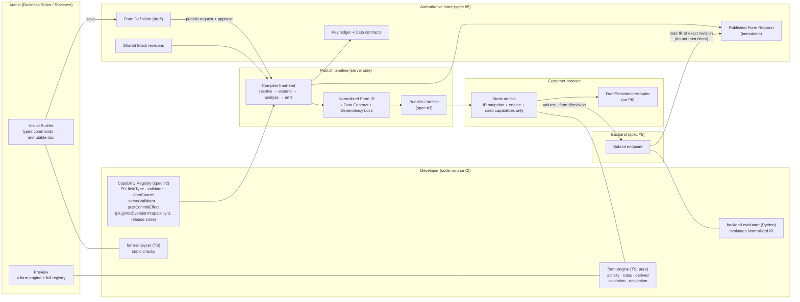
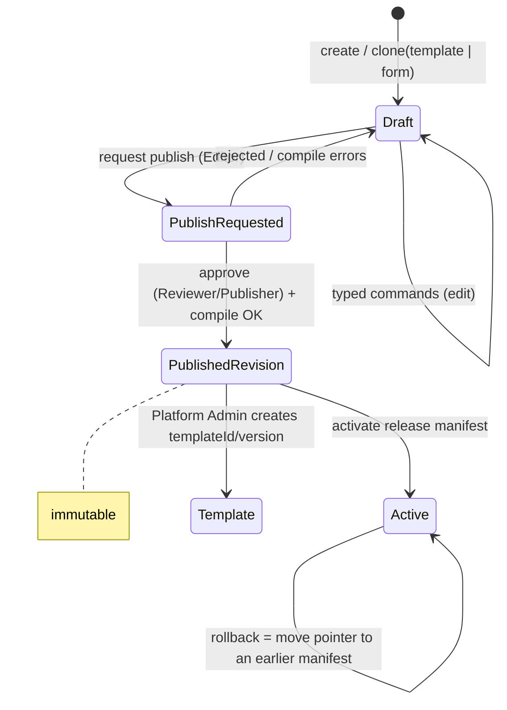
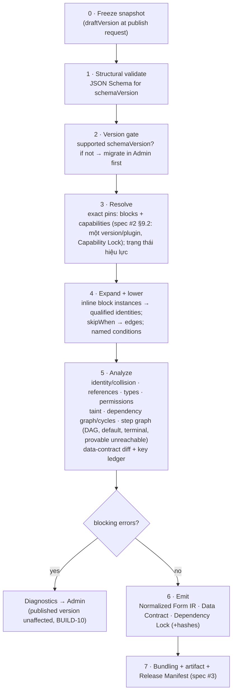

# Spec #1: Form Definition Schema & Workflow DSL (Architecture Proposal)

> **Trạng thái: PROPOSAL, revision 3.2** (2026-10-24).
> - Rev 3.2: chỉ **đồng bộ draft recovery với ADR-037** (spec #3 Answer #2): draft và session pin `releaseId`; §9 `session`, §13. Chưa có review mới của user cho spec #1.
> - Rev 3.1: chỉ **đồng bộ contract plugin với spec #2 rev 2** (theo yêu cầu của spec #2 review #1). Không đổi ngữ nghĩa DSL ngoài các mục liệt kê ở spec #2 §19 (Cross-Spec Interface Matrix). Chưa có review mới của user cho spec #1.
> - Review #1: CHANGES / VERIFICATION REQUIRED.
> - Review #2: CONDITIONALLY ACCEPTED FOR DESIGN CONTINUATION. User cho phép brainstorm spec #2, nhưng spec #1 **chưa được duyệt hoàn toàn**.
> - **G1 NOT APPROVED.** G9 và G10 đang BLOCKED.
> Ngày: 2026-10-23 (phiên 2). Nguồn:
> - [P01_BRAINSTORM_NOTES.md](../../discovery/P01_BRAINSTORM_NOTES.md) (Answer #1..#8)
> - [DECISIONS.md](../../DECISIONS.md) (ADR-002..016)
> - Master §5, §6.3
>
> Phạm vi: subsystem spec số 1 trên 6. Spec #2..#6 sẽ thiết kế plugin registry chi tiết, compiler/bundle, Admin, API/persistence/publish và Motion. Spec #1 chỉ định nghĩa **contract** mà các spec đó phải tuân theo.
>
> Tài liệu này không chứa code triển khai. Ví dụ JSON trong tài liệu chỉ để minh họa, không phải định dạng cuối cùng.

## 0. Cách đọc trạng thái

| Nhãn | Ý nghĩa |
|---|---|
| **ACCEPTED** | User đã xác nhận ở mức *nguyên tắc spec #1*. Nhãn này **không** có nghĩa kiến trúc hay implementation đã được duyệt. |
| **PROPOSED** | Claude đề xuất, user đồng ý về hướng hoặc chưa review. Cần duyệt chính thức tại buổi review spec #1 hoặc G1. |
| **OPEN** | Quyết định còn chờ user (xem §21). |
| *[Claude]* | Lựa chọn nhỏ Claude tự quyết để tài liệu đủ cụ thể. User có thể bác bỏ. |

### 0.1. Bảng tổng hợp quyết định

| ADR | Nội dung | Trạng thái |
|---|---|---|
| ADR-002 | Hướng kiến trúc Hybrid Form Compiler | ACCEPTED (hướng đi, G0) |
| ADR-004 | MVP là một vertical slice. Undo/redo thuộc P1 nhưng phải chừa đường. | ACCEPTED (G0) |
| ADR-005 | Kết luận performance chỉ dựa trên số đo thật | ACCEPTED (G0) |
| ADR-008 | Admin business-first, không cần code. Developer mở rộng qua typed contract. Người sửa form ≠ người publish. | ACCEPTED (nguyên tắc) |
| ADR-009 | Shared block có version, form pin cố định, tạo form mới bằng clone, không tự lan truyền thay đổi | ACCEPTED (nguyên tắc) |
| ADR-010 | T-01..T-05: named validator, revision bất biến, field ẩn, localization, nhóm lặp | ACCEPTED (nguyên tắc) |
| ADR-011 | T-06..T-08: template metadata, định danh theo block instance, block chỉ một tầng | ACCEPTED (nguyên tắc) |
| ADR-011 addendum A | R-01..R-08: định danh, đường dẫn, ledger, pinning, kiểm tra của compiler, migration, aggregate | **PROPOSED** |
| ADR-012 | Khôi phục draft của khách, privacy-first | ACCEPTED (nguyên tắc) |
| ADR-012 addendum A | Classification taint cho giá trị dẫn xuất và prefill | **PROPOSED** |
| ADR-013 | Derived state: `calculated` / `prefill` / `lookup` | **PROPOSED** (user quyết định sơ bộ) |
| ADR-014 | Navigation và activity semantics (N-01..N-13) | **PROPOSED** (user quyết định sơ bộ) |
| ADR-015 | Trải nghiệm validation và phân chia trách nhiệm giữa các lớp | ACCEPTED (nguyên tắc). Contract chi tiết V-01..V-09: **PROPOSED** |
| ADR-016 | Ranh giới plugin | ACCEPTED (nguyên tắc). Contract PL-01..PL-10: **PROPOSED** |
| ADR-017 | OD-01: hai evaluator (TS ở FE, Python ở BE) cùng một semantic contract và bộ conformance fixture | **APPROVED AS DESIGN DIRECTION** (review #1). Điều kiện parity xem §18. |
| ADR-018 | OD-14: G1 sau khi đủ 6 spec và có Cross-Subsystem Integration Review. Spike phải qua gate riêng. | **APPROVED AS DESIGN DIRECTION** (review #1) |
| ADR-019 | OD-02: JSON Schema 2020-12 canonical, ba lớp validation (§7.7) | **APPROVED AS DESIGN DIRECTION** kèm điều kiện (review #2). Cơ chế chi tiết PROPOSED. |
| ADR-020 | OD-04: block có `exports` tường minh (§7.8) | **APPROVED AS DESIGN DIRECTION** (review #2). Cú pháp PROPOSED. |
| ADR-021 | OD-07: platform đặt mức classification tối thiểu, Editor chỉ được tăng (§16) | **APPROVED AS DESIGN DIRECTION** (review #2). Bảng mức tối thiểu PROPOSED. |
| ADR-022 | OD-12: `deferToSubmit` có giới hạn, không fail-open (§11) | **APPROVED AS DESIGN DIRECTION** kèm giới hạn (review #2) |

---

## 1. Mục đích và lý do

Hiện nay, mỗi lần đổi field hoặc flow đều phải nhờ developer sửa React trong một source dùng chung cho nhiều site. Hệ quả là coupling cao, khó đảm bảo đổi site này không làm hỏng site khác, và bundle chứa cả phần không dùng. Spec #1 định nghĩa **ngôn ngữ mô tả form**: dữ liệu khai báo, có version, phân tích tĩnh được. Ngôn ngữ này phải đủ mạnh để người nghiệp vụ tự cấu hình hàng chục form khác nhau qua UI, nhưng không trượt thành một ngôn ngữ lập trình (ADR-008).

**Thước đo thành công** (ADR-008, định tính cho đến khi có baseline):
- tỉ lệ thay đổi không cần developer
- thời gian tạo form và đổi flow
- số regression
- mức tái sử dụng
- kích thước bundle
- khả năng test từng nhánh
- độ chính xác của rollback
- khả năng debug
- người không biết code có tự hoàn thành tác vụ được không

## 2. Goals, non-goals, anti-goals

**Goals**
- G-1: Mô tả được multi-step, rẽ nhánh, dependency giữa field, validation động, shared block, plugin, derived value, nhóm lặp, localization và versioning cho **hàng chục site**. Sports và PC chỉ là hai bài kiểm chứng.
- G-2: Mọi khái niệm đều cấu hình được bằng UI trực quan. Business Editor không phải gõ code, biểu thức hay regex.
- G-3: Đánh giá tất định. Frontend runtime, Admin preview và backend validator cho cùng một kết quả trên cùng input.
- G-4: Phân tích tĩnh trước khi publish: phát hiện collision, tham chiếu treo, sai kiểu, vòng phụ thuộc, step không tới được và thay đổi hợp đồng dữ liệu.
- G-5: Revision bất biến, pin chính xác, migration có kiểm soát, rollback được.
- G-6: Có extension point rõ ràng để developer thêm capability mà không cần hard-code vào engine.

**Non-goals (P0)**
- Không có ngôn ngữ lập trình tổng quát. Không `eval`, không `new Function`, không JavaScript do Admin nhập (SEC-02).
- Không nối API thu mua thật và không dùng dữ liệu thật (ADR-003).
- Không có vòng lặp trong step graph, không lồng block trong block, không có UI cho nhóm lặp (xem §20).

**Anti-goals: những điều khiến dự án thất bại dù chạy được**
- Admin thực chất chỉ là một JSON editor có kéo thả.
- Shared block biến thành cơ chế kế thừa, khiến sửa một chỗ làm hỏng 30 site.
- Preview chạy logic khác production (UX-05).
- Client tự quyết dữ liệu nghiệp vụ quan trọng.
- PII bị lưu trong trình duyệt.
- Mỗi edge case lại sinh thêm một toán tử không giới hạn.

## 3. Ràng buộc

- Ràng buộc từ master và CLAUDE.md:
  - AWS chỉ đọc trước G10.
  - Không push trước G9.
  - Chỉ dùng dữ liệu giả.
  - Chi tiết nội bộ công ty chỉ nằm trong `docs/internal/`.
- Ràng buộc từ G0:
  - MVP là vertical slice (ADR-004).
  - Builder state là immutable document với typed commands, để chừa đường cho undo/redo.
  - Số đo performance phải từ artifact thật (ADR-005).
- Backend dùng Python (master API-01). Engine runtime và compiler dùng TypeScript (định hướng ADR-002). Cách đảm bảo FE và BE cho cùng kết quả xem OD-01.

---

## 4. Kiến trúc tổng thể



**Các module logic.** Tên package được chốt ở spec #3/P02.

| Module | Nhiệm vụ | Không làm |
|---|---|---|
| `form-schema` | JSON Schema cho từng `schemaVersion`, type sinh ra, migrations | Không chứa logic runtime |
| `form-engine` | TS thuần, không phụ thuộc React: hàm activity, đánh giá rule, derived, validation, state machine điều hướng, tạo effect descriptor | Không gọi I/O trực tiếp, không truy cập DOM |
| `form-analyzer` | Phân tích tĩnh trên Normalized IR. Admin dùng để báo lỗi trực tiếp khi sửa, server dùng làm kết quả chính thức. | Không sửa definition |
| `form-compiler` (front-end) | Resolve, expand, lower, analyze, rồi emit IR, Data Contract và Dependency Lock | Phần bundling thuộc spec #3 |
| `form-runtime-react` | Adapter React: subscription theo từng node, focus/scroll/a11y, IME, effect runner | Không có logic nghiệp vụ riêng |
| capability registry | Manifest khai báo cùng module FE/BE của plugin | Không override navigation hoặc submit |
| backend evaluator | Python. Đánh giá IR cho submit: activity, rules, validators, tính lại `calculated` | Không resolve block, không làm phân tích tĩnh |

---

## 5. Mô hình thực thể (ADR-009, ADR-011)

| Thực thể | Sở hữu | Định danh | Vòng đời | Tương thích | Trạng thái |
|---|---|---|---|---|---|
| **Code Plugin / Capability** | Developer | `capabilityId@semver` | Phát hành qua source CI. Version đã phát hành là bất biến. Có thể bị đánh dấu `deprecated` / `vulnerable`. | Contract theo major version, cộng với `engineApi` range (PL-01) | ACCEPTED (nguyên tắc), contract PROPOSED |
| **Shared Form Block** | Editor viết, Reviewer duyệt | `blockId` + `rN` bất biến | draft → published → deprecated / vulnerable (vulnerable thì chặn publish) | `exports`, `inputs`, changelog theo `fieldDefId`, danh sách nơi đang dùng | ACCEPTED |
| **Form Template** | Platform Admin | `templateId`, `templateVersion`, `sourceRevision`, owner | Tạo từ một published revision. P0 chưa cần trang quản lý template đầy đủ. | Không áp dụng. Bản clone chỉ ghi `clonedFrom` để audit. | ACCEPTED |
| **Form Definition (draft)** | Business Editor | `formId` + `draftVersion` (dùng cho optimistic concurrency) | Sửa được. Mỗi form có một draft sống. | Pin chính xác block và capability | ACCEPTED |
| **Published Form Revision** | Reviewer/Publisher tạo | `formId@revN` | Bất biến, không bao giờ bị ghi lại | Là nguồn sự thật để backend kiểm tra submit (T-02) | ACCEPTED |
| **Release Manifest** | Compiler sinh ra | content hash | Bất biến. Mỗi form có một con trỏ "active" trỏ vào manifest; rollback chỉ là dời con trỏ (spec #3/#5) | Ghi form revision, block revisions, capability versions, engine version, `schemaVersion`, hash của artifact | ACCEPTED (nguyên tắc) |



*[Claude]* Mỗi form chỉ có một draft sống. Chỉnh sửa song song theo nhánh là việc của P2.

---

## 6. Định danh và đánh địa chỉ (ADR-011 + addendum R-01..R-04, PROPOSED)

### 6.1. Các lớp định danh (R-01)

| Lớp | Ví dụ | Ai thấy | Có đổi được không |
|---|---|---|---|
| `fieldDefId` | `fld_zip` | không ai (nội bộ) | Không bao giờ, trong suốt vòng đời của field definition. Ổn định qua các revision của block. |
| `blockInstanceId` | `inst_pickup` | không ai | Không bao giờ, trong suốt đời của lần đặt block đó vào form |
| **Field identity trong form** | `inst_pickup:fld_zip`. Field local của form dùng `$local:fld_x`. | không ai | Là bộ (instance, fieldDef). Hai instance của cùng một block không bao giờ trùng nhau. |
| `key` / instance `alias` | `pickupAddress.postalCode` | chỉ người có quyền Advanced | Đổi được theo R-04 |
| `label` | `{ "ja": "郵便番号" }` | mọi người | Đổi tự do |
| Option `value` | `takuhai` | Advanced | Là mã ổn định, tách khỏi label |

### 6.2. Thay đổi ngữ nghĩa (R-02)

| Loại thay đổi | Ví dụ | Xử lý |
|---|---|---|
| compatible | label, help, layout, thêm option, chỉnh tham số validator | Giữ nguyên `id` |
| contract-change | bỏ một option value, đổi key, đổi required/optional, đổi classification | Giữ `id`, đưa vào **data-contract diff**, Reviewer phải xác nhận trước khi publish |
| breaking | đổi kiểu giá trị (text→number, single→multi), đổi nghĩa của option hoặc đơn vị | **Cấm sửa tại chỗ.** Dùng "Replace field": tạo `fieldDefId` mới, cho field cũ nghỉ hưu. P0 không tự chuyển đổi giá trị. |

### 6.3. Ba dạng đường dẫn (R-03)

| Dạng | Dùng ở đâu | Ví dụ |
|---|---|---|
| Tham chiếu trong definition | rule, validation, nội dung step | `inst_pickup:fld_zip`. Trong group: `$item:fld_maker`. Group như một collection: `inst_items:grp_products` |
| Địa chỉ lúc runtime | state của engine | `inst_items:grp_products[itm_x3]/fld_maker` |
| Payload submit (serialized) | API, integration | `values.products[i].maker`, kèm `_itemId` |

- **State của nhóm lặp:** `{ order: [itemId…], items: { itemId → values } }`. Thứ tự tách khỏi định danh. Payload là mảng có thứ tự, và mỗi object mang `_itemId`.
- `itemId` được client sinh ngẫu nhiên, duy nhất trong group suốt phiên và không tái sử dụng. Backend chỉ kiểm tra định dạng và tính duy nhất.
- Draft của khách được khóa theo identity nội bộ, vì nó gắn với đúng một revision (ADR-012).

### 6.4. Key ledger (R-04)

- Mỗi form có một ledger **chỉ ghi thêm**, xuyên suốt các revision. Ví dụ: `identity inst_customer:fld_tel` dùng `tel` ở r1–r3, `phone` ở r4–r6, `mobile` từ r7.
- Quy tắc:
  1. Có thể đổi tên nhiều lần.
  2. Key đã từng xuất hiện trong một bản publish thì **được giữ riêng cho identity đó vĩnh viễn**. Identity đó được phép quay lại dùng key cũ của chính nó.
  3. Mỗi release sinh ra một **Data Contract** gồm key → identity, type, classification và `renamedFrom`. Integration và analytics nên map theo identity hoặc qua ledger.
- Alias của block instance tuân theo cùng các quy tắc này.

---

## 7. DSL: cấu trúc definition

### 7.1. Các thành phần chính (ARCH-01)

| Thành phần | Nội dung |
|---|---|
| `schemaVersion` | semver của định dạng DSL, ví dụ `1.0.0` |
| `formId`, `siteId` | định danh ổn định |
| `revision` / `draftVersion` | revision cho bản publish, `draftVersion` cho draft |
| `locale` | `{ default: "ja", supported: ["ja"] }` |
| `themeRef` | tham chiếu theme đã pin. Theme thuộc spec #4/#6. |
| `motion` | cấu hình preset. Thuộc spec #6, spec #1 chỉ giữ chỗ. |
| `dependencies` | `blocks` (`alias → id@revision`) và `capabilities` (`alias → { plugin, version, capability, kind }`, spec #2 §5.2, §6.6), pin chính xác. Không có `latest` hay wildcard. Một version mỗi `pluginId` trong một form release (ADR-031). |
| `effects` | binding tới post-commit effect đã được platform approve: `{ id, use: alias, on: "submission.committed", inputs }` (spec #2 §15.3, ADR-034). Không có trigger khác ở P0. |
| `blockInstances` | `{ id, alias, block: alias trong dependencies, inputs }`. *[Claude]* `inputs` ở P0 **chỉ là hằng số**. Compiler gập chúng lại khi expand, nên chúng không trở thành node trong dependency graph. Bind input vào field hoặc điều kiện là việc của P1, cần ADR. |
| `exports` (chỉ có ở block) | public contract của block (§7.8, OD-04) |
| `fields` | field local của form. Field plugin: `type: "plugin:<alias>"`, `config` theo `configSchema`, `inputs` map port (spec #2 §6.6). Validator: `validators: [{ use: alias, params? }]`, `params` mặc định `{}`. |
| `sections` | `{ id, title, visibleWhen?, content }`, là container hiển thị bên trong step. Xem §7.5. |
| `conditions` | **named conditions**, dùng lại được trong rule editor |
| `steps` | gồm `kind`: `form` / `review` / `complete`, `content`, và `transitions` có thứ tự |
| `dataPolicy` | mặc định về classification và persistence. Business Editor chỉ được *tăng* mức bảo vệ (§16). |

### 7.2. Ví dụ shared block (minh họa)

```json
{
  "schemaVersion": "1.0.0",
  "kind": "block",
  "blockId": "blk_customer_info",
  "revision": "r2",
  "inputs": { "requireKana": { "type": "boolean", "default": true } },
  "exports": [
    { "id": "prefecture", "field": "fld_prefecture", "type": "enum", "classification": "public" },
    { "id": "email", "field": "fld_email", "type": "string", "classification": "personal" }
  ],
  "fields": [
    { "id": "fld_name", "key": "name", "type": "text", "label": { "ja": "お名前" },
      "required": true, "classification": "personal" },
    { "id": "fld_kana", "key": "nameKana", "type": "text", "label": { "ja": "フリガナ" },
      "requiredWhen": { "op": "eq", "args": [{ "input": "requireKana" }, { "const": true }] },
      "validators": [{ "use": "katakana" }], "classification": "personal" },
    { "id": "fld_tel", "key": "phone", "type": "tel", "label": { "ja": "電話番号" },
      "required": true, "validators": [{ "use": "jpPhone" }], "classification": "personal" },
    { "id": "fld_email", "key": "email", "type": "email", "label": { "ja": "メールアドレス" },
      "required": true, "classification": "personal" },
    { "id": "fld_prefecture", "key": "prefecture", "type": "choice.select",
      "label": { "ja": "都道府県" }, "optionsFrom": "core:jpPrefectures", "classification": "public" }
  ],
  "dependencies": {
    "capabilities": {
      "katakana": { "plugin": "@platform/validator-katakana", "version": "1.0.0", "capability": "katakana", "kind": "validator" },
      "jpPhone": { "plugin": "@platform/validator-jp-phone", "version": "1.0.0", "capability": "jpPhone", "kind": "validator" }
    }
  },
  "changelog": [
    { "from": "r1", "change": "added", "fieldDefId": "fld_email" }
  ]
}
```

*Ghi chú:*
- `exports` (OD-04, ADR-020): bên ngoài instance chỉ tham chiếu được export, theo cú pháp `inst:@id` (§7.8).
- `input` chỉ đọc tham số của instance.

### 7.3. Ví dụ đoạn form PC (minh họa)

```json
{
  "schemaVersion": "1.0.0",
  "kind": "form",
  "formId": "frm_pc_demo",
  "siteId": "site_pc_demo",
  "draftVersion": 12,
  "locale": { "default": "ja", "supported": ["ja"] },
  "themeRef": "theme_pc@3",
  "dependencies": {
    "blocks": { "customerInfo": "blk_customer_info@r2" },
    "capabilities": {
      "storeSel": { "plugin": "@platform/store-selector", "version": "1.0.0", "capability": "storeSelector", "kind": "fieldType" },
      "logSubmission": { "plugin": "@platform/effect-mock-log", "version": "1.0.0", "capability": "recordSubmission", "kind": "postCommitEffect" }
    }
  },
  "effects": [
    { "id": "eff_log", "use": "logSubmission", "on": "submission.committed",
      "inputs": { "formRef": { "system": "formRef" }, "purchaseMethod": { "ref": "$local:fld_method" } } }
  ],
  "blockInstances": [
    { "id": "inst_customer", "alias": "customer", "block": "customerInfo",
      "inputs": { "requireKana": true } }
  ],
  "fields": [
    { "id": "fld_device", "key": "deviceType", "type": "choice.radio", "label": { "ja": "機種カテゴリ" },
      "required": true, "classification": "public",
      "options": [
        { "value": "desktop", "label": { "ja": "デスクトップ" } },
        { "value": "laptop", "label": { "ja": "ノート" } },
        { "value": "tablet", "label": { "ja": "タブレット" } },
        { "value": "peripheral", "label": { "ja": "周辺機器" } }
      ] },
    { "id": "fld_battery", "key": "batteryHealth", "type": "choice.select",
      "label": { "ja": "バッテリー状態" }, "classification": "public",
      "visibleWhen": { "op": "in", "args": [{ "ref": "$local:fld_device" }, { "const": ["laptop", "tablet"] }] },
      "requiredWhen": { "cond": "isPortable" },
      "options": [{ "value": "good", "label": { "ja": "良好" } }, { "value": "poor", "label": { "ja": "劣化あり" } }] },
    { "id": "fld_defects", "key": "defects", "type": "choice.checkboxes", "label": { "ja": "不具合" },
      "classification": "public",
      "options": [{ "value": "none", "label": { "ja": "なし" }, "exclusive": true },
                  { "value": "screen", "label": { "ja": "画面割れ" } }] },
    { "id": "fld_method", "key": "purchaseMethod", "type": "choice.radio", "label": { "ja": "買取方法" },
      "required": true, "classification": "public",
      "options": [{ "value": "store", "label": { "ja": "店頭買取" } },
                  { "value": "takuhai", "label": { "ja": "宅配買取" } }] },
    { "id": "fld_store", "key": "store", "type": "plugin:storeSel", "label": { "ja": "店舗選択" },
      "required": true, "classification": "public", "config": { "filterByPrefecture": false } },
    { "id": "fld_kit", "key": "packingKit", "type": "choice.radio", "label": { "ja": "梱包キット" },
      "required": true, "classification": "public",
      "options": [{ "value": "yes", "label": { "ja": "必要" } }, { "value": "no", "label": { "ja": "不要" } }] },
    { "id": "fld_defect_count", "key": "defectCount", "type": "calculated",
      "label": { "ja": "不具合の数" }, "submit": "displayOnly",
      "formula": { "op": "count", "args": [{ "ref": "$local:fld_defects" }] } }
  ],
  "conditions": {
    "isPortable": { "op": "in", "args": [{ "ref": "$local:fld_device" }, { "const": ["laptop", "tablet"] }] },
    "isStore": { "op": "eq", "args": [{ "ref": "$local:fld_method" }, { "const": "store" }] }
  },
  "steps": [
    { "id": "stp_category", "kind": "form", "title": { "ja": "機種カテゴリ" },
      "content": [{ "field": "$local:fld_device" }],
      "transitions": [{ "default": "stp_condition" }] },
    { "id": "stp_condition", "kind": "form", "title": { "ja": "状態" },
      "content": [{ "field": "$local:fld_battery" }, { "field": "$local:fld_defects" },
                  { "field": "$local:fld_defect_count" }],
      "transitions": [{ "default": "stp_method" }] },
    { "id": "stp_method", "kind": "form", "title": { "ja": "買取方法" },
      "content": [{ "field": "$local:fld_method" }],
      "transitions": [{ "when": { "cond": "isStore" }, "to": "stp_store" },
                      { "default": "stp_takuhai" }] },
    { "id": "stp_store", "kind": "form", "content": [{ "field": "$local:fld_store" }],
      "transitions": [{ "default": "stp_customer" }] },
    { "id": "stp_takuhai", "kind": "form", "content": [{ "field": "$local:fld_kit" }],
      "transitions": [{ "default": "stp_customer" }] },
    { "id": "stp_customer", "kind": "form", "content": [{ "block": "inst_customer" }],
      "transitions": [{ "default": "stp_review" }] },
    { "id": "stp_review", "kind": "review",
      "transitions": [{ "when": { "cond": "isStore" }, "to": "stp_done_store" },
                      { "default": "stp_done_takuhai" }] },
    { "id": "stp_done_store", "kind": "complete", "title": { "ja": "ご来店予約完了" } },
    { "id": "stp_done_takuhai", "kind": "complete", "title": { "ja": "宅配キット申込完了" } }
  ]
}
```

Ý nghĩa của các thành phần trong ví dụ:
- `review` là step 確認. Bấm 次へ ở đây chính là chạy **submit pipeline do engine sở hữu**.
- Khi submit thành công, engine đi theo transition sang step `complete` của đúng nhánh, nên mỗi nhánh có màn hoàn tất riêng.
- Rev 3.1: `storeSel` theo cú pháp của spec #2 §6.6; `config` theo `configSchema` của `@platform/store-selector@1.0.0` (spec #2 §6.4); dữ liệu cửa hàng hư cấu do `dataSource` `storeList` cung cấp, không còn `dataset` trong config. Motion preset ở P0 do core cung cấp (spec #6), nên không nằm trong `capabilities` (ADR-033). `jpPrefectures` (§7.2) là option set built-in của core (`core:jpPrefectures`), không phải capability.
- Field `fld_defects` có option `exclusive: true` để biểu diễn ràng buộc 「なし」 loại trừ các lựa chọn khác. Đây là một thuộc tính khai báo, không phải biểu thức.

### 7.4. Rule AST (ARCH-03, PROPOSED)

- **Dạng node:** `{ "op": <name>, "args": [...] }`.
- **Lá:**
  - `{ "ref": identity }`
  - `{ "const": value }`
  - `{ "cond": name }`, tham chiếu một named condition
  - `{ "input": name }`, tham số của block instance
  - `{ "item": fieldDefId }`, viết tắt của `$item:`
- Business Editor không bao giờ thấy AST. Rule editor trực quan sinh ra nó.

**Gắn điều kiện vào đích** *(PROPOSED, OD-03)*:
- Mỗi thuộc tính có đúng một điều kiện: `visibleWhen`, `requiredWhen`, option `availableWhen`, transition `when`, và `skipWhen` (dạng viết tắt, xem §8.1).
- Ưu điểm so với rule kiểu sự kiện–điều kiện–hành động (ECA): không có xung đột "hai rule cùng đặt visible", không phụ thuộc thứ tự, và phân tích được.
- Nhu cầu "khi X thì hiện A, B, C" được Admin UI đáp ứng bằng cách gán cùng một named condition cho A, B và C.

**Catalog toán tử P0** (hữu hạn, có kiểu):

| Nhóm | Toán tử | Kiểu |
|---|---|---|
| Logic | `and`, `or`, `not` | bool → bool |
| So sánh bằng | `eq`, `neq`, `in`, `notIn` | scalar / enum |
| So sánh thứ tự | `lt`, `lte`, `gt`, `gte` | number. Date thuộc P1. |
| Rỗng | `isEmpty`, `isNotEmpty` | mọi kiểu |
| Tập lựa chọn | `includes`, `includesAny` | multi-choice |
| Aggregate trên group | `any`, `all`, `count`, `sum` (vị từ bên trong dùng phạm vi `$item`) | collection |
| Dẫn xuất (chỉ dùng trong `formula`) | `add`, `subtract`, `multiply`, `min`, `max`, `concat`, `choose` | number / string |

**Ngữ nghĩa giá trị rỗng (R-08):**
- Field inactive, hidden hoặc chưa nhập được coi là **không có giá trị**.
- So sánh với "không có giá trị" luôn trả `false`. Chỉ `isEmpty`/`isNotEmpty` kiểm tra được trạng thái rỗng.
- Trên nhóm rỗng: `any([]) = false`, `all([]) = true`, `count([]) = 0`, `sum([]) = 0`.
- Rule editor hiển thị "(cũng đúng khi không có món nào)" bên cạnh `all`. Compiler cảnh báo khi dùng `all` trên group có `minItems = 0`.
- Aggregate chỉ xét item và field đang active.

**Đánh giá (D-04):**
- Có một dependency graph duy nhất gồm visible, required, availability, calculated và prefill.
- Có vòng thì báo lỗi compile và hiển thị đường vòng theo label.
- Thứ tự đánh giá là topological, tie-break theo id. Chỉ tính lại phần phía sau input vừa đổi (ARCH-06).

### 7.5. Container và giới hạn lồng nhau (*[Claude]*, P0)

| Container | Chứa được | Không chứa được (P0) |
|---|---|---|
| step | field, section, block instance, group | — |
| section | field, group | section khác, block instance |
| block (định nghĩa) | field, section, group | block khác (T-08) |
| group (lặp) | field | group khác, block instance, section |

- `active(parent(node))` đi theo chuỗi container: field → section/group → block instance → step.
- Mỗi block instance nằm trọn trong một step (OD-13).
- Dạng địa chỉ (§6.3) có tối đa một đoạn `[itemId]`, vì group không lồng group ở P0.

### 7.6. Ngữ nghĩa dữ liệu (review #1 §4, PROPOSED)

Đây là một phần của **DSL semantic contract** (ADR-017). Mọi quy tắc trong mục này đều có fixture dùng chung cho FE và BE.

#### 7.6.1. Rỗng: missing, chuỗi rỗng, null

Engine chỉ có **một** khái niệm "không có giá trị".

| Đầu vào | Trong engine | Trong payload | `isEmpty` | Với `required` |
|---|---|---|---|---|
| Chưa từng nhập, hoặc key không có | không có giá trị | **không có key** | true | lỗi |
| `""`, hoặc chuỗi chỉ toàn khoảng trắng (sau trim) | được chuẩn hóa thành không có giá trị | không có key. Nếu client vẫn gửi `""` thì BE chuẩn hóa giống FE. | true | lỗi |
| JSON `null` | không tồn tại | **422 `E-PAYLOAD-NULL`**, vì null không có nghĩa chuẩn nào | — | — |
| Multi-choice `[]` | không có giá trị | không có key | true | lỗi |
| Checkbox đơn `false` | giá trị `false` | `false` | **false** | thỏa. Trường hợp "phải đồng ý" dùng validator `mustBeTrue`. |
| Số `0` | giá trị `0` | `0` | false | thỏa |

- Toán tử so sánh (`eq`, `neq`, `lt`…) với "không có giá trị" luôn trả **false**.
- Vì vậy **`neq(x, A)` ≠ `not(eq(x, A))`** khi x rỗng: `neq` trả false, còn `not(eq)` trả true.
- Rule editor dùng `neq` cho câu "không phải A". Compiler cảnh báo `W-NOT-OVER-EMPTY` khi `not` bọc một phép so sánh trên field có thể rỗng.

#### 7.6.2. Số nguyên (P0)

- **Dải giá trị:** ±(2^53−1), tức safe integer của JS.
  - Python `int` không có giới hạn, nên BE phải **kiểm tra dải tường minh**.
  - Vượt dải → `E-NUM-RANGE` ở cả hai phía.
- **Parse từ ô nhập:**
  1. Chuẩn hóa (§7.6.5).
  2. Khớp `^-?[0-9]+$`.
  3. Số 0 ở đầu được chấp nhận và hiển thị lại dạng chuẩn (`007` thành `7`). `-0` thành `0`.
  4. Dấu thập phân, số mũ và dấu phân cách hàng nghìn còn sót → `E-NUM-FORMAT`.
- **`calculated`:** kiểm tra overflow **sau mỗi phép toán**. Vượt dải → field vào trạng thái lỗi (D-05). FE và BE ra cùng kết quả, có fixture ở biên.
- **Không bao giờ dùng kiểu số cho mã:** mã bưu chính, số điện thoại và mã định danh là chuỗi.

#### 7.6.3. Chiến lược mở rộng sang số thập phân (P1, chưa implement)

- Schema dành sẵn `numberKind: "integer" | "decimal"`. Bản 1.x chỉ chấp nhận `integer`.
- `decimal`:
  - Mỗi field có `scale` cố định.
  - Payload biểu diễn bằng **chuỗi** (`"1234.50"`).
  - Phép tính dùng **số nguyên đã nhân scale** (BigInt ở JS, `int` ở Python). Không dùng IEEE-754 float trong ngữ nghĩa DSL.
  - Rounding mode chọn từ tập hữu hạn (`halfUp`, `halfEven`, `down`).
  - Phép chia chỉ được dùng khi có khai báo scale và rounding.
- Khi đưa vào cần: tăng minor `schemaVersion`, thêm fixture biên, và ghi ADR.

#### 7.6.4. Unicode (revision 3)

- **Văn bản tự do không chuẩn hóa Unicode.** Giá trị được lưu đúng như khách nhập, chỉ trim khoảng trắng ở hai đầu.
  - *Lý do sửa so với revision 2:* NFC **không lossless** với chữ Hán tương thích (CJK Compatibility Ideographs). Ví dụ U+FA30 `侮` bị NFC đổi thành U+4FAE `侮`. Hai glyph có thể trông giống nhau, nhưng code point khác nhau, và người Nhật phân biệt chúng trong tên riêng. Với tên riêng tiếng Nhật (異体字), đây là mất dữ liệu quan trọng.
- **Độ dài = số code point của giá trị đã lưu** (sau trim). Không đếm theo grapheme cluster, vì cách tách grapheme phụ thuộc phiên bản Unicode/ICU (`Intl.Segmenter` so với thư viện Python), tức một nguồn lệch FE/BE. `maxLength` là giới hạn dữ liệu, không phải giới hạn hiển thị. Bộ đếm trên UI dùng cùng cách đếm.

| Chuỗi nhập | Code point | Ghi chú |
|---|---|---|
| `が` (U+304C) | 1 | |
| `か` + `゙` (U+304B U+3099) | 2 | Không ghép, vì không chuẩn hóa. Được ghi rõ trong tài liệu cho Editor. |
| `𠮷` | 1 | UTF-16 tính là 2. Đếm theo `.length` của JS sẽ **sai**. |
| `侮` (U+FA30) | 1 | **Giữ nguyên** U+FA30, không đổi thành U+4FAE |
| `👨‍👩‍👧` | 5 | Hiển thị như 1 grapheme |
| `ｶﾞ` (半角) | 2 | Field `katakana` chuyển thành `ガ` (1) theo §7.6.5. Field `text` giữ nguyên. |

- Validator nào cần so sánh "tương đương" (ví dụ chống trùng) thì tự chuẩn hóa **nội bộ** để so sánh, không sửa giá trị (§7.6.5).
- **Phiên bản Unicode:** CI ghi lại phiên bản ICU của Node và `unicodedata.unidata_version` của Python. Fixture có ký tự mới để phát hiện lệch.
  - *Đo trên máy local ngày 2026-10-24:* Node 20.20.2 dùng ICU 78.2 / Unicode 17.0, Python 3.9.6 hệ thống dùng Unicode 14.0.0. Hai phía **đang khác phiên bản**. Vì văn bản tự do không chuẩn hóa và độ dài đếm theo code point, khác biệt này không ảnh hưởng tới §7.6.4, nhưng phải được tính đến cho mọi phép dựa trên bảng Unicode, như phân loại ký tự trong validator `katakana`. Việc chọn phiên bản Python ở P02 phải xét điểm này.
- **Fixture phải ghi ký tự bằng escape** (`\uFA30`), không ghi glyph. Chính file spec này cũng bị công cụ soạn thảo tự chuẩn hóa U+FA30 thành U+4FAE ở revision đầu tiên của rev 3. Đây là bằng chứng thực tế rằng các công cụ có thể âm thầm đổi dữ liệu.

#### 7.6.5. Chuẩn hóa tiếng Nhật và canonicalization theo validator

**Nguyên tắc** để không âm thầm phá dữ liệu gốc (revision 3):
1. Canonicalization chỉ áp cho **field type có cấu trúc** (`tel`, `postal`, `number`, `email`, `katakana`), do field type khai báo, có version và fixture. Văn bản tự do (`text`, `textarea`) **chỉ trim**.
2. Mỗi phép biến đổi phải **idempotent** (`c(c(x)) = c(x)`) và chỉ bỏ những gì **không mang nghĩa đối với kiểu đó**, như dấu gạch trong số điện thoại hay độ rộng ký tự của chữ số. Phần bị bỏ được liệt kê tường minh trong bảng dưới đây.
3. Áp dụng khi **commit** (blur hoặc `compositionend`) và **hiển thị lại giá trị đã chuẩn hóa cho khách**, để khách luôn thấy chính xác cái sẽ được gửi.
4. BE áp lại cùng phép biến đổi. Nếu giá trị gửi lên chưa ở dạng chuẩn, BE chuẩn hóa, validate trên dạng chuẩn, và log lệch (không ghi PII).
5. Không có phép biến đổi nào ngoài bảng này. Thêm một phép mới cần một version mới của field type, kèm fixture.

| Field type | Canonicalization | Phần bị bỏ (có chủ đích) | Ví dụ |
|---|---|---|---|
| `text` (tên, địa chỉ chi tiết…) | trim | khoảng trắng ở hai đầu | `　山田　太郎 ` thành `山田　太郎` |
| `textarea` | đổi CRLF thành LF, trim hai đầu | ký tự xuống dòng kiểu CR, khoảng trắng hai đầu | |
| `email` | trim, ASCII 全角 thành 半角 | độ rộng ký tự | `ｔａｒｏ＠ｅｘａｍｐｌｅ．ｊｐ` thành `taro@example.jp` |
| `tel` | số 全角 thành 半角, bỏ khoảng trắng và các loại gạch (`-` `－` `ー` `‐`) | dấu phân cách, độ rộng ký tự | `０９０－１２３４－５６７８` thành `09012345678` |
| `postal` | như `tel`. Dạng chuẩn = 7 chữ số. | dấu phân cách, độ rộng ký tự | `１２３－４５６７` thành `1234567` |
| `number` | số 全角 thành 半角, bỏ `,` phân cách hàng nghìn, parse theo §7.6.2 | định dạng hiển thị | `１，２００` thành `1200` |
| `katakana` | 半角カナ thành 全角カナ. **Không** tự đổi ひらがな (validator báo lỗi). | độ rộng của kana | `ﾔﾏﾀﾞ` thành `ヤマダ` |
| `choice.*` | không biến đổi. Phải khớp đúng option `value`. | — | |

- **Canonicalization riêng của validator:**
  - Validator là hàm thuần và **không sửa giá trị**.
  - Nếu cần một dạng so sánh nội bộ (ví dụ so tên miền email không phân biệt hoa thường), validator khai báo trong manifest (spec #2) và có fixture FE/BE.
- *[Claude]* Định dạng hiển thị (ví dụ gạch nối trong số điện thoại) thuộc P1 và chỉ là phần trình bày, không thay đổi dạng chuẩn.

#### 7.6.6. Địa chỉ ổn định cho phần tử lặp

- `itemId`:
  - Dạng `itm_` + chuỗi ngẫu nhiên.
  - Client sinh, duy nhất trong group suốt phiên. Id đã xóa không được dùng lại.
  - Chỉ được lưu vào draft nếu giá trị của group được phép lưu.
- **Thứ tự** nằm trong `order`. Payload là mảng theo thứ tự hiển thị.
- **Lỗi BE được trả theo `itemId`**, ví dụ `products[itm_x3].maker`, không theo index. Đổi thứ tự sẽ không gắn lỗi nhầm phần tử.
- BE trả 422 khi `itemId` sai định dạng hoặc bị trùng.

#### 7.6.7. Giá trị ẩn và backend projection

- BE tính `project(IR, values)` = tập node active, qua `derivedPath` và hàm activity.
- **Key được chấp nhận ⊆ active ∩ (`submit` ≠ `displayOnly`).**
  - Key inactive → `422 INACTIVE_DATA_PRESENT`.
  - Key lạ → `422 UNKNOWN_FIELD`.
- Bản ghi được lưu gồm:
  - giá trị đã project và chuẩn hóa
  - các `calculated` có `include`, do BE tự tính
  - `formId`, `revision`, `schemaVersion`
  - hash của Data Contract
- Giá trị `displayOnly` không bao giờ được lưu. Giá trị ẩn chỉ nằm trong bộ nhớ trình duyệt, không bao giờ rời khỏi trình duyệt.

#### 7.6.8. Đổi tên, xóa và migration field

- **Đổi tên:** theo R-04 (ledger). Logic không bị ảnh hưởng.
- **Xóa trong draft:**
  - Compiler yêu cầu dọn hết tham chiếu (`E-REF-DANGLING`).
  - Sau khi đã publish, identity "nghỉ hưu" và key được giữ lại (reserved).
  - "Khôi phục" field cũ sẽ hồi sinh **đúng identity đó**, được phép.
  - Thêm một field mới sẽ có identity mới và không dùng lại được key cũ.
- **Không ảnh hưởng:** revision cũ, dữ liệu đã submit và draft của khách.
- **Migration `schemaVersion`:** theo R-07.

#### 7.6.9. Type coercion (revision 3)

- **Không có implicit coercion ở bất kỳ đâu trong DSL.**
- **Compile time:** kiểu của toán hạng phải khớp nhau, ví dụ number với number, hay option value (string) với const string. Viết `eq(numberField, "1")` sẽ báo `E-TYPE-OPERATOR`. P0 không cho dùng `lt`/`gt` trên string.
- **Payload:** mỗi field có `valueSchema` nghiêm ngặt.
  - Field số nhận JSON integer. Field chuỗi nhận JSON string. Boolean chỉ nhận `true` hoặc `false`. Multi-choice là mảng string không trùng nhau.
  - Sai kiểu thì BE trả **422 `E-TYPE`**. BE không đổi `"12"` thành `12`.
- **Parse đầu vào:** việc chuyển chuỗi từ DOM sang số chỉ diễn ra trong adapter field ở FE, thông qua canonicalization (§7.6.2), trước khi giá trị vào engine. Đó là parse, không phải coercion lúc đánh giá.
- **So sánh:**
  - Số so theo giá trị số.
  - Chuỗi so bằng nhau theo từng **code point**. Không dùng locale collation, không chuẩn hóa.

#### 7.6.10. Ma trận kịch bản parity FE/BE cho §7.6 (ADR-017)

| Nhóm quy tắc | Kịch bản bắt buộc (fixture chung, chạy ở cả TS và Python) |
|---|---|
| Rỗng (§7.6.1) | Mỗi dạng đầu vào (missing, `""`, chuỗi toàn khoảng trắng, `null`, `[]`, `false`, `0`) × (`isEmpty`, `eq`, `neq`, `not(eq)`, `required`, aggregate) |
| Số (§7.6.2) | `2^53−1`, `−(2^53−1)`, `2^53`, `-0`, `007`, `1.0`, `1e3`, `１，２００`, overflow sau `add`/`multiply`/`sum` |
| Unicode (§7.6.4) | Từng dòng của bảng §7.6.4 × `minLength`/`maxLength` ở đúng biên |
| Canonicalization (§7.6.5) | Từng dòng của bảng §7.6.5. Kiểm idempotent (`c(c(x)) = c(x)`). Giá trị chưa chuẩn được gửi thẳng tới BE. |
| Coercion (§7.6.9) | Mọi cặp kiểu sai trong payload → 422 `E-TYPE`. Mọi cặp kiểu sai trong rule → lỗi compile. |
| Phần tử lặp (§7.6.6) | Thêm, xóa, đổi thứ tự. Lỗi gắn đúng `itemId`. `itemId` trùng hoặc sai định dạng → 422. |
| Projection (§7.6.7) | Key inactive, key lạ, `displayOnly` → 422. Giá trị `calculated` bị sửa → BE tính lại. |
| Rename / xóa (§7.6.8) | Submit vào revision cũ dùng key cũ. Key đã reserved không gán được cho identity khác. |

Mỗi nhóm có **golden fixture** (đầu vào và kết quả kỳ vọng) cùng **differential test** dùng dữ liệu sinh ngẫu nhiên có seed (AC-29..AC-31).

### 7.7. Quản lý schema (OD-02, ADR-019, APPROVED AS DESIGN DIRECTION; cơ chế chi tiết PROPOSED)

**Một nguồn duy nhất:**
- Mỗi `schemaVersion` có **một** bộ JSON Schema Draft 2020-12 canonical (`$schema` 2020-12, `$id` mang version).
- Bộ schema đã phát hành thì **bất biến**.
- Không ai viết tay một schema thứ hai bằng TS hay Python.

**Ba lớp kiểm tra, không lẫn vào nhau:**

| Lớp | Công cụ | Kiểm gì | Không kiểm |
|---|---|---|---|
| Structural validation | JSON Schema 2020-12, cùng bộ schema ở FE (Admin, analyzer) và BE | hình dạng, kiểu, key bắt buộc, enum, `additionalProperties: false`, hình dạng node AST | ý nghĩa: tham chiếu, kiểu toán tử, graph |
| Semantic validation | analyzer (§14) | tham chiếu, exports, kiểu toán tử, graph, permission, classification, ledger, định dạng định danh | giá trị của khách |
| Runtime evaluation | engine TS và evaluator Python (ADR-017) | activity, rule, derived, validation trên giá trị | cấu trúc definition |

- **JSON Schema không thay thế Workflow DSL.** Business rule chỉ nằm trong typed DSL (§7.4) hoặc registered capability (§12). Admin không viết expression hay JavaScript.

**Sinh hoặc kiểm chứng contract TS/Python** (PROPOSED; chọn công cụ ở P02):
- Type TS được **sinh** từ schema canonical.
- Phía Python validate bằng một validator 2020-12 trên cùng file schema. Nếu dùng model typed thì model cũng được **sinh**, không viết tay.
- CI có **drift check**: sinh lại mà ra diff thì fail.

**Tương thích validator FE/BE:**
- Schema chỉ dùng một **danh sách keyword được phép**: `type`, `properties`, `required`, `additionalProperties`, `items`, `enum`, `const`, `minItems`/`maxItems`, `minLength`/`maxLength`, `minimum`/`maximum`, `$ref`/`$defs`, `oneOf` có `const` làm discriminator.
- **Không dùng `pattern`** trong structural schema, vì dialect regex của ECMA-262 và Python `re` khác nhau. Định dạng định danh được kiểm ở lớp semantic, có fixture chung.
- Validator ở FE và BE phải pass phần JSON-Schema-Test-Suite tương ứng với danh sách keyword trên. Kết quả được lưu làm evidence.

**`format`:**
- Trong 2020-12, `format` mặc định chỉ là **annotation**, và mức hỗ trợ assertion khác nhau giữa các thư viện.
- Quyết định: schema canonical **không dựa vào `format` để assert**. Nếu có xuất hiện thì chỉ để làm tài liệu, và cả hai validator được cấu hình **tường minh** ở chế độ annotation.
- Định dạng thật sự (id, semver, ngày) được kiểm ở lớp semantic.

**Fixture và conformance:**
- Mỗi `schemaVersion` có thư mục `valid/` và `invalid/`.
- FE và BE phải cho **cùng kết quả**: hợp lệ hay không, kèm vị trí lỗi (JSON Pointer + keyword). Nội dung message được phép khác nhau.

**Tiến hóa schema:**
- Definition đã publish được validate bằng **schema của chính `schemaVersion` của nó**. Schema cũ được giữ vĩnh viễn.
- Nâng schema **không bao giờ** mutate definition đã publish. Migration chỉ áp dụng cho draft (R-07).
- `configSchema` của capability (spec #2) dùng cùng dialect và cùng danh sách keyword.

### 7.8. Block exports (OD-04, ADR-020, APPROVED AS DESIGN DIRECTION; cú pháp PROPOSED)

```json
"exports": [
  { "id": "prefecture", "field": "fld_prefecture", "type": "enum", "classification": "public" },
  { "id": "email",      "field": "fld_email",      "type": "string", "classification": "personal" }
]
```

- **Stable identifier:**
  - Export `id` là tên public ổn định của block.
  - Bên ngoài tham chiếu theo dạng `{ "ref": "inst_customer:@prefecture" }`. Tiền tố `@` đánh dấu đây là export.
  - Bên trong block vẫn dùng `fieldDefId`.
  - Nhờ vậy tác giả block có thể thay field nội bộ (replace field) mà vẫn giữ export, miễn kiểu tương thích.
- **Chỉ tham chiếu được export.** Tham chiếu tới field nội bộ từ bên ngoài báo `E-REF-NOT-EXPORTED`.
- **Resolve** theo `blockInstanceId` và **block revision đã pin**. Không bao giờ dùng `latest` khi build (R-05).
- **Kiểm tra của analyzer:**
  - `id` export trùng → `E-EXPORT-DUPLICATE`
  - export trỏ tới field không tồn tại → `E-EXPORT-DANGLING`
  - tham chiếu tới export không tồn tại → `E-REF-DANGLING`
  - kiểu không khớp với toán tử → `E-TYPE-OPERATOR`
- **Contract của export được version theo block revision.**
  - Changelog phân loại theo R-02:
    - thêm export: compatible
    - đổi classification: contract-change
    - xóa export, hoặc đổi kiểu: breaking
  - Impact analysis liệt kê các form đang tham chiếu tới export bị đổi.
  - Nâng tới một revision có breaking change ở export đang được dùng sẽ bị chặn cho đến khi form sửa xong tham chiếu.

**Phân biệt ba loại "output":**

| Loại | Nguồn | Tham chiếu được từ rule? | Kiểu do ai khai báo |
|---|---|---|---|
| Field export | field của shared block | được, dạng `inst:@exportId` | khai trong block |
| Plugin output | capability instance, ví dụ `store-selector` sinh ra `region` | **P1** (spec #2 §19 I-11): projection khai báo từ value của `fieldType`, dạng `inst:fld_store/outputId`. P0 không có. | manifest (spec #2) |
| Integration/lookup output | phản hồi của connector | **không trực tiếp**. Chỉ được map vào field đích, rồi rule tham chiếu field đó. | `outputSchema` (spec #2) |

- Rule không bao giờ đọc phản hồi API thô.

## 8. Workflow DSL và ngữ nghĩa điều hướng (ADR-014, PROPOSED)

### 8.1. Step graph

- **Loại step:** `form`, `review` (確認, nơi chạy submit) và `complete` (terminal). Mỗi nhánh có thể có `complete` riêng.
- **Transition** là danh sách có thứ tự gồm `when → to`. **Điều kiện đầu tiên khớp sẽ thắng**, và bắt buộc có `default`, nên việc chọn nhánh luôn tất định.
- **P0 chỉ cho phép DAG** *(OD-06)*. Nhu cầu "thêm sản phẩm" dùng nhóm lặp, không dùng vòng lặp graph.
- Tùy chọn "bỏ qua step khi…" trong Admin (`skipWhen`) chỉ là dạng viết tắt. *[Claude]* Ở P0, `skipWhen` **chỉ dùng được cho step mà transition duy nhất là `default`**, và điều kiện skip **không được tham chiếu field của chính step đó**. Vi phạm một trong hai điều này là lỗi compile.
  - Lowering: mọi cạnh `X → S` được thay bằng `[when skip(S) → default(S)], [else → S]`.
  - Nhờ vậy graph là **nguồn duy nhất** quyết định step nào active (N-02), và EC-25 kiểm chứng được.
- **Trạng thái của step:**
  - `visited`
  - `current`
  - `upcoming`: nằm trên đường đi phía sau step hiện tại, hoặc chưa xác định
  - `offPath`: không còn trên đường đi
  - Tên `pending` chỉ dành cho trạng thái async của field (§8.3).

### 8.2. Hàm activity duy nhất (N-02)

```
active(node) = onActivePath(step(node)) ∧ visible(node) ∧ active(parent(node))
```

Runtime, preview và backend evaluator đều dùng hàm này với cùng bộ fixture. Field ẩn, step có điều kiện và rẽ nhánh vì thế theo cùng một chính sách.

**Đường đi là hàm thuần của giá trị** (*[Claude]*, để FE và BE so sánh được):
- `derivedPath(values)` đi từ start, ở mỗi step lấy transition đầu tiên khớp với giá trị **hiện tại**, và dừng ở `complete`.
  - Hàm này được tính **ngay mỗi khi giá trị đổi**, không đợi tới 次へ.
- `onActivePath(s)`:
  - **FE:** `s ∈ derivedPath(values)` ∧ s không đứng sau step hiện tại trên `derivedPath`. Step phía sau là `upcoming`, field của chúng chưa được validate và chưa được submit.
  - **BE và lúc submit:** `s ∈ derivedPath(values)`, tính tới `review`.
- **Không có history lưu riêng.**
  - 戻る = step đứng trước trên `derivedPath`.
  - Nếu giá trị không đổi thì đó chính là đường khách đã đi, vì graph là DAG và tất định.
- Engine chỉ lưu `current` và `furthestReached`. `furthestReached` chỉ dùng cho UI, không ảnh hưởng activity.

### 8.3. Từ vựng trạng thái (N-01 + N-09)

| Thuật ngữ | Tầng | Giữ giá trị trong bộ nhớ | Hiển thị | Validate | Dùng trong tính toán | Submit | Lưu vào draft |
|---|---|---|---|---|---|---|---|
| `hidden` | nguyên nhân lúc runtime (rule visible = false) | có, trừ `clearOnDeactivate` | không | không | như rỗng | không | không |
| `inactive` | trạng thái chung (hidden, cha inactive, hoặc step `offPath`/`upcoming`) | có, trừ `clearOnDeactivate` | không | không | như rỗng | không | không |
| `readOnly` | thuộc tính DSL (`calculated`, prefill `always`) | có | có, focus được, `aria-readonly` | có | có | nếu `include` | theo classification |
| `pending` | trạng thái phủ khi async đang chạy | có | có, `aria-busy`, **vẫn nhập được** | kết quả async coi là "chưa biết" | có | có | theo classification |
| `disabled` | **khóa chỉ lúc runtime** (ví dụ đang submit). Không phải thuộc tính DSL ở P0. | có | có | không trong lúc khóa | có | có | theo classification |
| `unreachable` | **thuộc tính compile-time**, chỉ khi chứng minh được (N-11) | — | — | — | — | — | — |
| `cleared` | **sự kiện**: xóa khỏi bộ nhớ, không khôi phục được | xóa | — | — | — | — | xóa |

`cleared` được kích hoạt khi:
- field có `clearOnDeactivate` trở thành inactive
- dependency đổi và policy là `reset`
- khách chọn Start Over
- backend xác nhận submit thành công
- phiên kết thúc

`clearOnDeactivate` **bắt buộc bật** với classification `secret`.

### 8.4. 次へ / 戻る / jump / deep link

- **次へ:**
  1. Validate mọi field active của step.
  2. Nếu có lỗi: ở lại step và làm theo V-04.
  3. Nếu hợp lệ: `current` trở thành step kế tiếp trên `derivedPath`.
  - Lookup đang `pending` **không** chặn 次へ. Nhưng **field required vẫn chưa hợp lệ thì chặn** (A4).
- **戻る:**
  - Lùi về step đứng trước trên `derivedPath`. Khi giá trị không đổi, đó chính là đường khách đã đi.
  - Không validate, giữ nguyên input kể cả khi sai (ADR-015).
- **Khi một câu trả lời phía trước thay đổi:**
  - `derivedPath` được tính lại ngay.
  - Step không còn trên đường đi chuyển sang `offPath`, giá trị của chúng được giữ trong bộ nhớ (inactive).
  - Khi quay lại nhánh cũ, giá trị được khôi phục, rồi revalidate và tính lại (ADR-014, N-07).
- **Sửa từ 確認 (N-12):**
  - Field vừa sửa kéo theo việc tính lại và revalidate **toàn bộ** phần phụ thuộc phía sau, trên mọi step của đường đi.
  - Nút "quay lại 確認" chỉ xuất hiện khi đường đi không đổi **và** toàn bộ đường đi hợp lệ.
  - 確認 luôn render từ state mới, không dùng bản tóm tắt cũ.
- **Deep link và reload (N-10, A2):**
  - Một step chỉ được chấp nhận nếu **mọi step trước nó trên đường đi được dựng lại đều hoàn tất**. "Hoàn tất" được tính **từ dữ liệu thực sự còn tồn tại và validation hiện hành**, không dựa vào cờ completion được lưu trữ.
  - Nếu không thỏa, khách được đưa tới step chưa hoàn tất đầu tiên.
  - Sau reload, PII không còn nữa (ADR-012), nên step chứa PII required sẽ là step chưa hoàn tất, và UI giải thích lý do.
- **Nút back/forward của trình duyệt** đồng bộ với history trong ứng dụng.

### 8.5. `unreachable` (N-11, A3)

Compiler chỉ chặn publish khi **chứng minh được**:
1. không có đường cạnh nào từ start tới step
2. điều kiện là hằng `false`, hoặc mâu thuẫn kiểu `eq` trên cùng field với hai literal khác nhau trong `and`
3. transition bị che bởi một điều kiện vô điều kiện hoặc giống hệt đứng trước nó

Mọi trường hợp phụ thuộc câu trả lời lúc runtime đều **không** phải lỗi. Preview có thể hiển thị "branch coverage" dạng không chặn. Bộ fixture phải chứng minh không có false positive (AC-21).

Các kiểm tra graph khác (đều chặn publish):
- thiếu `default`
- step không phải terminal nhưng không có transition
- có vòng (ở P0)
- không tới được bất kỳ `complete` nào
- `review` không đứng trước mọi `complete`

### 8.6. Submit pipeline (thuộc engine, plugin không override được)

1. Validate toàn bộ field active trên đường đi.
2. Build payload chỉ gồm giá trị active và `include`, theo key của Data Contract.
3. Gửi `{ formId, revision, schemaVersion, values, idempotencyKey }`. Chi tiết idempotency thuộc spec #5.
4. **Backend:**
   - Tải IR của đúng revision từ registry chính thức. Revision không tồn tại hoặc không còn được hỗ trợ thì từ chối.
   - Dựng lại đường đi active bằng cùng hàm activity.
   - Có field inactive trong payload thì trả **`422 INACTIVE_DATA_PRESENT`**.
   - Validate, tính lại `calculated`, chạy validator authoritative.
5. Nếu lỗi: ở lại 確認, giữ state và draft, cho phép retry. Lỗi được map về field theo V-08.
6. Nếu thành công: chuyển sang `complete` của đúng nhánh, xóa draft và `clear` state.

---

### 8.7. Review ngữ nghĩa điều hướng (review #1 §3, PROPOSED)

`derivedPath(values)` loại bỏ history dạng mảng, một nguồn gây ra hành vi không tái hiện được. Nhưng nó **không tự giải quyết mọi trường hợp**. Bốn giới hạn sau cần quy tắc riêng:
1. Tham chiếu tới dữ liệu phía sau (NR-03).
2. Kết quả async về trễ làm đổi dữ liệu phía trước (NR-06).
3. Entry trong history của trình duyệt trỏ tới step đã `offPath` (NR-08).
4. Reload làm mất PII (NR-09).

#### 8.7.1. Quy tắc tất định

| ID | Quy tắc |
|---|---|
| NR-01 | **Chọn transition:** đánh giá `when` theo thứ tự khai báo. **Điều kiện TRUE đầu tiên thắng**, kể cả khi điều kiện sau cũng TRUE. Admin hiển thị thứ tự ưu tiên rõ ràng (1, 2, …, "còn lại"). |
| NR-02 | **Không điều kiện nào khớp** → `default`. `default` là bắt buộc, nên việc chọn transition là hàm toàn phần và không có trạng thái "kẹt". |
| NR-03 | **Quy tắc dominance:** mọi field mà `when` của step S hoặc `visibleWhen`/`requiredWhen`/`skipWhen` tham chiếu (tính **bắc cầu** qua `calculated`/prefill) phải nằm ở S hoặc ở step **đứng trước S trên mọi đường đi**. Tham chiếu tới step phía sau → `E-FORWARD-REF`. Tham chiếu tới step chỉ có trên một số đường → `W-MAYBE-INACTIVE` (khi inactive thì tính như rỗng). Hệ quả: **khi khách chỉ sửa step hiện tại, phần đường đi tới step hiện tại không bao giờ đổi.** |
| NR-04 | **Dữ liệu chưa nhập:** tính như rỗng; so sánh trả false (§7.6.1), nên rơi xuống điều kiện sau hoặc `default`. |
| NR-05 | **Step bị skip:** `skip(S)` = TRUE thì đi tới `default(S)` (§8.1), và field của S là inactive. Điều kiện skip tuân theo NR-03. |
| NR-06 | **Step hiện tại không còn trên `derivedPath`.** Ở P0, chỉ kết quả async về trễ làm đổi giá trị phía trước mới gây ra tình huống này. Xử lý: `current` = **step rẽ nhánh**, tức step cuối cùng trên đường mới mà đường cũ và mới còn trùng nhau. Hiện thông báo 「回答内容の変更により、表示する項目が変わりました」. Giá trị của nhánh cũ được giữ (inactive). |
| NR-07 | **戻る** = step đứng trước trên `derivedPath` hiện tại, kể cả khi điều kiện vừa đổi. Không validate. |
| NR-08 | **Resolve step được yêu cầu** (deep link, popstate, reload): xem bảng T2. Đích dự phòng là `firstIncomplete(values)`, tức step đầu tiên trên `derivedPath` (tính tới `review`) chưa hoàn tất. Nếu không có step nào như vậy thì đích là `review`. |
| NR-09 | **Khôi phục draft:** áp NR-08 với giá trị đã khôi phục (không có PII). Step chứa PII required sẽ là `firstIncomplete`, kèm lời giải thích. |
| NR-10 | **Có vòng:** compile báo lỗi `E-GRAPH-CYCLE` và hiện đường vòng theo label. Phòng thủ thêm ở runtime: vòng duyệt `derivedPath` dừng sau tối đa N bước (N = số step). Vượt quá thì form báo lỗi cấp form, và BE từ chối. Sau khi compile pass, tình huống này không thể xảy ra. |
| NR-11 | **Async chưa xong lúc 次へ:** lookup và advisory không chặn. `authoritative` thì vào `awaitingValidation` (§8.7.6 C1) và chờ tới timeout: valid thì đi tiếp, invalid thì ở lại, timeout thì ở lại kèm 再試行. Validator `deferToSubmit` không chạy ở FE (§11). Khách sửa giá trị trong lúc chờ → hủy request (đổi fingerprint) và đánh giá lại. |

#### 8.7.2. T1: chọn transition tại step S

| `when₁` | `when₂` | … | Kết quả |
|---|---|---|---|
| TRUE | bất kỳ | … | `to₁` |
| FALSE | TRUE | … | `to₂` |
| FALSE | FALSE | FALSE | `default` |
| input rỗng hoặc inactive (so sánh → FALSE) | như trên | | rơi xuống điều kiện sau hoặc `default` |

#### 8.7.3. T2: resolve step được yêu cầu `r`

| `r` ∈ `derivedPath` | Mọi step trước `r` hoàn tất | `r.kind` | Kết quả |
|---|---|---|---|
| có | có | `form` / `review` | vào `r` |
| có | không | `form` / `review` | `firstIncomplete` |
| không (`offPath` hoặc không tồn tại) | — | bất kỳ | `firstIncomplete` + thông báo |
| có | có | `complete` | **không vào qua URL**. Chỉ vào được sau khi submit thành công, còn lại → `review` |

"Hoàn tất" được tính lại từ **giá trị đang có và validation hiện hành** (A2), không dùng cờ lưu trữ.

#### 8.7.4. T3: sự kiện điều hướng

| Sự kiện | Guard | Kết quả |
|---|---|---|
| 次へ / 戻る (mọi loại) | `fromStep` ≠ `current` | **bỏ qua** (INV-N3, chặn double-click) |
| 次へ ở step `form` | mọi field active của step hợp lệ, và không có `authoritative` đang chờ | `current` = step kế tiếp trên `derivedPath`, tính từ state hiện tại (INV-N2) |
| 次へ | có field không hợp lệ | ở lại, V-04 |
| 次へ | có `authoritative` đang chờ | `awaitingValidation` (NR-11, C1) |
| Input, 戻る hoặc popstate | đang `awaitingValidation` | hủy ý định 次へ (INV-N8) |
| 次へ ở `review` | toàn bộ đường đi hợp lệ, và không có submit nào đang chạy | submit pipeline (§8.6). Nếu đang có submit thì bỏ qua (INV-N5). |
| 戻る | `current` ≠ step đầu | `current` = step đứng trước (NR-07) |
| Đổi giá trị ở step hiện tại | — | tính lại `derivedPath`. `current` không đổi (nhờ NR-03). |
| Kết quả async đổi giá trị phía trước | fingerprint khớp, và khách chưa sửa field đó | tính lại. Nếu `current` ∉ path thì NR-06. |
| 修正する từ `review` tới `s` | `s` ∈ path, đứng trước `review` | `current` = `s` |
| Reload hoặc khôi phục draft | — | NR-08/NR-09 |

#### 8.7.5. Ví dụ cụ thể (form PC, §7.3)

| # | Tình huống | Diễn biến | Kết quả |
|---|---|---|---|
| E1 | Đổi nhánh từ phía trước | Giá trị `{device: laptop, method: takuhai, kit: yes}`. Đường đi: category → condition → method → takuhai → customer → review → done_takuhai. Từ `review`, khách 修正 `method` thành `store`. | Đường đi mới: … → method → **store** → customer → review → done_store. `kit` được giữ trong bộ nhớ (offPath). 次へ đi tới `store`, và field required `store` đang trống nên khách phải chọn. |
| E2 | 戻る sau khi đổi điều kiện | Ở `takuhai`, khách 戻る về `method`, đổi sang `store`, rồi 戻る tiếp | Về `condition`, là step đứng trước trên đường mới (NR-07) |
| E3 | Nhiều điều kiện cùng TRUE | Transition giả định `[device=laptop → A], [isPortable → B], default C`, với `device = laptop` | Đi A (NR-01). Admin hiển thị A có ưu tiên 1. |
| E4 | Không điều kiện nào khớp | Field `option` không bắt buộc và để trống, transition `[option=x → X], default Y` | Đi Y (NR-02, NR-04) |
| E5 | Step bị skip | `stp_condition` có `skipWhen: device = peripheral` và chỉ có `default` | `device = peripheral` thì category → method. Field `battery`/`defects` inactive. |
| E6 | Vòng | Editor nối `stp_customer → stp_method` | `E-GRAPH-CYCLE`, publish bị chặn |
| E7 | Tham chiếu dữ liệu chưa nhập | Transition ở `stp_method` tham chiếu `fld_store` (nằm ở step phía sau) | `E-FORWARD-REF` (NR-03) |
| E8 | Async chưa xong | Lookup địa chỉ đang `pending` ở `stp_customer`, khách đã nhập tay đủ các field required | 次へ được phép. Kết quả về sau không ghi đè giá trị khách đã sửa. |
| E9 | Khôi phục draft vào step không hợp lệ | Reload ở `review`, tên và điện thoại (PII) đã mất | Về `stp_customer` kèm lời giải thích (NR-09, EC-40) |
| E10 | Step hiện tại không còn trên đường đi | *(Giả định; demo P0 không có lookup ảnh hưởng nhánh.)* Lookup về trễ đổi field ở step 2, làm transition ở step 2 đổi | `current` = step 2, tức step rẽ nhánh, kèm thông báo (NR-06) |

Các bảng T1–T3 và ví dụ E1–E10 sẽ thành **test dạng bảng** chạy trên cả evaluator TS lẫn Python (AC-33).


#### 8.7.6. Tính nguyên tử và race condition (revision 3)

**Mô hình xử lý:**
- Engine là **một writer duy nhất**. Mọi tác động đều đi vào một **hàng đợi sự kiện tuần tự**: input, 次へ, 戻る, popstate, kết quả async, kết quả submit.
- Mỗi sự kiện được xử lý trọn vẹn trên **một snapshot state** và tạo ra một state mới có `stateVersion + 1`.
- Sự kiện điều hướng mang theo `fromStep` và `stateVersion` tại thời điểm khách thao tác.

**Invariant:**

| ID | Invariant |
|---|---|
| INV-N1 | Chỉ có một writer. Không có hai sự kiện nào được xử lý song song. |
| INV-N2 | Mọi transition được tính từ **chính state mà nó commit vào**, không dùng state cũ. |
| INV-N3 | Sự kiện điều hướng có `fromStep` ≠ `current` thì bị **bỏ qua**, không có tác dụng gì. |
| INV-N4 | Kết quả async chỉ được áp dụng khi `fingerprint` và `seq` khớp với yêu cầu mới nhất của node đó, node còn active, và khách chưa sửa field đích. |
| INV-N5 | Mỗi phiên form có tối đa **một submit đang chạy**. Mọi lần thử lại dùng cùng `idempotencyKey`. |
| INV-N6 | Sau mọi sự kiện, `current ∈ derivedPath(values)`. Nếu không thỏa, NR-06 được áp dụng **trong cùng sự kiện đó**. |
| INV-N7 | Chỉ vào được `complete` sau khi BE xác nhận thành công. |
| INV-N8 | Khi có một "ý định 次へ" đang chờ validation, **mọi thay đổi input, 戻る hoặc popstate đều hủy ý định đó**. Engine không bao giờ tự chuyển step sau khi khách đã sửa dữ liệu. |

**Kịch bản và hành vi mong đợi:**

| # | Kịch bản | Hành vi |
|---|---|---|
| C1 | Bấm 次へ khi validation `authoritative` đang `pending` | Step vào trạng thái `awaitingValidation`, ghi lại `{fromStep, stateVersion, fingerprint}`, nút 次へ hiện đang xử lý. Khi kết quả về và fingerprint khớp: hợp lệ thì chuyển step, transition **được tính lại** từ state hiện tại (INV-N2); không hợp lệ thì ở lại và hiện lỗi; timeout thì ở lại và hiện 再試行. |
| C2 | Khách sửa input khi async validation đang chạy | Request bị hủy bằng `AbortSignal` và fingerprint mới được tạo. Nếu đang `awaitingValidation` thì ý định 次へ bị hủy (INV-N8), khách phải bấm 次へ lại. |
| C3 | Response cũ về sau response mới | `seq` hoặc fingerprint không khớp nên response cũ bị bỏ (INV-N4) |
| C4 | Branch đổi trong lúc đang điều hướng, ví dụ kết quả lookup đổi field phía trước khi đang `awaitingValidation` | Sự kiện async được xử lý trước. Nếu `current` ∉ path thì áp NR-06 và ý định 次へ bị hủy. Nếu `current` vẫn trên path thì kết quả validation chỉ được dùng khi fingerprint của step còn khớp, và transition được tính từ state mới. |
| C5 | Browser Back/Forward và reload | popstate trở thành sự kiện `navigateTo(r)` và được resolve theo T2. Nếu đang chờ thì hủy ý định 次へ (INV-N8). Reload theo NR-08/NR-09. |
| C6 | Step hiện tại không còn reachable | NR-06 trong cùng sự kiện (INV-N6) |
| C7 | Khôi phục draft khi revision đã khác | Artifact đang chạy có revision R. Draft có revision ≠ R thì **không được áp dụng**: không migrate, không đoán (ADR-012). Khách thấy thông báo và bắt đầu lại, draft cũ bị xóa. Riêng tab đang mở từ trước khi publish vẫn submit theo revision cũ, và BE chấp nhận nếu revision đó còn được nhận (OD-09). |
| C8 | Double-click 次へ | Click thứ hai mang `fromStep` = step cũ, khác `current` mới, nên bị bỏ qua (INV-N3). Không có chuyện **nhảy qua hai step**. |
| C9 | Double-click Submit | Click đầu khóa runtime (`disabled`) và tạo một submit duy nhất (INV-N5). Click sau bị bỏ qua. Mạng lỗi rồi thử lại thì dùng cùng `idempotencyKey`, và BE trả về kết quả đã lưu. |
| C10 | Validation thành công nhưng transition không còn hợp lệ vì state đã đổi | Không thể dùng transition cũ (INV-N2). Kết quả validation chỉ được dùng nếu fingerprint của step còn khớp. Nếu không khớp thì validate lại. |

Các dòng C1–C10 được thêm vào T3 dưới dạng sự kiện và guard, và thành test dạng bảng (AC-34).

---

## 9. Mô hình state lúc runtime (ADR-012, ADR-014, PROPOSED)

| Phần state | Nội dung |
|---|---|
| `values` | theo địa chỉ runtime. Nhóm lặp dùng `{order, items}`. |
| `provenance` | theo node: `user` / `prefill` / `lookup` / `calculated` |
| `interaction` | theo field: `pristine` / `touched` / `dirty`. Theo step: `submitAttempted`. |
| `async` | theo node: `idle` / `pending` / `success` / `error` / `timeout`, kèm `fingerprint` và `seq` |
| `nav` | `current`, `furthestReached`. Đường đi **không lưu** mà được dẫn xuất qua `derivedPath(values)` (§8.2). |
| `session` | `formId`, `revision`, `releaseId`, identity của Capability Lock, `schemaVersion`, `sessionId`, dấu thời gian. Lấy từ release đang chạy, **không** từ active pointer (ADR-037). **Không chứa PII.** |

- **Engine là reducer thuần:** `(state, event) → (state', effects[])`.
  - Event gồm:
    - `input`, `compositionStart/End`, `commit`, `blur`
    - `next`, `back`, `jumpTo`
    - `itemAdd/Remove/Move`
    - `asyncResolved/Rejected/TimedOut`
    - `submitResult`, `restoreDraft`, `startOver`
  - Effect là *mô tả*, ví dụ `lookup`, `asyncValidate`, `submit`, `saveDraft`, `cancel`. Effect runner trong adapter thực thi chúng.
  - Nhờ vậy engine tất định, test được không cần DOM, và chạy được hoàn toàn trong bộ nhớ khi persistence bị tắt (ADR-012).
- **Selector theo node:** adapter React chỉ subscribe phần mình cần, để tránh re-render toàn form (PERF-04, đo bằng profiler).
- **`DraftPersistenceAdapter`:** là một effect handler.
  - Chỉ ghi giá trị **active**, có `persist: allowed` và không bị taint PII.
  - TTL thuộc OD-08. Lưu kiểu debounce hoặc checkpoint.
  - Lỗi storage không ảnh hưởng việc nhập liệu.
  - Không bao giờ là nguồn sự thật: khi khôi phục, engine chạy lại activity, dựng lại đường đi và validate.

---

## 10. Derived state (ADR-013, PROPOSED)

| Loại | Cấu hình bằng UI | Quy tắc |
|---|---|---|
| `calculated` (D-01) | formula builder trực quan | Catalog hữu hạn (§7.4). **Không có phép chia ở P0** (OD-10). Output có kiểu, `readOnly`. |
| `prefill/default` (D-02) | chọn nguồn + policy | Nguồn: giá trị tĩnh, field khác, hoặc query param trong allowlist (không bao giờ là PII). `editable`, `overwrite: ifEmpty \| untilEdited \| always` |
| `external lookup` (D-03) | chọn capability + map input/output | Chỉ qua `dataSource` đã đăng ký, không có URL trong definition (ARCH-10). Khai trên field đích: `derived: { kind: "lookup", source: alias, inputs, select: <JSON Pointer vào outputSchema>, overwrite: ifEmpty \| untilEdited }`. Async có fingerprint và latest-wins. Lỗi thì cho nhập tay. **Không ghi đè dữ liệu khách đã sửa.** Trạng thái field đích (`empty` / `autofilled(fp)` / `userEdited`) và cách xử lý khi input đổi: spec #2 §18.3. Engine áp kết quả bằng typed command `ApplyDerivedValue`; plugin không ghi state. |

- **Submit (D-06):**
  - Mỗi giá trị dẫn xuất khai báo `submit: include | displayOnly`.
  - Với `include`, backend **tự tính lại** và kết quả của backend là chuẩn. Nếu khác với client, chỉ log lệch (không kèm PII).
  - Giá trị đến từ lookup được validate như input của khách.
- **Lỗi (D-05):**
  - Thiếu input thì kết quả là "không có giá trị", không phải lỗi.
  - Overflow hoặc sai kiểu lúc runtime (lẽ ra không thể xảy ra sau compile) thì field vào trạng thái lỗi kèm thông báo dễ hiểu, form không crash.
- **Taint (D-07):** classification của output là mức cao nhất trong các input. Giá trị dẫn xuất từ PII cũng là PII.
- **Ước tính giá thu mua** và logic nghiệp vụ phức tạp tương tự phải nằm trong plugin hoặc backend (ADR-013).

---

## 11. Validation contract (ADR-015, chi tiết PROPOSED)

| Lớp | Trách nhiệm |
|---|---|
| DSL | rule, dependency, tính hợp lệ: `validate(IR, state) → errors` là hàm thuần |
| Runtime | thời điểm hiển thị lỗi, focus, scroll, a11y, IME |
| Backend | revalidate theo published revision, là nguồn quyết định cuối cùng |
| Business Editor | cấu hình qua UI, không code |

- **Built-in validators** đi theo `schemaVersion` của engine: `required`, `minLength`, `maxLength`, `min`, `max`, `minItems`, `maxItems`, `exclusiveOption`.
- **Named validators** đến từ registry, có pin version (T-01). Admin không bao giờ gõ regex. Cú pháp `{ use, params? }` và `paramsSchema`: spec #2 §6.6.
- **Server verification của field plugin** (spec #2 §13.2): mọi giá trị client gửi lên đều untrusted. `fieldType` khai `verification` (`validateAsInput` / `recompute` / `authoritativeCheck`); `authoritativeCheck` chạy một `serverValidator` theo cơ chế `deferToSubmit` dưới đây. Ví dụ `storeIdValid` của `store-selector` (spec #2 §15.2).

**Thời điểm hiển thị lỗi** (đã xác nhận, ADR-015):
- Lỗi chỉ hiện khi field `active` ∧ `invalid` ∧ (`touched` ∨ `submitAttempted`). Sau khi đã hiện thì cập nhật live mỗi lần thay đổi.
- Field lựa chọn kiểm tra ngay khi thay đổi.
- Trong lúc IME composition, engine không nhận giá trị nên không validate. UI vẫn hiển thị chữ đang gõ bình thường (A6). Enter trong composition không kích hoạt 次へ.
- Khi 次へ thất bại:
  - Focus field lỗi đầu tiên theo thứ tự hiển thị và scroll tới đó.
  - Có error summary qua `aria-live`.
  - Field dùng `aria-invalid` và `aria-describedby`.
  - Lỗi luôn có chữ và icon, không chỉ đổi màu.
- **Message:** registry cung cấp message mặc định đã localize (`ja`), có nội suy tham số. Editor có thể override theo từng field. Thiếu bản dịch thì dùng fallback T-04.
- **Field được kích hoạt lại:** revalidate. Lỗi chỉ hiện nếu field đã `touched` hoặc step đã `submitAttempted`.
- **Lỗi từ backend:**
  - Trả theo external path, kèm mã lỗi ổn định, không lặp lại PII. Phần tử lặp được định danh bằng `itemId`, không dùng index (§7.6.6).
  - Runtime map lỗi về field. Nếu field nằm ở step khác thì chuyển tới step đầu tiên có lỗi.
  - Path không biết thì hiện lỗi cấp form.

**Advisory vs authoritative (A5, PROPOSED):**

| Loại | Ý nghĩa | Phía FE khi timeout hoặc lỗi | Phía backend |
|---|---|---|---|
| `advisory` | gợi ý hoặc cảnh báo, không phải điều kiện nghiệp vụ bắt buộc | hiện cảnh báo, không chặn | không dựa vào nó |
| `authoritative` | điều kiện nghiệp vụ bắt buộc | **chặn 次へ** và hiện 再試行 *(mặc định)*. Developer có thể khai `deferToSubmit` với kiểm tra đắt, khi đó FE cho đi tiếp nhưng submit bắt buộc chạy kiểm tra ở backend. | **Bắt buộc chạy.** Nếu backend không kiểm tra được (timeout hoặc lỗi) thì submit bị từ chối với lỗi retryable, **không bao giờ coi là hợp lệ** |

Khái niệm `failOpen` ở đề xuất trước bị loại bỏ, thay bằng phân loại trên.

**Ba loại validation theo thời điểm chạy** (OD-12, ADR-022, APPROVED AS DESIGN DIRECTION kèm giới hạn):

| Loại | Chạy ở đâu và khi nào | Ví dụ | Ảnh hưởng tới 次へ | BE |
|---|---|---|---|---|
| **Synchronous** | FE: khi change, blur hoặc 次へ. BE: lúc submit. | `required`, `maxLength`, `jpPhone`, `exclusiveOption` | Chặn nếu sai | Luôn chạy lại |
| **Asynchronous (lúc ở step)** | FE gọi qua connector khi commit hoặc 次へ | kiểm tra tồn tại hoặc khả dụng (giả định) | `authoritative`: chờ tới timeout, chặn nếu sai hoặc timeout (C1). `advisory`: không chặn. | `authoritative`: bắt buộc chạy lại lúc submit |
| **Submit-time (`deferToSubmit`)** | **Chỉ BE**, trong submit pipeline | kiểm tra đắt hoặc cần dữ liệu phía server (giả định) | Không chặn 次へ. 確認 hiện câu 「最終確認は送信時に行います」. | Bắt buộc. Submit chỉ thành công khi kiểm tra pass. |

**Ràng buộc của `deferToSubmit`:**
- Validator phải nằm trong registry allowlist, manifest khai `allowsDeferToSubmit: true`, và có `authority: authoritative`.
- Editor chỉ bật được tùy chọn này cho validator có cờ đó.
- Không được dùng `deferToSubmit` để bỏ qua một validation đã sai ở FE. Nếu FE đã biết giá trị sai (sync) thì vẫn chặn.

**Ngữ nghĩa thất bại tất định** (không bao giờ fail-open):

| Kết quả của validator lúc submit | Phản hồi BE | Bài nộp | FE |
|---|---|---|---|
| pass | tiếp tục pipeline | được ghi khi mọi kiểm tra pass | — |
| reject | **422**, lỗi theo external path (V-08) | **không ghi** | đưa khách tới step có lỗi, focus field đó |
| timeout | **503 `E-VALIDATION-UNAVAILABLE`**, retryable | **không ghi** | ở lại 確認, hiện 再試行, giữ draft và state |
| validator hoặc BE không khả dụng | **503**, retryable | **không ghi** | như timeout |

**Retry, idempotency và side effect:**
- Validator chỉ được có `sideEffects: none | idempotentRead` (PL-03). Chạy nhiều lần (retry hoặc submit trùng) không làm thay đổi dữ liệu ở đâu.
- Bài nộp được ghi **một cách nguyên tử** cùng bản ghi idempotency, và chỉ sau khi mọi validation bắt buộc pass.
- Submit trùng với cùng `idempotencyKey` sẽ nhận lại kết quả đã lưu. Trường hợp hai request đồng thời được quyết ở spec #5.
- **Side effect không rollback được** (gửi mail, đẩy sang integration) chỉ chạy **sau khi bài nộp đã được ghi**, qua cơ chế action (spec #2/#5). Không bao giờ chạy bên trong validator.

**Test bắt buộc (AC-35):** success, reject, timeout, response cũ về sau (stale), submit trùng, retry sau 503, và thử dùng `deferToSubmit` cho validator không có cờ (phải ra lỗi compile).

---

## 12. Extension points và plugin contract (ADR-016)

**Nguyên tắc (ACCEPTED):** plugin mở rộng capability. **Form Engine sở hữu** lifecycle, navigation, điều phối validation và submit pipeline.

**Ranh giới giữa spec #1 và các spec sau** (review #1 §5). Mục đích là không có hai nguồn sự thật:

| Contract | Spec #1 định nghĩa | Chi tiết quyết ở | Nguồn sự thật khi spec sau được duyệt |
|---|---|---|---|
| Các loại capability và ranh giới plugin | nguyên tắc (ACCEPTED, ADR-016) | — | ADR-016 |
| Cách definition tham chiếu capability (`dependencies.capabilities`, pin chính xác) | ✔ (PROPOSED) | — | spec #1 |
| Định dạng manifest, từ vựng permission, trần timeout, fallback, hook cụ thể | **chỉ danh mục** PL-01..10 ở mức cao (PROPOSED) | **spec #2** | spec #2 |
| Validator contract FE/BE, catalog message, khai báo canonicalization | danh mục (PROPOSED) | **spec #2** | spec #2 |
| Định dạng serialize của Normalized IR và version của nó | khái niệm và các stage (§14, PROPOSED) | **spec #3** | spec #3 |
| Release Manifest, Dependency Lock | khái niệm | **spec #3** | spec #3 |
| Catalog mã diagnostic | ví dụ | **spec #3** (analyzer) và **spec #4** (cách hiển thị) | spec #3 |
| API submit, idempotency, lưu revision | ngữ nghĩa validate (§8.6, §7.6.7) | **spec #5** | spec #5 cho transport. Spec #1 vẫn giữ ngữ nghĩa. |
| Animation lifecycle | chỗ giữ `motion` | **spec #6** | spec #6 |

**Quy tắc:**
- Khi spec #2, #3, #5 hoặc #6 được duyệt, mục tương ứng ở spec #1 chỉ còn là **tham chiếu**.
- Nếu phát hiện mâu thuẫn, spec chuyên trách thắng. Spec #1 phải được sửa trong **cùng thay đổi**, và mâu thuẫn được ghi vào cross-subsystem review (§25).

**Đồng bộ với spec #2 rev 2 (rev 3.1).** Spec #2 §19 là Cross-Spec Interface Matrix giữa hai spec. Khi spec #2 được duyệt, bảng PL-01..PL-10 dưới đây chỉ còn là lịch sử; nguồn sự thật:

| PL | Thay bằng (spec #2 rev 2) |
|---|---|
| PL-01 registry, id, version, kind | §5 (identity, key), §7.1 (ma trận kind P0/P1/P2: `lookup` → `dataSource`; thêm `serverValidator`, `postCommitEffect`; `motionPreset`, `derivedFn`, `template`, `canonicalizer`, `layout` chỉ có contract ở P0), §8 (release pipeline) |
| PL-02 schema | §6.2.1, §6.3 (platform profile) |
| PL-03 quyền | §13.1 (classification theo port), §13.4 (permission) |
| PL-04 hook | §7.3, §7.4 |
| PL-05 lỗi, timeout, cancel | §12 |
| PL-06 dependency tracking | §6.6 (`inputs`) |
| PL-07 backend authoritative | §7.1 (facet theo family), §13.2 (verification policy) |
| PL-08 pinning | §9 (một version mỗi plugin, Capability Lock) |
| PL-09 thiếu/không tương thích | §9.2, §10, §16 |
| PL-10 privacy, side effect | §13 |

**Contract chuyển sang spec #2 làm nguồn sự thật** (revision 3):
- **Danh sách loại capability.** Spec #1 dùng các tên tạm `fieldType`, `validator`, `lookup`, `motionPreset`, `derivedFn`, `template`. Review #2 nêu các loại field, validator, action, data source, layout, integration. **Spec #2 sẽ chốt danh sách cuối cùng.** Các loại mới (action, layout) vẫn phải nằm trong ranh giới ADR-016: không loại nào được override navigation hoặc submit.
- Định dạng manifest, registry API, `configSchema` cho Inspector, interface renderer và interface validation phía server.
- Từ vựng permission và side effect, `minClassification`, `allowsDeferToSubmit`, `outputs`.
- Lifecycle, hủy (cancel) và xử lý kết quả cũ (stale) ở cấp capability. Spec #1 chỉ giữ các invariant INV-N4 và INV-N8.
- Compatibility và deprecation, conformance test của plugin, ràng buộc dependency và bảo mật.
- Plugin isolation và tree-shaking. Spec #2 định nghĩa contract, spec #3 lo phần bundling.


| P0 cho phép | P0 không cho phép |
|---|---|
| Custom field type qua typed contract | Plugin tạo, xóa hoặc đổi thứ tự step lúc runtime |
| Validator qua validator contract | Plugin override navigation hoặc submit |
| Lookup/connector qua capability đã được cấp quyền | Plugin thay đổi activity semantics |
| Motion preset qua animation lifecycle | JavaScript tùy ý do Business Editor nhập |
| Hàm dẫn xuất có giới hạn, có contract đánh giá FE/BE | Gửi PII ra ngoài vượt quá quyền đã khai báo |
| Template field/block/step khai báo, do Editor chủ động chèn, không sửa graph đang chạy | Ghi trực tiếp vào state nội bộ của engine |

**Contract tối thiểu (PL-01..PL-10, PROPOSED, ở mức cao; chi tiết thuộc spec #2):**

| # | Hạng mục | Đề xuất |
|---|---|---|
| PL-01 | Registry, id, version | `capabilityId` có namespace, ví dụ `@platform/store-selector`. `kind` thuộc {`fieldType`, `validator`, `lookup`, `motionPreset`, `derivedFn`, `template`}. Version là semver và bất biến sau phát hành. **Manifest khai báo** dạng JSON tĩnh, cộng với entry module FE và BE nếu cần. Có `engineApi` range để kiểm tra tương thích với engine. Registry do developer quản lý và phát hành qua source CI. |
| PL-02 | Schema và type checking | `configSchema` (những gì Editor cấu hình; Admin tự sinh inspector từ schema này), `valueSchema` (cho fieldType), `inputSchema`/`outputSchema` (cho lookup và derivedFn). Dùng chung hệ kiểu với DSL. Compiler kiểm tra kiểu của mọi mapping. |
| PL-03 | Quyền | Khai báo trong manifest: `network: [connectorId]` (connector do server sở hữu và nằm trong allowlist, không có URL), `acceptsClassifications: [public, personal?]`, `storage: none` (P0), `sideEffects: none \| idempotentRead`. Map field PII vào input của plugin mà plugin không có quyền tương ứng thì báo lỗi compile. |
| PL-04 | Lifecycle hooks được phép | **fieldType:** controlled component nhận `{value, onChange, status, config, a11y ids}`, không truy cập engine; thêm `normalize(value)`. **validator:** `validate(value, params, ctx) → result` thuần (đồng bộ), hoặc bất đồng bộ nhận `AbortSignal`. **lookup:** `fetch(inputs, signal) → outputs`, do async manager của engine gọi; engine nắm fingerprint, timeout và cancel. **motionPreset:** cung cấp variants cho animation lifecycle (spec #6). **derivedFn:** thuần, đồng bộ, tất định. **template:** chỉ là dữ liệu, được copy vào draft khi chèn và ghi `insertedFrom`. **Không có hook nào vào navigation hoặc submit.** |
| PL-05 | Lỗi, timeout, fallback, cancel | Mỗi field có error boundary riêng, nên plugin crash chỉ ảnh hưởng field của nó. Timeout lấy từ manifest, bị giới hạn bởi trần của platform; con số chốt ở spec #2 dựa trên đo đạc. Cancel qua `AbortSignal` khi fingerprint đổi, node inactive hoặc unmount. Manifest khai `fallback`: `manualEntry` (hiện input cơ bản) hoặc `unavailable` (hiện lỗi kèm 再試行). Field required mà chưa hợp lệ thì chặn 次へ. |
| PL-06 | Dependency tracking | Input của derivedFn và lookup được khai báo **tĩnh** qua mapping, không có đọc động. Output trở thành node trong dependency graph (D-04). |
| PL-07 | Backend authoritative | `authority: advisory \| authoritative`. Capability authoritative **bắt buộc có module BE** (Python) với cùng `id@version` và fixture conformance chung. Thiếu module BE thì chặn publish. |
| PL-08 | Version pinning | Definition pin `id@version` chính xác trong `dependencies.capabilities`. Admin đề xuất version tương thích mới nhất *lúc chèn*. Nâng version tạo draft mới, giống block. Manifest ghi version và hash module. |
| PL-09 | Phát hiện thiếu hoặc không tương thích | Compiler chặn publish khi: không có trong registry; `engineApi` không khớp; config sai `configSchema`; sai kiểu; thiếu quyền; capability authoritative thiếu module BE; status `vulnerable`. Status `deprecated` chỉ cảnh báo. |
| PL-10 | Privacy, taint, side effect | Plugin **chỉ nhận input đã được map**, không nhận toàn bộ state. Classification của output = max(input, mức khai báo). Mọi lời gọi mạng đi qua connector endpoint của platform (allowlist phía server, chống SSRF). Browser không gọi host bên ngoài trực tiếp. P0 không có telemetry từ plugin. |

*Phạm vi P0:* chỉ thiết kế contract. Implement tối thiểu đủ để `store-selector` (fieldType) và các named validator của demo chạy qua đúng contract này. Registry chi tiết thuộc spec #2.

---

## 13. Versioning, tương thích và migration (R-05, R-07, PROPOSED)

| Thứ có version | Cách đánh version | Quy tắc tương thích |
|---|---|---|
| `schemaVersion` (DSL) | semver | Minor bổ sung tùy chọn. Major đòi migration của developer. Engine khai báo dải schema mà nó đọc được. |
| Form revision | `revN` tăng dần | Bất biến. Submit gắn với revision cụ thể. |
| Block revision | `rN` | Bất biến. Đi kèm changelog theo `fieldDefId`. |
| Capability | semver | Major ↔ contract, cộng với range theo host (`browserHostApi`, `serverHostApi`, `designHostApi`, `formSchema`) và Capability Lock (spec #2 §9, §10) |
| Engine | semver | Ghi vào manifest. Revision cũ được build lại bằng engine nào thuộc spec #3. |
| Data Contract | sinh ra theo revision | Diff giữa các revision, phân loại theo R-02 |

- **Pinning:** published revision pin chính xác form revision, mọi block revision và mọi capability version. Nâng block hoặc capability chỉ tạo draft mới.
- **Migration `schemaVersion`:**
  - Chỉ áp dụng cho Admin draft.
  - Quy trình: dry run → preview diff → xác nhận → lưu draft mới (optimistic concurrency) → giữ lại draft cũ.
  - Nguyên tử. Idempotent: `migrate∘migrate = migrate`, kiểm bằng fixture.
  - Không bao giờ đụng tới published revision, draft của khách hay dữ liệu đã submit.
- **Draft của khách:** gắn với đúng **release** (`releaseId`, kèm `revision`) (ADR-012, ADR-037).
  - Metadata draft: `{ releaseId, revision, sessionId, savedAt, draftFormat }`, không PII. Mỗi tab có `sessionId` riêng, draft không ghi đè lẫn nhau.
  - Chọn release **trước khi** khởi tạo runtime: bootstrap ở Stable Entry URL đọc metadata draft và hỏi backend trạng thái release (spec #3, notes S3-P03). Runtime chỉ hydrate draft có cùng `releaseId` với chính nó (INV-R1).
  - Release còn supported → đề xuất Resume trên đúng release đó (Immutable Release URL), khôi phục theo NR-08/NR-09.
  - Retired / suspended / incompatible → thông báo rõ, đề xuất Start Over trên **active release** hiện tại. **Không xóa draft ngầm**, không migrate, không tự map field bằng cách đoán, không hứa khôi phục PII.
- **Backend nhận submit của release cũ:** tra release record tin cậy theo `releaseId`, kiểm khớp `formId` + `revision`, validate theo IR và Capability Lock của chính release đó. Không tin `revision`/`releaseId` của client như bằng chứng. Lỗi phân loại theo ADR-037: incompatible (409), tạm thời không khả dụng (503), retired (410), suspended (423) (mã HTTP chốt ở spec #5). Bao lâu thì release cũ ngừng được hỗ trợ: OD-09, OD2-09.

---

## 14. Compiler front-end pipeline (BUILD-01, ARCH-05/06, PROPOSED)

> Mục này mô tả **các stage ở mức khái niệm**. Định dạng IR, Dependency Lock, manifest và catalog diagnostic được quyết ở **spec #3** (§12, bảng ranh giới).



- **Cùng một analyzer chạy ở hai nơi:**
  - Trong Admin: báo lỗi trực tiếp trong lúc sửa (UX-04).
  - Trong publish pipeline phía server: kết quả chính thức. Server không tin kết quả của Admin.
- **Normalized IR:**
  - Phẳng, đã resolve, không còn dạng viết tắt.
  - Là input chung của engine FE và evaluator BE.
  - Được nhúng vào artifact và lưu kèm published revision.
- **Diagnostic:**
  - `{ code, severity: error|warning, nodes: [identity], message (theo label, localized), hint }`.
  - Mã lỗi ổn định, ví dụ `E-REF-DANGLING`, `E-ID-COLLISION`, `E-TYPE-OPERATOR`, `E-GRAPH-CYCLE`, `E-GRAPH-NO-DEFAULT`, `E-CONTRACT-BREAKING`, `E-CAP-MISSING`, `E-PERM-PII`, `W-ALL-EMPTY-GROUP`, `W-FIELD-NEVER-VISIBLE`. Danh sách đầy đủ có trong plan.

## 15. Trách nhiệm lúc runtime

| Thành phần | Sở hữu | Không được |
|---|---|---|
| `form-engine` | activity, rule, derived, validation, state machine điều hướng, submit pipeline, async manager (fingerprint, timeout, cancel) | I/O trực tiếp, DOM |
| Adapter React | render, subscription theo node, IME, focus/scroll/`aria-*`, effect runner, đồng bộ history với browser | logic nghiệp vụ, tự quyết tính hợp lệ |
| Plugin | phần việc khai báo trong PL-04 | navigation, submit, activity, state nội bộ |
| `DraftPersistenceAdapter` | lưu và khôi phục giá trị được phép lưu | PII, giá trị inactive, làm nguồn sự thật |
| Backend evaluator | dựng lại đường đi active, validate, tính lại, chạy validator authoritative | tin metadata hay giá trị dẫn xuất do client gửi |
| Admin preview | engine giống runtime, registry đầy đủ, mock lookup được gắn nhãn rõ ràng (BUILD-08) | dùng renderer hay logic riêng |

## 16. Privacy và bảo mật (OD-07, ADR-021, APPROVED AS DESIGN DIRECTION; bảng mức tối thiểu PROPOSED)

**Classification:** `public` < `personal` < `secret`. Đây là một enum có thứ tự. Thêm mức mới cần ADR. P0 không có policy language.

**Mức tối thiểu do platform đặt.** Editor chỉ được **tăng**, không được hạ thấp hơn mức này.

| Field type / nguồn | Mức tối thiểu (P0) | Lý do |
|---|---|---|
| `choice.*` (option do Editor định nghĩa) | `public` | Giá trị là mã option, không phải nội dung tự do |
| `number` | `public` | |
| `text`, `textarea` | **`personal`** | Văn bản tự do có thể chứa PII |
| `tel`, `email`, `postal`, `katakana` (tên), địa chỉ | `personal` | PII |
| file upload (P1) | `personal` | |
| OTP, token | `secret` | |
| Field của plugin | `dataPolicy.valueFloor` trong manifest; input/output theo port (`accepts`, `outputFloor`) | Khai bởi developer (spec #2 §13.1) |
| `calculated`, prefill, lookup | **taint** = mức cao nhất của các input, cộng với mức tối thiểu của field đích | D-07 |

- **Field mới mặc định** nhận mức tối thiểu của type đó. Không có field "chưa phân loại".
- **Thực thi:**
  - Analyzer báo `E-CLASS-BELOW-MIN` khi definition (kể cả JSON import) đặt mức thấp hơn tối thiểu.
  - BE kiểm tra lại theo **IR chính thức và registry** khi submit và khi lưu.
  - JSON của Admin không vô hiệu hóa được các chính sách này.
  - Persistence policy (ADR-012) và submission policy do platform và BE thực thi.
- **Ngoại lệ:** P0 không có. Muốn hạ mức tối thiểu thì developer sửa registry, tạo một version mới, qua review.
- **PII không được rời khỏi đúng chỗ của nó:**
  - P0 không lưu PII bền vững trong browser.
  - IR, compiler metadata, Release Manifest và diagnostic chỉ chứa **định nghĩa**, không chứa giá trị của khách.
  - Giá trị tĩnh (default, prefill hằng, `const` trong rule) chỉ được phép ở field `public`. Nếu không thì báo `E-STATIC-PII`.
  - Log của evaluator chỉ ghi identity và mã lỗi, không ghi giá trị.
  - Analytics (P1) chỉ nhận field `public`.
- **Bảo mật chung:**
  - Không `eval` hay `new Function` (SEC-02).
  - Label và message là text thuần. Markup được escape mặc định (SEC-05, stored XSS). Rich text, nếu có, thuộc P1 và cần sanitizer.
  - Connector chỉ nằm trong allowlist phía server (ARCH-10, SEC-03).
  - Không có secret trong artifact (T-02, SEC-04).
  - Backend chỉ tin IR chính thức (ARCH-07).

## 17. Luồng dữ liệu tổng thể

```mermaid
sequenceDiagram
  participant Ed as Business Editor
  participant Ad as Admin (Builder + Analyzer + Preview)
  participant St as Store (spec #5)
  participant Rv as Reviewer/Publisher
  participant Pp as Publish pipeline (compiler)
  participant Cu as Customer (artifact)
  participant Be as Backend evaluator
  Ed->>Ad: typed commands (add field, rule, branch…)
  Ad->>Ad: live diagnostics (analyzer) + preview (engine)
  Ad->>St: save draft (draftVersion, optimistic)
  Ed->>St: request publish
  Rv->>St: approve (acknowledge contract changes)
  St->>Pp: frozen snapshot
  Pp->>Pp: resolve → expand → analyze → emit IR + Data Contract + Lock
  Pp->>St: Published Revision (immutable) + ledger update
  Pp-->>Cu: static artifact (IR + engine + used capabilities) [spec #3]
  Cu->>Cu: engine in memory; DraftPersistenceAdapter (no PII)
  Cu->>Be: submit {formId, revision, schemaVersion, values, idempotencyKey}
  Be->>St: load IR for that exact revision
  Be->>Be: rebuild active path · validate · recompute · authoritative checks
  Be-->>Cu: ok → complete(branch) | 422/4xx errors by external path
```

---

## 18. Edge cases và acceptance criteria

- **Danh sách đầy đủ** ở [P01_BRAINSTORM_NOTES.md](../../discovery/P01_BRAINSTORM_NOTES.md):
  - EC-01..35
  - AC-01..22
  - UA-1..UA-6, là các ví dụ của user, giữ nguyên văn
- Spec này bổ sung:

| ID | Edge case → hành vi mong đợi |
|---|---|
| EC-36 | Plugin `store-selector` không tải được → field báo lỗi kèm 再試行. Field required nên chặn 次へ. Các field khác vẫn hoạt động (error boundary). |
| EC-37 | Editor map field `personal` vào input của một lookup không khai quyền nhận PII → `E-PERM-PII`, chặn publish. |
| EC-38 | Capability `@x@1.2.0` bị đánh dấu `vulnerable` sau khi form đã publish → form đang chạy không tự đổi. Publish mới bị chặn cho đến khi nâng version. Quy trình khẩn cấp theo ADR-009. |
| EC-39 | Validator authoritative timeout ở backend lúc submit → lỗi retryable, dữ liệu không được chấp nhận. Draft được giữ. |
| EC-40 | Reload ở step 5 của PC khi tên và điện thoại đã mất (PII không được lưu) → khách được đưa về step お客様情報 kèm lời giải thích. |
| EC-41 | Template chèn một step mẫu → copy vào draft với `insertedFrom`. Sửa template sau đó không ảnh hưởng form đã chèn. |

| ID | Acceptance criteria (thành test sau G1) |
|---|---|
| AC-23 | Mỗi vi phạm PL-09 tạo đúng diagnostic và chặn publish (fixture cho từng trường hợp). |
| AC-24 | Plugin chỉ nhận input đã map. Test chứng minh plugin không đọc được giá trị không được map. |
| AC-25 | Validator authoritative mà backend không chạy được → submit bị từ chối, không bao giờ trả thành công (A5). |
| AC-26 | Mọi fixture trong bộ conformance chung cho kết quả giống hệt nhau ở evaluator TS và evaluator Python (activity, rules, aggregates, calculated, validators). |
| AC-27 | Normalized IR của cùng một snapshot là tất định (cùng input cho cùng byte). |
| AC-28 | Analyzer chạy trong Admin và trong pipeline server cho cùng tập diagnostic trên cùng snapshot. |
| AC-29 | **Golden fixtures** có version theo `schemaVersion` (semantic contract của ADR-017). Mọi thay đổi ngữ nghĩa phải đi kèm fixture mới. |
| AC-30 | **Boundary tests** ở cả FE và BE cho: null, missing, chuỗi rỗng, `false`, `0`; biên ±(2^53−1) và overflow; các mẫu Unicode trong §7.6.4; chuẩn hóa trong §7.6.5; `neq` so với `not(eq)`. |
| AC-31 | **Differential tests:** sinh definition và giá trị ngẫu nhiên có seed (tái hiện được), chạy qua hai evaluator, so sánh activity, path, lỗi và `calculated`. Mọi khác biệt đều fail. Hai evaluator cùng PASS các test đơn giản **không** được coi là bằng chứng đủ về parity. |
| AC-32 | CI ghi lại phiên bản Unicode/ICU của Node và Python. Fixture có ký tự để phát hiện lệch phiên bản. |
| AC-33 | Bảng T1–T3 và ví dụ E1–E10 (§8.7) chạy như test dạng bảng ở engine TS. Các phần liên quan tới submit (T1, T2, projection) chạy ở cả Python. |
| AC-34 | Kịch bản C1–C10 (§8.7.6) chạy như test dạng bảng, kể cả response về sai thứ tự, double-click và popstate trong lúc `awaitingValidation`. Các invariant INV-N1..N8 được kiểm sau mỗi sự kiện bằng property test. |
| AC-35 | `deferToSubmit`: success, reject (422), timeout và không khả dụng (503, không ghi bài nộp), stale, submit trùng, retry. Dùng cho validator không có cờ thì ra lỗi compile. |
| AC-36 | Fixture `valid/` và `invalid/` của schema cho cùng kết quả (JSON Pointer + keyword) ở validator FE và BE. Drift check của type sinh ra pass. Validator FE và BE pass phần JSON-Schema-Test-Suite của danh sách keyword cho phép. |
| AC-37 | Exports: trùng `id`, export treo, tham chiếu tới field không export, và breaking change ở export đang được dùng đều bị chặn kèm diagnostic đúng. |
| AC-38 | Classification: `E-CLASS-BELOW-MIN` khi JSON import hạ mức. `E-STATIC-PII`. Quét IR, manifest, diagnostic và log không thấy giá trị của khách. |

## 19. Requirements được bao phủ

| Requirement | Mục |
|---|---|
| ARCH-01 schema fields | §7.1 |
| ARCH-02 field ID ổn định, phân tích khi rename | §6 |
| ARCH-03 rule dạng AST, operator allowlist, kiểu | §7.4 |
| ARCH-04 thứ tự ưu tiên transition, back, validate trước khi chuyển, terminal | §8 |
| ARCH-05 kiểm tra graph | §8.5, §14 |
| ARCH-06 DAG, phát hiện vòng, đánh giá tăng dần | §7.4 |
| ARCH-07 kiểm tra config và câu trả lời riêng, backend không tin client | §8.6, §11 |
| ARCH-08 migration N→N+1 | §13 |
| ARCH-09 plugin registry | §12 (chi tiết ở spec #2) |
| ARCH-10 allowlist connector | §10, §12 PL-03/PL-10 |
| F-P0-04/05/06/07/11 | §7–§11 |
| UX-04 lỗi cho Admin | §14 |
| UX-05/BUILD-08 preview = runtime | §15 |
| BUILD-01/10 | §14 |
| TEST-01..03 | §18 |
| SEC-02/03/04/05 | §16 |

## 20. Phạm vi P0 và phần hoãn

Cột "Thiết kế ở spec #1" là phần contract được chốt ngay bây giờ. Cột "Implement trong P0 slice" là phần thực sự được code trong vertical slice.

| Hạng mục | Thiết kế ở spec #1 | Implement trong P0 slice | Hoãn |
|---|---|---|---|
| Field cơ bản, section, multi-step, nhánh, `review`, `complete` theo nhánh | ✔ | ✔ | — |
| Rule AST, named conditions, catalog toán tử | ✔ | ✔ | Date ops và chia: P1 |
| Hàm activity, history, deep link/reload | ✔ | ✔ | — |
| `calculated` / prefill | ✔ | ✔ (tập con mà demo cần) | — |
| External lookup | ✔ contract | `storeList` (dataSource, dữ liệu hư cấu) cho `store-selector`; lookup → field (postal-code) chỉ contract | postal-code: P1; API thật: ngoài PoC |
| Validation timing, IME, a11y | ✔ | ✔ | — |
| Async validation | ✔ contract | không cần cho demo | — |
| Shared block có pin, nhiều instance | ✔ | ✔ (ít nhất `customer-info` dùng chung giữa Sports và PC) | Bulk adoption: P1 |
| Key ledger + Data Contract diff | ✔ | ✔ (bản tối thiểu: reserved key + diff) | UI diff đầy đủ: P1 |
| Template | ✔ metadata | clone từ revision | Template Management: P1 |
| Nhóm lặp | ✔ data model + `$item` + aggregate | engine + fixture | UI: P1 (T-05) |
| Draft của khách (không PII) | ✔ | ✔ | Draft phía server, nhiều thiết bị: P1 |
| Plugin contract | ✔ → spec #2 rev 2 | 5 kind P0 (spec #2 §7.1): `store-selector`, validator của demo, mock effect | kind còn lại theo spec #2 §7.1; Marketplace: P2 |
| Evaluator BE + conformance fixtures | ✔ | ✔ | — |
| Vòng lặp trong graph, block lồng, đa locale (UI), A/B | ✗ | ✗ | P1/P2 qua ADR |

## 21. Decision Matrix (review #1 §6)

**OD-01 và OD-14: APPROVED AS DESIGN DIRECTION** (review #1, ADR-017 và ADR-018).
- OD-01: chọn (a), dùng evaluator TS ở FE và evaluator Python ở BE, kèm điều kiện parity (§18, AC-29..AC-33). Nếu chi phí bảo trì không chấp nhận được thì mở lại ADR **kèm evidence**. Không tự chuyển sang Node service.
- OD-14: chọn (a), G1 chỉ được trình sau khi đủ 6 spec và có Cross-Subsystem Integration Review (§25). Spike muốn chạy được thì phải qua một gate riêng.

**OD-02, OD-04, OD-07, OD-12: APPROVED AS DESIGN DIRECTION kèm điều kiện** (review #2): ADR-019, ADR-020, ADR-021, ADR-022, áp dụng ở §7.7, §7.8, §16 và §11.

**OD-03, OD-05, OD-06, OD-08..OD-11, OD-13: vẫn OPEN, user chưa duyệt.** Cột "Khuyến nghị" chỉ là đề xuất của Claude.

| ID | Vấn đề | Phương án | Khuyến nghị | Lý do | Trade-off | Ảnh hưởng P0 | Phụ thuộc spec | Hạn quyết |
|---|---|---|---|---|---|---|---|---|
| OD-02 ✅ *(APPROVED AS DESIGN DIRECTION)* | Nguồn sự thật của schema | (a) JSON Schema 2020-12 là chuẩn, sinh type TS từ đó. (b) Zod là gốc, export JSON Schema. | (a) | Trung lập ngôn ngữ, Python validate trực tiếp được, khớp ADR-017 | Phải chọn công cụ sinh type. Lỗi schema kém thân thiện hơn Zod. | Cấu trúc của `form-schema` | #2 (`configSchema` dùng cùng định dạng), #3 | **Trước spec #2** |
| OD-03 | Cách biểu diễn rule | (a) Gắn điều kiện vào đích, cộng named conditions. (b) Rule ECA. | (a) | Không xung đột, không phụ thuộc thứ tự, phân tích được | UI phải ánh xạ câu "khi X thì A, B, C" thành nhiều điều kiện | Engine, analyzer, IR | #3 (IR), #4 (rule editor) | Trước spec #3 |
| OD-04 ✅ *(APPROVED AS DESIGN DIRECTION)* | Đóng gói block | (a) Chỉ field trong `exports` mới tham chiếu được từ ngoài. (b) Tham chiếu được mọi field. | (a) | Nâng block chỉ phải kiểm phần export, giảm coupling | Tác giả block phải khai `exports` | Analyzer, định nghĩa block | #2 (template), #4 | Trước spec #2 |
| OD-05 | Field inactive có trong payload | (a) 422 nghiêm ngặt. (b) Lặng lẽ loại bỏ. | (a) | Khớp điểm 7 của Answer #6, phát hiện tamper và bug client | Bug client lộ ra thành lỗi submit | Evaluator BE | #5 | Trước spec #5 |
| OD-06 | Step graph ở P0 | (a) Chỉ DAG. (b) Cho vòng có giới hạn. | (a) | Kiểm tra graph đơn giản và chắc chắn kết thúc (NR-10). Nhóm lặp đáp ứng nhu cầu "thêm sản phẩm". | Không hỗ trợ flow dạng lặp | Engine, analyzer | #3, #4 (flow editor) | Trước spec #3 |
| OD-07 ✅ *(APPROVED AS DESIGN DIRECTION)* | Ai đặt classification | (a) Developer đặt mặc định, Platform Admin quản lý ngoại lệ, Editor chỉ được tăng. (b) Editor tự chọn. | (a) | ADR-012: Editor không được nới hạn chế PII | Editor phụ thuộc mặc định do developer đặt | Taint, persistence, permission plugin | **#2** (`acceptsClassifications`), #4, #5 | **Trước spec #2** |
| OD-08 | TTL của draft khách | con số do nghiệp vụ quyết | Chưa đề xuất con số | Là quyết định nghiệp vụ và quyền riêng tư | — | Adapter draft | #5 | Tại G1 |
| OD-09 | Thời gian revision cũ còn nhận submit | (a) Đến khi bị retire thủ công. (b) Theo TTL. | (a), với điều kiện ≥ TTL draft | Không từ chối khách đang điền dở | Phải có thao tác retire | Evaluator BE, store | #5 | Trước spec #5 |
| OD-10 | Phép chia và toán ngày tháng trong `calculated` | (a) Hoãn sang P1 (§7.6.3). (b) Có ngay ở P0. | (a) | Cần chốt rounding và xử lý chia cho 0 trước | Một số phép tính phải đi qua plugin | Catalog toán tử | #2 (derivedFn) | Tại G1 |
| OD-11 | Ngôn ngữ của Admin (message, diagnostic) | ja / vi / en / nhiều ngôn ngữ | Chưa khuyến nghị | Phụ thuộc người dùng Admin thực tế | — | Catalog message của Admin | #4 | Trước spec #4 |
| OD-12 ✅ *(APPROVED AS DESIGN DIRECTION)* | Ngoại lệ `deferToSubmit` cho validator authoritative | (a) Cho phép, có khai báo, BE bắt buộc kiểm. (b) Không ở P0. | (a) | Tránh phải sửa contract về sau. Demo không dùng tới. | Thêm một nhánh hành vi cần test | Validator contract | **#2** | **Trước spec #2** |
| OD-13 | Block instance trải trên nhiều step | (a) Không ở P0. (b) Có. | (a) | Hàm activity và layout đơn giản hơn | Block lớn phải tách nhỏ | Analyzer | #4 | Trước spec #4 |
| *(G0)* | F-P0-13/16/18/19 vẫn là P0, làm sau vertical slice | — | Giữ nguyên P0 | ADR-004 | — | Lịch làm việc | #5 | Tại G1 |
| *(G0)* | Spike đo bundle isolation | phải qua gate riêng (ADR-018) | Đề xuất cùng spec #3 | ADR-005 | — | — | #3 | Khi viết spec #3 |

**Các quyết định cần có trước spec #2 (OD-02, OD-04, OD-07, OD-12) đã được user đưa ra ở review #2.** Các OD còn lại có hạn theo cột cuối.

## 22. Rủi ro và trade-off

| Rủi ro | Mức | Giảm thiểu |
|---|---|---|
| Evaluator FE và BE cho kết quả khác nhau | Cao | Một semantic contract duy nhất (§7.4, §7.6, §8.7), golden, boundary và differential tests (AC-29..33). Nếu chi phí bảo trì không chấp nhận được thì mở lại ADR-017 kèm evidence, **không tự chuyển** sang Node service. |
| Thiết kế rộng hơn khả năng giao của PoC | Cao | Bảng §20 tách *thiết kế* khỏi *implement P0*. Plan sau G1 chỉ lấy tập con cho vertical slice. |
| Plugin contract chỉ dựa trên một ví dụ thật (`store-selector`) | Trung bình | Giữ contract tối thiểu. Spec #2 kiểm lại bằng `postal-code` (mock) trên giấy trước khi chốt. |
| Analyzer báo nhầm, làm Editor mất niềm tin | Trung bình | Chỉ chặn khi chứng minh được (N-11). Fixture chống false positive (AC-21). Còn lại chỉ là cảnh báo. |
| Ledger, contract-change và acknowledgement quá kỹ thuật với Business Editor | Trung bình | Chỉ hiện ở màn Reviewer hoặc Advanced. Editor chỉ thấy câu tóm tắt "thay đổi này ảnh hưởng dữ liệu đã gửi". UX ở spec #4. |
| Khách mất PII khi reload | Chấp nhận | Đánh đổi có chủ ý (ADR-012). UI giải thích rõ. |
| Test IME bị giới hạn | Thấp–TB | Ghi rõ giới hạn của phương pháp test (AC-18) |
| Hiệu năng đánh giá tăng dần trên form lớn | Chưa biết | Đo trên artifact thật (ADR-005). Không tối ưu trước khi đo. |

**Trade-off chính đã chọn:**
- Hiểu ngầm của toàn bộ thiết kế: chấp nhận **ít biểu đạt hơn**, mọi thứ ngoài catalog đi qua plugin, để đổi lấy **phân tích tĩnh và an toàn**.
- Shared block pin cố định, đánh đổi công nâng cấp thủ công để không có regression lan giữa các site (ADR-009).
- Ở P0 khách phải nhập lại PII sau reload, đổi lại trình duyệt không lưu PII (ADR-012).

## 23. Để builder tự quyết

- Tên package và cấu trúc thư mục (spec #3/P02)
- Thư viện JSON Schema validator cụ thể
- Định dạng sinh `itemId`
- Cấu trúc nội bộ của reducer
- Danh sách đầy đủ mã diagnostic
- Chiến lược memo/selector, theo kết quả đo

## 24. Kết quả builder check (reviewer độc lập, 2026-10-23)

Một subagent mới, đóng vai builder không có ngữ cảnh hội thoại, đã đọc spec này. Phân loại phản hồi:

| Phản hồi | Phân loại | Xử lý |
|---|---|---|
| ADR-016 chưa có trong DECISIONS | Đã giải quyết | Đã thêm ADR-016 vào DECISIONS.md |
| ADR-014 addendum còn ghi `failOpen` là mặc định | Lỗi mâu thuẫn | Đã sửa trong DECISIONS.md: `failOpen` được thay bằng advisory/authoritative (§11) |
| OD-12 đặt sai khung | Lỗi | Đã đặt lại: chỉ còn câu hỏi về `deferToSubmit` |
| `pending` mang hai nghĩa | Lỗi | Trạng thái step đổi thành `upcoming`. `pending` chỉ dùng cho async (§8.1) |
| Lowering `skipWhen` mơ hồ | Nhỏ, *[Claude]* | Giới hạn cho step chỉ có `default`, điều kiện skip không được tham chiếu field của chính step (§8.1) |
| `onActivePath` dựa trên history hay trên giá trị? | Nhỏ, *[Claude]* | Dùng `derivedPath(values)` tính ngay, không lưu history (§8.2, §8.4, §9) |
| Ngữ nghĩa số và chuỗi giữa FE và BE | Nhỏ, *[Claude]* | Chỉ số nguyên, đếm theo code point, chuẩn hóa theo field type (§7.6) |
| Giới hạn container và nhóm lặp, thiếu định nghĩa section | Nhỏ, *[Claude]* | Bảng container (§7.5), thêm `sections` (§7.1) |
| Block `inputs` là hằng hay bind được | Nhỏ, *[Claude]* | P0 chỉ dùng hằng, gập lại khi compile (§7.1) |
| OD-01 đặt sai khung (Node đằng nào cũng chạy phía server) | **Của user** | Đã đặt lại khung OD-01 (§21) |
| Duyệt được gì sau spec #1, test thế nào khi chưa có Admin | **Của user** | OD-14 mới: G1 theo từng giai đoạn hay chờ đủ sáu spec (§21) |

## 25. Cross-Subsystem Integration Review (thực hiện sau khi đủ 6 spec, ADR-018)

Đây là điều kiện bắt buộc trước khi trình G1. Mỗi interface được rà theo ba câu hỏi:
- Có contract nào mâu thuẫn không?
- Có phụ thuộc vòng giữa các spec không?
- Còn quyết định nào chưa giải quyết không?

| Interface | Kiểm tra gì | Spec liên quan |
|---|---|---|
| Schema ↔ Plugin Registry | `dependencies.capabilities`, `configSchema`/`valueSchema` dùng cùng hệ kiểu, permission ↔ classification | #1, #2 |
| Schema ↔ Admin Editor | Mọi khái niệm DSL đều cấu hình được bằng UI mà không lộ AST. Typed commands chừa đường cho undo/redo. | #1, #4 |
| Workflow Engine ↔ Python Evaluator | ADR-017: semantic contract, conformance fixtures, differential tests | #1, #3, #5 |
| Plugin Registry ↔ Compiler | Resolve pin, kiểm tra PL-09, chỉ bundle capability được dùng | #2, #3 |
| Form Revision ↔ Backend Submission | Tải IR chính thức, projection, 422, idempotency | #1, #5 |
| Compiler ↔ Release Manifest | Dependency Lock, hash, tính tất định của IR (AC-27) | #3, #5 |
| Publishing ↔ Rollback | Manifest bất biến, con trỏ active, revision cũ vẫn nhận submit (OD-09) | #3, #5 |
| Motion ↔ Runtime Lifecycle | Chuyển step, focus và ARIA, reduced motion, không làm mất giá trị | #1, #6 |
| Draft Recovery ↔ Published Revision | Draft gắn revision, NR-08/NR-09, PII taint | #1, #5 |

Kết quả của review là một tài liệu riêng gồm danh sách conflict, phụ thuộc vòng và quyết định còn mở. **Chỉ sau tài liệu này mới được trình G1.**

## 26. Mức độ sẵn sàng của spec #1 (revision 3)

| Phần | Trạng thái | Còn mở |
|---|---|---|
| Mô hình thực thể (§5) | Sẵn sàng để user duyệt | — |
| Định danh, ledger, migration (§6, R-01..R-08) | Sẵn sàng để user duyệt | — |
| Ngữ nghĩa dữ liệu (§7.6) | **Đã sửa ở rev 3:** bỏ NFC cho văn bản tự do; thêm coercion (§7.6.9) và ma trận parity (§7.6.10). Chờ user review. | — |
| Quản lý schema (§7.7) | Hướng đi đã duyệt (ADR-019). Chờ user review cơ chế. | Công cụ sinh type: chọn ở P02 |
| Block exports (§7.8) | Hướng đi đã duyệt (ADR-020). Chờ user review cú pháp. | — |
| Rule AST và catalog toán tử (§7.4) | Chờ quyết định | OD-03, OD-10 |
| Container (§7.5), block inputs | Sẵn sàng để user duyệt | OD-13 |
| Điều hướng (§8, NR, T1–T3, C1–C10, INV-N1..N8) | **Đã bổ sung ở rev 3:** race condition và tính nguyên tử. Chờ user review. | OD-06 |
| Derived state (§10) | Sẵn sàng để user duyệt (ADR-013 PROPOSED) | OD-10 |
| Validation contract (§11) | Ba loại validation, `deferToSubmit` (ADR-022) | — |
| Classification (§16) | Hướng đi đã duyệt (ADR-021). Bảng mức tối thiểu PROPOSED. | — |
| Plugin contract (§12) | Mức cao. **Nguồn sự thật chuyển sang spec #2.** Rev 3.1 đã đồng bộ theo spec #2 rev 2 §19 (bảng PL → spec #2, ví dụ §7.2/§7.3, §7.1, §7.8, §10 D-03, §11, §13, §16, §20). | spec #2 review |
| Versioning và compiler (§13, §14) | Mức khái niệm. Chi tiết ở spec #3. | spec #3 |
| Parity FE/BE (ADR-017) | Hướng đi đã duyệt. Ma trận kịch bản §7.6.10, AC-29..38. | Test matrix đầy đủ: viết trong P01, trước G1 |

**Đề xuất:** nếu user không thấy vấn đề ở các phần mới trong rev 3 (§7.6.4/§7.6.5, §7.6.9/§7.6.10, §7.7, §7.8, §8.7.6, §11, §16), spec #1 có thể chuyển sang **READY_FOR_CROSS_REVIEW**. Trạng thái này chỉ được ghi khi user xác nhận. Claude không tự đánh dấu.

**Blocking issue của spec #1:** không có mục nào chặn việc brainstorm spec #2.
- Các OD còn mở (OD-03, OD-05, OD-06, OD-08..11, OD-13) có hạn ở spec #3–#5 hoặc G1.
- Việc user review rev 3 là điều kiện để chuyển sang READY_FOR_CROSS_REVIEW.
