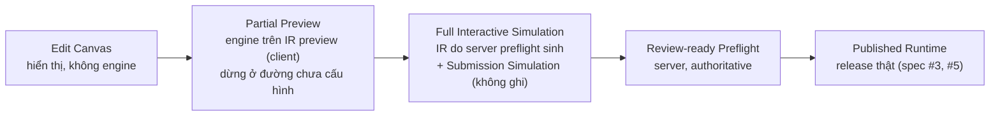
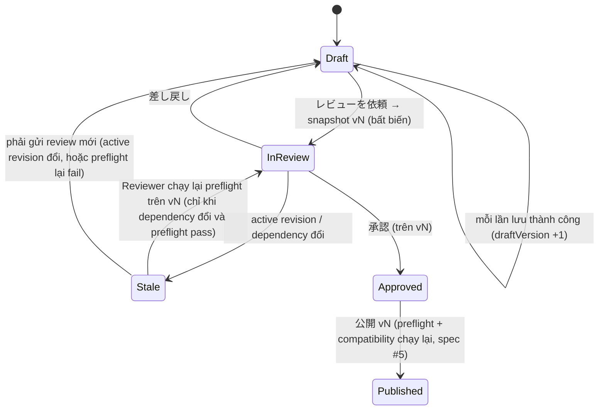

# Spec #4: Admin Form Builder — UX & Architecture (Design Proposal)

> **Trạng thái: PROPOSAL, revision 2** (2026-10-24).
> - Review #1 (rev 1): **SPEC4_REV1_CHANGES_REQUIRED**; OD4-01..05 → ADR-048..052. Rev 2 sửa BLOCKER A (Design Canvas), BLOCKER B (Preview), cùng các điểm còn lại. Thay đổi so với rev 1: §30.
> - Hướng đi đã duyệt: ADR-046, ADR-047, ADR-048..052. Cơ chế trong tài liệu này **PROPOSED** (danh sách giả định §28).
> - **G1 NOT APPROVED.** G9, G10 BLOCKED. Không có code.
> - Nguồn: [notes](../../discovery/P01_BRAINSTORM_NOTES.md) (Spec #4 Answer #1, #2, Review #1); [DECISIONS.md](../../DECISIONS.md); [spec #1 rev 3.4](2026-10-23-form-schema-workflow-design.md); [spec #2 rev 2.6](2026-10-24-plugin-contracts-capability-registry-design.md); [spec #3 rev 2.2](2026-10-24-compiler-bundle-release-design.md); master UX-01..07, F-P0-01..12, BUILD-08.
>
> Phạm vi: subsystem spec số 4 trên 6 — Admin để tạo và sửa form. Không gồm: API, persistence, auth, review/publish phía server (spec #5); Motion preset contract (spec #6). Spec #4 định nghĩa **UX contract** mà spec #5 phải phục vụ.
>
> Wireframe ASCII chỉ minh họa bố cục. Chuỗi tiếng Nhật là ví dụ; chuỗi thật nằm trong message catalog (ADR-048).

## 0. Cách đọc trạng thái

| Nhãn | Ý nghĩa |
|---|---|
| **APPROVED …** | User duyệt quyết định/hướng đi; cơ chế cần review |
| **PROPOSED** | Claude đề xuất, chờ review |
| **OPEN** | Chờ user (§23) |
| *[Claude]* | Lựa chọn nhỏ để tài liệu đủ cụ thể |

| ADR | Nội dung | Trạng thái |
|---|---|---|
| ADR-004 | Builder là immutable document + typed command; undo/redo P1 | ACCEPTED (G0) |
| ADR-008 | Admin no-code; người sửa ≠ người publish | ACCEPTED |
| ADR-009, ADR-011 | Shared block pin, clone; identity ổn định | ACCEPTED |
| ADR-015 | Validation UX | ACCEPTED |
| ADR-019..021 | Schema canonical; block exports; classification tối thiểu | APPROVED AS DESIGN DIRECTION |
| ADR-031, ADR-033 | Một version mỗi plugin trong form; design binding | APPROVED |
| ADR-046 | Business-first Visual Form Builder | APPROVED AS PRODUCT DIRECTION |
| ADR-047 | Hybrid Workspace; 5 loại state; typed command; mức draft; autosave | APPROVED AS PRODUCT/UX DESIGN DIRECTION |
| ADR-048 | Admin tiếng Nhật qua message catalog | APPROVED |
| ADR-049 | Điều kiện gắn đích + named condition ID ổn định; đóng OD-03 | APPROVED WITH CONDITIONS (điều kiện đáp ứng ở §11) |
| ADR-050 | Review trên snapshot bất biến; stale-review detection | APPROVED |
| ADR-051 | Shared block P0: chèn/xem/pin/nâng có impact; sửa block P1 | APPROVED |
| ADR-052 | Optimistic concurrency, không merge tự động | APPROVED |
| §4–§22 | Cơ chế | **PROPOSED** |
| OD4-06 | Cô lập Preview khỏi phiên Admin | **OPEN** (§23) |

---

## 1. Mục đích

Hiện nay mọi thay đổi field hay flow đều cần developer. Spec #4 định nghĩa công cụ để **Business Editor** (ADR-046) tự tạo và sửa form bằng thao tác trực quan, trong phạm vi capability đã duyệt, rồi gửi cho người có quyền duyệt. Công cụ phải nói ngôn ngữ nghiệp vụ, sinh **typed DSL của spec #1** mà không lộ JSON, cho thấy form chạy thế nào bằng **engine của runtime**, và chặn lỗi trước khi publish bằng thông báo người nghiệp vụ hiểu được.

**Anti-goal chính:** một JSON editor bọc drag-and-drop rồi gọi là no-code.

## 2. Goals, non-goals, anti-goals

**Goals**
- G4-1: Business Editor hoàn thành hành trình ngày đầu (§5) chỉ bằng UI.
- G4-2: Mọi chỉnh sửa đi qua typed command; một nguồn sự thật cho document.
- G4-3: Canvas tái dùng **phần hiển thị** của renderer runtime; Preview chạy **engine** của runtime; không có renderer hay engine thứ hai.
- G4-4: **Design Canvas không chạy hành vi runtime** (navigation, lookup, mạng, submit, command đặc quyền, effect) — được bảo đảm bằng kiến trúc và test, không bằng `inert`/CSS (§9).
- G4-5: Preview không bao giờ hiện thành công giả; workflow chưa hoàn chỉnh được nói rõ (§14).
- G4-6: Draft đang xây dở luôn sửa được; lỗi giải thích bằng tiếng Nhật và có đường sửa.
- G4-7: Không mất thay đổi; xung đột không ghi đè ngầm.
- G4-8: Truy cập được bằng bàn phím và screen reader; không bắt buộc drag-and-drop.

**Non-goals (P0):** free-form layout, vẽ edge, undo/redo đầy đủ, collaboration real-time, rule debugger nâng cao, bulk cross-site, template marketplace, AI sinh form, mobile full editing, sửa nội dung shared block (ADR-051), sửa token theme, merge tự động (ADR-052), hot-loading plugin.

**Anti-goals**
- JSON/DSL/regex/expression lộ ra cho Business Editor.
- Nhiều panel tự sửa document.
- Canvas mount component hành vi của plugin; coi `inert`, `pointer-events` hay CSS là ranh giới an toàn.
- Preview "đi tới" màn hoàn tất không có thật; Partial Preview được coi là bằng chứng form hợp lệ.
- Báo 保存済み / 公開しました khi server chưa xác nhận.
- Ngầm đổi version plugin, ngầm bỏ hay sửa tính năng chỉ đọc.

## 3. Ràng buộc

- Không code trước G1. Dữ liệu giả, cửa hàng hư cấu.
- Engine, analyzer, renderer là TypeScript (spec #1, #3); Admin dùng chung package đúng version.
- Persistence, auth, review/publish phía server: spec #5 (§21).
- **Ngôn ngữ (ADR-048):** mọi nhãn, lỗi, trạng thái, help text cho người nghiệp vụ đi qua **message catalog tiếng Nhật**; không hardcode chuỗi trong logic; identifier kỹ thuật và diagnostic nội bộ không nhất thiết dịch.

---

## 4. Information Architecture

```
Admin
├─ サイト選択 (chỉ site được phép)
│  └─ サイトのフォーム一覧: フォーム名 · 状態 · 公開中の版 · 最終更新 · 問題
├─ フォーム概要
│  ├─ 下書き: mức sẵn sàng, [編集する]
│  ├─ レビュー: yêu cầu đang chờ / kết quả / 要再確認
│  ├─ 公開履歴: các bản đã publish, bản đang công khai (Publisher: rollback — spec #5)
│  └─ 使用中の部品: shared block, plugin + cảnh báo (deprecated, có version mới, không có trong Admin)
├─ ビルダー (một draft): 作成 | フロー | プレビュー | 設定
├─ レビュー (Reviewer/Publisher): snapshot, thay đổi bằng ngôn ngữ nghiệp vụ, impact, preview snapshot, simulation, 承認/差し戻し/公開
└─ ライブラリ: スターター, 共通ブロック (chèn và xem; không sửa — ADR-051)
```

| Chip | Ý nghĩa |
|---|---|
| 下書きあり | có draft khác bản đang công khai |
| 編集中 / 一部プレビュー可 / シミュレーション可 / レビュー依頼可 | mức sẵn sàng (§14.1) |
| レビュー中 vN · 要再確認 | review của snapshot vN; stale (§17) |
| 差し戻し | Reviewer trả lại kèm ghi chú |
| 公開中 rN | revision active |
| 要確認 N件 | cảnh báo dependency |

**Thuật ngữ** (luồng chính dùng cột trái; cột phải chỉ ở 詳細/Reviewer):

| Hiển thị | Khái niệm kỹ thuật |
|---|---|
| フォーム / 下書き / 公開版 rN / 公開中 | form / draft / published revision / active release |
| ステップ / 項目 / 条件 / 名前付き条件 | step / field / rule / named condition |
| 共通ブロック | shared block instance (revision đã pin) |
| 部品 | capability từ catalog |
| — (không hiện) | Capability Lock, IR, release manifest, `releaseId`, `conditionId`, `fieldDefId` |

## 5. Hành trình ngày đầu → màn hình

| Bước (ADR-046) | Màn hình / chế độ |
|---|---|
| 1 Login & chọn site | サイト選択 → フォーム一覧 |
| 2 Tạo form | [新規作成]: スターターから / 既存フォームを複製 / 空のフォーム (không live inheritance; clone ghi `clonedFrom`) |
| 3 Step | 作成: Outline |
| 4 Field | 作成: ＋ trên Canvas hoặc Outline → 部品ライブラリ (§8, §10) |
| 5 Điều kiện | Inspector tab 条件; kiểm ở フロー (§11, §12) |
| 6 Theme & Motion | 設定 (§16) |
| 7 Preview & test | プレビュー (§14) |
| 8 Lưu & sửa lỗi | thanh trạng thái, 問題 panel (§13, §15) |
| 9 Gửi review | [レビューを依頼] (§17) |

---

## 6. Hybrid Workspace

```
┌ ヘッダー: PC買取フォーム ▸ 下書き   [作成][フロー][プレビュー][設定]           保存済み ✓ ┐
├ 構成 (Outline) ─────┬ キャンバス (Design Canvas) ─────────────────┬ インスペクター ─────────┤
│ ▾ 1 商品情報     ⚠1 │  商品情報                                    │ メーカー  (テキスト)     │
│     メーカー   ◀    │  ┏━━━━━━━━━━━━━━━━━━━━━━━━━━━━┓ ◀ 選択中     │ [基本][条件][検証][詳細] │
│     型番            │  ┃ メーカー *                 ┃              │ ラベル  [メーカー     ]  │
│ ▸ 2 買取方法  ⑂     │  ┃ [                       ]  ┃              │ 必須    [☑]             │
│ ▸ 3 店舗選択        │  ┗━━━━━━━━━━━━━━━━━━━━━━━━━━━━┛              │                          │
│ ▸ 3 宅配情報        │   ＋ 項目を追加                              │                          │
│ ▸ 4 連絡先          │  型番 [                       ]              │                          │
│   ▣ 顧客情報 (共通) │                                              │                          │
│ ▸ 5 確認            │                                              │                          │
├─────────────────────┴──────────────────────────────────────────────┴──────────────────────────┤
│ 問題 2件 ▸  ·  準備状況: 一部プレビュー可 (未設定の経路 1件)  ·  [レビューを依頼] (無効)            │
└───────────────────────────────────────────────────────────────────────────────────────────────┘
```

| Vùng | Vai trò | Không làm |
|---|---|---|
| 構成 (Outline) | cây theo container của spec #1 §7.5: step → section → field; step → block instance (block instance **không** nằm trong section); chọn; thêm/xóa/đổi tên; sắp xếp (drag, Alt+↑/↓, menu 移動先…); badge số vấn đề | lồng ngoài các container trên |
| キャンバス (Design Canvas) | hiển thị step đang chọn bằng **Presentational Renderer** qua Design-time Adapter, có Selection Layer (§9) | chạy engine, điều hướng, lookup, mạng, submit, command đặc quyền, effect |
| インスペクター | thuộc tính của đối tượng đang chọn (§10) | hiện cấu hình platform không cho sửa |
| Thanh trạng thái | lưu, vấn đề, mức sẵn sàng, レビューを依頼 | — |

**Chế độ:** 作成 (Outline + Canvas + Inspector) · フロー (bản đồ chỉ đọc + danh sách, §12) · プレビュー (§14) · 設定 (§16). Đổi chế độ không mất thay đổi chưa lưu; vùng chọn được giữ.

**Responsive** *[Claude]*: ≥ 1280 px ba cột; 960–1279 px Outline thu gọn được; < 960 px Outline và Inspector thành drawer; < 600 px chỉ xem và sửa thuộc tính đơn giản, không lỗi nghiêm trọng.

---

## 7. Editor state

| State | Nội dung | Ai ghi | Bền vững |
|---|---|---|---|
| **Document** | definition draft (DSL spec #1) | **chỉ** reducer áp typed command (§8) | server (spec #5) |
| **Selection** | `{kind, id}` đang chọn, chế độ, tab Inspector | Selection Layer | không |
| **Diagnostics** | kết quả phân tích phía client + kết quả preflight gần nhất của server (§14.3) | analyzer (thuần) / preflight | không |
| **Preview Runtime** | engine state của phiên preview | engine trong プレビュー | không; không ghi ngược Document |
| **Persistence** | `serverVersion`, `lastSavedDocHash`, hàng đợi lưu, lỗi, xung đột, command chưa lưu | save manager (§15) | không |

- Document đổi → Diagnostics tính lại (debounce); nếu đối tượng đang chọn bị xóa, chọn step cha và thông báo `aria-live`.
- **Single selection authority:** một store selection; Outline, Canvas, Flow, Inspector, 問題 panel chỉ đọc nó và phát `select(target)`.
- Preview nhận **snapshot bất biến** của Document (§14).
- Persistence đọc Document, không sửa nội dung; phản hồi server chỉ cập nhật Persistence (§15).
- Ô nhập dở (ví dụ dòng điều kiện chưa chọn giá trị) là trạng thái của ô, chưa phải command; không có bản sao Document trong widget.

---

## 8. Typed command model

`Command = { commandId, type, target, payload, issuedAt }`. `target` dùng identity ổn định (§8.2), không index hay label.

`apply(document, command) → { document', changes }` là hàm thuần. Ba lớp kiểm:

| Lớp | Khi nào | Kết quả |
|---|---|---|
| Precondition | trước khi áp | target tồn tại, payload đúng schema của command, quyền, giá trị trong tập cho phép (capability có trong Admin capability set và tương thích, classification ≥ tối thiểu) → sai thì **từ chối** |
| Impact analysis | trước command có thể phá tham chiếu | `ImpactReport { affected: [{ kind, id, label, how }] }` → hộp thoại (§13.4) |
| Diagnostics | sau khi áp | analyzer cập nhật; draft vẫn sửa được (§14.1) |

**Từ vựng P0** (chưa phải danh sách cuối):

| Nhóm | Command | Impact analysis |
|---|---|---|
| Form | `CreateFormFromStarter`, `CloneForm`, `CreateEmptyForm`, `UpdateFormSettings` | — |
| Step / section | `AddStep`, `RemoveStep`, `RenameStep`, `MoveStep`, `SetStepKind`, `AddSection`, `RemoveSection`, `MoveSection`, `UpdateSection` | rule trỏ tới step; field bên trong section |
| Field | `AddField{capability, stepId, sectionId?, index}`, `RemoveField`, `MoveField`, `UpdateFieldProperty{property, value}`, `DuplicateField` | tham chiếu từ rule/calculated/tính năng chỉ đọc; Data Contract (thêm/xóa field, đổi classification: contract-change theo spec #1 R-02) |
| Option | `AddOption`, `RemoveOption`, `UpdateOptionLabel`, `MoveOption`, `SetExclusiveOption` | `RemoveOption` đang dùng trong rule; Data Contract |
| Validation | `SetRequired`, `AddValidator{use, params}`, `RemoveValidator`, `UpdateValidatorParams`, `SetValidationMessage` | `SetRequired`: Data Contract (contract-change, R-02) |
| Điều kiện | `SetFieldCondition{fieldId, kind: visible\|required, condition}`, `SetTransitionRules{stepId, rules[], otherwise}`, `CreateNamedCondition`, `UpdateNamedCondition`, `RenameNamedCondition`, `DeleteNamedCondition` | named condition đang dùng; step đích; `requiredWhen`: Data Contract (R-02) |
| Block (ADR-051) | `InsertBlockInstance{block, revision}`, `RemoveBlockInstance`, `SetBlockInputs`, `UpgradeBlockInstance{toRevision}` | export đang được tham chiếu; thay đổi export; xung đột version plugin |
| Plugin | `UpdateCapabilityConfig`, `SetCapabilityInputs`, `UpgradeCapability{plugin, toVersion}` | diff `valueSchema` → Data Contract; xung đột với block (ADR-031) |
| Field tính toán | `AddCalculatedField{template}`, `UpdateCalculation` (chỉ template có kiểu đã duyệt) | vòng phụ thuộc; input đang dùng |
| Sau khi gửi | `SetEffects{effects}` (chỉ binding đã approve, cấu hình allowlist) | — |
| Giao diện | `SetTheme`, `SetMotionPreset` | — |
| Nâng cao (vai trò 詳細設定) | `ChangeFieldKey`, `ChangeOptionValue` | Data Contract (contract-change, R-02) |

- `UpdateFieldProperty.property` thuộc tập đóng theo loại field; không có "patch JSON tùy ý".
- Composite command (ví dụ "xóa field và gỡ tham chiếu") áp nguyên tử.
- Undo/redo P1: command đủ thông tin để sinh nghịch đảo; P0 giữ command log của phiên (§15).
- Server (spec #5) nhận **document snapshot** và tự validate cấu trúc; command là khái niệm phía Admin.

### 8.1. Phạm vi DSL mà Admin P0 sửa được

| Tính năng DSL | P0 Admin | Ghi chú |
|---|---|---|
| step, section, field core, option (nhãn), `exclusive` | sửa | |
| `visibleWhen`, `requiredWhen`, transition, named condition | sửa | §11 |
| validator, message | sửa | |
| field plugin: config, input port | sửa | |
| block instance: chèn, input hằng, nâng revision | sửa | không sửa nội dung block (ADR-051) |
| `calculated` | **chỉ template có kiểu đã duyệt** (ví dụ 「選択数を数える」 → `count`); không biểu thức tự do | vòng → `E-GRAPH-CYCLE` |
| effect (ADR-034) | chọn binding đã approve cho site; cấu hình chỉ trong allowlist (enum); **không** JS, webhook URL, đích đặc quyền, credential | server thực thi theo authorization và cấu hình release tin cậy; P0 chỉ mock |
| prefill, lookup → field, `skipWhen`, `availableWhen`, nhóm lặp | **chỉ đọc** | xem dưới |

**Tính năng chỉ đọc** (nếu có trong starter/clone):
- Được **bảo toàn nguyên vẹn**; không bị bỏ hay sửa ngầm; hiện 「この設定は管理画面では編集できません」 kèm danh sách dependency (field nó dùng, field dùng nó).
- Nằm trong impact analysis: thao tác khác làm chúng invalid (ví dụ xóa field mà prefill tham chiếu) → hộp thoại impact, và nếu vẫn tiếp tục → **blocking diagnostic** `E-READONLY-FEATURE-BROKEN` (gate preview).
- **Starter của P0** chỉ dùng tính năng trong phạm vi sửa được *[Claude]*: registry của starter kiểm khi đăng ký, để Business Editor không nhận một form không bảo trì được. Clone từ form có tính năng chỉ đọc vẫn được, kèm cảnh báo.

### 8.2. Identity, key và mã option

| Loại | Sinh thế nào | Bảo đảm |
|---|---|---|
| `fieldDefId`, `stepId`, `sectionId`, `blockInstanceId`, `conditionId`, `optionId` | platform sinh: tiền tố + **ULID** (ví dụ `fld_01JB…`) *[Claude]* | id mới sinh ra không trùng ở bất kỳ đâu, nên copy/paste và sửa đồng thời không tạo collision; bảo đảm **duy nhất trong namespace của form** (clone giữ id của nguồn trong form mới); bất biến suốt đời entity; không dùng lại; không suy ra từ thứ tự hay nhãn |
| `key` (tên trong Data Contract, spec #1 R-01) | platform sinh khi tạo field: `<loại>_<hậu tố ngẫu nhiên>` *[Claude]* | duy nhất trong form; không trùng key đã retire trong key ledger (R-04; Admin nhận ledger cùng draft); server kiểm lại khi lưu (trùng → từ chối lưu `KEY_COLLISION`, xem dưới) |
| Mã option (`value`) | platform sinh khi tạo option, tách khỏi nhãn | duy nhất trong field; bất biến; nhãn đổi tự do |
| `alias` của block instance (spec #1 §7.1) | platform sinh khi chèn: `<tên block>_<hậu tố ngẫu nhiên>` *[Claude]* | duy nhất trong form; đổi chỉ qua quyền 詳細設定 theo R-04 |

- Ví dụ `text_3`, `opt_2` ở rev 1 chỉ là alias minh họa; bảo đảm duy nhất đến từ ULID/hậu tố ngẫu nhiên **và** kiểm tra của server.
- **Trùng key khi lưu** (hiếm; ví dụ hai phiên cùng thêm field và hậu tố trùng với key đã retire): server **từ chối lần lưu** với lỗi `KEY_COLLISION` (spec #5), không phải diagnostic. Admin tự sinh key mới cho field **chưa từng publish** đang trùng, lưu lại, và báo `aria-live` 「項目のデータ名を自動で変更しました」. Key đã publish không bao giờ bị đổi tự động. Đây là ngoại lệ duy nhất của quy tắc "lưu không bị chặn vì diagnostic" (§14.1, §15).
- **Clone form:** form mới; giữ id, key, mã option của nguồn (namespace theo form), ghi `clonedFrom`; key ledger của form mới khởi tạo với các key đó là đã dùng.
- **Copy/paste, `DuplicateField` trong cùng form:** id mới, key mới, mã option mới.
- **Giá trị ngữ nghĩa đã có** (từ starter/clone/bản đã publish) được bảo toàn. Đổi key hoặc mã option chỉ qua command nâng cao (vai trò 詳細設定), là **contract-change** (spec #1 R-02), cần Reviewer xác nhận; P0 không migrate dữ liệu đã lưu.
- Business Editor mặc định không thấy id/key/mã option; Reviewer/Platform Admin thấy ở 詳細 và màn Review (§10.1).

### 8.3. Pin version plugin khi chèn

1. Form hoặc block trong form **đã dùng** plugin X → dùng **đúng version đó** (ADR-031). Nếu version đó không có trong Admin capability set → không chèn được, giải thích (§14.4).
2. Chưa dùng → ứng viên = release của X thỏa **tất cả**:
   - **trạng thái hiệu lực** (mức chặt nhất giữa status ledger và runtime override, spec #2 §16) là `active`. Chủ ý chặt hơn spec #2 §16.3: release `deprecated` vẫn dùng được nếu đã pin, nhưng không được chọn cho lần chèn mới;
   - với **mỗi facet mà release có** (spec #2 §6.2: `compat` chỉ khai cho host có facet): facet design → `compat.designHostApi` chứa Admin; facet browser → `compat.browserHostApi` chứa engine hiện tại; facet server → `compat.serverHostApi` chứa backend deployment đang chạy (support matrix, spec #5). Không kiểm host mà release không có facet (ví dụ `dataSource` chỉ có facet server);
   - nếu release có facet design hoặc browser: có trong **Admin capability set** (§14.4).
   
   Chọn semver cao nhất trong ứng viên. **"Active mới nhất" không đồng nghĩa tương thích.**
3. Không có ứng viên → precondition từ chối command (không phải diagnostic trong document), lý do `CAP_NO_COMPATIBLE_VERSION`, thông điệp 「この部品は現在の環境で利用できる版がありません。管理者に確認してください。」
4. Version được **pin ngay khi chèn**; mở Inspector không bao giờ đổi version. Nâng version chỉ qua 更新を確認 → `UpgradeCapability` (impact).
5. Xung đột phát sinh sau (ví dụ nâng block) → `E-CAP-VERSION-CONFLICT` kèm chuỗi phụ thuộc.

---

## 9. Design Canvas: Presentational Renderer, Design-time Adapter, Selection Layer

*(Viết lại ở rev 2 — BLOCKER A. `inert` không phải ranh giới an toàn: nó không ngăn effect của React.)*

```mermaid
flowchart LR
  DOC["Document (draft)"] --> DA["Design-time Adapter<br/>dựng props hiển thị từ document<br/>+ dữ liệu mẫu (previewFixtures)"]
  DA --> PR["Presentational Renderer<br/>core: component hiển thị thuần<br/>plugin: export Presentation (spec #2 rev 2.6)"]
  PR --> SL["Selection Layer<br/>khung chọn có thể focus,<br/>nhận click / bàn phím"]
  SL -->|select(target)| SEL["Selection store"]
  SL -->|＋ / di chuyển| CMD["Typed command"]
  X["Không có: engine, client connector,<br/>command dispatcher của runtime,<br/>submit, effect"]:::no
  classDef no fill:#fee,stroke:#c33
```

**Tái dùng hiển thị ≠ chạy hành vi.**

| Lớp | Làm gì | Không làm |
|---|---|---|
| **Presentational Renderer** | Core field: component **thuần hiển thị** (cùng markup/CSS với runtime, tách khỏi phần hành vi). Plugin: export **`Presentation`** của browser facet — thuần, không side effect, đã qua conformance (spec #2 rev 2.6 §7.4, §17.2). Plugin không có `Presentation` → **thẻ giữ chỗ trung tính** (nhãn + loại + 「プレビューで確認できます」). | **Không bao giờ mount `Component`** (component hành vi) của plugin trên canvas |
| **Design-time Adapter** | Dựng props hiển thị từ document: nhãn, helper, required, layout, giá trị mẫu, `sampleOptions` từ `previewFixtures`; cung cấp **DesignContext** chỉ chứa dữ liệu hiển thị | Không cung cấp engine, client connector, command dispatcher của runtime, submit, effect; không gọi lookup hay mạng; không khởi tạo hành vi runtime |
| **Selection Layer** | Mỗi field có một **khung chọn** (focus được, `role="option"` trong `listbox` của step, `aria-selected`, tên truy cập 「メーカー、テキスト、必須」); click/Enter để `select`; mũi tên di chuyển; ＋ là button | Không dùng `inert` để vô hiệu hóa; không làm mất direct selection hay accessibility tree. Phần hiển thị bên trong khung là `aria-hidden` (khung đã mang mô tả đầy đủ) |

**Phòng thủ nhiều lớp (không lớp nào đứng một mình):**

| # | Lớp | Bắt được |
|---|---|---|
| D1 | Contract: canvas chỉ mount `Presentation`/component hiển thị core | component hành vi chạy effect lúc mount |
| D2 | Conformance của registry: `Presentation` mount dưới spy (`fetch`, `XMLHttpRequest`, `WebSocket`, `sendBeacon`, timer, storage, indexedDB) → **0 lời gọi**; negative fixture phải làm test fail đúng lý do | `Presentation` vi phạm |
| D3 | Static boundary của spec #2 (L3): browser facet không dùng API mạng trực tiếp | gọi mạng trong code plugin |
| D4 | Không có context runtime trong cây canvas: hook cần engine/connector sẽ ném lỗi → khung hiện thẻ lỗi hiển thị, không crash Builder | code cố dùng runtime |
| D5 | CSP của Admin: `connect-src` chỉ origin API của Admin; Admin API yêu cầu xác thực và chống CSRF (spec #5) | lời gọi mạng lọt qua D1–D4 |
| D6 | Test E2E âm (TM-4C01..C04, §19) chạy Builder thật, không click gì, quan sát request và storage | hồi quy của cả hệ |

## 10. Properties Inspector

| Đối tượng | 基本 | 条件 | 検証 | 詳細 |
|---|---|---|---|---|
| Field core | ラベル, 補足, プレースホルダー, 選択肢 (nhãn), 他と同時に選べない選択肢 (`exclusive`), 幅 | 表示条件, 必須条件 | 必須, 検証ルール (chip), メッセージ | 分類 (chỉ tăng), 送信対象 (field tính toán) |
| Field plugin | design binding (chỉ ở Inspector, không ở canvas) hoặc inspector tự sinh (§10.2) | như trên | validator capability cho phép | version đã pin (chỉ đọc) + 更新を確認; trạng thái |
| Step | タイトル, 種類 (通常/確認/完了) | 次のステップ (§11.2) | — | — |
| Section | タイトル | 表示条件 | — | — |
| Block instance | tên, revision đã pin, field (chỉ đọc), input hằng | — (spec #1 không có điều kiện cho block instance) | — | exports (chỉ đọc), 更新 (impact, ADR-051) |
| Named condition | 名前, nội dung điều kiện, 使用箇所 N件 | — | — | — |

### 10.1. Phân quyền hiển thị *[Claude]*

| Vai trò (spec #5) | Thấy và sửa |
|---|---|
| Business Editor | 基本, 条件, 検証; 詳細 chỉ gồm 分類 (chỉ tăng) và 送信対象 |
| Reviewer / Platform Admin (quyền 詳細設定) | thêm: id, key, mã option, exports, version, mapping effect (chỉ đọc hoặc command nâng cao §8) |

### 10.2. Inspector tự sinh

- Mọi thuộc tính của `configSchema`/`paramsSchema` có `title` tiếng Nhật; enum có nhãn (spec #2 §6.3).
- Tự sinh chỉ cho tập con: boolean, enum có nhãn, string, integer, mảng chuỗi ngắn; ngoài tập con → bắt buộc design binding. Không bao giờ hiện tên thuộc tính thô.

### 10.3. Quy tắc chung

- Tab chỉ hiện khi có nội dung; mục không được sửa thì không hiện, trừ khi cần giải thích (ví dụ mức phân loại tối thiểu và lý do).
- Validator chọn từ catalog; tham số qua `paramsSchema`; không ô regex.
- Message lỗi mặc định từ catalog (`ja`), ghi đè theo field.

---

## 11. Visual Rule Editor (ADR-049)

### 11.1. Điều kiện hiển thị / bắt buộc của field

```
この項目を [表示する ▾] 次の条件のとき:
  [買取方法 ▾] [が ▾] [店頭買取 ▾]
  [＋ 条件を追加]   条件の組み合わせ: [すべて満たす ▾]
  または [名前付き条件を使う ▾]
```
- Ô field liệt kê field được phép theo spec #1 NR-03 (cùng step hoặc step trước; export của block). Field chỉ có trên một số đường → chọn được kèm cảnh báo `W-MAYBE-INACTIVE`. Tham chiếu tới step phía sau không xuất hiện (`E-FORWARD-REF` nếu tồn tại qua JSON nhập).
- Toán tử theo kiểu field (§11.5). Giá trị từ option list (choice, lưu **mã option**) hoặc ô số nguyên (number); không biểu thức.
- **すべて満たす / いずれかを満たす** một cấp *[Claude]*.
- Mỗi thuộc tính chỉ có **một** điều kiện (spec #1 §7.4) → không có xung đột giữa nhiều rule cùng đặt một thuộc tính.

### 11.2. 次のステップ (transition)

```
次のステップ:   (上の分岐が優先されます)
  1. [買取方法] [が] [店頭買取]  → [店舗選択 ▾]
  2. [買取方法] [が] [宅配買取]  → [宅配情報 ▾]
  それ以外                      → [連絡先 ▾]      ← luôn hiển thị; đích có thể là 「未設定」
  [＋ 分岐を追加]
```
- Đích chỉ là step **sau** step hiện tại (DAG; spec #1 OD-06 khuyến nghị (a)).
- Dòng có điều kiện mà đích còn 未設定 → `E-TRANSITION-TARGET-UNSET` (gate `workflow`); trong IR preview nó cũng trở thành `PREVIEW_ONLY_UNCONFIGURED_PATH` (spec #3 rev 2.2).
- Một step chỉ có `それ以外` → hiển thị gọn 「次へ進むと: 連絡先」.

### 11.3. Ngữ nghĩa (khớp spec #1)

| Câu hỏi (ADR-049) | Quy tắc | Nguồn |
|---|---|---|
| Nhiều điều kiện cùng đúng | **first-match theo thứ tự hiển thị**; không yêu cầu loại trừ lẫn nhau; UI ghi 「上の分岐が優先されます」 và đánh số ưu tiên | spec #1 §8.1, T1 (§8.7.2), E3 |
| `それ以外` | bắt buộc, là `default`; luôn hiển thị; đích 未設定 → `E-GRAPH-NO-DEFAULT` (gate `workflow`) | spec #1 §8.1 |
| Missing / null / rỗng | field chưa nhập, ẩn hoặc inactive = "không có giá trị"; **mọi so sánh với "không có giá trị" là `false`** (kể cả `ではない`); chỉ 「が入力されている / が空」 kiểm rỗng; `null` trong payload bị từ chối ở backend | spec #1 §7.4 (R-08), §7.6.1 |
| Kiểu | toán tử lọc theo kiểu; number là số nguyên; choice so bằng mã option | spec #1 §7.4, §7.6.2 |
| Chú thích cho người dùng | dòng dùng toán tử phủ định hoặc field có thể trống/ẩn hiện 「未回答・非表示のときは、この条件は成立しません（次の分岐へ進みます）」 | R-08 |
| Nhánh không bao giờ được chọn | (a) trường hợp spec #1 §8.5 coi là chứng minh được — điều kiện là hằng `false` hoặc mâu thuẫn, hoặc bị che bởi điều kiện vô điều kiện / giống hệt đứng trước → **`E-TRANSITION-SHADOWED`** (error, gate `workflow`, chặn publish như spec #1). (b) Trường hợp rộng hơn mà analyzer vẫn chứng minh được (cùng field, tập giá trị là tập con của nhánh trước) → `W-RULE-SHADOWED` (cảnh báo; spec #1 §8.5 không liệt kê nên không chặn) | spec #1 §8.5 (1)–(3); mã mới (§13.2) |
| Step không tới được / không tới hoàn tất / `review` không đứng trước mọi `complete` | `E-GRAPH-UNREACHABLE`, `E-GRAPH-NO-TERMINAL`, `E-GRAPH-REVIEW-ORDER` | kiểm tra của spec #1 §8.5; mã mới (§13.2) |
| Tham chiếu hỏng | `E-REF-DANGLING` (gate preview) | spec #1 §14 |

### 11.4. Named condition

- Lưu theo `conditionId` ổn định (ULID) với `label` tiếng Nhật đổi tự do (spec #1 rev 3.4 §7.1); mọi tham chiếu là `{ "cond": conditionId }`.
- Inspector hiện 使用箇所 N件; xóa khi đang dùng → hộp thoại impact.
- P0 UI chỉ cho named condition chứa điều kiện trên field, không lồng named condition khác → Admin không tạo được vòng. Document nhập từ ngoài vẫn được analyzer kiểm vòng: `E-COND-CYCLE` (spec #1 rev 3.4 §7.4).
- Tính hợp lệ của field trong named condition được kiểm **tại từng nơi dùng** (NR-03 phụ thuộc vị trí); lỗi hiện ở nơi dùng.

### 11.5. Mapping chuẩn sang DSL

| UI | DSL (spec #1 §7.4) |
|---|---|
| が | `eq` |
| ではない | `neq` |
| のいずれか / のいずれでもない | `in` / `notIn` |
| 以上 / 以下 / より大きい / より小さい | `gte` / `lte` / `gt` / `lt` (number) |
| が入力されている / が空 | `isNotEmpty` / `isEmpty` |
| (複数選択) を含む / のいずれかを含む | `includes` / `includesAny` |
| すべて満たす / いずれかを満たす | `and` / `or` |
| 名前付き条件 | `{ "cond": conditionId }` |
| この項目を表示する / 必須にする | `visibleWhen` / `requiredWhen` |
| 次のステップ: dòng 1..n + それ以外 | `transitions: [{ when, to } …, { default }]` theo đúng thứ tự |

Ví dụ §11.2 (Editor không bao giờ thấy; mã option `store`/`takuhai` đến từ starter và được bảo toàn — option tạo mới trong Admin có mã do platform sinh, §8.2):
```json
{
  "transitions": [
    { "when": { "op": "eq", "args": [{ "ref": "$local:fld_method" }, { "const": "store" }] }, "to": "stp_store" },
    { "when": { "op": "eq", "args": [{ "ref": "$local:fld_method" }, { "const": "takuhai" }] }, "to": "stp_takuhai" },
    { "default": "stp_customer" }
  ]
}
```

### 11.6. Kiểm nhất quán với spec #1 để đóng OD-03 (ADR-049)

| Yêu cầu của OD-03 (a) / ADR-049 | Kết quả |
|---|---|
| Điều kiện gắn đích, một điều kiện mỗi thuộc tính | khớp §11.1 và spec #1 §7.4 |
| Transition có thứ tự, first-match, `default` bắt buộc | khớp §11.2–§11.3 và spec #1 §8.1/T1 |
| Ngữ nghĩa rỗng/kiểu | khớp R-08, §7.6.1, §7.6.2 |
| Named condition ID ổn định, phát hiện vòng | spec #1 rev 3.4 §7.1/§7.4 sửa từ "name" sang `conditionId`; `E-COND-CYCLE` |
| Không có ECA, không phụ thuộc thứ tự ngoài transition | khớp |

Không còn mâu thuẫn ngữ nghĩa → OD-03 được đóng ở spec #1 rev 3.4.

### 11.7. Tham chiếu không còn hợp lệ

Phần bị mất hiện bằng chữ và biểu tượng 「⚠ 削除された項目」; `E-REF-DANGLING` có 修正する tới đúng dòng. Xóa field/step/named condition đang được tham chiếu luôn qua hộp thoại impact.

## 12. Flow Overview (chỉ đọc)

Ví dụ (draft dở, có một lỗi gieo sẵn: 宅配情報 chưa có đích cho それ以外):
```
商品情報 → 買取方法 ─[1 店頭買取]→ 店舗選択 ──────────────┐
                    ├─[2 宅配買取]→ 宅配情報 ┄[それ以外]┄→ ⚠ 未設定
                    └─[それ以外]──────────────────────────┴→ 連絡先 → 確認 → 完了
```
- Bố cục tự sinh từ step graph; không kéo node, không vẽ edge.
- Nhãn cạnh = số ưu tiên + câu điều kiện rút gọn / tên named condition.
- Highlight (màu **và** biểu tượng + chữ): step không tới được, không tới hoàn tất, đích 未設定 (cạnh nét đứt tới 「未設定」), nhánh bị che (`E-TRANSITION-SHADOWED` / `W-RULE-SHADOWED`, cạnh nét đứt kèm 「この分岐は選ばれません」), tham chiếu hỏng.
- Click step → 作成 với step đó; click cạnh → 条件 → 次のステップ của step nguồn.
- **Danh sách tương đương** luôn có (screen reader), mỗi dòng có liên kết tới step và rule.

---

## 13. Diagnostics UX

### 13.1. Cấu trúc

- Analyzer trả theo spec #1 §14: `{ code, severity: error | warning, nodes: [identity], message, hint }`.
- Admin chuyển qua **diagnostic presentation catalog** do spec #4 sở hữu (message catalog tiếng Nhật, ADR-048):

`UiDiagnostic = { code, severity, gate: preview | workflow | review | none, target (nodes[0]), related (nodes[1..]), messageJa, hintJa, fix }`

| `gate` | Chặn |
|---|---|
| `preview` | engine không chạy an toàn → chặn mọi preview |
| `workflow` | workflow chưa hoàn chỉnh → cho Partial Preview, chặn Full Simulation và review |
| `review` | chặn review |
| `none` | cảnh báo, không chặn |

- CI kiểm mọi code analyzer có thể phát đều có mục trong catalog *[Claude]*; code lạ → thông báo chung kèm mã.

### 13.2. Catalog (ví dụ)

| Code | gate | messageJa (ví dụ) | 修正する |
|---|---|---|---|
| `E-REF-DANGLING` | preview | 条件「店頭買取の場合」が参照している項目は削除されています。 | mở rule |
| `E-TYPE-OPERATOR` | preview | 「購入金額」は数値のため、この比較方法は使えません。 | mở rule |
| `E-GRAPH-CYCLE`, `E-COND-CYCLE` | preview | ステップ（または条件）の参照がループしています：… | mở đối tượng đầu vòng |
| `E-FORWARD-REF` | preview | 後のステップの項目を条件に使うことはできません。 | mở rule |
| `E-CAP-MISSING`, `E-CAP-CONFIG-INVALID` | preview | 部品「店舗選択」の設定に不足があります。 | mở 基本 |
| `E-CAP-VERSION-CONFLICT` | preview | 部品「店舗選択」が異なる版で使われています（フォーム / 共通ブロック「顧客情報」）。 | mở 詳細 |
| `E-ADMIN-CAP-NOT-BUNDLED` | preview | 部品「店舗選択」のこの版は、この管理画面では表示・編集できません。管理者に確認してください。 | — |
| `E-CAP-REVOKED` | preview | 部品「店舗選択」のこの版は利用停止されています。 | mở 詳細 |
| `E-READONLY-FEATURE-BROKEN` | preview | 編集できない設定「郵便番号から住所入力」が、削除された項目を参照しています。 | mở danh sách dependency |
| `E-GRAPH-NO-DEFAULT` | workflow | ステップ「買取方法」の『それ以外』の行き先が未設定です。 | mở dòng それ以外 |
| `E-GRAPH-NO-TERMINAL` | workflow | 「宅配情報」から完了ステップに到達できない経路があります。 | mở 次のステップ |
| `E-GRAPH-UNREACHABLE` | workflow | ステップ「SIM情報」にはどの経路からも到達できません。 | mở Flow |
| `E-GRAPH-REVIEW-ORDER` | workflow | 完了ステップの前に確認ステップを通らない経路があります。 | mở Flow |
| `E-TRANSITION-TARGET-UNSET` | workflow | ステップ「買取方法」の分岐 2 の行き先が未設定です。 | mở dòng đó |
| `E-TRANSITION-SHADOWED` | workflow | 分岐 2「宅配買取」は、上の分岐「すべての場合」が先に選ばれるため使われません。 | mở 次のステップ |
| `E-LABEL-MISSING` *[Claude]* | review | 項目のラベルが未入力です。 | mở 基本 |
| `E-CLASS-BELOW-MIN` | review | 「電話番号」の分類を下げることはできません。 | mở 詳細 |
| `E-CAP-VULNERABLE` | review | 部品「店舗選択」のこの版には問題が報告されています。 | 更新を確認 |
| `W-CONTRACT-CHANGE` | none (nhưng レビュー依頼 cần Editor xác nhận `dataContractDiff.acknowledged`; Reviewer duyệt) | この変更で、送信されるデータの項目が変わります（「店舗選択」の削除）。 | mở danh sách thay đổi |
| `W-CAP-DEPRECATED` | none | 部品「店舗選択」のこの版は将来廃止予定です。 | 更新を確認 |
| `W-FIELD-NEVER-VISIBLE` | none | 項目「SIM情報」はどの条件でも表示されません。 | mở rule |
| `W-MAYBE-INACTIVE` | none | 条件で使っている「店舗選択」は、経路によっては表示されません。 | mở rule |
| `W-RULE-SHADOWED` | none | 分岐 2 の条件は、上の分岐の条件にすべて含まれるため使われません。 | mở 次のステップ |

- **Nguồn mã:** spec #1 (`E-REF-DANGLING`, `E-TYPE-OPERATOR`, `E-GRAPH-CYCLE`, `E-COND-CYCLE`, `E-FORWARD-REF`, `E-GRAPH-NO-DEFAULT`, `E-CLASS-BELOW-MIN`, `W-FIELD-NEVER-VISIBLE`, `W-MAYBE-INACTIVE`, `E-CONTRACT-BREAKING`, `E-IR-PREVIEW-NODE`); spec #2 §9.2/§16.3 (`E-CAP-MISSING`, `E-CAP-CONFIG-INVALID`, `E-CAP-VERSION-CONFLICT`, `E-CAP-REVOKED`, `E-CAP-VULNERABLE`, `W-CAP-DEPRECATED`). **Mã mới do spec #4 đề xuất** (bổ sung vào catalog diagnostic của spec #3 khi đồng bộ): `E-GRAPH-UNREACHABLE`, `E-GRAPH-NO-TERMINAL`, `E-GRAPH-REVIEW-ORDER`, `E-TRANSITION-TARGET-UNSET`, `E-TRANSITION-SHADOWED` (đặt tên cho kiểm tra đã có ở spec #1 §8.5); `W-RULE-SHADOWED`, `W-CONTRACT-CHANGE`, `E-LABEL-MISSING`, `E-READONLY-FEATURE-BROKEN`, `E-ADMIN-CAP-NOT-BUNDLED`.
- `E-ADMIN-CAP-NOT-BUNDLED` khác `E-CAP-ENGINE-INCOMPAT` (spec #2, K3: version đã pin không tương thích host runtime) và khác mã runtime `E-CAPABILITY-UNAVAILABLE`: nó chỉ nói bản Admin này không chứa module của version đã pin, dù version đó có thể vẫn hợp lệ cho runtime.
- Thông báo không chứa key, path kỹ thuật, AST hay mã schema; dùng nhãn. `code` chỉ hiện ở 詳細.
- `E-CONTRACT-BREAKING` (đổi kiểu, spec #1 R-02) không phát sinh từ Admin P0: không có thao tác đổi kiểu; thay field = xóa + thêm → `W-CONTRACT-CHANGE`.
- Lỗi cấu trúc schema không được phép xảy ra với document do command sinh; nếu xảy ra (bug) → 「内部エラーが発生しました」 kèm mã.

### 13.3. 問題 panel

Nhóm theo step; lọc theo mức; mỗi dòng có 修正する; đếm theo gate (「プレビューを妨げる問題 · 未完成の経路 · レビュー依頼を妨げる問題」); ghi rõ nguồn (クライアント確認 / サーバー確認 + thời điểm).

### 13.4. Hộp thoại impact

```
「買取方法」を削除すると、次の設定に影響します:
  • ステップ「買取方法」の次のステップ（2件の分岐）
  • 名前付き条件「店頭買取の場合」
  • 送信されるデータの項目「買取方法」（公開中の版 r6 で使用中）
[キャンセル]  [削除して参照も外す]  [削除する（問題として残す）]
```
Mặc định là キャンセル; mọi lựa chọn sinh một (composite) command.

---

## 14. Phân tích, Preview và Simulation

*(Viết lại ở rev 2 — BLOCKER B và kiểm lại giả định chạy K1–K6 trong browser.)*

### 14.1. Năm tầng chạy và mức sẵn sàng

"Tầng chạy" (execution level) khác với 4 **chế độ** của Builder (作成/フロー/プレビュー/設定, §6): Edit Canvas thuộc chế độ 作成; Partial Preview và Full Simulation thuộc chế độ プレビュー; Review-ready Preflight thuộc màn Review; Published Runtime nằm ngoài Admin.



| Tầng chạy | Điều kiện vào | Chạy gì | Không được coi là |
|---|---|---|---|
| **Edit Canvas** | luôn | Presentational Renderer (§9) | form chạy được |
| **Partial Preview** (一部プレビュー) | không có diagnostic `gate: preview` | engine runtime trên **IR preview do client sinh** (§14.2); đường chưa cấu hình → node `PREVIEW_ONLY_UNCONFIGURED_PATH` | bằng chứng mọi nhánh hợp lệ |
| **Full Interactive Simulation** (シミュレーション) | không có `gate: preview` **và** không có `gate: workflow` (theo **server preflight**) | engine trên **IR do server sinh** + Submission Simulation: evaluator Python validate theo IR đó, **không ghi** submission, không outbox, không effect | publish |
| **Review-ready Preflight** | không còn diagnostic `error` theo server; compatibility, ledger hiện tại, support matrix pass; `W-CONTRACT-CHANGE` (nếu có) đã được Editor xác nhận (`dataContractDiff.acknowledged`) | spec #3 mode `preflight` + kiểm của spec #5 | đã duyệt |
| **Published Runtime** | sau approve + publish | release (spec #3/#5) | — |

Mức sẵn sàng hiển thị: 編集中 · 一部プレビュー可 · シミュレーション可 · レビュー依頼可 (refinement của "ba mức draft" trong ADR-047, chờ user duyệt — §28). **Lưu không bao giờ bị chặn vì diagnostic**; ngoại lệ duy nhất là lỗi từ chối của server khi lưu (`KEY_COLLISION`, §8.2), Admin tự xử lý.

### 14.2. Phân tích phía client: tập con an toàn cho browser

- Admin **không** chạy compiler pipeline. Nó chạy **tập con thuần, tất định** của spec #3 mode `preview` (rev 2.2): K1, K2, K3 (chỉ đọc trên catalog snapshot), K4, K5, K6.
- Contract của package dùng chung (`schema` + `analyzer` + `ir-lowering`):
  - cùng package **và cùng version** với server (version ghi trong Admin build manifest);
  - không I/O, không phụ thuộc code server-only, không nạp plugin source, không thao tác đặc quyền;
  - input do Admin tải qua API (spec #5): draft (`draftVersion`), block revision đã pin, catalog snapshot, ledger snapshot, runtime override snapshot, key ledger — mỗi snapshot có id (`catalogSnapshotId`, `ledgerSnapshotId`, `runtimeOverrideSnapshotId`, spec #3 §5.1);
  - không có implementation ngữ nghĩa thứ hai: không có "phiên bản Admin" của rule hay graph.
- Kết quả phía client chỉ để **hiển thị và Partial Preview**. **Kết quả authoritative** cho Full Simulation, review và publish là **server preflight** (spec #3 mode `preflight`).
- Không gọi production service: Partial Preview dùng `previewFixtures` hoặc adapter `dataSource` của release (dữ liệu hư cấu), có nhãn.

### 14.3. Phát hiện lệch giữa client và server

- Preflight trả `{ analyzerVersion, inputIds: { draftVersion, catalogSnapshotId, ledgerSnapshotId, runtimeOverrideSnapshotId }, diagnostics, diagnosticsDigest }`. `diagnosticsDigest` **chỉ** tính trên diagnostic của K1–K6. Kết quả kiểm của spec #5 (ledger hiện tại, support matrix, quyền) trả trong một trường riêng và **không** nằm trong digest.
- Admin chỉ so digest khi `inputIds` của nó **trùng hoàn toàn** với server; khác bất kỳ id nào → không so, tải lại snapshot và phân tích lại.
- Khác version → Admin coi kết quả client là không đáng tin, chỉ dùng kết quả server, hiện 「サーバーの確認結果を表示しています」.
- Cùng version, cùng `inputIds` mà khác digest → **lỗi hệ thống** (vi phạm ADR-017): dùng kết quả server; báo vận hành `DIAGNOSTIC_DRIFT` kèm `formId`, snapshot version, hai digest (không PII); có test (TM-4D02).
- **Parity preview/runtime** chỉ được tuyên bố PASS từ conformance scenario chạy trên cả preview, artifact đã build và evaluator Python (ADR-017), **không** từ việc renderer trông giống nhau.

### 14.4. Plugin trong Admin

- **Admin capability set** *[Claude]*: lúc deploy Admin, trusted pipeline chọn từ release store mọi release có facet design hoặc browser, có status ∈ {`active`, `deprecated`}, và với **từng facet có mặt** thì `compat` tương ứng (`designHostApi` / `browserHostApi`) chứa bản Admin/engine đó; **cộng** mọi release như vậy đang được pin bởi một draft hoặc revision còn được hỗ trợ. Release chỉ có facet server (`dataSource`, `serverValidator`, `postCommitEffect`) không cần module trong Admin: Admin chỉ cần metadata của nó trong catalog snapshot (để Inspector và impact analysis), và Partial Preview dùng adapter/fixture của release. Nhiều version của cùng plugin cùng tồn tại trong một Admin build (mỗi PRK một module riêng, một React). Danh sách ghi trong Admin build manifest.
- Design facet, browser facet và server facet của một FBK thuộc **cùng release** nên tương thích theo cấu trúc; có mặt adapter server trong backend được kiểm ở preflight (support matrix).
- Draft pin một version có facet design/browser nhưng **không có** trong Admin capability set: field hiện thẻ giữ chỗ chỉ đọc, Inspector chỉ đọc, `E-ADMIN-CAP-NOT-BUNDLED` (gate preview); **không bao giờ đổi version cho hợp Admin**. Cách giải quyết: Platform deploy Admin có version đó, hoặc Editor chủ động 更新を確認.
- Sửa form thông thường **không** cần build lại Admin (engine chạy IR). Chỉ release plugin mới cần Admin build mới. Không marketplace, không hot loading.

### 14.5. Partial Preview và đường chưa cấu hình

- Khi engine đi tới node `PREVIEW_ONLY_UNCONFIGURED_PATH` (spec #1 rev 3.4 §8.1):
  ```
  ⚠ この先の経路はまだ設定されていません（プレビューのみ）
  ステップ「宅配情報」の『それ以外』の行き先が未設定です。
  [修正する]   [前のステップに戻る]
  ```
  Không có nút 次へ/送信, không màn hoàn tất, không simulation.
- Thanh trên của Preview luôn ghi 「一部プレビュー：未設定の経路 N件」 khi còn `gate: workflow`.
- Partial Preview **không** được dùng làm bằng chứng mọi nhánh hợp lệ; nút Submission Simulation chỉ hiện ở Full Simulation.

### 14.6. Interactive Preview / Simulation — chung

- Khung desktop / mobile (1280 / 390 px *[Claude]*); chọn **kịch bản** (ví dụ 「店頭買取」「宅配買取」: điền sẵn giá trị quyết định nhánh, dữ liệu giả); bắt đầu từ step bất kỳ trên đường đi; reset.
- Theme đã chọn (§16) được áp đúng như runtime.
- Document đổi sau khi vào preview → banner 「下書きが変更されました。[最新の内容で再読み込み]」; preview không ghi ngược Document.
- Draft khách trong preview không lưu bền vững; không PII thật.

---

## 15. Autosave và xung đột (ADR-052)

- Transport (spec #5): `PUT /drafts/{draftId}` với envelope `{ draftVersion (base), document, saveSeq }` → `200 { draftVersion }` hoặc `409 { currentDraftVersion }`. `draftVersion` là **metadata của envelope** do server quản lý (spec #1 rev 3.4 §7.1).
- Autosave: debounce *[Claude: 1.5 s]* và checkpoint khi đổi chế độ, rời trang, gửi review. Một request lưu tại một thời điểm; command mới trong lúc lưu được gộp vào lần lưu sau. Phản hồi chỉ áp nếu `saveSeq` là mới nhất. Phản hồi thành công chỉ cập nhật Persistence; Document không bị thay.
- Trạng thái: 保存済み ✓ · 保存中… · 未保存の変更があります · 保存できませんでした [再試行]. **Không hiện 保存済み khi server chưa xác nhận.** Rời trang khi còn thay đổi chưa lưu → cảnh báo trình duyệt.
- `pending` không khóa sửa; chỉ レビューを依頼, 複製, rời trang phải chờ lưu xong.
- Server từ chối lần lưu vì `KEY_COLLISION` → xử lý tự động như §8.2; các lỗi từ chối khác (schema, quyền) → 保存できませんでした kèm lý do, thay đổi giữ trong Persistence.

**Khi 409:**
```
⚠ この下書きは他の場所で更新されました（版 15 → 16）。
あなたの未保存の変更（3件）はこの画面に残っています。
[最新版と比較]  [最新版を読み込む（自分の変更は破棄）]
```
- **最新版と比較**: tải bản server (chỉ đọc) và hiện **khác biệt theo step / field / rule** giữa bản server và bản gốc mà Editor bắt đầu sửa, bằng nhãn nghiệp vụ; bên cạnh là danh sách thay đổi chưa lưu của Editor (「項目『メーカー』のラベルを変更」…).
- Hướng dẫn: 「最新版を読み込んだあと、右の一覧を見ながら変更をもう一度行ってください。」
- Không merge tự động, không ghi đè server, không CRDT.

## 16. 設定: theme và Motion

- **フォーム情報:** tên, mô tả nội bộ.
- **テーマ (P0, đã duyệt):** chỉ chọn trong theme đã duyệt của site; preview và canvas dùng đúng theme đó; không CSS editor, không sửa token tự do (token editor: P1, spec #6).
- **モーション:** chọn preset đã duyệt theo contract spec #6; xem thử; công tắc 「動きを減らす設定で確認」. Animation không điều khiển business state.
- **送信後の処理:** chọn effect đã approve cho site (P0 chỉ mock); mapping mặc định; tùy chỉnh mapping chỉ với quyền 詳細設定 và trong allowlist.

## 17. Review và version (ADR-050)



- **Gửi review** (chỉ khi レビュー依頼可 và đã lưu): tóm tắt thay đổi so với bản đang công khai bằng ngôn ngữ nghiệp vụ; xác nhận đã biết thay đổi Data Contract; ghi chú cho Reviewer; kết quả preflight → tạo **ReviewRequest** `{ reviewId, snapshotVersion vN, snapshotDigest, baseActiveRevision, dependencyDigest (block revision đã pin + phần identity của Capability Lock), preflightResult }` (lưu: spec #5).
- **Snapshot vN bất biến.** Editor tiếp tục sửa draft (vN+1…) với banner 「レビュー中の内容 (vN) には、この後の変更は含まれません」. Reviewer chỉ thấy vN (preview do server sinh IR từ vN), không bao giờ thấy draft đang đổi.
- **Stale-review detection** (khi mở review, khi 承認, khi 公開):
  - `baseActiveRevision` ≠ active revision hiện tại (có người khác đã publish) → `要再確認：公開中の版が変わりました`; **không** approve được; Editor phải gửi review mới từ draft đã cập nhật.
  - Trạng thái dependency đổi (plugin thành `vulnerable`/`revoked`, adapter không còn trong support matrix) → `要再確認`; Reviewer chạy lại preflight trên vN; chỉ approve được khi pass.
- **Publish** dùng **đúng vN đã approve**; chạy lại preflight và compatibility gate ngay trước build (spec #5); fail → không publish, bản đang công khai không đổi, thông báo bằng ngôn ngữ nghiệp vụ.
- **Không bao giờ ngầm approve hay publish bản mới hơn vN.** Không multi-review nâng cao ở P0.
- Sau 公開: 「公開処理中」 cho tới khi spec #5 xác nhận activation; không hiện "公開しました" trước đó.

## 18. Accessibility và responsive

- Mục tiêu đề xuất *[Claude]*: WCAG 2.2 AA cho Admin trong phạm vi P0.
- Outline: ARIA `tree`; mũi tên; Alt+↑/↓; menu 移動先…; thông báo `aria-live` khi di chuyển.
- Canvas: Selection Layer (§9) — `listbox`/`option` focus được; Enter chọn; ＋ là button; không dùng `inert`.
- Chọn và lỗi không chỉ bằng màu.
- Đổi chế độ: focus tới tiêu đề chế độ mới. Flow có danh sách tương đương. Rule Editor là form tiêu chuẩn.
- Hộp thoại: focus trap, Esc đóng, nút mặc định an toàn.
- Chuỗi qua message catalog (ADR-048).

---

## 19. Acceptance / test matrix

Loại: **A** automated · **M** manual · **U** usability (người không phải developer).

| # | Nhóm | Tình huống | Kết quả mong đợi | Loại |
|---|---|---|---|---|
| 4C01 | Canvas side effect | Plugin fixture **chỉ có `Component`** với `useEffect` gọi `fetch` tới URL canary + ghi `localStorage` lúc mount; mở Builder ở step chứa field đó, **không click gì** | canvas hiện thẻ giữ chỗ; 0 request tới URL canary; không có ghi storage; `Component` không mount | A (Playwright, log request + spy storage) |
| 4C02 | Canvas side effect | Plugin fixture có `Presentation` vi phạm (effect + fetch) | conformance của registry fail đúng lý do (spec #2 C2); nếu ép vào Admin build test: request bị CSP chặn và báo cáo, khung hiện thẻ lỗi | A |
| 4C03 | Canvas side effect | Plugin hợp lệ (`storeSelector`) trên canvas | hiển thị bằng `Presentation` với `previewFixtures`; 0 request mạng; không timer | A |
| 4C04 | Canvas selection | Click / Enter / mũi tên trên khung field | Outline + Inspector theo cùng vùng chọn; accessibility tree có tên khung | A + M (screen reader) |
| 4P01 | Preview chưa hoàn chỉnh | `それ以外` của 宅配情報 未設定; chạy Partial Preview nhánh 宅配 | dừng ở trạng thái blocked có thông báo + 修正する; không 次へ/送信; không màn hoàn tất | A |
| 4P02 | Preview chưa hoàn chỉnh | Cùng draft; nhánh 店頭 hoàn chỉnh | chạy tới 確認 và hoàn tất của nhánh đó; thanh trên vẫn ghi 「一部プレビュー：未設定の経路 1件」 | A |
| 4P03 | Simulation | Draft còn `gate: workflow` | nút Full Simulation / Submission Simulation không khả dụng, có lý do | A |
| 4P04 | Simulation | Draft không còn lỗi workflow | simulation chạy trên IR do server sinh; 422 map về field; không ghi submission, không outbox | A |
| 4P05 | IR preview | (a) IR chứa `PREVIEW_ONLY_UNCONFIGURED_PATH` được đưa vào bước đăng ký release / backend; (b) chạy preflight trên draft còn đích 未設定 | (a) bị từ chối `E-IR-PREVIEW-NODE`; (b) output preflight không bao giờ chứa node đó, chỉ có diagnostic gate `workflow` | A |
| 4R01 | Rule | Hai nhánh cùng đúng | nhánh có ưu tiên cao hơn được chọn trong preview, artifact và evaluator Python (cùng fixture) | A (parity) |
| 4R02 | Rule | Field điều kiện chưa trả lời / bị ẩn với `ではない` | điều kiện `false`, rơi xuống nhánh sau/それ以外; UI có chú thích | A |
| 4R03 | Rule | (a) nhánh sau sau một nhánh vô điều kiện/giống hệt; (b) nhánh có tập giá trị là tập con của nhánh trước; (c) fixture phụ thuộc câu trả lời runtime | (a) `E-TRANSITION-SHADOWED` chặn review; (b) `W-RULE-SHADOWED` không chặn; (c) không có diagnostic (không false positive, spec #1 AC-21); Flow hiện cạnh nét đứt cho (a), (b) | A |
| 4R04 | Rule | Document nhập có vòng named condition | `E-COND-CYCLE` với đường vòng theo label | A |
| 4R05 | Rule | Đổi nhãn field / named condition | mọi rule vẫn đúng (tham chiếu theo id) | A |
| 4S01 | Review snapshot | Gửi review v5, sửa tiếp thành v7 | Reviewer thấy v5; diff, preview, simulation đều của v5; approve/publish dùng v5 | A |
| 4S02 | Review stale | Trong lúc review v5, form khác publish làm đổi active revision | `要再確認`; không approve được; phải gửi review mới | A |
| 4S03 | Review stale | Plugin trong v5 thành `vulnerable` | `要再確認`; preflight lại bị chặn tới khi giải quyết | A |
| 4S04 | Publish | Preflight chạy lại lúc publish fail | không publish; active không đổi; thông báo nghiệp vụ | A |
| 4V01 | Plugin version | Chèn plugin chưa dùng; version mới nhất `active` không tương thích backend; thêm một validator chỉ có facet browser và một `dataSource` chỉ có facet server | chọn version tương thích cao nhất; không có → command bị từ chối `CAP_NO_COMPATIBLE_VERSION`; validator và `dataSource` không bị loại vì thiếu `compat` của host mà chúng không có facet | A |
| 4V02 | Plugin version | Mở Inspector nhiều lần | version không đổi | A |
| 4V03 | Plugin version | Draft pin version không có trong Admin capability set | thẻ giữ chỗ chỉ đọc + `E-ADMIN-CAP-NOT-BUNDLED`; version không bị đổi | A |
| 4B01 | Shared block | Nâng `customer-info` r2 → r3 có export đổi | hộp thoại impact liệt kê tham chiếu; sau khi nâng, các form khác không đổi | A |
| 4B02 | Shared block | Nâng block làm xung đột version plugin | `E-CAP-VERSION-CONFLICT` kèm chuỗi | A |
| 4X01 | Chỉ đọc | Clone form có prefill; xóa field mà prefill tham chiếu | hộp thoại impact; nếu tiếp tục → `E-READONLY-FEATURE-BROKEN` (chặn preview); prefill không bị sửa/bỏ ngầm | A |
| 4X02 | Chỉ đọc | Lưu rồi mở lại form có tính năng chỉ đọc | tính năng giữ nguyên byte-for-byte trong document | A |
| 4K01 | Identity | Clone, copy/paste field, hai Editor thêm field đồng thời; ép trùng key với key đã retire | không trùng id/key/mã option trong form; trùng key → server từ chối lưu `KEY_COLLISION`, Admin đổi key của field chưa publish và lưu lại; key đã publish không đổi | A |
| 4W01 | Lưu | Phản hồi lưu đến sai thứ tự | trạng thái theo seq mới nhất; không ghi đè | A |
| 4W02 | Xung đột | 409 | thay đổi local giữ nguyên; xem bản server và khác biệt theo step/field/rule; không hiện 保存済み | A |
| 4D01 | Diagnostics | Mỗi code trong catalog | có fixture sinh ra; 修正する tới đúng target; message có trong catalog `ja` | A |
| 4D02 | Diagnostics | (a) cùng analyzer version và `inputIds`, digest client ≠ server (cố ý); (b) `runtimeOverrideSnapshotId` khác | (a) dùng kết quả server, báo `DIAGNOSTIC_DRIFT`; (b) không so, phân tích lại, không báo drift | A |
| 4T01 | Data Contract | Thay `requiredWhen`, xóa field, đổi classification | `W-CONTRACT-CHANGE`; レビュー依頼 chỉ mở sau khi Editor xác nhận | A |
| 4E01 | Effect | Thử cấu hình effect với URL/JS qua JSON nhập | bị từ chối (schema/allowlist); server không thực thi | A |
| 4I01 | i18n | Quét mã nguồn Admin | không có chuỗi hiển thị hardcode ngoài catalog | A |
| 4A01 | A11y | Các luồng chính bằng bàn phím; axe | không lỗi nghiêm trọng | A + M |
| 4U01 | Usability | 9 task (§20) | theo ngưỡng user chốt trước khi test | U |

## 20. Kế hoạch usability test

| Mục | Nội dung |
|---|---|
| Người tham gia | ≥ 5 người **không phải developer**, đóng vai persona (ADR-046); dữ liệu giả |
| Môi trường | Admin P0 với site PC giả, một starter (trong phạm vi sửa được), shared block `customer-info`, một rule lỗi gieo sẵn |
| Hình thức | moderated, think-aloud, ~60 phút/người; ghi màn hình nếu đồng ý |
| Task | 1 mở PC site · 2 tạo/clone · 3 thêm メーカー · 4 nhánh 店頭/宅配 · 5 validation · 6 preview từng nhánh · 7 sửa lỗi rule hệ thống chỉ ra · 8 lưu, đóng, mở lại · 9 gửi review |
| Ghi nhận | hoàn thành, thời gian, số lần cần developer, lỗi UX (mức 1–4), mức hiểu thông báo, parity preview/runtime (tự động) |
| KPI đề xuất | thêm field ≤ 3 thao tác; form hợp lệ đầu tiên ≤ 30 phút; ≥ 4/5 hoàn thành không cần developer; ≥ 80% lỗi gieo sẵn tự sửa — **chưa phải acceptance** |
| Quy tắc | không tuyên bố usability PASS chỉ từ developer tự test; ngưỡng PASS do user chốt trước khi test |

## 21. Cross-spec interfaces

| # | Interface | Spec khác | Spec #4 | Trạng thái |
|---|---|---|---|---|
| I4-01 | Document = DSL; command sinh DSL | spec #1 §7 | §8 | Đồng bộ |
| I4-02 | Tập con phân tích an toàn cho browser; server preflight authoritative; phát hiện lệch | spec #1 §14; spec #3 §5.1 (`preview`, `preflight`, rev 2.2) | §14.2, §14.3 | Đồng bộ |
| I4-03 | Rule: gắn đích, first-match, `それ以外`, named condition theo `conditionId`, `E-COND-CYCLE` | spec #1 rev 3.4 §7.1, §7.4, §8.1 | §11 | Đồng bộ; **OD-03 đóng** |
| I4-04 | Step graph DAG | spec #1 OD-06 | §11.2 | Chờ OD-06 |
| I4-05 | Block exports; block không trải nhiều step; block instance không có điều kiện | spec #1 ADR-020, OD-13, §7.1 | §6, §10 | Chờ OD-13 |
| I4-06 | Catalog, design binding, inspector tự sinh, `title` tiếng Nhật, `paramsSchema` | spec #2 §6.3, §7.2 | §10 | Đồng bộ |
| I4-07 | `Presentation` thuần của `fieldType` + conformance không side effect | spec #2 rev 2.6 §7.4, §17.2 | §9 | Đồng bộ |
| I4-08 | Admin capability set; kiểm `compat` theo facet có mặt | spec #2 §6.2, §10.1 (rev 2.6) | §8.3, §14.4 | Đồng bộ |
| I4-09 | Node `PREVIEW_ONLY_UNCONFIGURED_PATH` | spec #1 rev 3.4 §8.1; spec #3 rev 2.2 | §14.5 | Đồng bộ |
| I4-10 | `draftVersion` là metadata envelope | spec #1 rev 3.4 §7.1 | §15 | Đồng bộ |
| I4-11 | Preview ≠ release; engine giống runtime | spec #3 §5.1; spec #1 §15; BUILD-08 | §14 | Đồng bộ |
| I4-15 | Mã diagnostic mới (§13.2) | catalog diagnostic của spec #3 | §13.2 | **Cần bổ sung** vào spec #3 khi đồng bộ catalog |
| I4-12 | Ngôn ngữ Admin | spec #1 OD-11 (đóng cho P0, ADR-048) | §3 | Đồng bộ |
| I4-13 | Draft API, envelope, tải kèm block/catalog/ledger/key ledger; preflight; simulation; ReviewRequest + stale; approve/reject/publish; rollback; support matrix; quyền (Editor, Reviewer, Publisher, quyền 詳細設定); CSRF/CSP; Admin build manifest | spec #5 | §14–§17, §10.1 | **Chuyển spec #5** |
| I4-14 | Theme đã duyệt theo site; Motion preset; reduced motion; token editor P1 | spec #6 | §16 | **Chuyển spec #6** |

## 22. Phạm vi P0 / P1 / P2

| Hạng mục | P0 | P1 | P2 |
|---|---|---|---|
| Dashboard, form overview | ✔ | | |
| Starter (trong phạm vi sửa được), clone, form trống | ✔ | template management | marketplace |
| Hybrid workspace, 4 chế độ | ✔ | | |
| Design Canvas (Presentational Renderer + adapter + Selection Layer) | ✔ | | |
| Command P0 | ✔ | undo/redo UI | |
| Rule Editor (một cấp AND/OR, named condition, 次のステップ) | ✔ | nhóm lồng | rule debugger |
| Flow chỉ đọc + danh sách | ✔ | | sửa trên flow |
| Diagnostics, 問題, impact, phát hiện lệch | ✔ | | |
| Partial Preview, Full Simulation, Submission Simulation | ✔ | Visual Preview riêng | |
| Theme (chỉ chọn), Motion preset | ✔ | token editor | |
| Autosave, xung đột (không merge, có so sánh) | ✔ | merge có hỗ trợ | collaboration |
| Review trên snapshot + stale detection | ✔ | | multi-review |
| Shared block: chèn/xem/pin/nâng | ✔ | soạn/sửa block | bulk adoption |
| Tính năng chỉ đọc (prefill, lookup, skipWhen, nhóm lặp) | bảo toàn + impact | sửa trong Admin | |
| Cô lập Preview | theo OD4-06 | | |

## 23. Quyết định

**Đã quyết (review #1):** OD4-01 → ADR-048 · OD4-02 → ADR-049 · OD4-03 → ADR-050 · OD4-04 → ADR-051 · OD4-05 → ADR-052.

**OPEN:**

| ID | Vấn đề | Phương án | Khuyến nghị | Hạn |
|---|---|---|---|---|
| **OD4-06** | Cô lập Preview (chạy component hành vi của plugin) khỏi phiên Admin | (a) P0 chạy trong document của Admin, dựa trên trust model (ADR-023), L3 cấm API mạng, CSP; iframe sandbox ở origin riêng ở P1. (b) P0 đã dùng iframe sandbox trên origin preview riêng. | **(a)** cho P0, ghi là risk; (b) ở P1 | Trước plan |

**Chuyển sang spec #5:** I4-13 (API, persistence, ReviewRequest, stale data, preflight/simulation endpoint, support matrix, quyền, CSRF/CSP, Admin build manifest). **Chuyển sang spec #6:** I4-14. **Còn mở từ spec khác:** spec #1 OD-06, OD-13; OD2-08/09; VG-01..10.

## 24. Rủi ro

| Rủi ro | Mức | Giảm thiểu |
|---|---|---|
| Hybrid workspace vượt khả năng PoC | Trung bình | P0 cắt gọn; fallback A chỉ khi user duyệt đổi scope |
| Plugin không cung cấp `Presentation` → canvas nghèo | Trung bình | thẻ giữ chỗ rõ ràng; khuyến khích `Presentation` trong review plugin |
| Tách core field thành phần hiển thị và hành vi tốn công | Trung bình | làm một lần trong engine; dùng chung cho canvas và runtime |
| Lệch diagnostic client/server | Thấp | cùng package/version; phát hiện lệch §14.3 |
| Preview chạy code plugin trong phiên Admin | Trung bình | OD4-06 |
| Admin capability set thiếu version | Thấp | Admin build từ ledger + pin hiện có; thông báo rõ |
| Thông báo khó hiểu | Trung bình | catalog `messageJa` + `hintJa`; usability task 7 |

## 25. Để builder tự quyết

Thư viện UI, drag-and-drop, cấu trúc component; thuật toán bố cục Flow (tất định); debounce/breakpoint cụ thể; định dạng command log; cách hiện diff (miễn bằng ngôn ngữ nghiệp vụ); định dạng hậu tố ngẫu nhiên của key.

## 26. Builder check rev 1 (reviewer độc lập)

Đã xử lý ở rev 1 (bảng giữ nguyên ý): cách draft thành IR; facet plugin vào Admin; draft dở; phạm vi DSL P0; vai trò Advanced và xác nhận Data Contract; sinh key/mã option; pin version; container của block; danh sách field cho điều kiện; `それ以外` và `E-GRAPH-NO-DEFAULT`; hình dạng diagnostic; contract-change vs breaking; `draftVersion`; ghi đè token theme; inspector tự sinh lộ tên thuộc tính; key thô; ngữ nghĩa phủ định khi chưa trả lời. Rev 2 sửa tiếp phần preview và canvas theo review #1 (hai cách sửa ở rev 1 — `inert` và `__preview_end__` — đã bị bác).

## 27. Consistency review rev 2 (reviewer độc lập, chỉ đọc)

Đối chiếu với spec #1 rev 3.4, spec #2 rev 2.6, spec #3 rev 2.2, ADR-004..052. Kết quả: **không có BLOCKER**; 6 MAJOR, 10 MINOR, đều đã xử lý.

| # | Phát hiện | Xử lý |
|---|---|---|
| M1 | `W-RULE-SHADOWED` chỉ cảnh báo, trong khi spec #1 §8.5(3) chặn publish | tách (a) `E-TRANSITION-SHADOWED` error gate `workflow` / (b) `W-RULE-SHADOWED` (§11.3, §13.2, 4R03) |
| M2 | `E-CONTRACT-CHANGE` là error nên form không bao giờ đạt Review-ready; thiếu impact Data Contract cho `SetRequired`/`requiredWhen`/classification | `W-CONTRACT-CHANGE` + `dataContractDiff.acknowledged`; impact ở §8; test 4T01 |
| M3 | `E-KEY-COLLISION` mâu thuẫn "lưu không bị chặn" | từ chối lưu `KEY_COLLISION`, Admin đổi key field chưa publish (§8.2, §14.1, §15, 4K01) |
| M4 | điều kiện `compat` loại nhầm plugin không có facet tương ứng | chỉ kiểm host có facet (§8.3, §14.4, 4V01); spec #2 §10.1 sửa tương tự |
| M5 | digest có thể báo drift giả do khác override snapshot / kiểm của spec #5 | digest chỉ K1–K6, so khi `inputIds` trùng (§14.2, §14.3, 4D02); spec #3 §5.1 ghi rõ |
| M6 | `E-GRAPH-NO-TERMINAL`/`UNREACHABLE` dẫn nguồn sai; thiếu mã cho kiểm tra `review` | ghi là mã mới, thêm `E-GRAPH-REVIEW-ORDER`, I4-15 |
| m1 | mã chưa định nghĩa; trùng nghĩa `E-CAP-ENGINE-INCOMPAT` / `E-CAPABILITY-UNAVAILABLE` | liệt kê nguồn; `CAP_NO_COMPATIBLE_VERSION` là lý do từ chối; đổi tên `E-ADMIN-CAP-NOT-BUNDLED` |
| m2 | §8.2 "duy nhất toàn cục" vs clone giữ id; thiếu `alias`; ví dụ `const: store` | sửa bảo đảm thành namespace form; thêm `alias`; chú thích ví dụ |
| m3 | ví dụ §12 lệch §11.2 | vẽ lại, ghi rõ lỗi gieo sẵn |
| m4 | 4P05 giả định preflight nhận IR | sửa test |
| m5 | đích của dòng có điều kiện bỏ trống chưa có mã | `E-TRANSITION-TARGET-UNSET` |
| m6 | §17 thiếu Stale → Draft khi preflight fail | thêm |
| m7 | tham chiếu chéo cũ (I4-11, spec #2 §10.1, "rev 2.5") | sửa |
| m8 | lệch ADR-047 (mức draft, renderer khách); "chế độ" hai nghĩa | ghi là refinement chờ duyệt (§28); đổi thành "tầng chạy" |
| m9 | chỉ chọn `active` chặt hơn spec #2 §16.3 | ghi chủ ý, dùng trạng thái hiệu lực (§8.3) |
| m10 | spec #1 còn ghi OD-03 mở ở §7.4, §26 | sửa spec #1 |

Đã kiểm, không có vấn đề: mapping toán tử; first-match, `default`, R-08; stage K1–K6/K0–K6; facet `Presentation`/`Component`; trích dẫn ADR; container của block instance; envelope `draftVersion`; `inert`/`__preview_end__` chỉ còn ở dạng phủ định/lịch sử; không lộ thông tin nội bộ.

## 28. Giả định còn PROPOSED

- Chuỗi tiếng Nhật trong tài liệu là ví dụ; catalog thật soạn ở implementation.
- ID dạng tiền tố + ULID; key `<loại>_<hậu tố ngẫu nhiên>`; mã option sinh tự động.
- Bốn gate diagnostic (`preview`, `workflow`, `review`, `none`) và catalog §13.2, gồm các mã mới.
- **Refinement của ADR-047 chờ user duyệt:** (1) 4 mức sẵn sàng + 5 tầng chạy thay cho "ba mức draft"; (2) Canvas dùng **phần hiển thị** của renderer (core thuần hiển thị + `Presentation` của plugin) thay vì renderer khách đầy đủ.
- Release `deprecated` không được chọn khi chèn mới (§8.3), chặt hơn spec #2 §16.3.
- Trùng key xử lý bằng từ chối lưu + đổi key tự động cho field chưa publish (§8.2).
- Mức sẵn sàng 4 bậc; điều kiện của Full Simulation.
- Cấu trúc ReviewRequest và luật stale (§17); lưu trữ ở spec #5.
- Admin capability set (§14.4); Admin build manifest.
- Phân quyền hiển thị (§10.1); tên quyền 詳細設定.
- Phát hiện lệch bằng digest (§14.3).
- Breakpoint, kích thước khung preview, debounce.
- WCAG 2.2 AA là mục tiêu đề xuất.
- KPI usability.

## 29. Mâu thuẫn còn lại

Không có mâu thuẫn chặn sau khi đồng bộ spec #1 rev 3.4, spec #2 rev 2.6, spec #3 rev 2.2 (consistency review §27: 0 BLOCKER; 6 MAJOR + 10 MINOR đã xử lý). Việc đồng bộ còn lại không chặn: bổ sung mã mới vào catalog diagnostic của spec #3 (I4-15). Phụ thuộc chưa quyết: OD-06, OD-13 (spec #1), OD4-06, các mục chuyển spec #5/#6.

## 30. Thay đổi so với revision 1

- ADR-048..052 áp vào §3, §11, §15, §17, §22, §23.
- **§9 viết lại (BLOCKER A):** Presentational Renderer / Design-time Adapter / Selection Layer; bỏ `inert`; plugin chỉ dùng `Presentation`; phòng thủ D1–D6; test âm 4C01–4C04.
- **§14 viết lại (BLOCKER B + kiểm lại K1–K6):** năm chế độ; Partial Preview dừng ở `PREVIEW_ONLY_UNCONFIGURED_PATH` (bỏ `__preview_end__`); Full Simulation chỉ khi workflow hoàn chỉnh theo server; tập con phân tích an toàn cho browser; server preflight authoritative; phát hiện lệch; Admin capability set.
- §8.1: tính năng chỉ đọc bị phá → blocking diagnostic; starter trong phạm vi sửa được; effect allowlist; calculated chỉ template có kiểu.
- §8.2 mới: identity bằng ULID, key, mã option, clone/copy/đồng thời, bảo toàn giá trị.
- §8.3 mới: pin version theo support matrix; không đổi khi mở Inspector.
- §11: ngữ nghĩa first-match, rỗng, kiểu; `W-RULE-SHADOWED`; named condition theo `conditionId`, `E-COND-CYCLE`; mapping chuẩn (sửa `contains` → `includes`); kiểm nhất quán để đóng OD-03.
- §13: gate `workflow`; liệt kê nguồn mã và mã mới (§13.2); `E-CONTRACT-CHANGE` của rev 1 thành `W-CONTRACT-CHANGE` + xác nhận khi gửi review; nguồn client/server.
- Sau consistency review (§27): shadowing chứng minh được là error như spec #1 §8.5; trùng key là từ chối lưu; kiểm `compat` theo facet có mặt; digest theo `inputIds`; đổi tên `E-ADMIN-CAP-NOT-BUNDLED`; sửa ví dụ §12, test 4P05/4R03/4V01/4K01/4D02, thêm 4T01.
- §15: xem bản server và khác biệt theo step/field/rule khi 409.
- §16: P0 chỉ chọn theme.
- §17: ReviewRequest, snapshot bất biến, stale detection, publish từ snapshot đã approve.
- §19 mới: acceptance/test matrix.
- Đồng bộ: spec #1 rev 3.4, spec #2 rev 2.6, spec #3 rev 2.2.

## 31. Mức độ sẵn sàng (revision 2)

| Phần | Trạng thái | Còn mở |
|---|---|---|
| IA, journey, workspace, state (§4–§7) | Chờ final review | — |
| Command, identity, pin (§8) | Chờ final review | — |
| Design Canvas (§9) | Viết lại theo BLOCKER A | — |
| Inspector (§10) | Chờ final review | — |
| Rule Editor, Flow (§11, §12) | Điều kiện ADR-049 đáp ứng | OD-06, OD-13 |
| Diagnostics (§13) | Chờ final review | — |
| Preview/Simulation (§14) | Viết lại theo BLOCKER B | OD4-06 |
| Autosave (§15), theme (§16), review (§17) | Theo ADR-050/052 | transport: spec #5 |
| Test matrix (§19), usability (§20) | Chờ final review | ngưỡng PASS |
