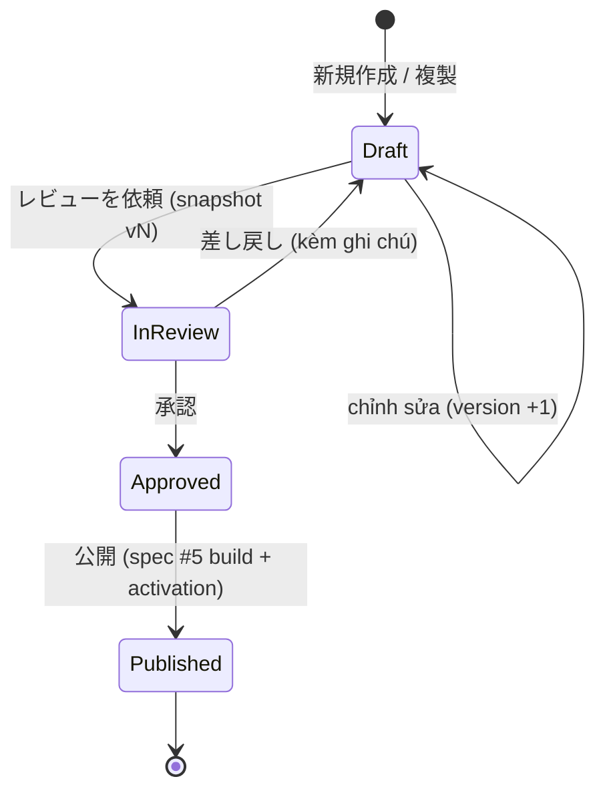

# Spec #4: Admin Form Builder — UX & Architecture (Design Proposal)

> **Trạng thái: PROPOSAL, revision 1** (2026-10-24). Chưa được user review. Đã qua builder check độc lập và sửa (§26).
> - Hướng đi đã duyệt: ADR-046 (Business-first Visual Form Builder), ADR-047 (Hybrid Workspace, editor state). Cơ chế trong tài liệu này **PROPOSED**.
> - **G1 NOT APPROVED.** G9 và G10 BLOCKED. Không có code.
> - Nguồn: [P01_BRAINSTORM_NOTES.md](../../discovery/P01_BRAINSTORM_NOTES.md) (Spec #4 Answer #1, #2); [DECISIONS.md](../../DECISIONS.md) ADR-004, 008, 009, 011, 015, 019..021, 033, 037, 038, 046, 047; [spec #1 rev 3.3](2026-10-23-form-schema-workflow-design.md); [spec #2 rev 2.5](2026-10-24-plugin-contracts-capability-registry-design.md); [spec #3 rev 2.1](2026-10-24-compiler-bundle-release-design.md); master UX-01..07, F-P0-01..12, BUILD-08.
>
> Phạm vi: subsystem spec số 4 trên 6 — Admin dùng để tạo và sửa form. Không gồm: API, persistence, auth, workflow review/publish phía server (spec #5); Motion preset contract và Motion Editor chi tiết (spec #6). Spec #4 định nghĩa **UX contract** mà spec #5 phải phục vụ.
>
> Ví dụ wireframe là ASCII minh họa bố cục, không phải thiết kế hình ảnh cuối. Chuỗi giao diện tiếng Nhật là ví dụ.

## 0. Cách đọc trạng thái

| Nhãn | Ý nghĩa |
|---|---|
| **APPROVED AS … DIRECTION** | User duyệt hướng đi; cơ chế cần review |
| **PROPOSED** | Claude đề xuất, chờ review |
| **OPEN** | Chờ user (§23) |
| *[Claude]* | Lựa chọn nhỏ để tài liệu đủ cụ thể |

| ADR | Nội dung | Trạng thái |
|---|---|---|
| ADR-004 | Vertical slice; undo/redo P1 nhưng builder là immutable document + typed command | ACCEPTED (G0) |
| ADR-008 | Admin no-code ưu tiên business; người sửa ≠ người publish | ACCEPTED |
| ADR-009, ADR-011 | Shared block pin, clone; identity ổn định | ACCEPTED |
| ADR-015 | Validation UX và trách nhiệm từng lớp | ACCEPTED |
| ADR-019..021 | Schema canonical; block exports; classification tối thiểu | APPROVED AS DESIGN DIRECTION |
| ADR-033 | Design binding/inspector của capability | APPROVED WITH P0 SCOPE |
| ADR-046 | Business-first Visual Form Builder; persona; hành trình 9 bước | APPROVED AS PRODUCT DIRECTION |
| ADR-047 | Hybrid Workspace; 5 loại state; typed command; 3 mức draft; autosave | APPROVED AS PRODUCT/UX DESIGN DIRECTION |
| §4–§22 | Cơ chế | **PROPOSED** |
| OD4-01..05 | Quyết định còn mở | **OPEN** (§23) |

---

## 1. Mục đích

Hiện nay mọi thay đổi field hay flow đều cần developer. Spec #4 định nghĩa công cụ để **Business Editor** (PO, PM, Business Operator; ADR-046) tự tạo và sửa form thu mua bằng thao tác trực quan, trong phạm vi capability platform đã duyệt, rồi gửi cho người có quyền duyệt. Công cụ phải:
- nói ngôn ngữ nghiệp vụ (Form, Step, Field, 条件, プレビュー, 公開), không phải ngôn ngữ kỹ thuật;
- sinh ra **typed DSL của spec #1**, không để ai sửa JSON;
- cho thấy form chạy thế nào **bằng chính engine của runtime**;
- chặn lỗi trước khi publish bằng thông báo người nghiệp vụ hiểu được.

**Anti-goal chính (ADR-046):** một JSON editor bọc drag-and-drop rồi gọi là no-code.

## 2. Goals, non-goals, anti-goals

**Goals**
- G4-1: Business Editor hoàn thành hành trình ngày đầu (§5) chỉ bằng UI.
- G4-2: Mọi chỉnh sửa đi qua typed command; một nguồn sự thật cho document.
- G4-3: Canvas và Preview dùng renderer/engine của runtime (BUILD-08); không có renderer thứ hai.
- G4-4: Draft đang xây dở luôn sửa được; lỗi được giải thích bằng tiếng Nhật và có đường sửa.
- G4-5: Không mất thay đổi: autosave an toàn, xung đột không ghi đè ngầm.
- G4-6: Truy cập được bằng bàn phím và screen reader; không bắt buộc drag-and-drop.

**Non-goals (P0)** — ADR-047: free-form layout, vẽ edge, undo/redo đầy đủ, collaboration real-time, rule debugger nâng cao, bulk cross-site, template marketplace, AI sinh form, mobile full editing.

**Anti-goals**
- JSON/DSL/regex/expression lộ ra cho Business Editor.
- Nhiều panel tự sửa document theo cách riêng.
- Preview chạy logic khác runtime, hoặc canvas đang lỗi được trình bày như form hợp lệ.
- Thông báo lỗi là raw schema/compiler error.
- Báo "đã lưu"/"đã publish" khi server chưa xác nhận.

## 3. Ràng buộc

- Không code trước G1. Dữ liệu giả, cửa hàng hư cấu.
- Engine, analyzer, renderer là TypeScript (spec #1, spec #3); Admin dùng chung các package đó.
- Persistence, auth, review/publish phía server thuộc spec #5; spec #4 chỉ định nghĩa contract mà UI cần.
- Ngôn ngữ giao diện: tiếng Nhật cho chuỗi nghiệp vụ và diagnostic (ADR-047); phạm vi đầy đủ là OD4-01.

---

## 4. Information Architecture

```
Admin
├─ サイト選択 (chỉ site được phép)
│  └─ サイトのフォーム一覧 (Site dashboard)
│      cột: フォーム名 · 状態 · 公開中の版 · 最終更新 · 問題
├─ フォーム概要 (Form overview)
│  ├─ 下書き: trạng thái sẵn sàng, [編集する]
│  ├─ レビュー: yêu cầu đang chờ / kết quả
│  ├─ 公開履歴: các bản đã publish, bản đang công khai (Publisher: rollback — spec #5)
│  └─ 使用中の部品: shared block, plugin + cảnh báo (deprecated, có version mới)
├─ ビルダー (một draft): 作成 | フロー | プレビュー | 設定
├─ レビュー (Reviewer/Publisher): thay đổi bằng ngôn ngữ nghiệp vụ, impact, preview snapshot, simulation, 承認/差し戻し/公開
└─ ライブラリ: スターター, 共通ブロック (P0: chọn và chèn; xem OD4-04)
```

**Trạng thái hiển thị của một form** (chip trên dashboard và overview):

| Chip | Ý nghĩa | Nguồn |
|---|---|---|
| 下書きあり | có draft khác bản đang công khai | spec #5 |
| 未完成 / プレビュー可 / レビュー依頼可 | mức sẵn sàng của draft (§14) | analyzer |
| レビュー中 | đã gửi một snapshot cho review | spec #5 |
| 差し戻し | Reviewer trả lại kèm ghi chú | spec #5 |
| 公開中 rN | revision đang active | spec #5 |
| 要確認 N件 | cảnh báo dependency (plugin `deprecated`/`vulnerable`, block có version mới) | spec #2 ledger |

**Thuật ngữ** (luồng chính dùng cột trái; cột phải chỉ ở màn 詳細/Reviewer):

| Hiển thị | Khái niệm kỹ thuật |
|---|---|
| フォーム | form (`formId`) |
| 下書き | draft (`draftVersion`) |
| 公開版 rN | published revision |
| 公開中 | active release |
| ステップ / 項目 / 条件 | step / field / rule, named condition |
| 共通ブロック | shared block instance (pinned revision) |
| 部品 (店舗選択など) | capability từ catalog |
| — (không hiện) | Capability Lock, IR, release manifest, `releaseId` |

## 5. Hành trình ngày đầu → màn hình

| Bước (ADR-046) | Màn hình / chế độ | Ghi chú |
|---|---|---|
| 1 Login & chọn site | サイト選択 → フォーム一覧 | chỉ site được phép (spec #5 auth) |
| 2 Tạo form | フォーム一覧 → [新規作成]: スターターから / 既存フォームを複製 / 空のフォーム | không live inheritance; clone ghi `insertedFrom` (spec #1) |
| 3 Step | ビルダー 作成: Outline | thêm/xóa/đổi tên/sắp xếp |
| 4 Field | 作成: ＋ trên Canvas hoặc Outline → 部品ライブラリ | §8, §10 |
| 5 Điều kiện | Inspector tab 条件; kiểm tra ở フロー | §11, §12 |
| 6 Theme & Motion | 設定 | §17 |
| 7 Preview & test | プレビュー | §16 |
| 8 Lưu & sửa lỗi | thanh trạng thái, 問題 panel | §13–§15 |
| 9 Gửi review | thanh trạng thái → [レビューを依頼] | §18 |

---

## 6. Hybrid Workspace

```
┌ ヘッダー: PC買取フォーム ▸ 下書き   [作成][フロー][プレビュー][設定]        保存済み ✓ ┐
├ 構成 (Outline) ─────┬ キャンバス (step đang chọn) ───────────┬ インスペクター ────────┤
│ ▾ 1 商品情報     ⚠1 │  商品情報                              │ メーカー  (テキスト)    │
│     メーカー   ◀    │  ┌────────────────────────────┐        │ [基本][条件][検証][詳細]│
│     型番            │  │ メーカー *                 │ ◀選択中 │ ラベル  [メーカー    ]  │
│     CPU             │  │ [                       ]  │        │ 必須    [☑]            │
│ ▸ 2 買取方法  ⑂     │  └────────────────────────────┘        │ 補足    [            ] │
│ ▸ 3 店舗選択        │   ＋ 項目を追加                        │                         │
│ ▸ 3 宅配情報        │  型番 [                       ]        │                         │
│ ▸ 4 連絡先          │                                        │                         │
│ ▸ 5 確認            │                                        │                         │
├─────────────────────┴────────────────────────────────────────┴─────────────────────────┤
│ 問題 2件 ▸   ·   準備状況: プレビュー可 (レビュー依頼にはあと2件)   ·   [レビューを依頼]     │
└────────────────────────────────────────────────────────────────────────────────────────┘
```

| Vùng | Vai trò | Không làm |
|---|---|---|
| 構成 (Outline) | cây theo container của spec #1 §7.5: step → section → field; step → block instance (block instance **không** nằm trong section); chọn; thêm/xóa/đổi tên; sắp xếp (drag, Alt+↑/↓, menu 移動先…); badge số vấn đề | lồng nhiều cấp ngoài các container trên |
| キャンバス | vẽ step đang chọn bằng renderer của runtime qua design-time adapter (§9); chọn bằng click; ＋ chèn | chạy engine, điều hướng, submit, gọi mạng |
| インスペクター | thuộc tính của đối tượng đang chọn, chia tab (§10) | hiện cấu hình platform không cho sửa |
| Thanh trạng thái | trạng thái lưu, số vấn đề, mức sẵn sàng, nút レビューを依頼 | — |

**Chế độ:**

| Chế độ | Nội dung | Vùng hiển thị |
|---|---|---|
| 作成 | sửa step/field/rule | Outline + Canvas + Inspector |
| フロー | bản đồ nhánh chỉ đọc + danh sách tương đương (§12) | Flow + Inspector (khi chọn rule) |
| プレビュー | Interactive Preview (§16) | Preview toàn màn hình + bảng điều khiển kịch bản |
| 設定 | thông tin form, theme, Motion preset (§17) | trang cài đặt |

- Đổi chế độ **không** làm mất thay đổi chưa lưu; vùng chọn được giữ khi quay lại 作成.
- **Responsive** *[Claude]*: ≥ 1280 px ba cột; 960–1279 px Outline thu gọn được; < 960 px Outline và Inspector thành drawer; < 600 px chỉ xem và sửa thuộc tính đơn giản (không bắt buộc full editing), không lỗi nghiêm trọng.

---

## 7. Editor state

| State | Nội dung | Ai ghi | Bền vững |
|---|---|---|---|
| **Document** | definition draft (DSL spec #1) | **chỉ** reducer áp typed command (§8) | server (spec #5) |
| **Selection** | đối tượng đang chọn (`{kind, id}`), chế độ, vị trí cuộn, tab Inspector | UI | không (có thể nhớ trong session) |
| **Diagnostics** | kết quả analyzer cho Document hiện tại | analyzer (hàm thuần, chạy lại sau mỗi command, debounce) | không |
| **Preview Runtime** | engine state của phiên preview | engine trong プレビュー | không; không bao giờ ghi ngược vào Document |
| **Persistence** | `serverVersion`, `lastSavedDocHash`, hàng đợi lưu, lỗi, xung đột | save manager (§15) | không |

**Contract đồng bộ:**
- Document thay đổi → Diagnostics tính lại; Selection được kiểm: nếu đối tượng đang chọn bị xóa, chọn sang đối tượng gần nhất (step cha) và thông báo `aria-live`.
- **Single selection authority**: một store selection duy nhất; Outline, Canvas, Flow, Inspector, 問題 panel chỉ đọc nó và phát `select(target)`.
- Preview nhận **snapshot bất biến** của Document lúc vào プレビュー (§16).
- Persistence đọc Document, không sửa nó; phản hồi từ server chỉ cập nhật Persistence (version), không thay Document (§15).
- Không có panel nào giữ bản sao Document riêng có thể sửa.

---

## 8. Typed command model

**Cấu trúc:** `Command = { commandId, type, target, payload, issuedAt }`. `commandId` do client sinh (ULID) *[Claude]*; `target` dùng identity ổn định của spec #1 (`stepId`, `fieldDefId`, `blockInstanceId`, `conditionId`), không dùng index hay label.

**Áp dụng:** `apply(document, command) → { document', changes }` là hàm thuần, chạy trong Admin. Ba lớp kiểm:

| Lớp | Khi nào | Kết quả |
|---|---|---|
| Precondition (cấu trúc) | trước khi áp | target tồn tại, payload đúng schema của command, quyền cho phép, giá trị trong tập cho phép (ví dụ capability có trong catalog, classification ≥ tối thiểu) → sai thì **từ chối command** (UI vốn không cho tạo command sai) |
| Impact analysis | trước khi áp command có thể phá tham chiếu | `ImpactReport { affected: [{ kind, id, label, how }] }`; khác rỗng → hộp thoại xác nhận (§13.4) |
| Diagnostics (ngữ nghĩa) | sau khi áp | analyzer cập nhật; draft vẫn sửa được (§14) |

**Từ vựng P0** (chưa phải danh sách cuối):

| Nhóm | Command | Impact analysis |
|---|---|---|
| Form | `CreateFormFromStarter`, `CloneForm`, `CreateEmptyForm`, `UpdateFormSettings` | — |
| Step | `AddStep`, `RemoveStep`, `RenameStep`, `MoveStep`, `SetStepKind` | `RemoveStep`: rule trỏ tới step; `SetStepKind` |
| Section | `AddSection`, `RemoveSection`, `MoveSection`, `UpdateSection` | `RemoveSection`: field bên trong |
| Field | `AddField{capability, stepId, sectionId?, index}`, `RemoveField`, `MoveField{toStep, toSection, index}`, `UpdateFieldProperty{property, value}` | `RemoveField`, `MoveField` (sang step sau field tham chiếu nó), đổi/xóa option đang dùng trong rule, đổi key (Data Contract) |
| Option | `AddOption`, `RemoveOption`, `UpdateOption`, `MoveOption` | `RemoveOption`/đổi `value` đang được rule dùng |
| Validation | `SetRequired`, `AddValidator{use, params}`, `RemoveValidator`, `UpdateValidatorParams`, `SetValidationMessage` | — |
| Điều kiện | `SetFieldCondition{fieldId, kind: visible\|required, condition}`, `SetTransitionRules{stepId, rules[], otherwise}`, `CreateNamedCondition`, `UpdateNamedCondition`, `DeleteNamedCondition` | `DeleteNamedCondition` đang được dùng |
| Block | `InsertBlockInstance{block, revision}`, `RemoveBlockInstance`, `UpgradeBlockInstance` | export đang được tham chiếu; thay đổi export breaking (spec #1 §7.8) |
| Plugin | `UpdateCapabilityConfig{fieldId, config}`, `SetCapabilityInputs{fieldId, inputs}` (map port, ví dụ 都道府県 → `prefecture`), `UpgradeCapability{plugin, toVersion}` | `UpgradeCapability`: diff `valueSchema` → Data Contract; xung đột với version của block (ADR-031) |
| Field tính toán | `AddCalculatedField{template}`, `UpdateCalculation` (P0: tập mẫu nhỏ như 「選択数を数える」 cho `count`; spec #1 §10) | đổi input đang dùng |
| Sau khi gửi | `SetEffects{effects}` (chọn trong danh sách effect được phép của site) | — |
| Giao diện | `SetTheme`, `SetMotionPreset` | — |

- **`UpdateFieldProperty.property`** thuộc tập đóng theo loại field (label, helper, placeholder, layout width trong tập cho phép, classification ≥ tối thiểu, key ở 詳細…). Không có "patch JSON tùy ý".
- **Identity:** `AddField` sinh `fieldDefId` mới và key theo §10.1; key ledger chặn dùng lại key đã retire (spec #1 R-04).
- **Pin version khi chèn plugin** *[Claude]*: nếu form hoặc block đã pin plugin đó → dùng **đúng version đó** (ADR-031, một version mỗi plugin); nếu chưa → version `active` tương thích mới nhất trong catalog. Alias do platform đặt (ví dụ `storeSelector`, trùng thì thêm hậu tố), Editor không thấy. Xung đột phát sinh sau đó (ví dụ nâng block) → `E-CAP-VERSION-CONFLICT` kèm chuỗi phụ thuộc. Nút 更新を確認 phát `UpgradeCapability`.
- **Composite command:** "xóa field và gỡ các tham chiếu" là một command hợp nhất, áp nguyên tử.
- **Undo/redo (P1):** mỗi command lưu đủ thông tin để sinh command nghịch đảo; P0 không có UI undo, nhưng command log của phiên được giữ (§15).
- **Server:** spec #5 nhận **document snapshot** (không phải command) và tự validate cấu trúc; command là khái niệm phía Admin *[Claude]*. Vì vậy backend Python không cần chạy lại reducer.

---

### 8.1. Phạm vi DSL mà Admin P0 sửa được *[Claude]*

| Tính năng DSL (spec #1) | P0 Admin | Ghi chú |
|---|---|---|
| step, section, field core, option (nhãn), `exclusive` | sửa | `exclusive` cần cho 「なし」 của PC |
| `visibleWhen`, `requiredWhen`, transition, named condition | sửa | §11 |
| validator, message | sửa | §10 |
| field plugin: config, input port | sửa | §10, `SetCapabilityInputs` |
| block instance: chèn, input hằng, nâng version | sửa | sửa nội dung block: OD4-04 |
| `calculated` | sửa trong tập mẫu nhỏ | đủ cho `defectCount` của PC |
| effect (ADR-034) | chọn trong danh sách được phép | 設定 |
| prefill, lookup → field, `skipWhen`, `availableWhen`, nhóm lặp | **chỉ đọc** | nếu có trong starter/clone: giữ nguyên, hiện 「この設定は管理画面では編集できません」, vẫn nằm trong impact analysis và diagnostic; **không bao giờ bị bỏ ngầm** |

## 9. Canvas và design-time interaction adapter

- Canvas vẽ **một step** bằng **chính component renderer** của runtime (core field và browser facet của plugin), không phải bản vẽ lại.
- **Design-time adapter** bọc mỗi field:
  - wrapper nhận click/Enter để `select(field)`; control bên trong ở trạng thái `inert` (không nhận nhập liệu, không focus);
  - truyền cho renderer: `value` mẫu (rỗng hoặc ví dụ), `onChange` = no-op, `status` mẫu, `ids` thật;
  - **không** khởi tạo engine, không đánh giá transition, không chạy validator async, không gọi `dataSource`, không submit, không gọi mạng;
  - field plugin cần dữ liệu (ví dụ `storeSelector`) nhận `options` từ `previewFixtures` của `dataSource` (spec #2 §9.5), có nhãn 「プレビュー用データ」.
- Hiển thị: viền + biểu tượng cho field đang chọn (không chỉ màu), nhãn `required`, helper, layout width; điểm ＋ giữa các field.
- Field ẩn theo điều kiện vẫn **hiện trên canvas** với nhãn 「条件付きで表示」 để Editor sửa được (canvas không phải preview).
- Tùy chọn 「エラー表示の確認」: hiện mẫu thông báo lỗi của field (từ catalog message) mà không chạy validation thật.
- Thao tác trên canvas chỉ phát command (`AddField`, `MoveField`) hoặc `select`; không bao giờ đổi Document trực tiếp.
- **Mọi plugin** dùng trên canvas phải là browser facet từ release store đúng version trong draft (hoặc dev identity ở Dev Preview, spec #2 §9.5).

## 10. Properties Inspector

| Đối tượng | 基本 | 条件 | 検証 | 詳細 |
|---|---|---|---|---|
| Field core | ラベル, 補足, プレースホルダー, 選択肢 (chỉ **nhãn**; mã option do platform sinh), 幅, 「なし」のように他と同時に選べない選択肢 (`exclusive`) | 表示条件, 必須条件 | 必須, 検証ルール (chip), メッセージ | 分類 (chỉ tăng); 送信対象 cho field tính toán (`include`/`displayOnly`). **Key và mã option chỉ hiện (chỉ đọc) cho vai trò có quyền 詳細設定** (§10.1) |
| Field plugin | design binding của capability hoặc inspector tự sinh từ `configSchema` (spec #2 §7.2) | như trên | như trên (validator được capability cho phép) | version (chỉ đọc + nút 更新を確認), trạng thái (`deprecated`…) |
| Step | タイトル, 種類 (通常/確認/完了) | **次のステップ** (§11.2) | — | id (chỉ đọc) |
| Section | タイトル | 表示条件 | — | — |
| Block instance | tên, version đã pin, danh sách field (chỉ đọc), **giá trị input hằng của block** (ví dụ フリガナを必須にする; spec #1 §7.1) | — (spec #1 không có điều kiện cho block instance) | — | exports (chỉ đọc), 更新 (impact) |

### 10.1. Phân quyền hiển thị *[Claude]*

| Vai trò (spec #5) | Thấy và sửa |
|---|---|
| Business Editor | 基本, 条件, 検証; 詳細 chỉ gồm 分類 (chỉ tăng) và 送信対象 |
| Reviewer / Platform Admin | thêm: key, mã option, exports, version đã pin, id (chỉ đọc); thay đổi Data Contract hiện đầy đủ ở màn Review |

- **Key** (external path của Data Contract, spec #1 R-01) do platform sinh khi thêm field: `<loại>_<số thứ tự>` (ví dụ `text_3`, `choice_2`), ASCII, duy nhất trong document **và** không trùng key đã retire trong key ledger (R-04; Admin nhận ledger cùng draft, I4-09). Không suy ra từ nhãn tiếng Nhật. Starter/clone giữ key có sẵn (ví dụ `purchaseMethod`).
- **Mã option** (`value`) do platform sinh (`opt_<số>`), hoặc giữ từ starter/clone; Editor chỉ sửa nhãn. Đổi nhãn không đổi mã, nên rule không bị phá.
- Đổi key/mã option (nếu cần) là thao tác của vai trò có quyền 詳細設定, đi qua impact analysis (Data Contract).

### 10.2. Inspector tự sinh từ schema

- Mọi thuộc tính trong `configSchema`/`paramsSchema` phải có `title` tiếng Nhật (và `description` nếu cần); registry kiểm (spec #2 rev 2.5 §6.3).
- Inspector tự sinh chỉ hỗ trợ tập con: boolean, enum (hiển thị bằng nhãn), string, integer, mảng chuỗi ngắn. Capability có schema ngoài tập này **bắt buộc** có design binding (spec #2 §7.2); registry kiểm. Không bao giờ hiện tên thuộc tính thô (ví dụ `filterByPrefecture`).

### 10.3. Quy tắc chung

- Tab chỉ hiện khi có nội dung; mục không được phép sửa thì không hiện (không phải hiện rồi khóa), trừ khi cần giải thích (ví dụ phân loại tối thiểu: hiện mức hiện tại và lý do không hạ được).
- Validator chọn từ catalog (named validator spec #1 T-01); tham số qua form sinh từ `paramsSchema`; không có ô regex.
- Message lỗi: mặc định từ catalog (`ja`), ghi đè được theo field.

## 11. Visual Rule Editor

### 11.1. Điều kiện hiển thị / bắt buộc của field

Dạng câu:
```
この項目を [表示する ▾]  次の条件のとき:
  [買取方法 ▾] [が ▾] [店頭買取 ▾]
  [＋ 条件を追加]   条件の組み合わせ: [すべて満たす ▾]
```
- Ô field liệt kê field được phép tham chiếu theo spec #1 NR-03 (cùng step hoặc step trước; export của block, ADR-020). Field chỉ có trên **một số** đường đi vẫn chọn được nhưng hiện cảnh báo 「この項目は経路によっては表示されません」 (`W-MAYBE-INACTIVE`). Field không hợp lệ không xuất hiện.
- **Điều kiện đặt tên** dùng ở nhiều chỗ: trình sửa liệt kê mọi field của form; tính hợp lệ được analyzer kiểm **tại từng nơi dùng**, và lỗi hiện ở nơi dùng đó.
- **Ngữ nghĩa khi chưa trả lời** (spec #1 R-08): với toán tử phủ định (ではない) và khi field có thể chưa trả lời hoặc bị ẩn, câu điều kiện hiện chú thích 「未回答・非表示のときは、この条件は成立しません」 để Editor không hiểu nhầm.
- Toán tử lọc theo kiểu field (spec #1 §7.4): choice → `が` / `ではない` / `のいずれか`; number → `以上` / `以下` / `と等しい`; text → `が入力されている` / `が空`; checkbox → `を含む`.
- Giá trị lấy từ option list (choice) hoặc ô nhập có kiểu (number); không nhập biểu thức.
- **条件の組み合わせ**: すべて満たす (AND) / いずれかを満たす (OR); P0 không lồng nhóm *[Claude]*.
- Một dòng điều kiện đang nhập dở (chưa chọn giá trị) là trạng thái nhập của ô, chưa phải command; chỉ khi dòng đủ (field + toán tử + giá trị) mới phát `SetFieldCondition`. Không có bản sao document nào nằm trong widget.
- **Điều kiện đặt tên** (named condition): 「この条件に名前を付ける」 → dùng lại ở nơi khác (ví dụ 「店頭買取の場合」).

### 11.2. 次のステップ (transition của step)

```
次のステップ:
  1. [買取方法] [が] [店頭買取]  → [店舗選択 ▾]
  2. [買取方法] [が] [宅配買取]  → [宅配情報 ▾]
  それ以外                      → [連絡先 ▾]      ← bắt buộc
  [＋ 分岐を追加]   (thứ tự: trên xuống, điều kiện đầu tiên đúng được dùng)
```
- Thứ tự đánh số và kéo/di chuyển bằng menu. **Dòng `それ以外` luôn hiển thị**; đích của nó có thể là 「未設定」 khi đang xây dở. Đích 未設定 → `E-GRAPH-NO-DEFAULT` (spec #1 §8.1 bắt buộc `default`), với 修正する mở đúng dòng này.
- Step đích chỉ là step **sau** step hiện tại (DAG, spec #1 OD-06 khuyến nghị (a)); Editor thử chọn step trước → không có trong danh sách, có giải thích.
- Một step chỉ có `それ以外` → hiển thị gọn 「次へ進むと: 連絡先」.

### 11.3. Serialize sang DSL (minh họa)

Câu ở §11.2 sinh ra (spec #1 §7.3):
```json
{
  "transitions": [
    { "when": { "op": "eq", "args": [{ "ref": "$local:fld_method" }, { "const": "store" }] }, "to": "stp_store" },
    { "when": { "op": "eq", "args": [{ "ref": "$local:fld_method" }, { "const": "takuhai" }] }, "to": "stp_takuhai" },
    { "default": "stp_customer" }
  ]
}
```
- Editor không bao giờ thấy dạng này. Mọi ref dùng identity (`fld_method`), nên đổi label 「買取方法」 không phá rule.
- Cách biểu diễn rule bám phương án (a) của spec #1 OD-03 (điều kiện gắn vào đích + named condition) — **OD4-02**.

### 11.4. Tham chiếu không còn hợp lệ

- Rule tham chiếu field/option/step đã bị xóa → câu hiển thị phần bị mất bằng chữ và biểu tượng: 「⚠ 削除された項目」; diagnostic `E-REF-DANGLING` (§13) với 修正する dẫn tới đúng rule.
- Xóa field/step đang được tham chiếu luôn đi qua hộp thoại impact (§13.4).

## 12. Flow Overview (chỉ đọc)

```
商品情報 → 買取方法 ─[店頭買取]→ 店舗選択 ─┐
                    └─[それ以外]→ 宅配情報 ─┴→ 連絡先 → 確認 → 完了(店頭) / 完了(宅配)
⚠ 宅配情報: 完了に到達しない経路があります
```
- Bố cục **tự sinh** từ step graph (trái → phải theo thứ tự topo); không kéo node, không vẽ edge.
- Nhãn cạnh = câu điều kiện rút gọn hoặc tên named condition.
- Highlight (màu **và** biểu tượng + chữ): step không tới được, step không tới hoàn tất, nhánh thiếu `それ以外`, rule có tham chiếu hỏng.
- Click step → 作成 với step đó được chọn; click cạnh → Inspector mở tab 条件 → 次のステップ của step nguồn.
- **Danh sách tương đương** (luôn có, đọc được bằng screen reader):
  ```
  1. 商品情報 → 次へ: 買取方法
  2. 買取方法 → 店頭買取の場合: 店舗選択 / それ以外: 宅配情報
  3. 店舗選択 → 次へ: 連絡先
  …
  ```
  Mỗi dòng có liên kết tới step và tới rule.

---

## 13. Diagnostics UX

### 13.1. Cấu trúc

- **Analyzer** trả diagnostic theo spec #1 §14: `{ code, severity: error | warning, nodes: [identity], message, hint }`.
- **Admin** chuyển thành dạng hiển thị qua **diagnostic presentation catalog** do spec #4 sở hữu (một bảng `code → gate, messageJa, hintJa, fix`):

`UiDiagnostic = { code, severity: error | warning, gate: preview | review | none, target: { kind, id } (lấy từ nodes[0], các node khác là liên quan), messageJa, hintJa, fix: FixAction }`

- `code`: mã ổn định từ analyzer (spec #1 §14) và resolution (spec #2 §9.2). Mã lỗi build (spec #3 §18.1) chỉ xuất hiện ở màn Review/publish.
- Code chưa có trong catalog → hiện thông báo chung kèm mã, và CI kiểm mọi code analyzer có thể phát đều có mục trong catalog *[Claude]*.
- `gate`: mức sẵn sàng bị chặn — `preview` (engine không chạy an toàn được) hoặc `review` (không gửi review được); warning có `gate: none`.
- `fix`: hành động 修正する — `select(target)` + mở tab Inspector phù hợp + cuộn tới ô cần sửa; một số lỗi có hành động trực tiếp (ví dụ 「『それ以外』を追加」).
- Nhiều diagnostic cùng target được gộp ở Outline (badge) và Canvas (biểu tượng cạnh field).

### 13.2. Ví dụ catalog (dịch sang ngôn ngữ nghiệp vụ)

| Code (analyzer) | gate | messageJa (ví dụ) | 修正する |
|---|---|---|---|
| `E-REF-DANGLING` | preview | 条件「店頭買取の場合」が参照している項目は削除されています。 | mở rule, chọn lại field |
| `E-TYPE-OPERATOR` | preview | 「購入金額」は数値のため、この比較方法は使えません。 | mở rule |
| `E-GRAPH-CYCLE` | preview | ステップの流れがループしています（買取方法 → … → 買取方法）。 | mở 次のステップ |
| `E-CAP-MISSING`, `E-CAP-CONFIG-INVALID` | preview | 部品「店舗選択」の設定に不足があります：表示方法を選んでください。 | mở 基本 của field |
| `E-CAP-REVOKED` | preview | 部品「店舗選択」のこの版は利用停止されています。管理者に確認してください。 | mở 詳細 |
| `E-GRAPH-NO-DEFAULT` | review | ステップ「買取方法」の『それ以外』の行き先が未設定です。 | mở dòng それ以外 |
| `E-GRAPH-NO-TERMINAL` | review | 「宅配情報」から完了ステップに到達できない経路があります。 | mở 次のステップ |
| `E-GRAPH-UNREACHABLE` | review | ステップ「SIM情報」にはどの経路からも到達できません。 | mở Flow |
| `E-LABEL-MISSING` *[Claude]* | review | 項目のラベルが未入力です。 | mở 基本 |
| `E-CLASS-BELOW-MIN` | review | 「電話番号」の分類を下げることはできません。 | mở 詳細 |
| `E-CAP-VULNERABLE` | review | 部品「店舗選択」のこの版には問題が報告されています。更新が必要です。 | mở 詳細 (更新を確認) |
| `E-CONTRACT-CHANGE` (spec #1 R-02: xóa/đổi tên key, đổi classification) | review (cần Editor xác nhận đã biết; Reviewer duyệt chính thức) | 「店舗選択」を削除すると、送信されるデータの項目が変わります。 | mở danh sách thay đổi |
| `E-CONTRACT-BREAKING` (đổi kiểu; spec #1 R-02 yêu cầu "Replace field") | review | — (P0 Admin không có thao tác đổi kiểu; thay field = xóa + thêm field mới → `E-CONTRACT-CHANGE`) | — |
| `W-CAP-DEPRECATED` | — | 部品「店舗選択」のこの版は将来廃止予定です。 | 更新を確認 |
| `W-FIELD-NEVER-VISIBLE` | — | 項目「SIM情報」はどの条件でも表示されません。 | mở rule |
| `W-MAYBE-INACTIVE` | — | 条件で使っている「店舗選択」は、経路によっては表示されません。 | mở rule |
| `E-CAP-VERSION-CONFLICT` (spec #2 §9.2) | preview | 部品「店舗選択」が異なる版で使われています（フォーム: 1.1.0 / 共通ブロック「顧客情報」: 1.0.0）。 | mở 詳細 của block/field |

- Thông báo không chứa path kỹ thuật, AST hay mã JSON Schema. Mã `code` chỉ hiện ở 詳細 (cho người hỗ trợ).
- Lỗi cấu trúc schema (JSON Schema) **không được phép xảy ra** với document do command sinh ra; nếu xảy ra (bug) thì hiện lỗi chung 「内部エラーが発生しました」 kèm mã để báo cáo, không đổ raw error cho Editor.

### 13.3. 問題 panel

Mở từ thanh trạng thái; nhóm theo step; lọc theo mức (エラー/警告); mỗi dòng có 修正する; đếm theo gate (「プレビューを妨げる問題 N件 · レビュー依頼を妨げる問題 M件」).

### 13.4. Hộp thoại impact

Ví dụ xóa field 「買取方法」:
```
「買取方法」を削除すると、次の設定に影響します:
  • ステップ「買取方法」の次のステップ (2件の分岐)
  • 条件「店頭買取の場合」
  • 送信されるデータの項目「買取方法」(公開中の版 r6 で使用中)
[キャンセル]  [削除して参照も外す]  [削除する (問題として残す)]
```
- Mặc định là キャンセル. Nút nguy hiểm không được đặt ở vị trí mặc định.
- Mọi lựa chọn đều sinh một (composite) command; không có thay đổi nào ngoài command.

## 14. Vòng đời draft và mức sẵn sàng

| Mức | Điều kiện | Cho phép |
|---|---|---|
| **編集中 (Editable)** | document đúng cấu trúc của schema (luôn đúng nếu chỉ do command sinh) | sửa, lưu |
| **プレビュー可 (Previewable)** | không có diagnostic `gate: preview` (§13.2): mọi ref resolve được, kiểu khớp, không vòng, capability có trong catalog và config hợp lệ, không capability `revoked`, không xung đột version | + プレビュー (§14.1) |
| **レビュー依頼可 (Review-ready)** | không có diagnostic `error` nào; chạy thêm **preflight** của spec #5 (dry-run phân tích phía server, compatibility, ledger hiện tại); thay đổi Data Contract breaking đã được xác nhận | + レビューを依頼 |

### 14.1. Draft được biến thành thứ engine chạy được thế nào *[Claude]*

- Admin chạy **front-end của compiler ở mode `preview`** (spec #3 rev 2.1 §5.1): K1–K6 trong trình duyệt, bằng chính package TS của analyzer/compiler. Input: document draft, block revision đã pin, catalog snapshot, ledger snapshot (Admin nhận cùng draft, I4-09). Output: **Normalized IR dùng cho preview**; không chunk, không bundle, không artifact, không trusted.
- Mode `preview` khác mode `release` ở đúng hai điểm:
  1. Chỉ dừng khi có diagnostic `gate: preview`. Lỗi `gate: review` (ví dụ nhãn trống, phân loại) không chặn việc sinh IR preview.
  2. Transition `それ以外` còn 未設定 được lower thành cạnh tới một step hoàn tất tổng hợp `__preview_end__` với nội dung 「この先のステップは未設定です（プレビューのみ）」. Step này **chỉ** có trong IR preview, không bao giờ trong release.
- Engine của runtime **không đổi**: nó chạy IR preview như mọi IR khác. Nhờ vậy G4-3 (cùng engine) vẫn giữ.
- **Facet plugin trong Admin** *[Claude]*: Admin được build (bởi trusted pipeline) **cùng** browser facet và design facet của mọi release trong catalog mà Admin hỗ trợ, resolve từ release store theo hash; một React duy nhất. Admin **không** nạp code plugin lúc runtime từ URL (ADR-023). Plugin có release mới → build lại Admin. Sửa draft không bao giờ cần bundle lại (engine chạy IR).
- Submission Simulation: server (spec #5) chạy evaluator Python trên IR preview **đã được server tự sinh lại** từ cùng snapshot; không tin IR của Admin.

### 14.2. Ghi chú

- Analyzer chạy trong Admin sau mỗi command (debounce) để hiển thị; **kết quả chính thức** là phân tích phía server ở preflight và lúc publish (spec #1 §14: server không tin Admin).
- Lưu không bao giờ bị chặn vì diagnostic.

## 15. Autosave và xung đột

**Giao thức** (transport ở spec #5):
- `PUT /drafts/{draftId}` với `{ document, baseVersion, saveSeq }` → `200 { version }` hoặc `409 { currentVersion }`.
- Autosave: debounce *[Claude: 1.5 s sau command cuối]* và checkpoint khi đổi chế độ, rời trang, gửi review.
- **Một request lưu tại một thời điểm.** Command mới trong lúc đang lưu → đánh dấu "chưa lưu", gửi tiếp sau khi request hiện tại xong (gộp).
- Phản hồi chỉ được áp nếu `saveSeq` là seq mới nhất đã gửi; phản hồi trễ của seq cũ bị bỏ (không ghi đè trạng thái mới).
- Phản hồi thành công chỉ cập nhật `serverVersion` và `lastSavedDocHash`; **Document trên client không bị thay** bởi phản hồi.
- `draftVersion` là **metadata của envelope** do server quản lý (`{ draftId, draftVersion, document }`), không phải nội dung mà command sửa *[Claude]*. Trường `draftVersion` trong ví dụ của spec #1 §7.1/§7.3 được hiểu là metadata này (I4-13).

**Trạng thái hiển thị:** 保存済み ✓ · 保存中… · 未保存の変更があります · 保存できませんでした [再試行]. Rời trang khi còn thay đổi chưa lưu → cảnh báo trình duyệt.

**`pending`:** khi đang lưu, Editor vẫn sửa bình thường. Chỉ các thao tác cần trạng thái đã lưu mới chờ: レビューを依頼 (phải lưu xong và không còn thay đổi chưa lưu), 複製, rời trang.

**Xung đột (409)** — người khác (hoặc tab khác) đã lưu version mới hơn:
```
⚠ この下書きは他の場所で更新されました。あなたの未保存の変更 (3件) はまだこの画面にあります。
[変更内容を確認]  [最新版を読み込む (自分の変更は破棄)]
```
- Không ghi đè server. Thay đổi local được giữ trong bộ nhớ cho tới khi Editor chọn.
- 変更内容を確認: danh sách command chưa lưu, mô tả bằng ngôn ngữ nghiệp vụ (「項目『メーカー』のラベルを変更」), để Editor áp lại thủ công sau khi tải bản mới (P0). Merge tự động: **OD4-05**.
- Không có CRDT, không có collaboration real-time.

## 16. Ranh giới Edit Canvas và Preview

| | Edit Canvas (作成) | Visual Preview *(P1, tùy chọn)* | **Interactive Preview (プレビュー)** | Submission Simulation | Published Customer Form |
|---|---|---|---|---|---|
| Chạy engine | không | không | **có** (engine của runtime) | có + evaluator phía server | có |
| Nguồn document | Document hiện tại (live) | snapshot | **snapshot** lúc vào プレビュー → IR preview (§14.1) | snapshot đó; server tự sinh IR | revision đã publish |
| Draft có lỗi | vẫn hiển thị | — | chỉ khi **プレビュー可** | chỉ khi プレビュー可 | — |
| Plugin | browser facet, dữ liệu `previewFixtures` | — | browser facet theo version của draft; `dataSource` gọi adapter của release (dữ liệu hư cấu) hoặc `previewFixtures` (có nhãn) | như Preview | release thật |
| Side effect | không | không | không | **không**: server validate theo snapshot, không ghi submission, không outbox, không effect | có (theo spec #5) |
| Nhãn | — | — | 「プレビュー」 | 「送信シミュレーション（実際には送信されません）」 | — |

**Interactive Preview:**
- Khung desktop / mobile (độ rộng chuẩn *[Claude]*: 1280 / 390 px), xoay vòng bằng nút.
- Bảng điều khiển: chọn **kịch bản** (ví dụ 「店頭買取」「宅配買取」: điền sẵn giá trị quyết định nhánh, không PII thật), bắt đầu từ step bất kỳ trên đường đi, reset.
- Chạy Back/Next, required/validation, 確認, màn hoàn tất; draft khách trong preview không lưu bền vững.
- Khi Document đổi sau khi đã vào preview: banner 「下書きが変更されました。[最新の内容で再読み込み]」. Preview không bao giờ ghi ngược vào Document.
- Admin preview dùng release capability (production preview); Dev Preview cho plugin chưa phát hành là môi trường riêng (spec #2 §9.5).
- **Submission Simulation** (spec #5 cung cấp endpoint): gửi payload preview tới evaluator phía server chạy trên snapshot IR → trả "受付可能" hoặc lỗi theo path (422) map về field; giúp kiểm parity FE/BE (ADR-017). Không lưu gì.

## 17. 設定: theme và Motion

- **フォーム情報:** tên, mô tả nội bộ, (site cố định).
- **テーマ:** chọn từ theme đã duyệt của site (danh sách thẻ có xem trước màu, chữ, khoảng cách). Không CSS. P0 **chỉ chọn theme** (DSL chỉ có `themeRef`); tùy chỉnh token trong form cần thêm trường DSL, để P1 qua spec #6 *[Claude]*.
- **送信後の処理:** chọn effect đã được platform approve cho site (ADR-034; P0 chỉ có mock), dùng mapping input mặc định; tùy chỉnh mapping chỉ ở vai trò có quyền 詳細設定.
- **モーション:** chọn preset đã duyệt (spec #6), xem thử; công tắc 「動きを減らす設定で確認」 để xem hành vi reduced motion. Không code Motion. Animation không điều khiển business state.
- Đổi theme/Motion là command (`SetTheme`, `SetMotionPreset`); ảnh hưởng hiện ngay trên Canvas và Preview.

## 18. Review request và trạng thái version



- **Gửi review** (chỉ khi レビュー依頼可 và đã lưu): hộp thoại tóm tắt thay đổi so với bản đang công khai (bằng ngôn ngữ nghiệp vụ: step/field/điều kiện thêm-xóa-sửa; thay đổi Data Contract; block/plugin đổi version), ô ghi chú cho Reviewer, kết quả preflight → gửi.
- **Snapshot:** review áp cho **snapshot vN** (bất biến). Editor có tiếp tục sửa draft trong lúc review hay không: **OD4-03** (khuyến nghị: được, với banner 「レビュー中の内容 (vN) には、この後の変更は含まれません」).
- **Reviewer** (spec #5 quyền): xem diff, impact (shared block, plugin, Data Contract), mở preview của snapshot, chạy simulation; 承認 / 差し戻し; Publisher 公開. Editor **không** có nút publish nếu không có quyền; UI ẩn và backend chặn.
- **Phản hồi trạng thái:** sau khi bấm 公開, UI hiện 「公開処理中」 cho tới khi spec #5 xác nhận activation; không hiện "公開しました" trước đó. Lỗi build/integrity hiện bằng ngôn ngữ nghiệp vụ, bản đang công khai không đổi.

## 19. Accessibility và responsive

- Mục tiêu đề xuất *[Claude]*: WCAG 2.2 mức AA cho Admin trong phạm vi P0.
- Outline là ARIA `tree`; di chuyển bằng phím mũi tên; Alt+↑/↓ sắp xếp; menu ngữ cảnh 「移動先…」; mỗi lần di chuyển có thông báo `aria-live` (「メーカー を 2番目に移動しました」).
- Canvas: mỗi wrapper field là phần tử focus được với nhãn 「項目: メーカー（テキスト）。Enterで選択」; ＋ là button có nhãn.
- Chọn và lỗi không chỉ bằng màu: viền + biểu tượng + chữ.
- Đổi chế độ: focus chuyển tới tiêu đề của chế độ mới.
- Flow Overview có danh sách tương đương (§12); Rule Editor là form tiêu chuẩn (select, button), không phải canvas.
- Hộp thoại: focus trap, Esc đóng (trừ khi đang thao tác nguy hiểm), nút mặc định an toàn.
- Responsive theo §6.

## 20. Kế hoạch usability test

| Mục | Nội dung |
|---|---|
| Người tham gia | ≥ 5 người **không phải developer**, đóng vai persona Business Editor (ADR-046); dữ liệu hoàn toàn giả |
| Môi trường | Admin P0 với site PC giả, một starter, một shared block `customer-info`, một rule có lỗi gieo sẵn |
| Hình thức | moderated, think-aloud, khoảng 60 phút/người; ghi màn hình nếu người tham gia đồng ý |
| Task | 1 mở PC site · 2 tạo/clone PC form · 3 thêm メーカー · 4 nhánh 店頭/宅配 · 5 cấu hình validation · 6 preview từng nhánh · 7 sửa lỗi rule hệ thống chỉ ra · 8 lưu, đóng, mở lại · 9 gửi review |
| Ghi nhận | hoàn thành (có/không/có trợ giúp), thời gian từng task, số lần cần developer, lỗi UX (mức độ nghiêm trọng 1–4), mức hiểu thông báo (người tham gia giải thích lại), parity preview/runtime (tự động, §20.1) |
| KPI đề xuất (chưa phải acceptance) | thêm field ≤ 3 thao tác; form hợp lệ đầu tiên ≤ 30 phút; ≥ 4/5 hoàn thành không cần developer; ≥ 80% lỗi gieo sẵn tự sửa được |
| Quy tắc | **không tuyên bố usability PASS chỉ từ developer tự test**; ngưỡng PASS do user chốt trước khi test |

### 20.1. Kiểm tra tự động liên quan

- Parity preview/runtime: cùng bộ kịch bản chạy trong Interactive Preview và trên artifact đã build → cùng đường đi, cùng lỗi validation (ADR-017).
- Mỗi command: test reducer (precondition, impact, tính tất định).
- Mỗi diagnostic trong catalog: có fixture gây ra nó và kiểm 修正する dẫn tới đúng target.
- A11y: axe + kiểm bàn phím cho các luồng chính; kiểm screen reader thủ công.

## 21. Cross-spec interfaces

| # | Interface | Spec khác | Spec #4 | Trạng thái |
|---|---|---|---|---|
| I4-01 | Document = definition DSL; typed command sinh DSL | spec #1 §7, §7.4, §8, R-04 | §8, §11 | Đồng bộ |
| I4-02 | Analyzer dùng chung (Admin hiển thị, server chính thức) | spec #1 §14, spec #3 K1–K6 | §13, §14 | Đồng bộ |
| I4-03 | Rule biểu diễn theo OD-03 (a) | spec #1 OD-03 | §11 | **Chờ OD4-02** |
| I4-04 | Step graph DAG | spec #1 OD-06 | §11.2 | Chờ OD-06 |
| I4-05 | Block exports, chỉ tham chiếu export; block không trải nhiều step | spec #1 ADR-020, OD-13 | §10, §11.1 | Chờ OD-13 |
| I4-06 | Catalog, design binding, inspector tự sinh, `paramsSchema`, trạng thái plugin | spec #2 §6, §7.2, §16 | §10 | Đồng bộ |
| I4-07 | Preview dùng release capability; Dev Preview riêng; `previewFixtures` | spec #2 §9.5 | §9, §16 | Đồng bộ |
| I4-08 | Preview ≠ release; engine giống runtime; mode `preview` của front-end compiler (K1–K6 trong Admin, IR preview có `__preview_end__`) | spec #3 §5.1 (rev 2.1), BUILD-08 | §14.1, §16 | Đồng bộ (spec #3 rev 2.1) |
| I4-13 | `draftVersion` là metadata envelope do server quản lý | spec #1 §7.1, §7.3 | §15 | **Cần ghi rõ ở spec #1** khi duyệt spec #4 |
| I4-14 | `title` tiếng Nhật bắt buộc cho thuộc tính `configSchema`/`paramsSchema`; tập con inspector tự sinh | spec #2 §6.3 (rev 2.5) | §10.2 | Đồng bộ (spec #2 rev 2.5) |
| I4-15 | Key do platform sinh; ledger gửi cùng draft; vai trò có quyền 詳細設定 | spec #1 R-01, R-04; spec #5 | §10.1 | Pending spec #5 (quyền, API) |
| I4-09 | Draft API (`PUT` + `baseVersion` + 409); tải draft **kèm** block revision đã pin, catalog snapshot, ledger snapshot, key ledger; preflight; review request; approve/reject; publish; rollback; quyền | spec #5 | §14.1, §15, §18 | **Pending spec #5** |
| I4-10 | Submission Simulation endpoint (không ghi) | spec #5 | §16 | Pending spec #5 |
| I4-11 | Theme token, Motion preset, reduced motion | spec #6 | §17 | Pending spec #6 |
| I4-12 | Ngôn ngữ Admin | spec #1 OD-11 | §3, §13 | **Chờ OD4-01** |

## 22. Phạm vi P0 / P1 / P2

| Hạng mục | P0 | P1 | P2 |
|---|---|---|---|
| Site/form dashboard, form overview | ✔ | | |
| Tạo từ starter, clone, form trống | ✔ | template management | marketplace |
| Hybrid workspace (Outline, Canvas, Inspector), 4 chế độ | ✔ | | |
| Command P0 (§8) | ✔ | undo/redo UI | |
| Rule Editor (AND/OR một cấp, named condition, 次のステップ) | ✔ | nhóm lồng | rule debugger nâng cao |
| Flow Overview chỉ đọc + danh sách | ✔ | | sửa trực tiếp trên flow |
| Diagnostics + 問題 panel + hộp thoại impact | ✔ | | |
| Interactive Preview + kịch bản + simulation | ✔ | Visual Preview riêng | |
| Theme + Motion preset | ✔ | | |
| Autosave + xung đột (không merge) | ✔ | merge có hỗ trợ | collaboration |
| Review request UX | ✔ | | |
| Shared block | chèn, xem, nâng version có impact | sửa block trong Admin (OD4-04) | bulk adoption |
| Responsive | desktop-first, drawer | | mobile editing đầy đủ |
| Free-form layout, edge editing, AI | ✘ | | xem xét |

## 23. Open decisions

| ID | Vấn đề | Phương án | Khuyến nghị | Hạn |
|---|---|---|---|---|
| **OD4-01** | Ngôn ngữ của Admin (spec #1 OD-11) | (a) Tiếng Nhật cho toàn bộ Admin P0. (b) Tiếng Nhật cho luồng nghiệp vụ và diagnostic, phần kỹ thuật/Reviewer song ngữ. (c) Đa ngôn ngữ ngay P0. | **(a)** cho P0; i18n-ready (chuỗi qua catalog) để thêm ngôn ngữ ở P1 | Trước plan |
| **OD4-02** | Cách biểu diễn rule (spec #1 OD-03) | (a) Điều kiện gắn vào đích + named condition. (b) Rule ECA. | **(a)**: khớp câu 「この項目を表示する 次の条件のとき」 và 「次のステップ」; không xung đột thứ tự | Trước spec #4 rev 2 |
| **OD4-03** | Sửa draft trong lúc review | (a) Được sửa; review áp cho snapshot vN; banner. (b) Khóa draft tới khi review xong. | **(a)** | Trước spec #5 |
| **OD4-04** | Sửa shared block trong Admin ở P0 | (a) P0 chèn/xem/nâng version; block được seed sẵn; sửa block ở P1. (b) P0 có trình sửa block (dùng lại Builder ở chế độ block). | **(a)**: demo chỉ cần `customer-info` dùng chung; giữ P0 nhỏ | Trước plan |
| **OD4-05** | Xử lý xung đột 409 ở P0 | (a) Không merge; danh sách thay đổi để áp lại thủ công. (b) Merge tự động theo command. | **(a)** cho P0 | Trước plan |

Còn mở liên quan: spec #1 OD-06 (DAG), OD-13 (block trải nhiều step); OD2-08/09; VG-01..10.

## 24. Rủi ro

| Rủi ro | Mức | Giảm thiểu |
|---|---|---|
| Hybrid workspace vượt khả năng PoC | Trung bình | P0 cắt gọn (Flow chỉ đọc, không free layout); fallback A chỉ khi user duyệt đổi scope |
| Renderer của runtime không hợp với chế độ chỉnh sửa | Trung bình | design-time adapter (`inert`, props mẫu); contract renderer của spec #2 không phụ thuộc engine |
| Analyzer trong Admin chậm trên form lớn | Thấp–TB | debounce; đo trước khi tối ưu (ADR-005) |
| Thông báo diagnostic khó hiểu | Trung bình | catalog có `messageJa` + `hintJa`; usability test task 7 |
| Mất thay đổi khi xung đột | Thấp | không ghi đè; giữ thay đổi local; danh sách áp lại |
| Editor tưởng canvas là form thật | Thấp | canvas có nhãn trạng thái, field ẩn có nhãn; preview tách riêng |
| Usability chỉ được "test" bởi developer | Trung bình | quy tắc §20 |

## 25. Để builder tự quyết

- Thư viện UI, drag-and-drop, cấu trúc component
- Thuật toán bố cục của Flow Overview (miễn tất định)
- Debounce, độ rộng breakpoint cụ thể (đo trên thiết bị)
- Định dạng command log nội bộ
- Cách hiện diff trong hộp thoại review (miễn bằng ngôn ngữ nghiệp vụ)

## 26. Builder check (reviewer độc lập, 2026-10-24)

| Phản hồi | Loại | Xử lý |
|---|---|---|
| Draft thành IR cho preview thế nào khi còn lỗi `gate: review`; chạy ở đâu; Admin lấy block/catalog/ledger từ đâu | Lỗ hổng | §14.1: mode `preview` (K1–K6 trong Admin), `__preview_end__`; I4-08; I4-09; spec #3 rev 2.1 |
| Facet plugin vào Admin thế nào | Lỗ hổng | §14.1: build cùng Admin từ release store, không nạp lúc runtime *[Claude]* |
| DSL chứa được chỉnh sửa dở không | Lỗ hổng | dòng điều kiện dở là trạng thái nhập, chưa phải command (§11.1); đích `それ以外` có thể 未設定 (§11.2) |
| Admin P0 sửa được phần nào của DSL | Lỗ hổng | §8.1 (phần không sửa được: chỉ đọc, không bỏ ngầm) |
| Vai trò Advanced, ai xác nhận Data Contract | Lỗ hổng | §10.1; `E-CONTRACT-CHANGE` (Editor xác nhận đã biết, Reviewer duyệt) |
| Sinh key/mã option | Lỗ hổng | §10.1 |
| Pin version khi chèn plugin; 更新を確認 | Lỗ hổng | §8 (`UpgradeCapability`, quy tắc pin) |
| Block instance trong section; điều kiện của block instance | Mâu thuẫn spec #1 §7.5/§7.1 | §6, §10 |
| Danh sách field cho điều kiện hẹp hơn NR-03; named condition | Mâu thuẫn | §11.1 |
| `それ以外` luôn có vs `E-GRAPH-NO-DEFAULT`; preview dừng giữa chừng vs `default` bắt buộc | Mâu thuẫn | §11.2, §13.2, §14.1 |
| Hình dạng diagnostic khác spec #1; ai map code → gate | Mâu thuẫn | §13.1 presentation catalog |
| Xóa key là breaking? | Mâu thuẫn spec #1 R-02 | §13.2 `E-CONTRACT-CHANGE` vs `E-CONTRACT-BREAKING` |
| `draftVersion` trong document bị cũ | Mâu thuẫn | §15 envelope; I4-13 |
| Ghi đè token theme khi DSL chỉ có `themeRef` | Mâu thuẫn | §17: P0 chỉ chọn theme |
| Inspector tự sinh hiện tên thuộc tính thô | Lộ khái niệm kỹ thuật | §10.2; spec #2 rev 2.5 |
| Key thô trong hộp thoại impact và diagnostic; 詳細 không phân quyền; Editor gõ mã option | Lộ khái niệm kỹ thuật | §10.1, §13.2, §13.4 |
| Ngữ nghĩa khi chưa trả lời của toán tử phủ định | Bẫy logic | §11.1 chú thích (spec #1 R-08) |

Không có câu hỏi nào cần user quyết ngoài OD4-01..05; các lựa chọn *[Claude]* mới được liệt kê để user kiểm.

## 27. Mức độ sẵn sàng (revision 1)

| Phần | Trạng thái | Còn mở |
|---|---|---|
| IA, hành trình (§4, §5) | Chờ user review | — |
| Workspace, state (§6, §7) | Theo ADR-047; chờ review | — |
| Command model (§8) | Chờ review | — |
| Canvas, Inspector (§9, §10) | Chờ review | — |
| Rule Editor, Flow (§11, §12) | Chờ review | OD4-02, OD-06, OD-13 |
| Diagnostics, mức sẵn sàng (§13, §14) | Chờ review | — |
| Autosave (§15) | Chờ review | OD4-05; transport spec #5 |
| Preview (§16) | Chờ review | simulation endpoint spec #5 |
| Theme/Motion (§17) | Khung | spec #6 |
| Review/version (§18) | Khung UX | OD4-03; spec #5 |
| Usability test (§20) | Chờ review | ngưỡng PASS do user chốt |
