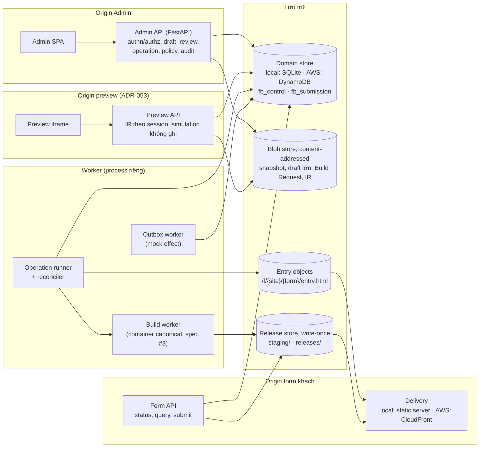
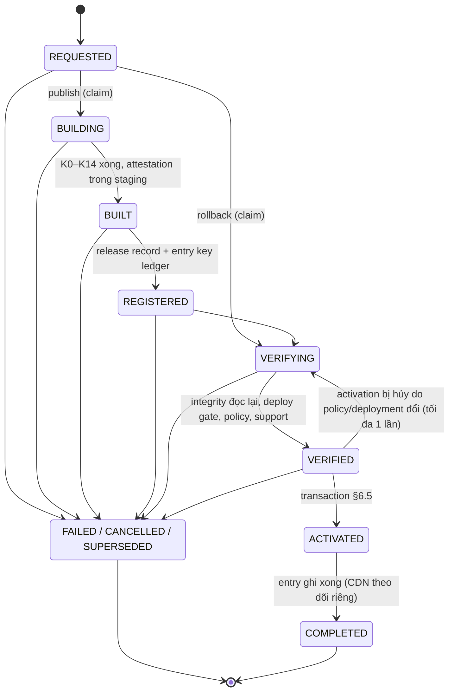
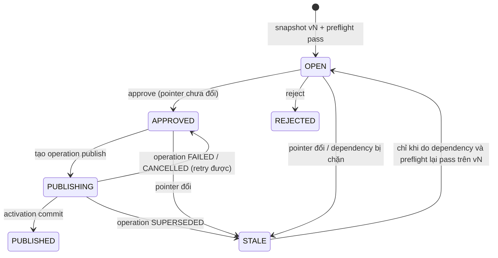
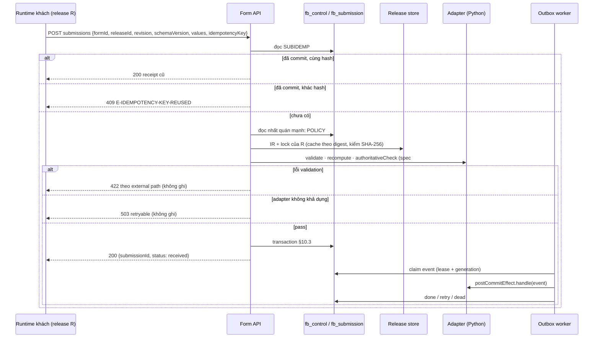

# Spec #5: API, Persistence & Publishing (Architecture Proposal)

> **Trạng thái: PROPOSAL, revision 1** (2026-10-24). Chưa được user review. Đã qua consistency review độc lập và sửa (§22: 1 BLOCKER, 10 MAJOR, các MINOR).
> - Hướng đi đã duyệt: ADR-054 (yêu cầu publication/rollback), ADR-055 (phương án A: Operation Record + Reconciler + Transactional Store). Cơ chế trong tài liệu này **PROPOSED**.
> - **G1 NOT APPROVED.** G9, G10 BLOCKED. Không có code. Mọi nội dung về AWS là **thiết kế đích sau G10**, không phải thao tác đã làm; mặc định là demo local.
> - Nguồn: [notes](../../discovery/P01_BRAINSTORM_NOTES.md) (Spec #5 Answer #1, quyết định phương án A); [DECISIONS.md](../../DECISIONS.md); [spec #1 rev 3.4](2026-10-23-form-schema-workflow-design.md) §6.4, §8.6, §9, §13, §16; [spec #2 rev 2.8](2026-10-24-plugin-contracts-capability-registry-design.md) §10, §13.3, §15, §16; [spec #3 rev 2.3](2026-10-24-compiler-bundle-release-design.md) §4, §5.1, §11.6, §14, §16; [spec #4 rev 2.2](2026-10-24-admin-form-builder-design.md) §14, §15, §17, §21 (I4-13, I4-17); master API-01..10.
> - Kịch bản PC Rev 7 → Rev 8 → rollback trong tài liệu là **kịch bản tổng hợp (SYNTHETIC)**, không phải sự cố có thật.
>
> Phạm vi: subsystem spec số 5 trên 6 — backend authoritative: lưu trữ, review, publication, rollback, phân phối, submit, outbox, policy. Không gồm: compiler (spec #3), UX của Admin (spec #4), Motion (spec #6).

## 0. Cách đọc trạng thái

| Nhãn | Ý nghĩa |
|---|---|
| **APPROVED …** | User duyệt hướng đi |
| **PROPOSED** | Claude đề xuất, chờ review |
| **OPEN** | Chờ user quyết (§17) |
| *[Claude]* | Lựa chọn nhỏ để tài liệu đủ cụ thể |

| ADR | Nội dung | Trạng thái |
|---|---|---|
| ADR-008 | Người sửa ≠ người publish | ACCEPTED |
| ADR-012 | Không PII bền vững trong browser | ACCEPTED |
| ADR-017 | Một ngữ nghĩa, hai runtime (TS/Python), conformance | APPROVED AS DESIGN DIRECTION |
| ADR-029 | Adapter theo version, supported set, deploy gate | APPROVED |
| ADR-032, ADR-035 | Governance plugin, runtime override | APPROVED |
| ADR-034 | Effect chỉ sau commit, qua outbox | APPROVED |
| ADR-036..040 | Release tự chứa, session pin release, CSR, reproducible build, code splitting | APPROVED AS DESIGN DIRECTION |
| ADR-050, ADR-052 | Review trên snapshot bất biến; optimistic concurrency | APPROVED |
| ADR-053 | Preview cô lập trên origin riêng | APPROVED |
| ADR-054 | Yêu cầu publication/rollback | APPROVED AS DESIGN REQUIREMENTS |
| ADR-055 | Phương án A + storage baseline | APPROVED AS DESIGN DIRECTION |
| §4–§16 | Cơ chế | **PROPOSED** |
| OD5-01..OD5-05 | §17 | **OPEN** |

---

## 1. Mục đích

Spec #1–#4 định nghĩa form, plugin, compiler và Admin. Spec #5 là phần **giữ sự thật**: draft nào là bản mới nhất, snapshot nào đã được duyệt, release nào đang active, release nào khách còn được gửi, submission nào đã nhận, effect nào đã chạy. Mọi quyết định đó phải đúng khi có hai người thao tác cùng lúc, khi worker chết giữa chừng, khi mạng timeout mà không biết kết quả, và khi CDN chậm.

Thiết kế xoay quanh một vertical slice nhỏ chạy được sau G1:

```
Business Editor → lưu draft → server preflight → snapshot review bất biến → approve
→ Build Request → compile/verify → đăng ký release → stage + verify artifact → activation
→ form khách → submit authoritative → mock effect → rollback
```

## 2. Goals, non-goals, anti-goals

**Goals**
- G5-1: Một miền giao dịch logic cho mọi trạng thái authoritative; không cần distributed transaction (ADR-055).
- G5-2: Activation chỉ xảy ra sau mọi gate; không bao giờ có pointer trỏ tới artifact chưa sẵn sàng.
- G5-3: Không lost update giữa publish, rollback và sửa draft.
- G5-4: Mọi operation tiếp tục được hoặc kết thúc rõ ràng sau crash, timeout, unknown outcome.
- G5-5: Admin chỉ báo thành công khi đúng tầng đó đã thành công; tách DB committed / entry / CDN / session.
- G5-6: Submission được kiểm theo release tin cậy của chính nó, ghi nguyên tử cùng outbox, idempotent.
- G5-7: Cùng domain contract chạy trên SQLite (local) và DynamoDB (AWS), chứng minh bằng contract test.
- G5-8: Audit trả lời được "ai, cái gì, khi nào, kết quả" mà không chứa PII.

**Non-goals (P0):** canary, progressive rollout, auto rollback theo metric, phân loại sự cố tự động (P1, ADR-054); multi-region; Step Functions; generic database framework; collaboration real-time; webhook/email thật; file upload; analytics.

**Anti-goals**
- Báo 公開しました khi mới commit DB; báo khách mới đã nhận release khi chưa quan sát được.
- Dùng `releaseId`, snapshot hay revision do client gửi làm bằng chứng authorization.
- Hứa atomicity giữa DynamoDB, S3 và CloudFront.
- Activation từ một operation cũ sau khi đã có publish/rollback mới hơn.
- Ghi đè artifact bất biến; rebuild release cũ để rollback.
- Tự rollback backend; tự migrate session của khách.
- Hứa exactly-once với hệ thống bên ngoài.
- Log PII hoặc payload form.

## 3. Ràng buộc

- Không code trước G1. Không ghi AWS trước G10 (ADR-006). Dữ liệu giả, cửa hàng hư cấu, không gọi API thật.
- Backend Python (master API-01). Framework HTTP: FastAPI *[Claude]*, chạy như process thường ở local; adapter Lambda chỉ là phương án sau G10.
- Store: SQLite (local) / DynamoDB (AWS); blob: filesystem (local) / S3 (AWS); phân phối: static server (local) / CloudFront (AWS) (ADR-055).
- Build worker tách khỏi request (master API-06); build chạy trong container canonical của spec #3.
- Giới hạn DynamoDB phải được tôn trọng ngay cả ở local: item ≤ 400 KB; transaction ≤ 100 action, ≤ 4 MB.

---

## 4. Kiến trúc tổng thể



| Thành phần | Trách nhiệm | Không làm |
|---|---|---|
| Admin API | xác thực, phân quyền theo site, draft, preflight, preview session, review, tạo operation, policy override, audit | build; ghi artifact; đổi pointer trực tiếp ngoài operation |
| Preview API | phục vụ IR server sinh và Submission Simulation cho một preview session | ghi submission; gọi hệ thống ngoài; nhận credential Admin |
| Form API | status release cho bootstrap; query `dataSource`; submit | tin `releaseId`/revision của client; đọc pointer để chọn release cho submit |
| Operation runner | chạy state machine publication/rollback (§6), claim có lease + fencing | quyết định nghiệp vụ thay người |
| Reconciler | tìm operation treo, entry lệch pointer, outbox treo; đẩy tiếp hoặc kết thúc | sửa artifact; tự rollback |
| Build worker | chạy spec #3 mode `release` / `preflight` trên Build Request | đọc "mới nhất"; gọi mạng ngoài store |
| Outbox worker | xử lý event mock effect, retry, dead-letter | gửi ra hệ thống thật |

**Process P0 local** *[Claude]*: ba process API (Admin, Preview, Form — ba origin/cổng) dùng chung package domain; một process worker chạy runner, reconciler, outbox; build chạy bằng `docker run` image canonical. **AWS sau G10** (chỉ là ánh xạ đề xuất): API trên Lambda + API Gateway (hoặc container), build trên CodeBuild, runner/reconciler/outbox theo lịch (EventBridge Scheduler) hoặc container nhỏ; quyết ở G10.

---

## 5. Persistence

### 5.1. Aggregate và vị trí lưu

| Aggregate | Mutable? | Nội dung chính | Lưu ở đâu | Kích thước |
|---|---|---|---|---|
| Site, Membership | có | site, người dùng, vai trò theo site | `fb_control` | nhỏ |
| Form | có (`version`) | `siteId`, tên, `revisionCounter`, `draftId` | `fb_control` | nhỏ |
| Draft head | có (`draftVersion`) | `PayloadRef` của definition, `savedBy/At`, `baseReleaseId` | `fb_control` + blob nếu lớn | ref ≤ 1 KB; nội dung ≤ 2 MB |
| Key ledger | chỉ thêm, bất biến | entry `(key, releaseId) → identity`; key được giữ khi entry thuộc release **đã từng active** (§6.4 R4) | `fb_control`, mỗi entry một item | nhỏ |
| Review snapshot | **bất biến** | `snapshotVersion`, `PayloadRef` (luôn blob), digest, block revision đã pin | `fb_control` (metadata) + blob | ref nhỏ |
| ReviewRequest | có (`version`) | trạng thái, snapshot, `basePointerVersion`, `dependencyDigest`, preflight ref, người gửi/duyệt | `fb_control` | nhỏ |
| Release record | trạng thái có (`version`); identity bất biến | `releaseId`, form, revision, snapshot digest, `lrmDigest`, `artifactSetDigest`, `indexHtmlSha256`, attestation ref, 4 chiều trạng thái (§9.1), `serverHostApi`, backend deployment version | `fb_control` | nhỏ |
| Active pointer | có (`pointerVersion`, `entryVersion`) | `activeReleaseId`, `lastOperationId`; `entryVersion` tăng mỗi khi pointer **hoặc** availability đổi (§6.6) | `fb_control`, một item mỗi form | nhỏ |
| Form availability | có (`version`) | `live` / `degraded` (M4: ngừng nhận submit) / `suspended` (M5: trang bảo trì), lý do, `incidentId` (spec #2 §16.1) | `fb_control`, một item mỗi form | nhỏ |
| Backend deployment | có (`version`) | `deploymentVersion`, `serverHostApi`, adapter inventory hash, kết quả deploy gate | `fb_control`, item `DEPLOYMENT#CURRENT` | nhỏ |
| Preview session | có, TTL | `previewSessionId` (hash), người dùng, form, `mode`, `draftVersion`/`snapshotId`/`catalogSnapshotId`, `expiresAt`, `revoked` | `fb_control` | nhỏ |
| Release stats | đếm (ADD) | số request theo `releaseId` × giờ × kết quả (200/409/410/413/422/423/503) | `fb_control` | nhỏ |
| Operation | có (`generation`) | publish / rollback, state, lease, stage results, lỗi | `fb_control` | ≤ 16 KB *[Claude]* |
| Idempotency (Admin) | chỉ thêm, có TTL | scope + key → request hash, kết quả | `fb_control` | nhỏ |
| Audit event | chỉ thêm | §12 | `fb_control` | ≤ 4 KB |
| Policy override | chỉ thêm + đóng | spec #2 §16.5; `policyVersion` toàn cục | `fb_control` | nhỏ |
| Submission | bất biến sau commit | release, values **mã hóa**, phần `public`, `policyVersionSeen` | `fb_submission` | item ≤ 380 KB (values rõ ≤ 160 KB, `publicValues` ≤ 32 KB) |
| Submission idempotency | chỉ thêm, TTL = retention submission | `(formId, idempotencyKey)` → hash, `submissionId` | `fb_submission` | nhỏ |
| Outbox event | có (`generation`), TTL = retention submission | effect, input đã map (phần `personal` mã hóa), trạng thái, lease, attempts | `fb_submission` | ≤ 64 KB |
| Snapshot/draft lớn, Build Request, preflight result | bất biến | JSON canonical | blob, content-addressed | ≤ 2 MB / 1 MB |
| Artifact release, attestation, provenance | bất biến, write-once | spec #3 §4 | release store | — |
| `entry.html` | có (bản chiếu của pointer) | spec #3 §14.1 | entry objects | nhỏ |

**Hai bảng** *[Claude]*: `fb_control` (control plane) và `fb_submission` (data plane). Tách vì submission có chính sách khác: mã hóa PII, retention, quyền đọc, khối lượng ghi. Transaction của DynamoDB được phép trải hai bảng trong cùng account/region, nên submission vẫn `ConditionCheck` được release record (§10.3).

### 5.2. Key design (DynamoDB; SQLite dùng bảng tương ứng)

`fb_control` — `PK`, `SK` (string):

| Item | PK | SK | GSI |
|---|---|---|---|
| Site | `SITE#{siteId}` | `META` | — |
| Membership | `SITE#{siteId}` | `MEMBER#{userId}` | GSI1 `USER#{userId}` / `SITE#{siteId}` |
| Form | `FORM#{formId}` | `META` | GSI1 `SITE#{siteId}` / `FORM#{formId}` |
| Draft head | `FORM#{formId}` | `DRAFT#{draftId}` | — |
| Key ledger | `FORM#{formId}` | `KEY#{key}#{releaseId}` | — |
| Snapshot | `FORM#{formId}` | `SNAP#{snapshotVersion:08d}` | — |
| ReviewRequest | `FORM#{formId}` | `REVIEW#{reviewId}` | GSI1 `FORM#{formId}#REVIEWS` / `{createdAt}` |
| Active pointer | `FORM#{formId}` | `POINTER` | — |
| Form availability | `FORM#{formId}` | `AVAILABILITY` | — |
| Backend deployment | `DEPLOYMENT#CURRENT` | `META` | — |
| Preview session | `PREVIEW#{sha256(previewSessionId)}` | `META` | TTL `expiresAt` |
| Release stats | `RELSTAT#{releaseId}` | `{yyyymmddhh}` | — |
| Release | `REL#{releaseId}` | `META` | GSI1 `FORM#{formId}#RELEASES` / `{registeredAt}` |
| Operation | `OP#{operationId}` | `META` | GSI1 `FORM#{formId}#OPS` / `{createdAt}`; **GSI2 (sparse)** `OPS#OPEN` / `{leaseUntil}` chỉ khi chưa terminal |
| Idempotency | `IDEMP#{scope}#{key}` | `META` | TTL `expiresAt` |
| Audit | `AUDIT#{formId}` (hoặc `AUDIT#SITE#{siteId}`) | `{at}#{eventId}` | — |
| Policy | `POLICY#{target}` | `{createdAt}#{overrideId}` | — |
| Policy version | `POLICY#STATE` | `META` (`policyVersion`) | — |

`fb_submission`:

| Item | PK | SK | GSI |
|---|---|---|---|
| Submission | `SUB#{submissionId}` | `META` | GSI1 `REL#{releaseId}` / `{submittedAt}` (thống kê, không PII trong key) |
| Submission idempotency | `SUBIDEMP#{formId}#{idempotencyKey}` | `META` | — |
| Outbox event | `EVT#{eventId}` | `META` | **GSI2 (sparse)** `OUTBOX#OPEN` / `{dueAt}` khi `pending` (`dueAt = nextAttemptAt`) **hoặc** `inflight` (`dueAt = lease.until`); bỏ thuộc tính GSI khi `done`/`dead`/`blocked`/`discarded`. P0 một partition; chia shard khi cần (P1) |

- GSI chỉ dùng để **tìm việc**, luôn eventually consistent. Mọi claim và chuyển trạng thái là **conditional update trên item gốc**, đọc nhất quán mạnh.
- **Hot item:** hai transaction DynamoDB chạm cùng một item (kể cả ConditionCheck) sẽ xung đột (`TransactionConflict`). Vì vậy transaction có tần suất cao (submit) **không** chạm item dùng chung (`POLICY#STATE`, `REL#…`, `FORM#…/AVAILABILITY`); chỉ các thao tác hiếm (activation, approve, override) mới ConditionCheck chúng (§10.3). Xung đột còn lại được ánh xạ thành `Conflict` có thể retry với jitter (CT-17).
- ID: tiền tố + ULID (spec #4 §8.2). Không đưa PII vào key hay tên thuộc tính.
- SQLite: một bảng mỗi loại item, khóa chính tương ứng `PK/SK`, ràng buộc `UNIQUE`; WAL; transaction `BEGIN IMMEDIATE`.

### 5.3. Payload lớn: `PayloadRef` và content hash

```
PayloadRef = { inline?: <canonical JSON>, blobKey?: "sha256/<hex>", sha256: "<hex>", size: <bytes>, format: "jcs-json" }
```

- Canonical hóa bằng JCS (như spec #3), tính SHA-256 trên đúng byte đó.
- **Ngưỡng inline** *[Claude]*: ≤ 256 KB thì inline trong item (còn chỗ cho thuộc tính, dưới 400 KB); lớn hơn thì blob. **Snapshot luôn là blob**, vì Build Request tham chiếu nó bằng digest (spec #3 §5.1 `definitionSnapshot`).
- **Trần cứng P0:** definition ≤ 2 MB → vượt thì `413 DEFINITION_TOO_LARGE`, không lưu.
- **Ghi (không distributed transaction):**
  1. Ghi blob tại key `sha256/<hex>` **có điều kiện không tồn tại** (S3 `If-None-Match: *`; local: tạo file độc quyền). Đã tồn tại → đọc lại, so hash; trùng thì là no-op (idempotent).
  2. Ghi item DB có điều kiện (ví dụ `draftVersion = :base`), lưu `PayloadRef`.
  3. Bước 2 thất bại → blob mồ côi, vô hại (content-addressed, không ai tham chiếu); dọn bằng job GC theo mark-and-sweep (P0: chỉ báo cáo; xóa ở P1).
- **Đọc:** tải blob, tính lại SHA-256, so với `PayloadRef.sha256`; lệch → `E-PAYLOAD-INTEGRITY`, fail closed, audit. Truyền lên S3 kèm checksum SHA-256 của request để phát hiện lỗi đường truyền.
- Blob store là private; không có URL công khai.

### 5.4. Transaction grouping

| Thao tác | Một transaction gồm | Số action | Bên ngoài transaction (trước) |
|---|---|---|---|
| Lưu draft | Update draft head (`draftVersion = :base`) | 1 | blob nếu lớn; kiểm key ledger (đọc nhất quán) |
| Tạo review | Put snapshot (`not exists`) · Put ReviewRequest · ConditionCheck draft head (`draftVersion = :requested`) · Update form (`reviewCounter`) · Put idempotency · Put audit | 6 | blob snapshot; preflight server cho đúng digest |
| Approve / reject | Update ReviewRequest (`version = :v`, `state = OPEN`, người duyệt ≠ người gửi) · ConditionCheck pointer (`pointerVersion = :basePointerVersion`) · ConditionCheck `POLICY#STATE` (`policyVersion = review.preflightPolicyVersion`; khác → `409 REVIEW_RECHECK_REQUIRED`, chạy lại preflight) · Put audit | 4 | — |
| Tạo operation publish | Put operation (`not exists`) · Put idempotency · Update ReviewRequest (`APPROVED → PUBLISHING`) · ConditionCheck pointer (`pointerVersion = :basePointerVersion`, sai → `409 REVIEW_STALE`) · Update form (`revisionCounter`, chỉ khi review chưa có revision) · Put audit | 6 | — |
| Đăng ký release | **Put release chỉ với `attribute_not_exists`**; nếu đã tồn tại (retry cùng review → cùng `releaseId`): **chỉ** ConditionCheck bộ identity (`lrmDigest`, `indexHtmlSha256`, `artifactSetDigest`, `formId`), **không bao giờ ghi đè** trạng thái (suspended/quarantined/retired giữ nguyên) · Update operation (fencing) · Put audit | 3 | ghi entry key ledger `KEY#{key}#{releaseId}` (Put `attribute_not_exists`, bất biến; §6.4 R4) |
| Đánh dấu `verified` | Update release (`state = registered`, `version = :v`) · Update operation (`generation = :g`, `VERIFYING → VERIFIED`, ghi `policyVersionChecked`, `deploymentVersionChecked`) | 2 | integrity gate, deploy gate, policy |
| **Activation** | §6.5 | 8 | — |
| Kết thúc operation không thành công | Update operation (→ `FAILED`/`CANCELLED`/`SUPERSEDED`, fencing) · Update ReviewRequest (`PUBLISHING → APPROVED`, hoặc `STALE` khi SUPERSEDED) · Put audit | 3 | — |
| Submit | §10.3 | 2 + số effect (≤ 10) | đọc policy, availability, release (§10.3) |
| Policy override; suspend/resume/retire release; đổi availability | Put/Update đối tượng · Update `POLICY#STATE` (`policyVersion + 1`) · (availability: Update `POINTER.entryVersion + 1`) · Put audit | 3–4 | — |

Không transaction nào chạm giới hạn 100 action / 4 MB; số effect mỗi form giới hạn ≤ 10 ở P0 *[Claude]*.

## 6. Publication và rollback

### 6.1. Operation

```
Operation = {
  operationId, type: publish | rollback, formId, siteId,
  state, generation, lease: { owner, until },
  idempotencyKey, requestedBy, requestedAt,
  expectedPointerVersion,              // pointer mà người yêu cầu đã thấy (§6.3)
  reviewId?, snapshotDigest?, revision?, buildRequestDigest?,   // publish
  targetReleaseId?, reason?,                                     // rollback (releaseId của publish được điền khi đăng ký)
  policyVersionChecked?, stages: [{ name, status, attempts, startedAt, endedAt, code? }],
  activation?: { pointerVersion, at },
  delivery: { entry: pending | written | failed, cdn: n/a | pending | invalidated | confirmed | timeout, observedReleaseId?, checkedAt? },
  outcome?: { code, retryable, message }
}
```

### 6.2. State machine



- Mọi trạng thái trước ACTIVATED có thể kết thúc bằng **FAILED** (lỗi), **CANCELLED** (người yêu cầu hủy) hoặc **SUPERSEDED** (pointer đã khác `expectedPointerVersion`, kiểm ở đầu mỗi stage và trong transaction activation). Việc kết thúc và cập nhật review đi cùng một transaction (§5.4).
- **ACTIVATED** không bao giờ quay về FAILED: pointer đã đổi. Từ đó chỉ có COMPLETED; lỗi ghi entry/CDN được reconciler xử lý tiếp (§6.6, §6.7).

| Stage | Việc | Side effect ngoài DB | Idempotent nhờ |
|---|---|---|---|
| BUILDING | tạo Build Request (spec #3 §5.1) từ snapshot đã approve, lưu blob theo digest; chạy build worker mode `release` (K0–K14, hai lần chạy sạch) | ghi `staging/{buildRequestDigest}/…` write-once | key theo digest; staging đã có cùng attestation → dùng lại |
| BUILT | đọc attestation trong staging | — | — |
| REGISTERED | đọc từng file staging, kiểm SHA-256, ghi `releases/{releaseId}/…` bằng `PutObject` có `If-None-Match: *` (không dùng CopyObject có điều kiện — chưa xác minh, VG-11); đã tồn tại → so hash; ghi entry key ledger; đăng ký release (§5.4) | ghi release store | content-addressed; `E-RELEASE-ID-COLLISION` nếu khác identity (spec #3 §11.6) |
| VERIFYING | integrity gate **đọc lại từ storage** (mọi file trong inventory, `index.html` theo attestation, không file thừa, tính lại `releaseId`); deploy gate / adapter precheck của release với `DEPLOYMENT#CURRENT` (spec #2 §10.4); trạng thái hiệu lực của plugin theo ledger + override **hiện tại** (M2); support/security/retention của release; kiểm key ledger (§6.4 R4); release → `verified` cùng transaction với operation (§5.4) | đọc | thuần đọc |
| ACTIVATED | §6.5 | — | điều kiện trong transaction |
| COMPLETED | sinh `entry.html` từ pointer + availability + khối `load` của release; ghi entry có điều kiện theo `entryVersion` (§6.6) | ghi entry | theo `entryVersion` |
| (sau COMPLETED) | invalidation CDN + probe (§6.6), theo dõi trong `delivery.cdn` | CDN | `CallerReference = {formId}:{entryVersion}:{attempt}` |

- **Rollback** bỏ qua BUILDING/BUILT/REGISTERED. Release đích phải: thuộc đúng form; **đã từng active** (`activatedAt` có giá trị — release của operation bị SUPERSEDED hay review STALE không bao giờ là đích hợp lệ, ADR-050); khác release đang active; `security = normal`; retention `served`; `support = supported`; plugin không bị chặn bởi M2; adapter có trong deployment hiện tại. Không rebuild, không sửa artifact.
- **Ngoài P0** *[Claude]*: rollback tới release `retired` (cần platform-admin `reinstate` có audit trước, không phải Publisher) và tới release `archived` (cần khôi phục + integrity gate lại). P0 liệt kê chúng trong `rollback-candidates` với lý do không đủ điều kiện.
- **CANCELLED** chỉ trước ACTIVATED. Sau ACTIVATED muốn quay lại thì làm rollback mới.
- **Revision**: gán khi tạo operation publish cho review chưa có revision (`revisionCounter + 1`), lưu vào review; retry hoặc publish lại cùng review dùng **cùng** revision (Build Request giống hệt → cùng `releaseId`). Review bị bỏ sau khi đã có revision tạo ra khoảng trống số revision; lịch sử ghi rõ 「r8（公開されていません）」.

### 6.3. Expected pointer version và chống lost update

- **Publish:** `expectedPointerVersion = review.basePointerVersion` — pointer lúc Editor gửi review (ADR-050). Nếu active đã đổi kể từ đó, review là stale và activation **phải** thất bại. Một cơ chế phục vụ cả stale-review lẫn lost update.
- **Rollback:** `expectedPointerVersion` = pointer mà Publisher thấy trên màn hình rollback (client gửi kèm; server chỉ dùng nó làm **điều kiện**, không làm bằng chứng quyền).
- Không có khóa độc quyền theo form *[Claude]*: rollback khẩn cấp không bao giờ phải chờ một build dài. Hai operation song song → operation nào activation trước thắng; operation còn lại bị **SUPERSEDED** ở lần kiểm pointer tiếp theo (đầu mỗi stage và trong transaction activation). Build đang chạy của operation thua bị bỏ; artifact staging còn lại vô hại.
- Cùng một review không thể có hai operation publish: transaction tạo operation đổi review `APPROVED → PUBLISHING` có điều kiện.

### 6.4. Claim, lease, fencing

- **Claim:** `UpdateItem OP#id SET lease.owner = :me, lease.until = :now + L, generation = generation + 1 WHERE state ∉ terminal AND (lease.until < :now OR attribute_not_exists(lease.owner))`. Trả về `generation` mới = **fencing token**.
- Mọi ghi sau đó của worker vào operation (và vào release record khi đăng ký/verify) có điều kiện `generation = :g AND lease.owner = :me`. Worker bị treo rồi tỉnh lại sẽ bị từ chối ở lần ghi kế tiếp.
- **Lease** *[Claude]*: `L = 5 phút`, heartbeat mỗi 60 giây (gia hạn có điều kiện cùng `generation`). Build dài hơn `L` vẫn an toàn nhờ heartbeat; worker chết → lease hết → reconciler claim lại với `generation + 1`.
- **Đồng hồ:** DynamoDB không có thời gian phía server; lease dùng đồng hồ worker. Yêu cầu đồng bộ giờ (NTP), lệch tối đa *[Claude: 30 giây]* ≪ `L`; worker phát hiện lệch lớn hơn thì không claim. Lệch giờ chỉ làm claim sớm/muộn; **fencing** bảo đảm worker cũ không ghi được, và side effect bên ngoài của worker cũ đều vô hại (R1–R5 dưới).
- **Side effect bên ngoài phải idempotent hoặc có điều kiện:**
  - R1 staging: key theo `buildRequestDigest`, write-once.
  - R2 release store: key theo `releaseId` (content-addressed), write-once; tồn tại thì so hash.
  - R3 entry: ghi có điều kiện theo `entryVersion` (§6.6), không bao giờ ghi đè bản mới hơn.
  - R4 key ledger: entry `KEY#{key}#{releaseId}` ghi bằng `PutItem attribute_not_exists` (bất biến; ghi lại là no-op). Một key được coi là **đã giữ** cho identity X khi có entry của X thuộc release có `activatedAt` (spec #1 §6.4: chỉ bản đã publish mới giữ key). Activation đặt `activatedAt` trong transaction §6.5, nên mọi entry của release được xác nhận **nguyên tử**, không cần ghi hàng trăm item trong transaction. VERIFYING kiểm: không key nào của release có entry thuộc release đã active với identity khác → nếu có, `E-KEY-COLLISION`, FAILED.
  - R4b ghi `verified` và mọi chuyển trạng thái của release record do worker thực hiện đều nằm trong transaction có điều kiện `generation` của operation (§5.4).
  - R5 CDN invalidation: `CallerReference` tất định → CloudFront trả lại invalidation cũ thay vì tạo mới.
  - R6 S3: write-once chỉ đúng với writer tuân thủ; sau G10 thêm IAM chỉ cho worker ghi prefix `releases/` và Object Lock (governance) cho prefix đó. Xử lý `412 Precondition Failed` (đã tồn tại → đọc, so hash) và `409 ConditionalRequestConflict` (ghi đồng thời → retry rồi so hash).

**Retryable vs terminal** *[Claude]*:

| Lỗi | Phân loại | Xử lý |
|---|---|---|
| Lỗi phân tích/compile (`E-*` của K1–K12), `E-BUILD-NON-REPRODUCIBLE`, `E-TOOLCHAIN-MISMATCH` | terminal | FAILED; báo Editor/Platform |
| `E-ARTIFACT-HASH-MISMATCH`, `E-ARTIFACT-UNEXPECTED-FILE`, `E-RELEASE-ID-COLLISION`, `E-PAYLOAD-INTEGRITY` | terminal + **sự cố bảo mật** | FAILED; staging của operation đánh dấu quarantine; audit + cảnh báo |
| Deploy gate / adapter precheck fail | terminal cho operation này | FAILED; cần Platform deploy backend phù hợp rồi tạo operation mới |
| Plugin bị chặn (M2), release `suspended`/`quarantined` | terminal | FAILED với lý do policy |
| Pointer đã đổi | terminal | SUPERSEDED |
| Throttling, timeout store/blob, container build lỗi hạ tầng, worker chết | retryable | backoff lũy thừa có jitter, tối đa `N = 5` lần mỗi stage; quá → FAILED (`retryable: true`), Publisher có thể bấm 再試行 (operation mới, cùng review) |
| **Unknown outcome** (timeout sau khi gửi transaction) | — | §6.7 |

### 6.5. Transaction activation

Điều kiện tiên quyết đã kiểm ở VERIFYING; transaction **kiểm lại** những gì có thể đổi giữa chừng. Ví dụ PC (synthetic): publish r8 thay r7. Yêu cầu: release đích ≠ release đang active (API từ chối trước: `409 NO_CHANGE`), nên không có hai action trên cùng một item.

Trước khi gửi, runner ghi vào operation (có điều kiện `generation`) các tham số tất định: `activationEventId = {operationId}:activated`, `activationAt`. Lần gửi lại dùng **đúng** các tham số này (nếu khác, DynamoDB trả `IdempotentParameterMismatch`).

DynamoDB `TransactWriteItems` (`ClientRequestToken = {operationId}:activate:{generation}`):

| # | Action | Item | Điều kiện / cập nhật |
|---|---|---|---|
| 1 | Update | `FORM#frm_pc_demo` / `POINTER` | **điều kiện** `pointerVersion = :expected (41)` (lần publish đầu: `attribute_not_exists(pointerVersion)`) → `activeReleaseId = rel_r8…`, `pointerVersion = 42`, `entryVersion + 1`, `lastOperationId`, `updatedAt` |
| 2 | Update | `REL#rel_r8…` / `META` (release đích) | **điều kiện** `formId = :form AND state = verified AND security = normal AND support = supported AND retention = served AND version = :v` → `activation = active`, `activatedAt = if_not_exists(activatedAt, :at)`, `lastActivatedAt = :at`, **REMOVE** `deactivatedAt`, `supportEndsAt`, `version + 1` |
| 3 | Update | `OP#op_…` / `META` | **điều kiện** `state = VERIFIED AND generation = :g AND lease.owner = :me` → `state = ACTIVATED`, `activation = { pointerVersion: 42, at }` |
| 4 | Update | `FORM#frm_pc_demo` / `REVIEW#rvw_…` (chỉ publish) | **điều kiện** `state = PUBLISHING AND snapshotDigest = :digest` → `state = PUBLISHED`, `publishedReleaseId` |
| 5 | ConditionCheck | `POLICY#STATE` / `META` | `policyVersion = :checked` (không override/suspend mới kể từ VERIFYING) |
| 6 | ConditionCheck | `DEPLOYMENT#CURRENT` / `META` | `deploymentVersion = :checked` (backend không đổi kể từ deploy gate/adapter precheck) |
| 7 | Put | `AUDIT#frm_pc_demo` / `{activationAt}#{activationEventId}` | `attribute_not_exists(PK)`; `{ action: release.activated, from: rel_r7…, to: rel_r8…, pointerVersion: 42, operationId, actor }` |
| 8 | Update | `REL#rel_r7…` / `META` (release vừa rời active; bỏ qua ở lần publish đầu) | **điều kiện** `attribute_exists(PK) AND activation = active AND formId = :form` → `activation = inactive`, `deactivatedAt = :at`, `supportEndsAt = :at + max(G, T_edge_max)`, `version + 1` |

SQLite (cùng contract): `BEGIN IMMEDIATE`; `UPDATE pointer … WHERE pointer_version = ?` (kiểm `changes() = 1`); `UPDATE release … WHERE` các điều kiện của action 2; `UPDATE operation … WHERE generation = ? AND lease_owner = ? AND state = 'VERIFIED'`; `UPDATE review …`; `SELECT` policy/deployment version và so; `INSERT audit`; `UPDATE` release cũ; mỗi lệnh kiểm `changes() = 1`; `COMMIT`. Sai bất kỳ → `ROLLBACK`.

**Hủy transaction** (`TransactionCanceledException` với lý do từng action / `ROLLBACK`): đọc lại — pointer khác → SUPERSEDED; release đích đổi trạng thái → FAILED với lý do; policy/deployment đổi → quay lại VERIFYING (một lần) rồi FAILED nếu vẫn chặn; generation khác → worker dừng. `TransactionConflictException` / `TransactionInProgressException` → retry cùng tham số với backoff + jitter.

**Không** có bước nào ở đây làm entry hay CDN đổi cùng lúc. Commit chỉ có nghĩa: **nguồn sự thật đã đổi**.

### 6.6. Sau activation: entry, CDN, khách thật

| Tầng | Ý nghĩa | Ai bảo đảm | Trạng thái API | Wording (Admin) |
|---|---|---|---|---|
| T1 DB committed | pointer = r8; backend coi r8 là active | transaction §6.5 | `activation.committed = true` | 「公開を確定しました（r8）。配信の切り替えを反映しています。」 |
| T2 Entry ghi xong | `entry.html` ở origin mang `activeReleaseId = r8`, `pointerVersion = 42` | runner; reconciler | `delivery.entry = written` | 「配信設定を r8 に更新しました。」 |
| T3 CDN | invalidation đã tạo/hoàn tất; probe qua CDN thấy r8 | runner; reconciler | `delivery.cdn = invalidated → confirmed` hoặc `timeout` | 「確認した配信経路で r8 が表示されています（確認時刻 hh:mm）。」 / 「一部の配信経路で切り替えを確認できていません。」 |
| T4 Khách mới | mỗi edge, mỗi trình duyệt tự nhận entry mới khi cache hết hạn | không ai bảo đảm tuyệt đối; giới hạn trên `T_edge_max` (spec #3 §16.2) | — | 「新しく開始するお客様は、通常 T_edge_max 以内に r8 になります。」 |
| Session cũ | khách đang điền r7 tiếp tục r7 (ADR-037) | release r7 vẫn `supported` tới `supportEndsAt` | `previousRelease.supportEndsAt` | 「入力中のお客様は r7 のまま続行できます（サポート期限: …）。」 |

- **Ghi entry có điều kiện:** entry object mang metadata `entryVersion`. Writer đọc ETag + `entryVersion` hiện tại; chỉ ghi khi bản mới có `entryVersion` lớn hơn, với `If-Match: <etag>` (local: file tạm + rename có khóa). Hai writer (runner, reconciler) không bao giờ ghi lùi. Nội dung entry: availability `suspended` (M5) → trang bảo trì tĩnh 「現在メンテナンス中です」, không bootstrap; ngược lại → shell + khối `active` + `bootstrap.js` của active release (spec #3 §14.1).
- **`bootstrap.js`** và các platform asset (`/_platform/bootstrap.<hash>.js`) được trusted pipeline phát hành vào release store (spec #3 §14.1), phục vụ bất biến từ cùng origin phân phối; giữ ít nhất bằng release còn tham chiếu.
- **CDN (sau G10):** HTML entry `no-cache` + ETag ở browser, TTL ngắn ở edge + invalidation đường dẫn `/f/{site}/{form}/*` (master API-08). Probe: `GET` stable entry qua CDN, đọc `active.releaseId`, thử lại đến `T_confirm` *[Claude: 10 phút]*; quá hạn → `delivery.cdn = timeout`, cảnh báo, reconciler thử invalidation lại với `CallerReference` có `attempt` mới. Local và mọi môi trường trước G10: không có CDN → `cdn = n/a`; probe chỉ được xây ở P0 cho môi trường AWS (sau G10). `T_edge_max` phụ thuộc cấu hình CDN thật → **OPEN, chốt ở G10** (VG-10).
- **Operation COMPLETED** khi T2 xong. T3 được theo dõi riêng; `cdn = timeout` không làm operation thất bại (pointer đã đổi), nhưng hiện rõ là chưa xác nhận.
- **Không bao giờ** hiện "完了" cho T4.

### 6.7. Unknown outcome và reconciler

- **Unknown outcome** (gửi transaction rồi timeout/mất kết nối): đọc nhất quán mạnh `OP` và `POINTER`.
  - `OP.state = ACTIVATED` với `generation` của mình, hoặc `POINTER.lastOperationId = operationId` → đã thành công, tiếp tục T2.
  - Không → gửi lại **cùng** transaction, cùng `ClientRequestToken` và **cùng tham số** đã lưu (DynamoDB coi là idempotent trong 10 phút); quá 10 phút thì điều kiện của transaction (state, generation, pointerVersion) vẫn ngăn áp hai lần.
  - Client Admin timeout khi tạo operation → gửi lại cùng `Idempotency-Key` → nhận lại `operationId` cũ và trạng thái thật.
- **Reconciler** (P0 mỗi 30 giây *[Claude]*):
  1. Operation chưa terminal có lease hết hạn → claim lại (`generation + 1`), tiếp tục từ stage đã ghi.
  2. Operation ở trạng thái **trước ACTIVATED** quá tuổi tối đa *[Claude: 2 giờ]* → FAILED (`OPERATION_TIMEOUT`) bằng transaction kết thúc (§5.4), cảnh báo. Operation ở ACTIVATED chưa COMPLETED quá lâu → **chỉ cảnh báo**, tiếp tục ghi entry; không bao giờ đánh FAILED.
  3. Mỗi form: `entry.entryVersion < POINTER.entryVersion` → ghi lại entry; đang `cdn = pending/timeout` → invalidation + probe.
  4. Outbox event `inflight` có lease hết hạn (tìm qua `OUTBOX#OPEN` theo `dueAt`) → claim lại được trực tiếp (§10.5).
  5. Release vừa rời active quá `supportEndsAt` → **không** tự retire; báo cáo để Platform retire tường minh (spec #2 §10.3).
  6. Báo cáo override chưa có ledger entry (spec #2 §16.5).
- Mỗi lần reconciler hành động: audit `reconciler.*` (không PII).

---

## 7. API boundaries

### 7.1. Ba origin, ba API

| API | Origin | Người gọi | Xác thực |
|---|---|---|---|
| Admin API `/api/admin/…` | Admin | Admin SPA | phiên Admin (OD5-01), cookie `__Host-` `Secure; HttpOnly; SameSite=Strict`; request thay đổi trạng thái phải có CSRF token synchronizer trong header, `Origin` khớp chính xác, `Sec-Fetch-Site: same-origin` (spec #4 §14.7: cookie không phân biệt được origin cùng site); `Cross-Origin-Resource-Policy: same-origin` |
| Preview API `/api/preview/…` | preview (ADR-053), **site khác** Admin | iframe preview | header `X-Preview-Session` (bearer capability hẹp, spec #4 §14.7; không bao giờ trong URL; redact trong log); không cookie Admin |
| Form API `/api/forms/…` | phân phối form khách | runtime của khách | không đăng nhập; giới hạn tần suất; quyền suy ra từ release tin cậy |

CORS: mỗi API chỉ cho đúng origin của mình; không bao giờ `*` hay `null`.

### 7.2. Admin API (P0)

| Method + path | Quyền | Mục đích | Concurrency / idempotency |
|---|---|---|---|
| `GET /sites`, `GET /sites/{siteId}/forms` | thành viên site | danh sách | — |
| `POST /sites/{siteId}/forms` | editor | tạo form (starter/clone/trống) | `Idempotency-Key` |
| `GET /forms/{formId}/draft` | editor+ | envelope `{ draftVersion, document, keyLedger, pinnedBlocks, catalogSnapshotId, ledgerSnapshotId, runtimeOverrideSnapshotId, analyzerVersion }` (spec #4 §14.2) | `ETag: draftVersion` |
| `PUT /forms/{formId}/draft` | editor | lưu `{ draftVersion(base), document, saveSeq }` | điều kiện `draftVersion`; `409 VERSION_CONFLICT { currentDraftVersion }`; `409 KEY_COLLISION { keys }` (spec #4 §8.2); `413 DEFINITION_TOO_LARGE` |
| `POST /forms/{formId}/preflight` | editor+ | spec #3 mode `preflight` trên `draftVersion` | kết quả cache theo `inputIds` |
| `POST /forms/{formId}/preview-sessions` | editor+ (`review`: reviewer+) | `{ mode: partial, catalogSnapshotId }` \| `{ mode: simulation, draftVersion }` \| `{ mode: review, snapshotId }` → `previewSessionId` (spec #4 §14.7) | hết hạn *[Claude: 30 phút]*; thu hồi khi có phiên mới cho cùng người + form, logout, mất membership/vai trò |
| `POST /forms/{formId}/reviews` | editor | tạo snapshot + ReviewRequest `{ draftVersion, dataContractAck, note }` | `Idempotency-Key`; đòi preflight pass cho đúng digest + `policyVersion` hiện tại |
| `GET /forms/{formId}/reviews/{reviewId}` | reviewer+, người gửi | snapshot, diff nghiệp vụ, preflight, stale | — |
| `POST /reviews/{reviewId}/approve` · `/reject` | reviewer, **≠ người gửi** | `{ version, comment }` | điều kiện `version`; `409 REVIEW_STALE` nếu pointer đổi |
| `POST /forms/{formId}/operations` (publish) | publisher | `{ type: publish, reviewId }` | `Idempotency-Key`; `202 { operationId }`; `409 REVIEW_STALE` |
| `POST /forms/{formId}/operations` (rollback) | publisher | `{ type: rollback, targetReleaseId, expectedPointerVersion, reasonCode, note? }` | `Idempotency-Key`; `409 POINTER_CHANGED { current }`; `409 NO_CHANGE` nếu đích đang active; `422 ROLLBACK_TARGET_INELIGIBLE { reasons }` |
| `GET /forms/{formId}/operations/{operationId}` | thành viên site | status contract (§6.1, §6.6) | không cache |
| `POST /operations/{operationId}/cancel` | publisher | hủy trước ACTIVATED | điều kiện state |
| `GET /forms/{formId}/releases` | thành viên site | lịch sử: revision, `releaseId`, 4 chiều trạng thái, ai publish/rollback, số submission theo kết quả | — |
| `GET /forms/{formId}/rollback-candidates` | publisher | release **đã từng active** đủ điều kiện + lý do không đủ của release khác (retired, archived, suspended, adapter thiếu, plugin bị chặn) | — |
| `POST /releases/{releaseId}/retire` | platform-admin | retire tường minh sau `supportEndsAt`; không retire release đang active | điều kiện `version` + `activation = inactive`; `policyVersion + 1` |
| `PUT /forms/{formId}/availability` | platform-security | `{ state: live \| degraded \| suspended, version, incidentId, reasonCode }` (M4/M5, spec #2 §16.2) | điều kiện `version`; `policyVersion + 1`, `entryVersion + 1` |
| `DELETE /preview-sessions/current` | editor+ | thu hồi phiên preview của mình cho form (Admin gọi khi iframe nạp lại, đóng preview) | — |
| `POST /policy/overrides` · `/close` | platform-security | spec #2 §16.5 | `policyVersion + 1` |
| `POST /releases/{releaseId}/suspend` · `/resume` | platform-security | security status của release | audit + incident id; `policyVersion + 1` |
| `GET /audit?formId=…` | site admin, platform | audit | — |
| `GET /support-matrix` | editor+ | backend deployment hiện tại: `serverHostApi`, adapter có mặt (spec #4 §8.3) | — |

- `Idempotency-Key`: ULID/UUID do client sinh; scope = `userId + method + path`; lưu `{ requestHash, response }` *[Claude: 24 giờ]*. Cùng key + cùng hash → trả lại response cũ; khác hash → `409 IDEMPOTENCY_KEY_REUSED`. Với operation, idempotency là **phụ**: bảo đảm chính là trạng thái review và điều kiện pointer.
- Mã lỗi Admin API dùng dạng `UPPER_SNAKE` (`VERSION_CONFLICT`, `KEY_COLLISION`, `REVIEW_STALE`, `REVIEW_RECHECK_REQUIRED`, `POINTER_CHANGED`, `NO_CHANGE`, `ROLLBACK_TARGET_INELIGIBLE`, `OPERATION_SUPERSEDED`, `FORBIDDEN`, `IDEMPOTENCY_KEY_REUSED`, `DEFINITION_TOO_LARGE`, `CONFLICT_RETRY`), tách khỏi diagnostic (`E-`/`W-`, spec #1/#3/#4) và lỗi runtime công khai (`E-RELEASE-*`, spec #3 §16.4).
- Body lỗi: `{ code, retryable, details?, messageKey? }`; Admin hiện chuỗi tiếng Nhật từ catalog (ADR-048).

### 7.3. Preview API (ADR-053)

| Method + path | Mục đích |
|---|---|
| `GET /api/preview/session/ir` | IR do server preflight sinh cho `draftVersion` (`simulation`) hoặc `snapshotId` (`review`) của session; chỉ khi không có `gate: workflow` |
| `POST /api/preview/session/simulate-submit` | evaluator Python chạy submit pipeline trên IR đó + `values` tổng hợp; **không** ghi submission, không outbox; trả 200/422 như thật |
| `GET /api/preview/session/queries/{alias}` | `dataSource` qua adapter đọc dữ liệu hư cấu hoặc `previewFixtures`; quyền kiểm theo capability trong **catalog snapshot của form** (phiên `partial`) hoặc Capability Lock của IR server (`simulation`/`review`), không theo IR client gửi |

Mọi route đọc session từ header `X-Preview-Session`. Session hết hạn/bị thu hồi → `410 PREVIEW_SESSION_EXPIRED`. Preview API không có route ghi nào ngoài log kỹ thuật và endpoint nhận báo cáo vi phạm CSP; không có cấu hình hay đường mạng tới hệ thống production.

### 7.4. Form API (khách)

| Method + path | Mục đích | Cache |
|---|---|---|
| `GET /api/forms/releases/{releaseId}/status` | `{ support, security, availability, resumable, activeReleaseId? }` cho bootstrap (spec #3 §14.2); đọc nhất quán mạnh | `no-store` |
| `GET /api/forms/releases/{releaseId}/queries/{alias}` | `dataSource` (spec #2), kiểm release ∈ `S`, policy | theo capability |
| `POST /api/forms/submissions` | §10 | — |

Mã lỗi: spec #3 §16.4 (409/503/410/423/422/409 idempotency), chốt HTTP ở đây.

### 7.5. Phân quyền

| Vai trò (theo site) | Được làm |
|---|---|
| `editor` | tạo/sửa draft, preflight, preview, gửi review |
| `reviewer` | xem review, approve/reject (không duyệt review của chính mình) |
| `publisher` | publish review đã approve, rollback, hủy operation |
| `site-admin` | quản lý thành viên site, quyền 詳細設定 (spec #4 §10.1), xem audit |
| `platform-admin` (toàn cục) | retire release, cấu hình site policy (effect được phép), deploy |
| `platform-security` (toàn cục) | override plugin, suspend/resume release, form availability (M4/M5) |

- Site của form suy ra từ record của form, không từ request. Mọi route kiểm membership + vai trò ở server.
- **Quyền tối thiểu theo process** *[Claude]*: Admin API đọc/ghi `fb_control`, không đọc `fb_submission` (P0 không có màn xem submission); Preview API chỉ đọc item `PREVIEW#`, release, catalog và blob cần thiết, **không** có quyền gì trên `fb_submission`; Form API ghi `fb_submission`, đọc `fb_control` (release, policy, availability) và ghi `RELSTAT#`; worker theo nhiệm vụ. Ở AWS là IAM role riêng cho từng process (sau G10).
- Một người có thể giữ nhiều vai trò; ràng buộc cứng duy nhất ở P0 là **người duyệt ≠ người gửi review** (ADR-008) *[Claude]*.

---

## 8. Review (ADR-050) — phía server



- Snapshot tạo một lần, content-addressed, không sửa. `basePointerVersion` = pointer lúc tạo review.
- `STALE` do pointer đổi là **cuối cùng** cho review đó (Editor gửi review mới từ draft); do dependency (plugin `vulnerable`/`revoked`, adapter mất khỏi support matrix) thì Reviewer chạy lại preflight trên vN.
- Phát hiện stale: khi đọc review, khi approve (ConditionCheck pointer), khi tạo operation (ConditionCheck pointer), và ở activation (CAS). Không có job nền bắt buộc; reconciler có thể đánh dấu sớm cho UI.
- Approve còn đòi `policyVersion` hiện tại bằng `policyVersion` của preflight trên vN; khác → `409 REVIEW_RECHECK_REQUIRED`, Reviewer bấm 再確認 để chạy lại preflight trên vN (không đổi snapshot).

## 9. Security, compatibility và support

### 9.1. Bốn chiều trạng thái của release (spec #3 §16.1)

| Chiều | Giá trị | Ai đổi | Dùng ở đâu |
|---|---|---|---|
| Activation | `active` / `inactive` | operation (pointer) | resolver cho khách mới |
| Support | `supported` / `retired` (+ `supportEndsAt`) | `supportEndsAt` đặt khi rời active; retire tường minh bởi platform-admin | submit, status, query |
| Security | `normal` / `suspended` | platform-security | submit, status, query, rollback |
| Asset retention | `served` / `withdrawn` / `archived` / `quarantined` | retention job, platform-security | delivery, rollback |

Cộng với **trạng thái hiệu lực của plugin** (ledger + override, spec #2 §16) và **form availability** (`live`/`degraded`/`suspended`, spec #2 §16.1; item `FORM#…/AVAILABILITY`, §5.1) — sáu trục, không gộp.

| Form availability | Submit | Entry | Session đang mở |
|---|---|---|---|
| `live` | bình thường | shell + bootstrap | bình thường |
| `degraded` (M4) | `423 E-FORM-SUBMISSION-PAUSED` | không đổi | điền tiếp được, không gửi được; draft giữ |
| `suspended` (M5) | `423 E-FORM-SUSPENDED` | trang bảo trì tĩnh (sau khi entry/CDN lan truyền) | bootstrap/status trả `suspended`; runtime đang chạy nhận 423 khi gửi |

### 9.2. Supported set và deploy gate

- `S` = release đang active của mọi form ∪ release đã rời active chưa quá `supportEndsAt` ∪ release mà OD-09 giữ lại (spec #2 §10.3).
- Deploy gate (spec #2 §10.4) chạy khi backend khởi động (P0) và trước khi nhận traffic sau deploy (AWS); đọc `S` từ `fb_control`.
- Rollback form chạy adapter precheck cho release đích với backend **đang chạy**; thiếu adapter → FAILED, chỉ rõ adapter thiếu. Không tự rollback backend.

### 9.3. Policy store và OD2-08 (`T_stale`)

Policy override, trạng thái release và form availability đều nằm **trong cùng store** với submission (`fb_control`). Mỗi thay đổi của chúng tăng `POLICY#STATE.policyVersion` trong cùng transaction (§5.4).

| Đường | Cần policy store? | Khi store không khả dụng |
|---|---|---|
| **Submit** | có; submit vốn phải ghi DB | không ghi được submission → `503` retryable. Không có cache nào được dùng cho submit. |
| Activation, rollback, approve | có | không chạy được (fail closed) |
| Query `dataSource`, `serverValidator` lúc nhập | đọc policy (có cache) | dùng cache tới `T_stale` hoặc fail closed |
| Status cho bootstrap | đọc release + availability | `503`; bootstrap hiện 「確認できませんでした」 + 再試行 (spec #3 §14.2) |

**Submit đọc policy thế nào** (§10.3): đọc **nhất quán mạnh** `POLICY#STATE.policyVersion` **trước**, rồi mới đọc override, release, availability (thứ tự này bảo đảm `policyVersion` đọc được không mới hơn những gì đã đọc); lưu `policyVersionSeen` vào submission. Transaction submit **không** ConditionCheck các item dùng chung (tránh hot item, §5.2).

**Giới hạn trung thực:** một thay đổi policy commit **trong lúc** một submit đang được xử lý (giữa lần đọc và commit; bị chặn trên bởi timeout xử lý submit *[Claude: 10 giây]*) có thể không chặn submit đó. Đây **không** phải cache: không submit nào bắt đầu sau khi thay đổi đã commit có thể bỏ qua nó. Bù lại:
- outbox worker kiểm lại policy trước khi chạy effect (spec #2 §15.3) → effect của submission đó vẫn bị `blocked`;
- submission mang `policyVersionSeen`, nên sau sự cố liệt kê được chính xác các submission nhận trong cửa sổ đó.

Phương án chặt hơn: ConditionCheck `POLICY#STATE` + `REL#…` trong mỗi transaction submit — loại bỏ cửa sổ nhưng mọi submit toàn hệ thống tuần tự hóa qua một item (`TransactionConflict`), và SQLite không tái hiện được hiện tượng đó. Không chọn cho P0 *[Claude]*.

Hai con số cho đường query:
- `T_refresh`: cách cache biết có thay đổi khi store **khả dụng** — đề xuất so `policyVersion` (một lần đọc nhỏ) mỗi request, độ trễ thu hồi ≈ 0 *[Claude]*.
- `T_stale`: thời gian còn được dùng cache khi store **không khả dụng**.

Quy tắc bắt buộc (ADR-055): cache đã biết một override `revoked`/`suspended` thì **không bao giờ** nới lỏng do hết hạn; khi mất kết nối, instance chỉ biết những gì nó đã đọc — **giới hạn nhận biết** = thay đổi commit sau lần đọc thành công cuối cùng không được thấy cho tới khi kết nối lại hoặc hết `T_stale`. Với nhiều instance (ba process local; Lambda sau G10), mỗi instance có cache riêng; giới hạn trên áp cho từng instance.

| Phương án | Hành vi khi store mất | Revocation latency tối đa (query) | Availability | Ghi chú |
|---|---|---|---|---|
| (a1) `T_stale = 0` | query fail closed ngay | 0 (sau khi store lại) | query hỏng ngay khi store chập chờn; submit cũng hỏng vì cần DB | đơn giản nhất |
| (a2) `T_stale = 60 s` | dùng snapshot tốt gần nhất ≤ 60 s, quá hạn fail closed | ≤ 60 s | chịu được chập chờn ngắn khi khách đang chọn cửa hàng | lookup chỉ đọc dữ liệu hư cấu ở PoC |
| (a3) `T_stale = 15 phút` | như trên | ≤ 15 phút | cao | cửa sổ dài cho một plugin vừa bị `revoked` |
| (b) fail open | — | không giới hạn | cao nhất | **bác** (spec #2 OD2-08) |

**Khuyến nghị:** (a2) — `T_stale = 60 s`, `T_refresh` bằng so `policyVersion` mỗi request (fallback TTL 5 s). Lý do: submit không dùng cache; query chỉ đọc nên cửa sổ 60 s chấp nhận được; khi store mất lâu hơn thì submit cũng không chạy, nên kéo dài `T_stale` không đem lại lợi ích nghiệp vụ. Instance khởi động mà không đọc được policy → **không nhận traffic**. **OPEN (OD5-02).**

**Giới hạn khác:** backend không chặn được code browser facet đã nằm trong artifact (spec #2 §16.3); muốn chặn phía khách phải dùng M5 (availability `suspended` → đổi entry), chịu độ trễ `T_edge_max` của CDN. Spec #2 §16.5 ("một process, cache vô hiệu ngay khi ghi") được thay bằng cơ chế so `policyVersion` này.

### 9.4. Grace window `G` (OD2-09), draft TTL (OD-08), retire (OD-09)

Các đại lượng liên quan:
- `TTL_draft` (OD-08): khách có thể quay lại tiếp tục draft trong bao lâu (draft chỉ chứa giá trị không PII, ADR-012).
- `G`: release vừa rời active còn được hỗ trợ bao lâu.
- `T_edge_max`: thời gian tối đa một edge còn phục vụ entry cũ (spec #3 §16.2).
- Ràng buộc: `supportEndsAt ≥ deactivatedAt + max(G, T_edge_max)`; `assetsWithdrawnAt ≥ supportEndsAt` (spec #3 §16.1).

Để khách **luôn** resume được draft trên release cũ: `G ≥ TTL_draft + T_edge_max`. Nếu `G` ngắn hơn, khách quay lại sau `G` nhận 410 và phải Start Over (draft được giữ nhưng không hydrate được, ADR-037).

| Phương án | `TTL_draft` | `G` | Khách | Chi phí vận hành |
|---|---|---|---|---|
| (g1) ngắn | 24 giờ | 48 giờ | resume trong một ngày; quay lại sau → làm lại | ít release trong `S`; nâng backend nhanh |
| (g2) trung bình | 72 giờ | 7 ngày | đủ cho khách cần vài ngày tìm số serial, phụ kiện | `S` chứa thêm vài release mỗi form; deploy gate kiểm nhiều hơn; giữ adapter cũ ≥ 7 ngày |
| (g3) dài | 14 ngày | 30 ngày | thuận tiện nhất | giữ adapter/asset lâu; nâng `serverHostApi` major chậm; nhiều release cũ phải còn tương thích |

- Security suspension **luôn** vượt `G` (423 ngay, không chờ).
- Backend không tương thích release cũ (adapter thiếu) → release đó **không** ở trong `S` hợp lệ → deploy gate chặn deploy, hoặc platform-admin retire tường minh (410, có audit). Không có trạng thái "supported nhưng thực ra không chạy".
- **OD-09:** khuyến nghị (a) retire thủ công, với `supportEndsAt` tối thiểu như trên; reconciler chỉ báo cáo release quá hạn.

**Khuyến nghị:** (g2) cho PoC — `TTL_draft = 72 giờ`, `G = 7 ngày`. `TTL_draft` là quyết định nghiệp vụ/quyền riêng tư (OD-08), nên đây chỉ là giá trị đề xuất. **OPEN (OD5-03).**

### 9.5. Retention asset *[Claude]*

| Giai đoạn | Điều kiện | Asset | Release record, IR, Data Contract, attestation |
|---|---|---|---|
| `served` | active hoặc chưa quá `supportEndsAt` | phục vụ qua CDN | giữ |
| `withdrawn` | đã retire | không phục vụ; vẫn trong store | giữ |
| `archived` | retire + 30 ngày | chuyển lớp lưu trữ rẻ (AWS: lifecycle) | giữ |
| `quarantined` | sự cố bảo mật | gỡ khỏi phục vụ ngay | giữ để điều tra |

Release record, IR và Data Contract **không bao giờ xóa** ở P0, vì submission tham chiếu `releaseId` và cần IR để giải thích/kiểm lại dữ liệu.

---

## 10. Submission và outbox

### 10.1. Luồng



### 10.2. Quy tắc

- **Trusted lookup:** release lấy theo `releaseId` từ `fb_control`; `formId`/`revision` của client chỉ để **so khớp** (lệch → `409 E-RELEASE-INCOMPATIBLE`). Site suy ra từ form (spec #2 §13.3). IR đọc từ release store, kiểm SHA-256 với LRM.
- **Validation authoritative:** spec #1 §8.6 + spec #2 §15; field inactive có trong payload → `422 INACTIVE_DATA_PRESENT` (OD-05, khuyến nghị (a) — **OPEN, xem §17**).
- **Body submit** (thay `{formId, revision, …}` của spec #1 §8.6 / spec #2 §15): `{ formId, releaseId, revision, schemaVersion, values, idempotencyKey }`.
- **Idempotency:** key ≥ 128 bit do runtime sinh; **payload hash = SHA-256 của JCS `{formId, releaseId, values}`** (cụ thể hơn `revision`; spec #1 §8.6 và spec #2 §15.1 đồng bộ theo định nghĩa này); lần thử bị 422 **không** được lưu (không ghi gì) — retry cùng key + cùng payload sẽ được validate lại; key chưa commit có thể dùng lại với payload khác (spec #2 §15.1).
- **Giới hạn:** `values` (rõ) ≤ 160 KB, `publicValues` ≤ 32 KB, item submission sau mã hóa ≤ 380 KB → vượt thì `413`; số effect mỗi form ≤ 10.
- **Thống kê:** mỗi request submit kết thúc (mọi mã) → `UpdateItem RELSTAT#{releaseId}/{giờ} ADD count_{code} 1` **ngoài** transaction, best-effort (có thể đếm thiếu/thừa khi retry; là số xấp xỉ cho vận hành, không phải dữ liệu nghiệp vụ). Không PII.

### 10.3. Transaction submit

Trước transaction (đọc nhất quán mạnh, đúng thứ tự §9.3): `policyVersion` → override → `REL#releaseId` → `FORM#…/AVAILABILITY`. Bị chặn → trả lỗi tương ứng, không ghi.

| # | Action | Điều kiện |
|---|---|---|
| 1 | Put `SUBIDEMP#{formId}#{key}` | `attribute_not_exists` |
| 2 | Put `SUB#{submissionId}` (`policyVersionSeen`, `releaseId`, values mã hóa, `publicValues`, `expiresAt`) | `attribute_not_exists` |
| 3..n | Put `EVT#{eventId}` mỗi effect (`status = pending`, `nextAttemptAt = now`, GSI `OUTBOX#OPEN`, `expiresAt`) | `attribute_not_exists` |

- Hai request cùng key đồng thời: một transaction thắng; bên thua đọc lại `SUBIDEMP` → trả receipt cũ (cùng hash) hoặc 409.
- Transaction không chạm `POLICY#STATE`, `REL#…`, `AVAILABILITY` → không có hot item; xung đột chỉ xảy ra giữa hai request cùng key (đúng nghĩa).
- Không đọc pointer: đổi active release **không** ảnh hưởng submission của release đã pin (ADR-037).
- Cửa sổ giữa đọc và commit: §9.3 (giới hạn trung thực).

### 10.4. PII: phân loại, mã hóa, retention

- `values` lưu dưới dạng **mã hóa phía ứng dụng** với một khóa có `keyId` (P0 local: một khóa demo trong file cấu hình không commit, chỉ dữ liệu giả; AWS sau G10: khóa KMS). Định dạng có `keyId` + thuật toán để sau này đổi sang data key riêng cho mỗi submission (envelope encryption) mà không đổi schema *[Claude]*.
- Thêm `publicValues`: chỉ field `public` (spec #1 §16) ở dạng rõ để mock effect và thống kê dùng.
- Input của effect: chỉ field đã map và được `accepts` của effect cho phép; field `personal` trong input được mã hóa như `values`.
- Retention: thuộc tính TTL `expiresAt = submittedAt + R_sub` (OD5-04) cho `SUB#`, `SUBIDEMP#` và `EVT#`. DynamoDB TTL xóa **trễ** (không tức thời) — tài liệu và UI vận hành không được hứa thời điểm xóa chính xác; API đọc bỏ qua item đã quá `expiresAt`. SQLite: job xóa định kỳ.
- Log, audit, metric: chỉ id, mã lỗi, `releaseId`, số đếm; không bao giờ giá trị.

### 10.5. Outbox worker

- **Tìm việc:** query GSI `OUTBOX#OPEN` với `dueAt ≤ now` (gồm event `pending` đến hạn và `inflight` có lease hết hạn).
- **Claim (trên item gốc):** `UpdateItem EVT#id SET status = inflight, lease = {me, now+L}, dueAt = now+L, generation = generation + 1 WHERE (status = pending AND nextAttemptAt ≤ :now) OR (status = inflight AND lease.until < :now)`.
- **Xử lý:** kiểm lại policy (spec #2 §15.3: bị chặn → `blocked`, không retry ngầm, audit); gọi `handle(event)` (idempotent theo `eventId`); cập nhật `done` có điều kiện `generation` (bỏ thuộc tính GSI).
- **Retry:** lỗi retryable → `pending`, `attempts + 1`, `nextAttemptAt = dueAt =` backoff lũy thừa có jitter; quá `N_effect = 8` lần *[Claude]* → `dead` (tương đương dead-letter) + audit + cảnh báo; Platform có thao tác 再実行 (đặt lại `pending`) hoặc 破棄 (`discarded`), đều audit.
- **Bảo đảm:** at-least-once giao cho handler; mock handler khử trùng bằng ràng buộc unique trên `eventId` → hiệu ứng một lần **cho mock**. Với hệ thống thật (ngoài P0), exactly-once chỉ có nếu đích hỗ trợ idempotency key; spec này **không** hứa.

## 11. Local/AWS parity: domain contract và contract test

### 11.1. Port theo nghiệp vụ (không phải database framework)

```python
class DraftRepository:          # load(form_id) / save(form_id, base_version, payload_ref, ...) -> new_version | Conflict
class ReviewRepository:         # create_snapshot_and_review(...), approve(review_id, version, pointer_version), reject(...)
class ReleaseRepository:        # register(record) | IdentityCollision, mark_verified(...), set_support/security/retention(...)
class OperationRepository:      # create(...), claim(op_id, now) -> generation, heartbeat, advance(op_id, g, from, to, ...)
class ActivationUnitOfWork:     # activate(op, g, expected_pointer_version, release_id, previous_release_id, policy_version, deployment_version, params) -> Activated | Superseded | Recheck | Conflict
class SubmissionUnitOfWork:     # commit(submission, idem, events) -> Committed | Duplicate | KeyReused | Conflict
class OutboxRepository:         # claim(now) -> event+g, complete(event_id, g), retry(...), dead(...)
class PolicyRepository:         # current_version(), list_effective(), add_override(...)
class AuditRepository:          # append(event)  (thường được gọi bên trong các unit of work trên)
class BlobStore:                # put_if_absent(sha256, bytes), get_verified(ref)
class ReleaseObjectStore:       # put_write_once(key, bytes, sha256), read(key)
class EntryPublisher:           # write_if_newer(form, pointer_version, html)
```

Hai implementation: `sqlite` và `dynamodb`. Logic state machine, validation, quyết định retry nằm **trên** port, dùng chung.

### 11.2. Contract test suite (chạy trên cả hai adapter)

| ID | Kiểm | Cách gây lỗi |
|---|---|---|
| CT-01 | Hai lần lưu draft cùng `base` → đúng một thành công, một `VERSION_CONFLICT` | song song |
| CT-02 | Snapshot không ghi đè được; cùng `snapshotVersion` lần hai bị từ chối; đọc blob bị sửa → `E-PAYLOAD-INTEGRITY` | sửa byte blob |
| CT-03 | Hai activation cùng `expected` → một `Activated`, một `Superseded` | song song |
| CT-04 | Activation sau khi pointer đã đổi bởi rollback → `Superseded`, pointer không đổi | tuần tự |
| CT-05 | Worker generation cũ không ghi được sau khi bị claim lại | claim chồng |
| CT-06 | Idempotency Admin: cùng key cùng hash → cùng kết quả; khác hash → 409; đồng thời → một bản ghi | song song |
| CT-07 | Submission + outbox nguyên tử: lỗi chèn giữa các action → không có gì được ghi | adapter bọc lỗi |
| CT-08 | Release bị suspend **trước** khi submit đọc policy → 423, không ghi; suspend **giữa** đọc và commit → submission được ghi với `policyVersionSeen` cũ, effect của nó bị `blocked` ở worker (giới hạn §9.3 được kiểm, không bị che) | đổi trạng thái theo thời điểm |
| CT-09 | Thứ tự đọc: `policyVersion` đọc trước override; override chen giữa hai lần đọc không làm submission mang `policyVersionSeen` mới hơn dữ liệu đã đọc | chen ghi giữa hai lần đọc |
| CT-10 | Claim outbox độc quyền; lease hết → claim lại; `done` của generation cũ bị từ chối | song song + đồng hồ giả |
| CT-11 | Giới hạn kích thước: item > 400 KB, definition > 2 MB, values > 256 KB, transaction > 100 action đều bị từ chối **ở cả SQLite** | dữ liệu lớn |
| CT-12 | Unknown outcome: commit rồi ném timeout → đọc lại xác định đúng kết quả; gửi lại không áp hai lần | adapter bọc lỗi sau commit |
| CT-13 | Key ledger: cùng identity no-op; khác identity → `E-KEY-COLLISION` | tuần tự |
| CT-14 | Review: approve khi pointer đổi → `REVIEW_STALE`; người gửi tự approve → `FORBIDDEN` | tuần tự |
| CT-15 | Đọc sau ghi: mọi đọc dùng cho quyết định là nhất quán mạnh (GSI không được dùng để quyết định) | kiểm code path + test với GSI trễ giả lập |
| CT-16 | Hai request tạo operation publish cho cùng review đồng thời → đúng một operation | song song |
| CT-17 | Xung đột transaction (DynamoDB `TransactionConflict`; SQLite `SQLITE_BUSY`) được ánh xạ thành `Conflict` và retry có jitter cho kết quả đúng | ép hai transaction chạm cùng item |
| CT-18 | Reclaim operation ở mỗi stage → tiếp tục đúng stage, không lặp side effect sai, kết quả như chạy liền | kill sau mỗi stage |
| CT-19 | Đăng ký lại release đã `suspended` (retry cùng review) → trạng thái security **không** bị đặt lại | tuần tự |
| CT-20 | Activation cập nhật release đích (`active`, xóa `supportEndsAt`) và release trước (`inactive`, `supportEndsAt`) nguyên tử; rollback tới release chưa từng active bị từ chối | tuần tự |

- SQLite không tái hiện xung đột theo item của DynamoDB (chỉ có khóa cả database); CT-17 trên SQLite chỉ kiểm đường ánh xạ lỗi, không chứng minh hành vi throughput.
- Chạy trên: `sqlite` (CI); `dynamodb` với **DynamoDB Local** (emulator, CI) — evidence ghi rõ "emulator"; **DynamoDB thật** trong account PoC cô lập **sau G10** — chỉ khi đó mới được nói "đã kiểm trên AWS".
- DynamoDB Local không mô phỏng đầy đủ throttling, giới hạn throughput hay độ trễ GSI; các hành vi đó không được coi là đã chứng minh trước G10.
- Fault injection: wrapper quanh port để ném lỗi **trước** / **sau** commit, làm chậm, giả lập crash process (kill worker giữa stage) trong test E2E.

---

## 12. Audit và chẩn đoán

`AuditEvent = { eventId, at, actor: { userId, roles } | { system: "runner" | "reconciler" | "outbox" }, siteId, formId?, action, target: { reviewId? | operationId? | releaseId? | overrideId? }, outcome: ok | rejected | failed, code?, detail? }`

| Câu hỏi (ADR-054) | Trả lời bằng |
|---|---|
| Ai yêu cầu review / approve / publish? | `review.created`, `review.approved`, `operation.created` |
| Release nào đang active? | `POINTER` + `release.activated` |
| Publish/rollback bắt đầu, kết thúc lúc nào? | `operation.*` với từng stage |
| Verification nào PASS/FAIL? | `operation.stage` với `code` |
| Bao nhiêu lỗi theo release? | `RELSTAT#{releaseId}` theo giờ × mã kết quả (200/409/410/413/422/423/503), xấp xỉ (§10.2); metric theo `releaseId` (AWS: CloudWatch EMF, P1) |
| Rollback nào, vì sao? | `operation.created` type rollback với `reasonCode` (enum: 不具合 / 表示崩れ / 設定ミス / セキュリティ / その他) + `note` ngắn |

- Audit chỉ thêm; không API sửa/xóa. `note` giới hạn 200 ký tự, UI nhắc 「個人情報を入力しないでください」.
- Không PII, không giá trị form, không token, không cookie.

---

## 13. Failure / recovery matrix

Ký hiệu: P = pointer, R7/R8 = release (synthetic PC).

| # | Tình huống | DB | Artifact | Retry / reconcile | Khách | Admin thấy |
|---|---|---|---|---|---|---|
| 1 | Build thất bại (lỗi compile/không reproducible) | OP `FAILED` (terminal, mã spec #3); review về `APPROVED`; P = R7 | staging dở hoặc trống, không release | không tự retry; Editor sửa → review mới | không ảnh hưởng | 「公開できませんでした（ビルドエラー: …）。公開中の版 r7 は変更されていません。」 |
| 2 | Upload artifact thành công một phần | OP `BUILDING`/`REGISTERED` chưa xong; không release `verified` | thiếu file trong staging/releases | retry stage (write-once: file đã có so hash, file thiếu ghi tiếp); integrity gate chặn nếu thiếu | không ảnh hưởng | 「公開処理中（再試行 2/5）」 |
| 3 | Integrity check thất bại | OP `FAILED`, sự cố bảo mật; release `quarantined` nếu đã đăng ký | giữ để điều tra, không phục vụ | không retry; Platform điều tra | không ảnh hưởng | 「配信ファイルの検証に失敗しました。管理者に連絡済みです。」 |
| 4 | Xung đột transaction DB | transaction hủy, không gì đổi | — | đọc lại: pointer đổi → SUPERSEDED; release/policy đổi → VERIFYING lại; generation đổi → worker dừng | không ảnh hưởng | theo kết quả đọc lại |
| 5 | Worker crash trước activation | OP non-terminal, lease hết | staging/releases dở (vô hại) | reconciler claim lại, tiếp từ stage đã ghi | không ảnh hưởng | 「公開処理中（処理を再開しました）」 |
| 6 | Worker crash ngay sau activation | P = R8, OP `ACTIVATED`; entry còn R7 | đủ | reconciler thấy entry lệch pointer → ghi entry, invalidation | khách mới vẫn nhận R7 tới khi entry cập nhật; R7 supported nên an toàn | 「公開を確定しました（r8）。配信の切り替えを反映しています。」 |
| 7 | Client timeout nhưng operation đã commit | như bình thường | như bình thường | Admin gửi lại cùng `Idempotency-Key` / poll `operationId` | không ảnh hưởng | trạng thái thật, không báo lỗi giả |
| 8 | Hai Publisher cùng publish (hai review khác nhau, cùng base) | một OP `ACTIVATED`; OP còn lại `SUPERSEDED`, review của nó `STALE` | artifact của OP thua nằm lại (vô hại) | không retry; gửi review mới | nhận release của OP thắng | người thua: 「公開中の版が変更されたため、この公開は中止されました。再レビューが必要です。」 |
| 9 | Rollback và publish đồng thời | bên activation trước thắng; bên kia `SUPERSEDED` (CAS) | — | người thua thấy trạng thái mới, quyết lại | nhận release của bên thắng | 「別の操作が先に反映されました（現在: r7）。内容を確認してください。」 |
| 10 | CloudFront invalidation chậm/lỗi | P đúng; `delivery.cdn = pending/timeout` | đủ | reconciler thử lại invalidation + probe; cảnh báo sau `T_confirm` | một số khách mới nhận release trước thêm tối đa `T_edge_max` (release trước vẫn supported) | 「一部の配信経路で切り替えを確認できていません（再試行中）。」 |
| 11 | Release cũ không còn tương thích (rollback) | OP `FAILED` ở VERIFYING (adapter precheck); P không đổi | — | không retry; Platform deploy backend có adapter, hoặc chọn release khác | không ảnh hưởng | 「r6 は現在のサーバーで動作しないため戻せません（不足: store-selector@1.0.0 の adapter）。」 |
| 12 | Security revocation trong lúc publish | override commit → `policyVersion` tăng; activation transaction hủy (action 5) → VERIFYING lại → M2 chặn → `FAILED`; review về `APPROVED` (không publish được tới khi có version sửa) | release `verified` nhưng không active | không retry tới khi có version sửa (M6) | không ảnh hưởng (R7 vẫn chạy, trừ khi R7 cũng bị chặn; submit đang xử lý đúng lúc override: §9.3) | 「セキュリティ上の理由で公開を停止しました（部品: …）。」 |
| 13 | Submission đúng lúc đổi active release | không liên quan pointer; submission validate theo release đã pin (R7 vẫn `supported`, activation đặt `supportEndsAt` cho R7) | — | — | khách R7 gửi thành công theo R7; khách mới dùng R8 | — |
| 14 | Reconciler restart, gặp lại operation cũ | OP non-terminal | — | claim với `generation + 1`; mọi ghi của instance cũ bị fencing chặn; nếu P đã đổi bởi operation khác → SUPERSEDED | không ảnh hưởng | 「公開処理中」 hoặc kết quả cuối |
| 15 | Snapshot vượt giới hạn DynamoDB | snapshot luôn là blob (§5.3), item chỉ chứa ref; vượt trần 2 MB → từ chối tạo review | blob content-addressed | không retry; Editor rút gọn form | không ảnh hưởng | 「フォームが大きすぎるため保存できません（上限 2 MB）。」 |
| 16 | Policy store/DB mất kết nối khi đang nhận submit | không ghi được | — | khách retry cùng key; query dùng cache ≤ `T_stale` rồi fail closed | `503` 「一時的に送信できません。しばらくしてから再度お試しください。」, draft giữ | cảnh báo vận hành |
| 18 | Platform-security đặt form `suspended` (M5) | availability `suspended`, `policyVersion + 1`, `entryVersion + 1` | entry → trang bảo trì (reconciler) | CDN như #10 | submit `423 E-FORM-SUSPENDED` ngay; khách mới thấy trang bảo trì sau lan truyền | 「フォームを停止しました。配信の切り替えを反映しています。」 |
| 19 | Retry publish cùng review khi release cùng `releaseId` đã bị `suspended` | Put release bị bỏ qua (đã tồn tại), chỉ kiểm identity; `security` giữ `suspended`; VERIFYING → FAILED | không đổi | không retry | không ảnh hưởng | 「この版はセキュリティ上の理由で停止されています。」 |
| 17 | Outbox effect lỗi liên tục | event `dead` sau `N_effect` | — | Platform 再実行 / 破棄 (audit) | không ảnh hưởng (submission đã nhận) | danh sách 「処理できなかった送信後処理」 |

---

## 14. Test matrix bổ sung (ngoài CT-01..15)

| ID | Kịch bản | Mong đợi |
|---|---|---|
| TM-5P01 | Vertical slice E2E local: Editor → review → approve (người khác) → publish → khách điền R8 → submit → mock effect → rollback R7 | mọi bước đúng; audit đủ câu hỏi §12 |
| TM-5P02 | Kill worker ở mỗi stage (BUILDING … ACTIVATED) | operation hoàn tất hoặc FAILED rõ; không pointer trỏ release chưa `verified` |
| TM-5P03 | Synthetic PC: R8 lỗi nhánh 店頭買取 → rollback R7 trong khi có session R8 đang mở | pointer = R7; session R8 tiếp tục tới `supportEndsAt` của R8; khách mới nhận R7 |
| TM-5P04 | Rollback tới release đã `retired`, `archived`, hoặc chưa từng active | bị từ chối `422 ROLLBACK_TARGET_INELIGIBLE` với lý do; `rollback-candidates` hiện lý do (reinstate/khôi phục: P1) |
| TM-5P05 | Rollback tới release `suspended` | bị chặn |
| TM-5P06 | Publish khi backend thiếu adapter của release mới | FAILED ở VERIFYING; pointer không đổi |
| TM-5S01 | Submit release đã retire / suspended / không thuộc form / adapter thiếu | 410 / 423 / 409 / 503, không ghi |
| TM-5S02 | Submit trùng key cùng/khác payload, đồng thời | 200 cùng receipt / 409 / một bản ghi |
| TM-5S03 | Payload có field inactive | 422 `INACTIVE_DATA_PRESENT` (nếu OD-05 = (a)) |
| TM-5S04 | Log/audit/metric sau 100 submission có PII giả có marker | không marker nào xuất hiện |
| TM-5E01 | Mock effect lỗi 8 lần | `dead`, audit, 再実行 chạy lại đúng một lần ghi (unique `eventId`) |
| TM-5A01 | Mỗi route Admin với vai trò sai / site khác | 403; không rò rỉ sự tồn tại của form site khác |
| TM-5A02 | Request Admin API từ origin preview / không CSRF token | bị từ chối (spec #4 4Z02) |
| TM-5D01 | Entry ghi bởi hai writer với `entryVersion` 41 và 42 theo thứ tự ngược | kết quả cuối mang 42 |
| TM-5F01 | M4 / M5 trên form có session đang mở | M4: 423 khi gửi, draft giữ; M5: status trả `suspended`, entry thành trang bảo trì; về `live` → entry và submit trở lại bình thường |
| TM-5R01 | Đếm `RELSTAT` sau loạt submit 200/422/423 | số đếm khớp (xấp xỉ cho phép khi retry) và không có PII |
| TM-5D02 | Probe CDN timeout (giả lập) | `delivery.cdn = timeout`, operation vẫn COMPLETED, UI không nói "完了" cho khách mới |

## 15. Phạm vi P0 / P1 / P2

| Hạng mục | P0 | P1 | P2 |
|---|---|---|---|
| Domain store SQLite + DynamoDB adapter, contract test | ✔ (DynamoDB thật sau G10) | | |
| Draft, snapshot, review, approval, stale | ✔ | multi-review | |
| Publish/rollback state machine, reconciler, fencing | ✔ | | |
| Rollback thủ công tới release đã từng active, còn `served`/`supported` | ✔ | reinstate release `retired`, khôi phục `archived`; auto rollback theo ngưỡng | |
| Canary / progressive rollout | | đánh giá | |
| Entry (kể cả trang bảo trì M5) | ✔ | | |
| CDN invalidation + probe | sau G10 (môi trường AWS) | | |
| Form availability M4/M5 | ✔ | | |
| Submission + outbox + mock effect + dead-letter | ✔ | effect thật qua sandbox | |
| Mã hóa `values` (một khóa có `keyId`), TTL retention | ✔ | data key mỗi submission; xóa theo yêu cầu | |
| Audit tối thiểu, `RELSTAT` theo release | ✔ | metric CloudWatch, dashboard | phân loại sự cố tự động |
| Outbox một partition GSI | ✔ | chia shard | |
| GC blob mồ côi | báo cáo | xóa | |
| DynamoDB Streams thay polling outbox | | đánh giá | |

## 16. Cross-spec interfaces

| # | Interface | Spec khác | Spec #5 | Trạng thái |
|---|---|---|---|---|
| I5-01 | Build Request, mode `release`/`preflight`, attestation, `E-RELEASE-ID-COLLISION` | spec #3 §5.1, §11.6 | §6.2 | Đồng bộ |
| I5-02 | Activation, entry, consistency, 4 chiều trạng thái, error contract | spec #3 §14, §16 | §6.5, §6.6, §9.1, §7.4 | Đồng bộ; spec #3 §16.3 bước 5–6 được chi tiết hóa ở §6.6 |
| I5-03 | Supported set, deploy gate, fail closed, governance, override | spec #2 §10, §16 | §9 | Đồng bộ; OD2-08/09 → OD5-02/03 |
| I5-04 | Submit, idempotency (payload hash `{formId, releaseId, values}`), outbox, effect binding | spec #2 §15, §15.1; spec #1 §8.6 | §10 | Đồng bộ (spec #1, spec #2 sửa theo §10.2); OD-05 |
| I5-05 | Draft envelope, 409, `KEY_COLLISION`, preflight, preview session, ReviewRequest, stale, roles, CSRF/CSP, support matrix | spec #4 §8.2, §14, §15, §17, §10.1 (I4-13, I4-17) | §7, §8 | Đồng bộ (spec #4 §15 đổi path thành `PUT /forms/{formId}/draft`; §17 `baseActiveRevision` → `basePointerVersion`) |
| I5-10 | Form availability M4/M5, mã `E-FORM-SUBMISSION-PAUSED` / `E-FORM-SUSPENDED` (423) | spec #2 §16.1–§16.2; spec #3 §16.4 | §5.1, §9.1, §7.2 | Mới; bổ sung vào error contract spec #3 khi đồng bộ |
| I5-11 | Policy cache theo `policyVersion` thay “một process” | spec #2 §16.5 | §9.3 | Thay thế; ghi chú ở spec #2 |
| I5-06 | Draft khách, `TTL_draft`, resume | spec #1 §13 (OD-08), spec #3 §14 | §9.4 | Chờ OD5-03 |
| I5-07 | PII classification | spec #1 §16 | §10.4 | Đồng bộ; retention chờ OD5-04 |
| I5-08 | Theme/Motion | spec #6 | — | không ảnh hưởng |
| I5-09 | Build và deploy Admin build / Preview build (INV-A1/A2), Admin build manifest (`buildManifestHash`), header hai origin | spec #2 rev 2.8 §11.1; spec #4 §14.4, §14.7 | §4 (deploy Admin cùng Admin API; build bằng toolchain spec #3 trong trusted pipeline) | Đồng bộ; chi tiết pipeline ở plan |

## 17. Quyết định cần user

| ID | Vấn đề | Phương án | Khuyến nghị | Hạn |
|---|---|---|---|---|
| **OD5-01** | Xác thực Admin | (a) OIDC theo mô hình BFF (API giữ phiên, cookie `__Host-`): local dùng IdP giả lập chạy container với tài khoản hư cấu, AWS dùng Cognito — **cùng code path**. (b) Đăng nhập dev chỉ ở local + Cognito ở AWS — hai code path. (c) API tự quản lý mật khẩu. | **(a)** — một code path, không tự viết lưu mật khẩu; (b) rẻ hơn nhưng rủi ro đường dev lọt sang AWS | Trước plan |
| **OD5-02** | `T_stale` (OD2-08) | §9.3: (a1) 0 · (a2) 60 s · (a3) 15 phút · (b) fail open (bác) | **(a2)** + `T_refresh` theo `policyVersion` mỗi request | Trước plan |
| **OD5-03** | `G` (OD2-09), `TTL_draft` (OD-08), retire (OD-09) | §9.4: (g1) 24 h / 48 h · (g2) 72 h / 7 ngày · (g3) 14 / 30 ngày; retire thủ công. `T_edge_max` chốt ở G10 theo cấu hình CDN | **(g2)** + OD-09 (a) | Trước plan (OD-08 tại G1; `T_edge_max` tại G10) |
| **OD5-04** | Retention submission `R_sub` ở PoC | 7 / 30 / 90 ngày (dữ liệu giả) | **30 ngày**; không quyết cho production | Trước plan |
| **OD-05** (spec #1) | Field inactive trong payload | (a) 422 · (b) loại bỏ im lặng | **(a)** | Trước plan |

Các lựa chọn *[Claude]* khác (ngưỡng inline 256 KB, trần 2 MB, lease 5 phút, lệch giờ ≤ 30 s, `N = 5`, `N_effect = 8`, reconciler 30 s, `T_confirm` 10 phút, timeout submit 10 s, không khóa form, hai bảng, FastAPI, không ConditionCheck item dùng chung trong submit) có thể đổi trong review mà không ảnh hưởng kiến trúc.

## 18. Rủi ro

| Rủi ro | Mức | Giảm thiểu |
|---|---|---|
| State machine + reconciler tự viết có lỗi ở trường hợp hiếm | Cao | contract test, fault injection từng stage (TM-5P02), fencing, mọi side effect ngoài idempotent |
| SQLite và DynamoDB lệch ngữ nghĩa | Trung bình | port theo nghiệp vụ; CT-01..15 trên cả hai; CT-11 ép giới hạn DynamoDB lên SQLite; chỉ tuyên bố AWS sau G10 |
| CDN lan truyền chậm làm người vận hành tưởng rollback chưa có tác dụng | Trung bình | tách T1–T4 trong UI; probe; giải thích `T_edge_max` |
| Đồng hồ worker lệch | Thấp | fencing theo generation; side effect ngoài vô hại |
| Mã hóa phía ứng dụng làm khó tra cứu | Thấp (PoC) | `publicValues`; tra cứu PII không phải P0 |
| Cookie/CSRF giữa ba origin cấu hình sai | Trung bình | TM-5A02, spec #4 4Z02; site riêng cho preview (spec #4 §14.7) |
| Hot item (`POLICY#STATE`, `REL#…`, `POINTER`) | Trung bình nếu chạm trong transaction tần suất cao | submit không chạm item dùng chung (§10.3); chỉ activation/approve/override ConditionCheck chúng; xung đột → `Conflict` + retry (CT-17); giới hạn throughput thật chỉ đo được trên DynamoDB sau G10 |
| Cửa sổ giữa đọc policy và commit submit | Thấp | ≤ timeout xử lý submit; effect bị chặn ở worker; `policyVersionSeen` để truy vết (§9.3) |
| `RELSTAT` đếm xấp xỉ | Thấp | ghi rõ là số vận hành, không phải dữ liệu nghiệp vụ |

## 19. Để builder tự quyết

Cấu trúc package Python, thư viện DynamoDB client, định dạng log, cơ chế lập lịch worker local, thuật toán backoff cụ thể, schema SQLite chi tiết, tên thư mục trong blob/release store (giữ quy tắc content-addressed và write-once).

## 20. Giả định còn PROPOSED

- Hai bảng; key design §5.2; ngưỡng/trần kích thước.
- State machine §6.2, lease/fencing §6.4, retry §6.4, reconciler §6.7.
- Không khóa độc quyền theo form; publish dùng `basePointerVersion` của review làm `expectedPointerVersion`.
- Key ledger dạng entry `(key, releaseId)` xác nhận bằng `activatedAt` của release.
- Submit không ConditionCheck item dùng chung; chấp nhận cửa sổ ≤ timeout xử lý (§9.3).
- Form availability, `DEPLOYMENT#CURRENT`, `RELSTAT`, `PREVIEW#` là aggregate mới.
- Rollback chỉ tới release đã từng active; reinstate/khôi phục là P1.
- Revision gán khi tạo operation và dùng lại khi retry cùng review.
- Ba origin, ba API; mã lỗi Admin `UPPER_SNAKE`.
- Vai trò §7.5; ràng buộc người duyệt ≠ người gửi.
- Mã hóa phía ứng dụng; `publicValues`.
- Retention asset §9.5.
- Ánh xạ AWS (Lambda/CodeBuild/EventBridge) chỉ là đề xuất cho G10.

## 21. Mức độ sẵn sàng (revision 1)

| Phần | Trạng thái | Còn mở |
|---|---|---|
| Persistence (§5) | Chờ review | — |
| Publication/rollback (§6) | Chờ review | — |
| API (§7), review (§8) | Chờ review | OD5-01 |
| Policy (§9) | Chờ quyết định | OD5-02, OD5-03 |
| Submission/outbox (§10) | Chờ review | OD5-04, OD-05 |
| Parity (§11), audit (§12), failure matrix (§13), test (§14) | Chờ review | — |
| Consistency review độc lập | Đã chạy, đã sửa (§22) | review lại sau khi user phản hồi nếu thay đổi lớn |

## 22. Consistency review độc lập (rev 1, chỉ đọc)

Đối chiếu ADR-037/050/052..055, spec #1 rev 3.4, spec #2 rev 2.7–2.8, spec #3 rev 2.3, spec #4 rev 2.1–2.2. Verdict: **SPEC5_REV1_CHANGES_REQUIRED** — hướng A đứng vững; 1 BLOCKER, 10 MAJOR, nhiều MINOR. Đã xử lý trong revision 1 trước khi trình:

| # | Phát hiện | Xử lý |
|---|---|---|
| B1 | Đăng ký release bằng Put "tồn tại với cùng identity" ghi đè trạng thái security/support/retention | Put chỉ `attribute_not_exists`; tồn tại → chỉ ConditionCheck identity (§5.4); CT-19; failure #19 |
| M1 | Activation không đặt release đích `active`, không xóa `supportEndsAt`; action 7 thiếu điều kiện | action 2 thành Update có điều kiện; action 8 `attribute_exists` + `activation = active`; `max(G, T_edge_max)`; đích ≠ active (§6.5); CT-20 |
| M2 | Rollback tới release chưa từng active vượt stale-review | đích phải có `activatedAt` (§6.2) |
| M3 | Publisher un-retire release; un-retire nằm ngoài transaction | bỏ khỏi P0; reinstate bởi platform-admin là P1 (§6.2, §15) |
| M4 | Reconciler đánh FAILED operation đã ACTIVATED | timeout chỉ trước ACTIVATED (§6.7) |
| M5 | Thứ tự đọc policy; suspend/retire không tăng `policyVersion` | đọc `policyVersion` trước; mọi thay đổi policy/release/availability tăng `policyVersion` (§5.4, §9.3) |
| M6 | Hot item trong transaction submit | bỏ ConditionCheck item dùng chung khỏi submit; nêu cửa sổ còn lại trung thực; CT-17 (§9.3, §10.3, §18) |
| M7 | Outbox `inflight` không tìm lại được | GSI `OUTBOX#OPEN` cho `pending` + `inflight` (§5.2, §10.5) |
| M8 | Payload hash lệch spec #2 | chốt `{formId, releaseId, values}`; sửa spec #1 §8.6, spec #2 §15 (§10.2) |
| M9 | Không trả lời được "số lỗi theo release" | `RELSTAT` theo giờ × mã (§10.2, §12) |
| M10 | Thiếu form availability M4/M5 | aggregate, API, entry theo `entryVersion`, 423 (§5.1, §6.6, §7.2, §9.1); failure #18; TM-5F01 |
| m | State machine thiếu cạnh; review update ngoài transaction | sơ đồ §6.2; review cập nhật trong transaction activation (action 4) và transaction kết thúc (§5.4) |
| m | Gửi lại transaction phải cùng tham số; `TransactionInProgress` | tham số tất định lưu trước (§6.5) |
| m | Fencing cho `verified`/ledger; ledger giữ key của release chưa publish | `verified` cùng transaction với operation; ledger entry xác nhận bằng `activatedAt` (§6.4 R4) |
| m | Lệch giờ | NTP, ≤ 30 s (§6.4) |
| m | Deploy gate không kiểm lại khi activation | `DEPLOYMENT#CURRENT` + action 6 (§6.5) |
| m | Kích thước submission, TTL của `EVT`/`SUBIDEMP` | giới hạn mới, TTL (§5.1, §10.2, §10.4) |
| m | S3 write-once, CopyObject có điều kiện, 412/409 | PutObject có điều kiện, IAM + Object Lock sau G10, xử lý lỗi (§6.2, §6.4 R6); VG-11 |
| m | Thiếu điều kiện ở tạo review / tạo operation / approve | §5.4 |
| m | Preview session chưa có aggregate; thu hồi khi iframe reload; quyền Preview API | `PREVIEW#` (§5.1), `DELETE /preview-sessions/current` (§7.2), quyền tối thiểu (§7.5) |
| m | Lệch tên với spec #4 | spec #4 §15, §17 sửa (I5-05) |
| m | Spec #2 §16.5 "một process" | thay bằng so `policyVersion` (§9.3, I5-11) |
| m | `T_edge_max`, `bootstrap.js` | `T_edge_max` OPEN tới G10 (OD5-03); phục vụ `bootstrap.js` (§6.6) |
| m | Thiếu CT | CT-16..20 |
| m | Scope có thể cắt | outbox một partition, một khóa mã hóa, không reinstate/khôi phục archived, probe CDN chỉ sau G10 (§15) |
