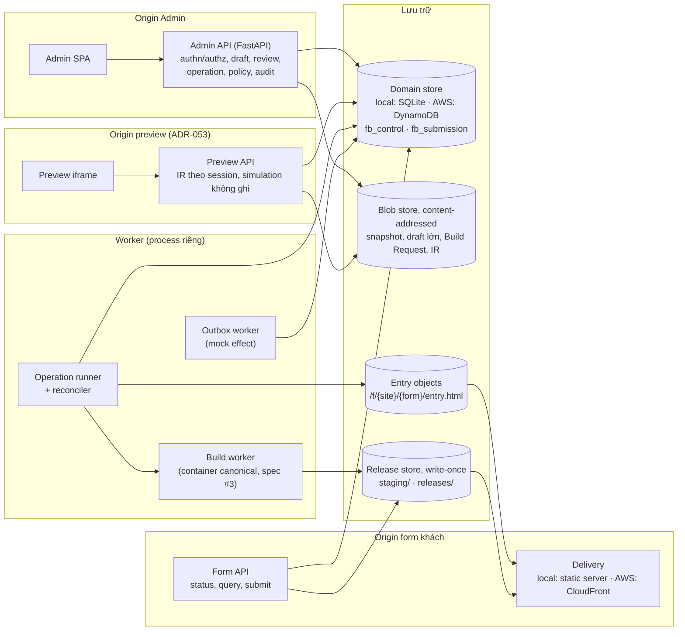
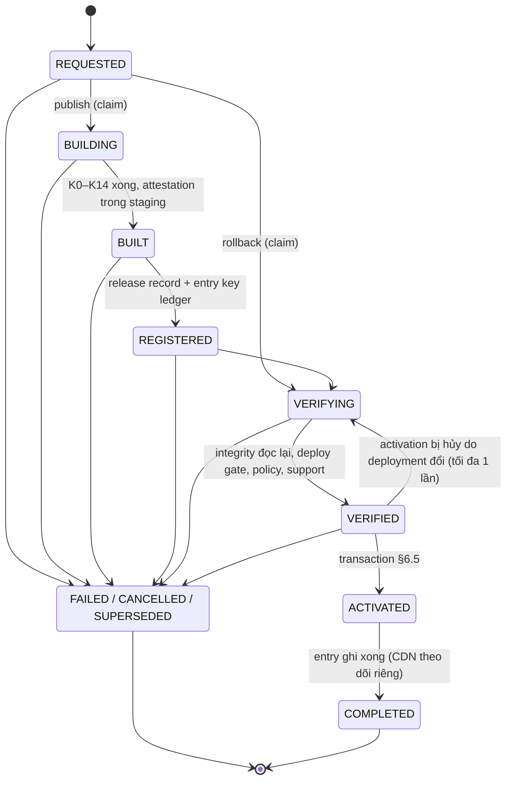
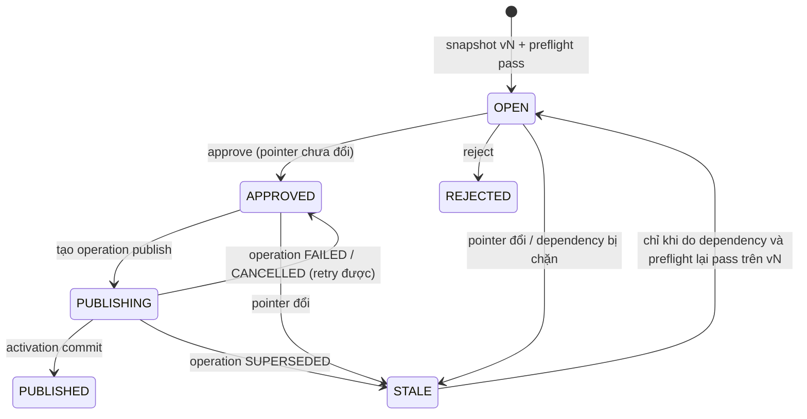
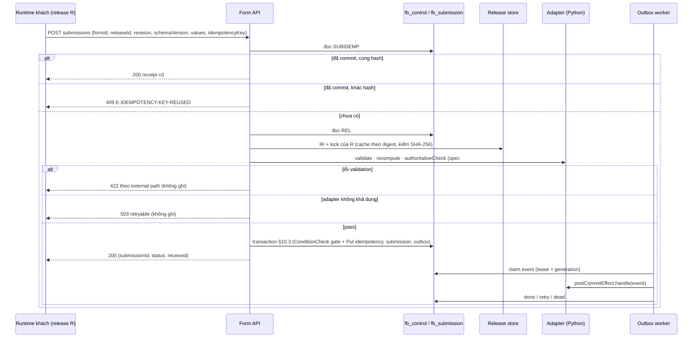

# Spec #5: API, Persistence & Publishing (Architecture Proposal)

> **Trạng thái: PROPOSAL, revision 2 + C1** (2026-10-24). Cross-Subsystem Review: NOT READY FOR G1 → vòng sửa C1 (ADR-068) đã áp: §5, §6.2, §6.5, §6.6, §6.8 (mới), §7, §8, §9.2, §9.3 (viết lại), §9.6 (mới), §13, §14, §16. Trạng thái các finding: `docs/discovery/P01_CROSS_SUBSYSTEM_REVIEW.md` §10.
> - Review rev 1 (user): **SPEC5_REV1_CHANGES_REQUIRED**; phương án A giữ nguyên. OD5-01..04, OD-05, OD4-07 → ADR-056..061. **Security BLOCKER** (cửa sổ submit/revocation) sửa bằng submission admission gate (§9.3). Kiểm thêm publication (§5.3, §5.4, §6.6). Thay đổi: §24.
> - Review rev 2 (user): READY_FOR_CROSS_SPEC_REVIEW **với verification items** V5-01 (tạo gate FBK, UNVERIFIED) và V5-02 (thực thi adapter, OD5-05) — §23.4.
> - Rev 1 đã qua consistency review độc lập (§22). Rev 2 qua ba vòng targeted review (§23): admission gate dùng tập `blockers`, `CAPSTATUS` làm điểm CAS cho gate FBK, gate trước mọi lời gọi adapter.
> - Hướng đi đã duyệt: ADR-054 (yêu cầu publication/rollback), ADR-055 (phương án A: Operation Record + Reconciler + Transactional Store). Cơ chế trong tài liệu này **PROPOSED**.
> - **G1 NOT APPROVED.** G9, G10 BLOCKED. Không có code. Mọi nội dung về AWS là **thiết kế đích sau G10**, không phải thao tác đã làm; mặc định là demo local.
> - Nguồn: [notes](../../discovery/P01_BRAINSTORM_NOTES.md) (Spec #5 Answer #1, quyết định phương án A); [DECISIONS.md](../../DECISIONS.md); [spec #1 rev 3.5](2026-10-23-form-schema-workflow-design.md) §6.4, §8.6, §9, §13, §16; [spec #2 rev 2.9](2026-10-24-plugin-contracts-capability-registry-design.md) §10, §13.3, §15, §16; [spec #3 rev 2.4](2026-10-24-compiler-bundle-release-design.md) §4, §5.1, §11.6, §14, §16; [spec #4 rev 2.3](2026-10-24-admin-form-builder-design.md) §14, §15, §17, §21 (I4-13, I4-17); master API-01..10.
> - Kịch bản PC Rev 7 → Rev 8 → rollback trong tài liệu là **kịch bản tổng hợp (SYNTHETIC)**, không phải sự cố có thật.
>
> Phạm vi: subsystem spec số 5 trên 6 — backend authoritative: lưu trữ, review, publication, rollback, phân phối, submit, outbox, policy. Không gồm: compiler (spec #3), UX của Admin (spec #4), Motion (spec #6).

## 0. Cách đọc trạng thái

| Nhãn | Ý nghĩa |
|---|---|
| **APPROVED …** | User duyệt hướng đi |
| **PROPOSED** | Claude đề xuất, chờ review |
| **OPEN** | Chờ user quyết (§17) |
| *[Claude]* | Lựa chọn nhỏ để tài liệu đủ cụ thể |

| ADR | Nội dung | Trạng thái |
|---|---|---|
| ADR-008 | Người sửa ≠ người publish | ACCEPTED |
| ADR-012 | Không PII bền vững trong browser | ACCEPTED |
| ADR-017 | Một ngữ nghĩa, hai runtime (TS/Python), conformance | APPROVED AS DESIGN DIRECTION |
| ADR-029 | Adapter theo version, supported set, deploy gate | APPROVED |
| ADR-032, ADR-035 | Governance plugin, runtime override | APPROVED |
| ADR-034 | Effect chỉ sau commit, qua outbox | APPROVED |
| ADR-036..040 | Release tự chứa, session pin release, CSR, reproducible build, code splitting | APPROVED AS DESIGN DIRECTION |
| ADR-050, ADR-052 | Review trên snapshot bất biến; optimistic concurrency | APPROVED |
| ADR-053 | Preview cô lập trên origin riêng | APPROVED |
| ADR-054 | Yêu cầu publication/rollback | APPROVED AS DESIGN REQUIREMENTS |
| ADR-055 | Phương án A + storage baseline | APPROVED AS DESIGN DIRECTION |
| ADR-056 | Xác thực OIDC + BFF | APPROVED |
| ADR-057 | `T_stale = 60 s` chỉ cho query thông tin | APPROVED WITH RESTRICTIONS |
| ADR-058 | TTL draft 72 h, `G` 7 ngày, retire thủ công | APPROVED AS P0 DEFAULTS |
| ADR-059 | Retention submission 30 ngày | APPROVED |
| ADR-060 | Field inactive → 422 | APPROVED |
| ADR-061 | Inspector P0 chỉ tự sinh | APPROVED |
| §4–§16 | Cơ chế | **PROPOSED** |
| OD5-01..04, OD-05 | §17 | **Đã quyết** (ADR-056..060) |

---

## 1. Mục đích

Spec #1–#4 định nghĩa form, plugin, compiler và Admin. Spec #5 là phần **giữ sự thật**: draft nào là bản mới nhất, snapshot nào đã được duyệt, release nào đang active, release nào khách còn được gửi, submission nào đã nhận, effect nào đã chạy. Mọi quyết định đó phải đúng khi có hai người thao tác cùng lúc, khi worker chết giữa chừng, khi mạng timeout mà không biết kết quả, và khi CDN chậm.

Thiết kế xoay quanh một vertical slice nhỏ chạy được sau G1:

```
Business Editor → lưu draft → server preflight → snapshot review bất biến → approve
→ Build Request → compile/verify → đăng ký release → stage + verify artifact → activation
→ form khách → submit authoritative → mock effect → rollback
```

## 2. Goals, non-goals, anti-goals

**Goals**
- G5-1: Một miền giao dịch logic cho mọi trạng thái authoritative; không cần distributed transaction (ADR-055).
- G5-2: Activation chỉ xảy ra sau mọi gate; không bao giờ có pointer trỏ tới artifact chưa sẵn sàng.
- G5-3: Không lost update giữa publish, rollback và sửa draft.
- G5-4: Mọi operation tiếp tục được hoặc kết thúc rõ ràng sau crash, timeout, unknown outcome.
- G5-5: Admin chỉ báo thành công khi đúng tầng đó đã thành công; tách DB committed / entry / CDN / session.
- G5-6: Submission được kiểm theo release tin cậy của chính nó, ghi nguyên tử cùng outbox, idempotent.
- G5-7: Cùng domain contract chạy trên SQLite (local) và DynamoDB (AWS), chứng minh bằng contract test.
- G5-8: Audit trả lời được "ai, cái gì, khi nào, kết quả" mà không chứa PII.

**Non-goals (P0):** canary, progressive rollout, auto rollback theo metric, phân loại sự cố tự động (P1, ADR-054); multi-region; Step Functions; generic database framework; collaboration real-time; webhook/email thật; file upload; analytics.

**Anti-goals**
- Báo 公開しました khi mới commit DB; báo khách mới đã nhận release khi chưa quan sát được.
- Dùng `releaseId`, snapshot hay revision do client gửi làm bằng chứng authorization.
- Hứa atomicity giữa DynamoDB, S3 và CloudFront.
- Activation từ một operation cũ sau khi đã có publish/rollback mới hơn.
- Ghi đè artifact bất biến; rebuild release cũ để rollback.
- Tự rollback backend; tự migrate session của khách.
- Hứa exactly-once với hệ thống bên ngoài.
- Log PII hoặc payload form.

## 3. Ràng buộc

- Không code trước G1. Không ghi AWS trước G10 (ADR-006). Dữ liệu giả, cửa hàng hư cấu, không gọi API thật.
- Backend Python (master API-01). Framework HTTP: FastAPI *[Claude]*, chạy như process thường ở local; adapter Lambda chỉ là phương án sau G10.
- Store: SQLite (local) / DynamoDB (AWS); blob: filesystem (local) / S3 (AWS); phân phối: static server (local) / CloudFront (AWS) (ADR-055).
- Build worker tách khỏi request (master API-06); build chạy trong container canonical của spec #3.
- Giới hạn DynamoDB phải được tôn trọng ngay cả ở local: item ≤ 400 KB; transaction ≤ 100 action, ≤ 4 MB.

---

## 4. Kiến trúc tổng thể



| Thành phần | Trách nhiệm | Không làm |
|---|---|---|
| Admin API | xác thực, phân quyền theo site, draft, preflight, preview session, review, tạo operation, policy override, audit | build; ghi artifact; đổi pointer trực tiếp ngoài operation |
| Preview API | phục vụ IR server sinh và Submission Simulation cho một preview session | ghi submission; gọi hệ thống ngoài; nhận credential Admin |
| Form API | status release cho bootstrap; query `dataSource`; submit | tin `releaseId`/revision của client; đọc pointer để chọn release cho submit |
| Operation runner | chạy state machine publication/rollback (§6), claim có lease + fencing | quyết định nghiệp vụ thay người |
| Reconciler | tìm operation treo, entry lệch pointer, outbox treo; đẩy tiếp hoặc kết thúc | sửa artifact; tự rollback |
| Build worker | chạy spec #3 mode `release` / `preflight` trên Build Request | đọc "mới nhất"; gọi mạng ngoài store |
| Outbox worker | xử lý event mock effect, retry, dead-letter | gửi ra hệ thống thật |

**Process P0 local** *[Claude]*: ba process API (Admin, Preview, Form — ba origin/cổng) dùng chung package domain; một process worker chạy runner, reconciler, outbox; build chạy bằng `docker run` image canonical. **AWS sau G10** (chỉ là ánh xạ đề xuất): API trên Lambda + API Gateway (hoặc container), build trên CodeBuild, runner/reconciler/outbox theo lịch (EventBridge Scheduler) hoặc container nhỏ; quyết ở G10.

---

## 5. Persistence

### 5.1. Aggregate và vị trí lưu

| Aggregate | Mutable? | Nội dung chính | Lưu ở đâu | Kích thước |
|---|---|---|---|---|
| Site, Membership | có | site, người dùng, vai trò theo site | `fb_control` | nhỏ |
| Form | có (`version`) | `siteId`, tên, `revisionCounter`, `draftId` | `fb_control` | nhỏ |
| Draft head | có (`draftVersion`) | `PayloadRef` của definition, `savedBy/At`, `baseReleaseId` | `fb_control` + blob nếu lớn | ref ≤ 1 KB; nội dung ≤ 2 MB |
| Key ledger | chỉ thêm, bất biến | entry `(key, releaseId) → identity`; key được giữ khi entry thuộc release **đã từng active** (§6.4 R4) | `fb_control`, mỗi entry một item | nhỏ |
| Review snapshot | **bất biến** | `snapshotVersion`, `PayloadRef` (luôn blob), digest, block revision đã pin | `fb_control` (metadata) + blob | ref nhỏ |
| ReviewRequest | có (`version`) | trạng thái, snapshot, `basePointerVersion`, `dependencyDigest`, preflight ref, người gửi/duyệt | `fb_control` | nhỏ |
| Release record | trạng thái có (`version`); identity bất biến | `releaseId`, form, revision, snapshot digest, `lrmDigest`, `artifactSetDigest`, `indexHtmlSha256`, attestation ref, 4 chiều trạng thái (§9.1), `serverHostApi`, backend deployment version | `fb_control` | nhỏ |
| Active pointer | có (`pointerVersion`, `entryVersion`) | `activeReleaseId`, `lastOperationId`; `entryVersion` tăng mỗi khi pointer **hoặc** availability đổi (§6.6) | `fb_control`, một item mỗi form | nhỏ |
| Form availability | có (`version`) | `live` / `degraded` (M4: ngừng nhận submit) / `suspended` (M5: trang bảo trì), lý do, `incidentId` (spec #2 §16.1) | `fb_control`, một item mỗi form | nhỏ |
| Backend deployment | có (`version`) | `deploymentVersion`, `serverHostApi`, adapter inventory hash, kết quả deploy gate | `fb_control`, item `DEPLOYMENT#CURRENT` | nhỏ |
| Preview session | có, TTL | `previewSessionId` (hash), người dùng, form, `mode`, `draftVersion`/`snapshotId`/`catalogSnapshotId`, **`platformReleaseId`**, `blockedPrks`, `expiresAt`, `revoked` (SR-05, §7.3) | `fb_control` | nhỏ |
| Admission gate | có (`blockers` SS, `capVersion`/`relVersion`/`availabilityVersion`) | gate form / release / server FBK — **phép chiếu** của item authoritative, ghi cùng transaction (§9.3.1) | `fb_control` | nhỏ |
| Plugin usage | chỉ thêm | `PRKUSE#{prk}/{releaseId}`: release nào dùng plugin version nào (ghi khi đăng ký release) — để liệt kê chính xác form bị ảnh hưởng (§9.3.8) | `fb_control` | nhỏ |
| Site policy | có (`version`) | `SITEPOLICY#{siteId}`: `allowedEffects` (spec #2 §13.3); snapshot digest đi vào preflight và Build Request | `fb_control` | nhỏ |
| Platform release | bất biến | `PLATFORMREL#{id}`: digest/version của engine, analyzer, compiler, bundler, builder image, bootstrap, template HTML, Admin build, Preview build, `motion-presets` được hỗ trợ, evaluator (`supportedIrFormats`); `current` = bản đang deploy (§6.8, CSR-10) | `fb_control` | nhỏ |
| Catalog snapshot | bất biến | `CATSNAP#{id}`: digest catalog plugin + ledger status tại thời điểm tạo (mỗi lần ingestion tạo bản mới) | `fb_control` + blob | nhỏ |
| Capability status (policy hiệu lực theo plugin) | có (`capVersion`, CAS) | `CAPSTATUS#{PRK}`: `serverFbks` (bất biến), `sources` (ledger, override mở, mitigation M3), `publishBlockers`, `fbkBlockers` (§9.3.2) — **nguồn sự thật duy nhất** cho trạng thái hiệu lực của plugin version | `fb_control` | ≤ 64 KB |
| Blob touch | có | `BLOBTOUCH#{sha256}`: `touchedAt`, `gcState` (bảo vệ blob khỏi GC, §5.3) | `fb_control` | nhỏ |
| Admin session (BFF) | có, TTL | `sessionId` (hash), `userId`, token OIDC **mã hóa**, CSRF token, `expiresAt`, `idleExpiresAt` | `fb_control` | nhỏ |
| Release stats | đếm (ADD) | số request theo `releaseId` × giờ × kết quả (200/409/410/413/422/423/503) | `fb_control` | nhỏ |
| Operation | có (`generation`) | publish / rollback, state, lease, stage results, lỗi | `fb_control` | ≤ 16 KB *[Claude]* |
| Idempotency (Admin) | chỉ thêm, có TTL | scope + key → request hash, kết quả | `fb_control` | nhỏ |
| Audit event | chỉ thêm | §12 | `fb_control` | ≤ 4 KB |
| Policy override | chỉ thêm + đóng | spec #2 §16.5; `policyVersion` toàn cục | `fb_control` | nhỏ |
| Submission | bất biến sau commit | release, values **mã hóa**, phần `public` | `fb_submission` | item ≤ 380 KB (values rõ ≤ 160 KB, `publicValues` ≤ 32 KB) |
| Submission idempotency | chỉ thêm, TTL = retention submission | `(formId, idempotencyKey)` → hash, `submissionId` | `fb_submission` | nhỏ |
| Outbox event | có (`generation`), TTL = retention submission | effect, input đã map (phần `personal` mã hóa), trạng thái, lease, attempts | `fb_submission` | ≤ 64 KB |
| Snapshot/draft lớn, Build Request, preflight result | bất biến | JSON canonical | blob, content-addressed | ≤ 2 MB / 1 MB |
| Artifact release, attestation, provenance | bất biến, write-once | spec #3 §4 | release store | — |
| `entry.html` | có (bản chiếu của pointer) | spec #3 §14.1 | entry objects | nhỏ |

**Hai bảng** *[Claude]*: `fb_control` (control plane) và `fb_submission` (data plane). Tách vì submission có chính sách khác: mã hóa PII, retention, quyền đọc, khối lượng ghi. Transaction của DynamoDB được phép trải hai bảng trong cùng account/region, nên submission vẫn `ConditionCheck` được release record (§10.3).

### 5.2. Key design (DynamoDB; SQLite dùng bảng tương ứng)

`fb_control` — `PK`, `SK` (string):

| Item | PK | SK | GSI |
|---|---|---|---|
| Site | `SITE#{siteId}` | `META` | — |
| Membership | `SITE#{siteId}` | `MEMBER#{userId}` | GSI1 `USER#{userId}` / `SITE#{siteId}` |
| Form | `FORM#{formId}` | `META` | GSI1 `SITE#{siteId}` / `FORM#{formId}` |
| Draft head | `FORM#{formId}` | `DRAFT#{draftId}` | — |
| Key ledger | `FORM#{formId}` | `KEY#{key}#{releaseId}` | — |
| Snapshot | `FORM#{formId}` | `SNAP#{snapshotVersion:08d}` | — |
| ReviewRequest | `FORM#{formId}` | `REVIEW#{reviewId}` | GSI1 `FORM#{formId}#REVIEWS` / `{createdAt}` |
| Active pointer | `FORM#{formId}` | `POINTER` | — |
| Form availability | `FORM#{formId}` | `AVAILABILITY` | — |
| Backend deployment | `DEPLOYMENT#CURRENT` | `META` | — |
| Preview session | `PREVIEW#{sha256(previewSessionId)}` | `META` | TTL `expiresAt` |
| Release stats | `RELSTAT#{releaseId}` | `{yyyymmddhh}` | — |
| Release | `REL#{releaseId}` | `META` | GSI1 `FORM#{formId}#RELEASES` / `{registeredAt}` |
| Operation | `OP#{operationId}` | `META` | GSI1 `FORM#{formId}#OPS` / `{createdAt}`; **GSI2 (sparse)** `OPS#OPEN` / `{leaseUntil}` chỉ khi chưa terminal |
| Idempotency | `IDEMP#{scope}#{key}` | `META` | TTL `expiresAt` |
| Audit | `AUDIT#{formId}` (hoặc `AUDIT#SITE#{siteId}`) | `{at}#{eventId}` | — |
| Policy | `POLICY#{target}` | `{createdAt}#{overrideId}` | — |
| Policy version | `POLICY#STATE` | `META` (`policyVersion`; **không** bị submit chạm) | — |
| Gate | `GATE#FORM#{formId}` · `GATE#REL#{releaseId}` · `GATE#FBK#{fbk}` | `META` (P0 một item, không shard) | — |
| Plugin usage | `PRKUSE#{prk}` | `{releaseId}` | — |
| Site policy | `SITEPOLICY#{siteId}` | `META` | — |
| Platform release | `PLATFORMREL#{id}` · `PLATFORMREL#CURRENT` | `META` | — |
| Catalog snapshot | `CATSNAP#{id}` | `META` | — |
| Gate intent | `GATEINTENT#{gateKey}` | `META` | TTL `expiresAt` (60 s) |
| Capability status | `CAPSTATUS#{PRK}` | `META` | — |
| Blob touch | `BLOBTOUCH#{sha256}` | `META` | — |
| Admin session | `SESSION#{sha256(sessionId)}` | `META` | TTL `expiresAt`; **GSI3** `USER#{userId}` / `SESSION#…` và `PREVIEW#…` để thu hồi theo người dùng (MINOR-08) |

`fb_submission`:

| Item | PK | SK | GSI |
|---|---|---|---|
| Submission | `SUB#{submissionId}` | `META` | GSI1 `REL#{releaseId}` / `{submittedAt}` (thống kê, không PII trong key) |
| Submission idempotency | `SUBIDEMP#{formId}#{idempotencyKey}` | `META` | — |
| Outbox event | `EVT#{eventId}` | `META` | **GSI2 (sparse)** `OUTBOX#OPEN` / `{dueAt}` khi `pending` (`dueAt = nextAttemptAt`) **hoặc** `inflight` (`dueAt = lease.until`); bỏ thuộc tính GSI khi `done`/`dead`/`blocked`/`discarded`/`expired`. P0 một partition; chia shard khi cần (P1) |

- GSI chỉ dùng để **tìm việc**, luôn eventually consistent. Mọi claim và chuyển trạng thái là **conditional update trên item gốc**, đọc nhất quán mạnh.
- **Hot item:** hai transaction DynamoDB chạm cùng một item (kể cả ConditionCheck) sẽ xung đột (`TransactionConflict`). Submit chỉ chạm **gate có phạm vi hẹp** (form, release, FBK), không chạm `POLICY#STATE`, `REL#…` hay `AVAILABILITY` (§9.3, §10.3). Xung đột được ánh xạ thành `Conflict`, retry có giới hạn với jitter (CT-17); throughput thật đo sau G10 (VG-12).
- **Logical expiration:** mọi item có TTL (`SUB#`, `SUBIDEMP#`, `EVT#`, `PREVIEW#`, `SESSION#`, `IDEMP#`) được coi là **không tồn tại** khi `expiresAt ≤ now` lúc đọc/xử lý, độc lập với việc DynamoDB TTL xóa vật lý (trễ, không đúng giây). Ngoại lệ có chủ đích: `SUBIDEMP#` hết hạn chỉ cho phép key được dùng lại sau khi submission tương ứng cũng hết hạn (cùng `expiresAt`).
- ID: tiền tố + ULID (spec #4 §8.2). Không đưa PII vào key hay tên thuộc tính.
- SQLite: một bảng mỗi loại item, khóa chính tương ứng `PK/SK`, ràng buộc `UNIQUE`; WAL; transaction `BEGIN IMMEDIATE`.

### 5.3. Payload lớn: `PayloadRef` và content hash

```
PayloadRef = { inline?: <canonical JSON>, blobKey?: "sha256/<hex>", sha256: "<hex>", size: <bytes>, format: "jcs-json" }
```

- Canonical hóa bằng JCS (như spec #3), tính SHA-256 trên đúng byte đó.
- **Ngưỡng inline** *[Claude]*: ≤ 256 KB thì inline trong item (còn chỗ cho thuộc tính, dưới 400 KB); lớn hơn thì blob. **Snapshot luôn là blob**, vì Build Request tham chiếu nó bằng digest (spec #3 §5.1 `definitionSnapshot`).
- **Trần cứng P0:** definition ≤ 2 MB → vượt thì `413 DEFINITION_TOO_LARGE`, không lưu.
- **Ghi (không distributed transaction):**
  0. **Touch:** `UpdateItem BLOBTOUCH#{sha} SET touchedAt = :now WHERE attribute_not_exists(gcState)` — bảo vệ blob khỏi GC trong 24 giờ, kể cả khi nội dung trùng với một blob mồ côi cũ (ví dụ Editor hoàn tác về đúng nội dung trước). Điều kiện thất bại (GC đang xóa blob này) → chờ ngắn rồi lặp lại; sau khi GC xong, bước 1 sẽ tạo lại blob.
  1. Ghi blob tại key `sha256/<hex>` **có điều kiện không tồn tại** (S3 `If-None-Match: *`; local: tạo file độc quyền). Đã tồn tại → đọc lại, so hash; trùng thì là no-op (idempotent).
  2. Ghi item DB có điều kiện (ví dụ `draftVersion = :base`), lưu `PayloadRef`.
  3. Bước 2 thất bại → **blob mồ côi** (không item nào tham chiếu). Blob mồ côi vẫn là dữ liệu của form (định nghĩa, có thể chứa giá trị `const`/default `public`), nên có chính sách dọn:
     - **GC mark-and-sweep** *[Claude]* chạy hằng ngày (P0, cả local; xóa thật, không chỉ báo cáo): tập được tham chiếu = draft head hiện tại ∪ mọi snapshot ∪ Build Request ∪ preflight result còn được review tham chiếu. Với mỗi blob **không** được tham chiếu và `BLOBTOUCH.touchedAt` **cũ hơn 24 giờ**: (a) `UpdateItem BLOBTOUCH SET gcState = deleting WHERE touchedAt = :seen AND attribute_not_exists(gcState)` — thất bại nghĩa là có writer vừa touch → bỏ qua; (b) kiểm lại tham chiếu (nhất quán mạnh) — **có** tham chiếu thì `REMOVE gcState` và dừng; (c) xóa blob; (d) xóa `BLOBTOUCH`. Writer gặp `gcState = deleting` thì chờ tới khi (d) xong. **Khôi phục sau crash:** mỗi lần chạy, GC xử lý trước các `BLOBTOUCH` đang `deleting` quá 10 phút: kiểm lại tham chiếu → có thì `REMOVE gcState`, không thì làm tiếp (c)(d). **Blob không có `BLOBTOUCH`** (ví dụ ghi trước khi có cơ chế, hoặc crash trước bước 0): GC tạo `BLOBTOUCH` với `touchedAt = now` (`attribute_not_exists`) và chỉ xét lại sau 24 giờ. **Giới hạn writer:** từ bước 0 tới commit bước 2 không quá 1 giờ *[Claude]*; quá thì writer touch lại trước khi commit (24 giờ ≫ 1 giờ nên GC không thể chen vào). **Local FS:** ghi file tạm rồi `link()` (thất bại nếu đã tồn tại) để không để lại file ghi dở; file đã tồn tại mà hash lệch → `E-PAYLOAD-INTEGRITY`, sự cố. Draft blob cũ bị thay bởi version mới hơn, và **snapshot blob mồ côi** khi transaction tạo review thất bại, đều được dọn theo cùng cách. Mỗi lần xóa ghi audit `blob.gc` (chỉ hash, kích thước).
     - Blob của **snapshot** không bao giờ bị GC khi snapshot item còn (P0: giữ vĩnh viễn).
- **Đọc:** tải blob, tính lại SHA-256, so với `PayloadRef.sha256`; lệch → `E-PAYLOAD-INTEGRITY`, fail closed, audit. Truyền lên S3 kèm checksum SHA-256 của request để phát hiện lỗi đường truyền.
- **Access control:** blob store private, mã hóa phía server, không URL công khai. Ghi: Admin API (draft, snapshot) và worker (Build Request, preflight). Đọc: Admin API, worker, Preview API (chỉ IR/snapshot của phiên). Xóa: chỉ job GC. Ở AWS là IAM theo role (sau G10).
- **Recovery:** blob thiếu hoặc lệch hash → `E-PAYLOAD-INTEGRITY`, fail closed, audit + cảnh báo. Draft: Admin giữ thay đổi local và lưu lại (ghi blob mới). Snapshot: không sửa được → review đó bị đánh dấu hỏng, Editor gửi review mới từ draft.

### 5.4. Transaction grouping

| Thao tác | Một transaction gồm | Số action | Bên ngoài transaction (trước) |
|---|---|---|---|
| Tạo form | Put form · Put `GATE#FORM#{formId}` (mở) · Put `POINTER` (`pointerVersion = 0`, chưa có release; MINOR-07) · Put `AVAILABILITY` (`live`) · Put idempotency · Put audit | 6 | — |
| Lưu draft | Update draft head (`draftVersion = :base`) | 1 | blob nếu lớn; kiểm key ledger (đọc nhất quán) |
| Tạo review | Put snapshot (`not exists`) · Put ReviewRequest · ConditionCheck draft head (`draftVersion = :requested`) · Update form (`reviewCounter`) · Put idempotency · Put audit | 6 | blob snapshot; preflight server cho đúng digest |
| Approve / reject | Update ReviewRequest (`version = :v`, `state = OPEN`, người duyệt ≠ người gửi) · ConditionCheck pointer (`pointerVersion = :basePointerVersion`) · ConditionCheck `CAPSTATUS#{PRK}` mỗi plugin trong lock của snapshot (`attribute_not_exists(publishBlockers)`; có → `409 REVIEW_RECHECK_REQUIRED`) · Put audit | 3 + số plugin | — |
| Tạo operation publish | Put operation (`not exists`) · Put idempotency · Update ReviewRequest (`APPROVED → PUBLISHING`) · ConditionCheck pointer (`pointerVersion = :basePointerVersion`, sai → `409 REVIEW_STALE`) · Update form (`revisionCounter`, chỉ khi review chưa có revision) · Put audit | 6 | — |
| Đăng ký release | **Put release chỉ với `attribute_not_exists`** + Put `GATE#REL#{releaseId}` (`blockers = {rel#pending}`, `relVersion = 1`, `attribute_not_exists`) + Put `PRKUSE#{prk}/{releaseId}` mỗi plugin trong lock; nếu đã tồn tại (retry cùng review → cùng `releaseId`): **chỉ** ConditionCheck bộ identity (`lrmDigest`, `indexHtmlSha256`, `artifactSetDigest`, `formId`), **không bao giờ ghi đè** trạng thái (suspended/quarantined/retired giữ nguyên) · Update operation (fencing) · Put audit | 4 | ghi entry key ledger `KEY#{key}#{releaseId}` (Put `attribute_not_exists`, bất biến; §6.4 R4) |
| Đánh dấu `verified` | Update release (**`state IN (registered, verified)`**, `version = :v` → `verified`; idempotent, CSR-15) · Update operation (`generation = :g`, `VERIFYING → VERIFIED`, ghi `deploymentVersionChecked`) | 2 | integrity gate, deploy gate, policy |
| **Activation** | §6.5 | 8 + số plugin (≤ 10) + số server FBK (≤ 10) ≤ 28 | — |
| Kết thúc operation không thành công | Update operation (→ `FAILED`/`CANCELLED`/`SUPERSEDED`, fencing) · Update ReviewRequest (`PUBLISHING → APPROVED`, hoặc `STALE` khi SUPERSEDED) · Put audit | 3 | — |
| Submit | §10.3: ConditionCheck gate form + release + FBK · Put idempotency · Put submission · Put outbox | ≤ 2 + 10 + 2 + 10 | validate, adapter |
| Đổi policy plugin (ingestion, override, M3, đồng bộ ledger), trạng thái release, availability | §9.3.4: Update item authoritative (CAS) · Update mọi gate chiếu từ nó (`SET`/`REMOVE blockers`, `attribute_exists`) · bản ghi lịch sử · `POLICY#STATE` · audit — mỗi item một action | ≤ 15 | `GetItem` nhất quán mạnh item authoritative |

Không transaction nào chạm giới hạn 100 action / 4 MB; số effect mỗi form giới hạn ≤ 10 ở P0 *[Claude]*.

## 6. Publication và rollback

### 6.1. Operation

```
Operation = {
  operationId, type: publish | rollback, formId, siteId,
  state, generation, lease: { owner, until },
  idempotencyKey, requestedBy, requestedAt,
  expectedPointerVersion,              // pointer mà người yêu cầu đã thấy (§6.3)
  reviewId?, snapshotDigest?, revision?, buildRequestDigest?,   // publish
  targetReleaseId?, reason?,                                     // rollback (releaseId của publish được điền khi đăng ký)
  deploymentVersionChecked?, stages: [{ name, status, attempts, startedAt, endedAt, code? }],
  activation?: { pointerVersion, at },
  delivery: { entry: pending | written | failed, cdn: n/a | pending | invalidated | confirmed | timeout, observedReleaseId?, checkedAt? },
  outcome?: { code, retryable, message }
}
```

### 6.2. State machine



- Mọi trạng thái trước ACTIVATED có thể kết thúc bằng **FAILED** (lỗi), **CANCELLED** (người yêu cầu hủy) hoặc **SUPERSEDED** (pointer đã khác `expectedPointerVersion`, kiểm ở đầu mỗi stage và trong transaction activation). Việc kết thúc và cập nhật review đi cùng một transaction (§5.4).
- **ACTIVATED** không bao giờ quay về FAILED: pointer đã đổi. Từ đó chỉ có COMPLETED; lỗi ghi entry/CDN được reconciler xử lý tiếp (§6.6, §6.7).

| Stage | Việc | Side effect ngoài DB | Idempotent nhờ |
|---|---|---|---|
| BUILDING | **lắp Build Request theo §6.8** (mọi trường từ nguồn authoritative đã ghi trong review, không từ trạng thái Admin hiện tại), lưu blob theo digest và ghi digest vào review (retry dùng lại → cùng `releaseId`); chạy build worker mode `release` (K0–K14, hai lần chạy sạch) | ghi `staging/{buildRequestDigest}/…` write-once | key theo digest; staging đã có cùng attestation → dùng lại |
| BUILT | đọc attestation trong staging | — | — |
| REGISTERED | đọc từng file staging, kiểm SHA-256, ghi `releases/{releaseId}/…` bằng `PutObject` có `If-None-Match: *` (không dùng CopyObject có điều kiện — chưa xác minh, VG-11); đã tồn tại → so hash; ghi entry key ledger; đăng ký release (§5.4) | ghi release store | content-addressed; `E-RELEASE-ID-COLLISION` nếu khác identity (spec #3 §11.6) |
| VERIFYING | integrity gate **đọc lại từ storage** (mọi file trong inventory, `index.html` theo attestation, không file thừa, tính lại `releaseId`); deploy gate / adapter precheck của release với `DEPLOYMENT#CURRENT` (spec #2 §10.4); evaluator hiện tại hỗ trợ `irFormat` của release (CSR-11); `LRM.toolchain.engine` = engine của `review.platformReleaseId` (CSR-10); `CAPSTATUS` của mọi plugin trong lock (M2) và gate FBK tồn tại; support/security/retention của release; kiểm key ledger (§6.4 R4); release → `verified` cùng transaction với operation (§5.4) | đọc | thuần đọc |
| ACTIVATED | §6.5 | — | điều kiện trong transaction |
| COMPLETED | sinh `entry.html` từ pointer + availability + khối `load` của release; ghi entry có điều kiện theo `entryVersion` (§6.6) | ghi entry | theo `entryVersion` |
| (sau COMPLETED) | invalidation CDN + probe (§6.6), theo dõi trong `delivery.cdn` | CDN | `CallerReference = {formId}:{entryVersion}:{attempt}` |

- **Rollback** bỏ qua BUILDING/BUILT/REGISTERED. Release đích phải: thuộc đúng form; **đã từng active** (`activatedAt` có giá trị — release của operation bị SUPERSEDED hay review STALE không bao giờ là đích hợp lệ, ADR-050); khác release đang active; `security = normal`; retention `served`; `support = supported`; plugin không bị chặn bởi M2; adapter có trong deployment hiện tại. Không rebuild, không sửa artifact.
- **Ngoài P0** *[Claude]*: rollback tới release `retired` (cần platform-admin `reinstate` có audit trước, không phải Publisher) và tới release `archived` (cần khôi phục + integrity gate lại). P0 liệt kê chúng trong `rollback-candidates` với lý do không đủ điều kiện.
- **CANCELLED** chỉ trước ACTIVATED. Sau ACTIVATED muốn quay lại thì làm rollback mới.
- **Revision**: gán khi tạo operation publish cho review chưa có revision (`revisionCounter + 1`), lưu vào review; retry hoặc publish lại cùng review dùng **cùng** revision (Build Request giống hệt → cùng `releaseId`). Review bị bỏ sau khi đã có revision tạo ra khoảng trống số revision; lịch sử ghi rõ 「r8（公開されていません）」.

### 6.3. Expected pointer version và chống lost update

- **Publish:** `expectedPointerVersion = review.basePointerVersion` — pointer lúc Editor gửi review (ADR-050). Nếu active đã đổi kể từ đó, review là stale và activation **phải** thất bại. Một cơ chế phục vụ cả stale-review lẫn lost update.
- **Rollback:** `expectedPointerVersion` = pointer mà Publisher thấy trên màn hình rollback (client gửi kèm; server chỉ dùng nó làm **điều kiện**, không làm bằng chứng quyền).
- Không có khóa độc quyền theo form *[Claude]*: rollback khẩn cấp không bao giờ phải chờ một build dài. Hai operation song song → operation nào activation trước thắng; operation còn lại bị **SUPERSEDED** ở lần kiểm pointer tiếp theo (đầu mỗi stage và trong transaction activation). Build đang chạy của operation thua bị bỏ; artifact staging còn lại vô hại.
- Cùng một review không thể có hai operation publish: transaction tạo operation đổi review `APPROVED → PUBLISHING` có điều kiện.

### 6.4. Claim, lease, fencing

- **Claim:** `UpdateItem OP#id SET lease.owner = :me, lease.until = :now + L, generation = generation + 1 WHERE state ∉ terminal AND (lease.until < :now OR attribute_not_exists(lease.owner))`. Trả về `generation` mới = **fencing token**.
- Mọi ghi sau đó của worker vào operation (và vào release record khi đăng ký/verify) có điều kiện `generation = :g AND lease.owner = :me`. Worker bị treo rồi tỉnh lại sẽ bị từ chối ở lần ghi kế tiếp.
- **Lease** *[Claude]*: `L = 5 phút`, heartbeat mỗi 60 giây (gia hạn có điều kiện cùng `generation`). Build dài hơn `L` vẫn an toàn nhờ heartbeat; worker chết → lease hết → reconciler claim lại với `generation + 1`.
- **Đồng hồ:** DynamoDB không có thời gian phía server; lease dùng đồng hồ worker. Yêu cầu đồng bộ giờ (NTP), lệch tối đa *[Claude: 30 giây]* ≪ `L`; worker phát hiện lệch lớn hơn thì không claim. Lệch giờ chỉ làm claim sớm/muộn; **fencing** bảo đảm worker cũ không ghi được, và side effect bên ngoài của worker cũ đều vô hại (R1–R5 dưới).
- **Side effect bên ngoài phải idempotent hoặc có điều kiện:**
  - R1 staging: key theo `buildRequestDigest`, write-once.
  - R2 release store: key theo `releaseId` (content-addressed), write-once; tồn tại thì so hash.
  - R3 entry: ghi có điều kiện theo `entryVersion` (§6.6), không bao giờ ghi đè bản mới hơn.
  - R4 key ledger: entry `KEY#{key}#{releaseId}` ghi bằng `PutItem attribute_not_exists` (bất biến; ghi lại là no-op). Một key được coi là **đã giữ** cho identity X khi có entry của X thuộc release có `activatedAt` (spec #1 §6.4: chỉ bản đã publish mới giữ key). Activation đặt `activatedAt` trong transaction §6.5, nên mọi entry của release được xác nhận **nguyên tử**, không cần ghi hàng trăm item trong transaction. VERIFYING kiểm: không key nào của release có entry thuộc release đã active với identity khác → nếu có, `E-KEY-COLLISION`, FAILED.
  - R4b ghi `verified` và mọi chuyển trạng thái của release record do worker thực hiện đều nằm trong transaction có điều kiện `generation` của operation (§5.4).
  - R5 CDN invalidation: `CallerReference` tất định → CloudFront trả lại invalidation cũ thay vì tạo mới.
  - R6 S3: write-once chỉ đúng với writer tuân thủ; sau G10 thêm IAM chỉ cho worker ghi prefix `releases/` và Object Lock (governance) cho prefix đó. Xử lý `412 Precondition Failed` (đã tồn tại → đọc, so hash) và `409 ConditionalRequestConflict` (ghi đồng thời → retry rồi so hash).

**Retryable vs terminal** *[Claude]*:

| Lỗi | Phân loại | Xử lý |
|---|---|---|
| Lỗi phân tích/compile (`E-*` của K1–K12), `E-BUILD-NON-REPRODUCIBLE`, `E-TOOLCHAIN-MISMATCH` | terminal | FAILED; báo Editor/Platform |
| `E-ARTIFACT-HASH-MISMATCH`, `E-ARTIFACT-UNEXPECTED-FILE`, `E-RELEASE-ID-COLLISION`, `E-PAYLOAD-INTEGRITY` | terminal + **sự cố bảo mật** | FAILED; staging của operation đánh dấu quarantine; audit + cảnh báo |
| Deploy gate / adapter precheck fail | terminal cho operation này | FAILED; cần Platform deploy backend phù hợp rồi tạo operation mới |
| Plugin bị chặn (M2), release `suspended`/`quarantined` | terminal | FAILED với lý do policy |
| Pointer đã đổi | terminal | SUPERSEDED |
| Throttling, timeout store/blob, container build lỗi hạ tầng, worker chết | retryable | backoff lũy thừa có jitter, tối đa `N = 5` lần mỗi stage; quá → FAILED (`retryable: true`), Publisher có thể bấm 再試行 (operation mới, cùng review) |
| **Unknown outcome** (timeout sau khi gửi transaction) | — | §6.7 |

### 6.5. Transaction activation

Điều kiện tiên quyết đã kiểm ở VERIFYING; transaction **kiểm lại** những gì có thể đổi giữa chừng. Ví dụ PC (synthetic): publish r8 thay r7. Yêu cầu: release đích ≠ release đang active (API từ chối trước: `409 NO_CHANGE`), nên không có hai action trên cùng một item.

Trước khi gửi, runner ghi vào operation (có điều kiện `generation`) các tham số tất định: `activationEventId = {operationId}:activated`, `activationAt`. Lần gửi lại dùng **đúng** các tham số này (nếu khác, DynamoDB trả `IdempotentParameterMismatch`).

DynamoDB `TransactWriteItems` (`ClientRequestToken = {operationId}:activate:{generation}`):

| # | Action | Item | Điều kiện / cập nhật |
|---|---|---|---|
| 1 | Update | `FORM#frm_pc_demo` / `POINTER` | **điều kiện** `pointerVersion = :expected (41)` (form chưa publish: `pointerVersion = 0`, MINOR-07) → `activeReleaseId = rel_r8…`, `pointerVersion = 42`, `entryVersion + 1`, **`bootstrapDigest = :b`** với `:b` = bootstrap **mới hơn** giữa bootstrap hiện tại của pointer và bootstrap của release đích (không bao giờ hạ version khi rollback, CSR-14), `lastOperationId`, `updatedAt` |
| 2 | Update | `REL#rel_r8…` / `META` (release đích) | **điều kiện** `formId = :form AND state = verified AND security = normal AND support = supported AND retention = served AND version = :v` → `activation = active`, `activatedAt = if_not_exists(activatedAt, :at)`, `lastActivatedAt = :at`, **REMOVE** `deactivatedAt`, `supportEndsAt`, `version + 1` |
| 3 | Update | `OP#op_…` / `META` | **điều kiện** `state = VERIFIED AND generation = :g AND lease.owner = :me` → `state = ACTIVATED`, `activation = { pointerVersion: 42, at }` |
| 4 | Update | `FORM#frm_pc_demo` / `REVIEW#rvw_…` (chỉ publish) | **điều kiện** `state = PUBLISHING AND snapshotDigest = :digest` → `state = PUBLISHED`, `publishedReleaseId` |
| 5 | Update | `GATE#REL#rel_r8…` | **điều kiện** `attribute_exists(PK) AND relVersion = :rv` → `SET blockers = derive(REL sau action 2)` hoặc `REMOVE blockers` (gỡ `rel#pending`), `relVersion = :rv+1` — phép chiếu của `REL#` (§9.3.1) |
| 5a | ConditionCheck | `CAPSTATUS#{PRK}` mỗi plugin trong lock (≤ 10 plugin mỗi form *[Claude]*) | `attribute_exists(PK) AND attribute_not_exists(publishBlockers)` (M2: không activate release chứa version `vulnerable`/`revoked`) |
| 5b | ConditionCheck | `GATE#FBK#{fbk}` mỗi server FBK trong đường submit | `attribute_exists(PK) AND attribute_not_exists(blockers)` (gate tồn tại và mở; tránh activate một release mà mọi submit sẽ bị 423) |
| 6 | ConditionCheck | `DEPLOYMENT#CURRENT` / `META` | `deploymentVersion = :checked` (backend không đổi kể từ deploy gate/adapter precheck) |
| 7 | Put | `AUDIT#frm_pc_demo` / `{activationAt}#{activationEventId}` | `attribute_not_exists(PK)`; `{ action: release.activated, from: rel_r7…, to: rel_r8…, pointerVersion: 42, operationId, actor }` |
| 8 | Update | `REL#rel_r7…` / `META` (release vừa rời active; bỏ qua ở lần publish đầu) | **điều kiện** `attribute_exists(PK) AND activation = active AND formId = :form` → `activation = inactive`, `deactivatedAt = :at`, `supportEndsAt = :at + G` (ADR-058; `T_edge_max ≤ G` là mục kiểm chứng khi deploy, §9.4), `version + 1` |

SQLite (cùng contract): `BEGIN IMMEDIATE`; `UPDATE pointer … WHERE pointer_version = ?` (kiểm `changes() = 1`); `UPDATE release … WHERE` các điều kiện của action 2; `UPDATE operation … WHERE generation = ? AND lease_owner = ? AND state = 'VERIFIED'`; `UPDATE review …`; `SELECT` gate release, `CAPSTATUS`, gate FBK, deployment version và so với điều kiện của action 5–6; `INSERT audit`; `UPDATE` release cũ; mỗi lệnh kiểm `changes() = 1`; `COMMIT`. Sai bất kỳ → `ROLLBACK`.

Không còn ConditionCheck `POLICY#STATE` toàn cục: activation chỉ kiểm đúng các item liên quan tới release đích (release, gate release, `CAPSTATUS` và gate FBK của nó, deployment), nên thay đổi availability hay retire ở form khác không làm hủy activation.

**Hủy transaction** (`TransactionCanceledException` với lý do từng action / `ROLLBACK`): đọc lại — pointer khác → SUPERSEDED; release đích hoặc gate release đổi trạng thái → FAILED với lý do; `CAPSTATUS`/gate FBK chặn → FAILED (policy); deployment đổi → quay lại VERIFYING (một lần) rồi FAILED nếu vẫn chặn; generation khác → worker dừng. `TransactionConflictException` / `TransactionInProgressException` → retry cùng tham số với backoff + jitter.

**Không** có bước nào ở đây làm entry hay CDN đổi cùng lúc. Commit chỉ có nghĩa: **nguồn sự thật đã đổi**.

### 6.6. Sau activation: entry, CDN, khách thật

| Tầng | Ý nghĩa | Ai bảo đảm | Trạng thái API | Wording (Admin) |
|---|---|---|---|---|
| T1 DB committed | pointer = r8; backend coi r8 là active | transaction §6.5 | `activation.committed = true` | 「公開を確定しました（r8）。配信の切り替えを反映しています。」 |
| T2 Entry ghi xong | `entry.html` ở origin mang `activeReleaseId = r8`, `pointerVersion = 42` | runner; reconciler | `delivery.entry = written` | 「配信設定を r8 に更新しました。」 |
| T3 CDN | invalidation đã tạo/hoàn tất; probe qua CDN thấy r8 | runner; reconciler | `delivery.cdn = invalidated → confirmed` hoặc `timeout` | 「確認した配信経路で r8 が表示されています（確認時刻 hh:mm）。」 / 「一部の配信経路で切り替えを確認できていません。」 |
| T4 Khách mới | mỗi edge, mỗi trình duyệt tự nhận entry mới khi cache hết hạn | không ai bảo đảm tuyệt đối; giới hạn trên `T_edge_max` (spec #3 §16.2) | — | 「新しく開始するお客様は、通常 T_edge_max 以内に r8 になります。」 |
| Session cũ | khách đang điền r7 tiếp tục r7 (ADR-037) | release r7 vẫn `supported` tới `supportEndsAt` | `previousRelease.supportEndsAt` | 「入力中のお客様は r7 のまま続行できます（サポート期限: …）。」 |

- **Ghi entry có điều kiện — `entryVersion` là fencing token:**
  1. Writer (runner hoặc reconciler) đọc **nhất quán mạnh** item `POINTER` → `{ entryVersion, activeReleaseId, availabilityState }` (một item, nên là một snapshot nhất quán; `availabilityState` được ghi vào `POINTER` cùng transaction đổi availability).
  2. Sinh nội dung entry **chỉ** từ snapshot đó.
  3. Đọc object entry hiện tại: ETag + metadata `entryVersion`. Object đã có `entryVersion ≥` của mình → dừng.
  4. `PutObject` với `If-Match: <ETag>` (object chưa có: `If-None-Match: *`); metadata `entryVersion`. Local: khóa file + so `entryVersion` + rename nguyên tử.
  5. `412`/`409 ConditionalRequestConflict` → quay lại bước 1.
  - Kịch bản của review: publish R8 (`entryVersion` 42) → reconciler A bắt đầu ghi R8 → rollback R7 commit (43) → writer B ghi R7 (43) → A ghi tiếp: ETag A đọc đã cũ → `412` → A đọc lại `POINTER` (43) → thấy object đã 43 → dừng. Nếu A ghi **trước** B: B nhận `412` khi `If-Match` hoặc đọc thấy 42 < 43 → ghi 43. Kết quả ổn định luôn là `entryVersion` lớn nhất = pointer authoritative (TM-5G09).
  - Reconciler định kỳ so object với `POINTER.entryVersion` và sửa lệch; đây là bảo đảm hội tụ cuối cùng. CDN có thể còn phục vụ bản cũ tới `T_edge_max` — DB CAS **không** làm S3 hay CloudFront đổi nguyên tử. Nội dung entry: availability `suspended` (M5) → trang bảo trì tĩnh 「現在メンテナンス中です」, không bootstrap; ngược lại → shell + khối `active` + `bootstrap.js` của active release (spec #3 §14.1).
- **`bootstrap.js`** và các platform asset (`/_platform/bootstrap.<hash>.js`) được trusted pipeline phát hành vào release store (spec #3 §14.1), phục vụ bất biến từ cùng origin phân phối; giữ ít nhất bằng release còn tham chiếu. *(C1, CSR-14)* `entry.html` dùng **`POINTER.bootstrapDigest`** (bootstrap mới nhất từng được active, không giảm khi rollback), **không** phải bootstrap của active release. Luật của spec #3 §14.1 (bootstrap mới đọc được mọi `draftFormat` của release còn trong `S`) vì vậy luôn áp dụng: rollback R8 → R6 trong khi draft R7 còn supported → entry vẫn dùng bootstrap của R8 → draft R7 resume được (TM-5P07).
- **CDN (sau G10):** HTML entry `no-cache` + ETag ở browser, TTL ngắn ở edge + invalidation đường dẫn `/f/{site}/{form}/*` (master API-08). Probe: `GET` stable entry qua CDN, đọc `active.releaseId`, thử lại đến `T_confirm` *[Claude: 10 phút]*; quá hạn → `delivery.cdn = timeout`, cảnh báo, reconciler thử invalidation lại với `CallerReference` có `attempt` mới. Local và mọi môi trường trước G10: không có CDN → `cdn = n/a`; probe chỉ được xây ở P0 cho môi trường AWS (sau G10). `T_edge_max` phụ thuộc cấu hình CDN thật → **OPEN, chốt ở G10** (VG-10).
- **Operation COMPLETED** khi T2 xong. T3 được theo dõi riêng; `cdn = timeout` không làm operation thất bại (pointer đã đổi), nhưng hiện rõ là chưa xác nhận.
- **Không bao giờ** hiện "完了" cho T4.

### 6.7. Unknown outcome và reconciler

- **Unknown outcome** (gửi transaction rồi timeout/mất kết nối): đọc nhất quán mạnh `OP` và `POINTER`.
  - `OP.state = ACTIVATED` với `generation` của mình, hoặc `POINTER.lastOperationId = operationId` → đã thành công, tiếp tục T2.
  - Không → gửi lại **cùng** transaction, cùng `ClientRequestToken` và **cùng tham số** đã lưu (DynamoDB coi là idempotent trong 10 phút); quá 10 phút thì điều kiện của transaction (state, generation, pointerVersion) vẫn ngăn áp hai lần.
  - Client Admin timeout khi tạo operation → gửi lại cùng `Idempotency-Key` → nhận lại `operationId` cũ và trạng thái thật.
- **Reconciler** (P0 mỗi 30 giây *[Claude]*):
  1. Operation chưa terminal có lease hết hạn → claim lại (`generation + 1`), tiếp tục từ stage đã ghi.
  2. Operation ở trạng thái **trước ACTIVATED** quá tuổi tối đa *[Claude: 2 giờ]* → FAILED (`OPERATION_TIMEOUT`) bằng transaction kết thúc (§5.4), cảnh báo. Operation ở ACTIVATED chưa COMPLETED quá lâu → **chỉ cảnh báo**, tiếp tục ghi entry; không bao giờ đánh FAILED.
  3. Mỗi form: `entry.entryVersion < POINTER.entryVersion` → ghi lại entry; đang `cdn = pending/timeout` → invalidation + probe.
  4. Outbox event `inflight` có lease hết hạn (tìm qua `OUTBOX#OPEN` theo `dueAt`) → claim lại được trực tiếp (§10.5).
  5. Release vừa rời active quá `supportEndsAt` → **không** tự retire; báo cáo để Platform retire tường minh (spec #2 §10.3).
  6. Báo cáo override chưa có ledger entry (spec #2 §16.5).
- Mỗi lần reconciler hành động: audit `reconciler.*` (không PII).

### 6.8. Lắp Build Request: mọi trường có nguồn authoritative (C1: CSR-09, CSR-10, CSR-12, CSR-08)

Nguyên tắc: Build Request chỉ được lắp từ những gì **đã ghi trong review** (khi preflight trên snapshot vN) và các record bất biến; **không** lấy giá trị ngầm từ trạng thái Admin đang thay đổi.

| Trường (spec #3 §5.1) | Nguồn authoritative | Ghi/pin lúc | Ghi chú |
|---|---|---|---|
| `form.formId`, `form.siteId` | `FORM#…/META` | tạo form | bất biến |
| `form.revision` | `review.revision` (gán khi tạo operation publish đầu tiên, §6.2) | tạo operation | retry cùng review dùng lại |
| `definitionSnapshot` | `review.snapshotDigest` (`SNAP#`) | tạo review | bất biến |
| `blockRevisions` | block revision đã pin trong snapshot | tạo review | digest từ block store |
| `previousDataContract` | `REL#{release tại basePointerVersion}.dataContractDigest`; form chưa publish → `null` | tạo review | CSR-08 |
| `keyLedgerSnapshot` *(mới)* | digest tập entry key ledger thuộc release đã active, đọc khi preflight vN | preflight | cũng nằm trong `inputIds` của preflight (CSR-08) |
| `registryCatalog`, `ledgerSnapshotId` | `CATSNAP#{id}` ghi trong `review.preflight.inputIds` | preflight | catalog + ledger status bất biến tại thời điểm đó |
| `runtimeOverrideSnapshotId` | digest `{PRK → capVersion, publishBlockers}` của mọi PRK trong lock, đọc `CAPSTATUS` khi preflight | preflight | K3 thuần; VERIFYING + activation kiểm trạng thái **hiện tại** |
| `sitePolicy` *(mới)* | digest `SITEPOLICY#{siteId}` khi preflight | preflight | K5 `E-EFFECT-NOT-ALLOWED` thuần; VERIFYING và outbox kiểm lại hiện tại |
| `motionPresets` *(mới)* | digest platform asset `@platform/motion-presets@<version đã pin trong definition>` trong release store | preflight | CSR-12; version phải có trong `PLATFORMREL` |
| `buildConfig`, `bootstrap`, `releaseHtmlTemplate`, `builderImage`, `platformSource` | `PLATFORMREL#{review.platformReleaseId}` | preflight (ghi `platformReleaseId` vào review) | CSR-10: engine của build = engine của preview/preflight mà Reviewer đã thấy |

**Ràng buộc platform release (CSR-10).**
- Preflight trả `{ platformReleaseId, engineVersion, analyzerVersion, inputIds, … }`; ReviewRequest ghi lại.
- Preview mode `review`/`simulation` chỉ chạy được khi Preview build đang phục vụ thuộc **cùng** `platformReleaseId`; khác → iframe không start, Admin hiện 「プレビューの版が審査対象と一致しません」 và không coi preview đó là bằng chứng.
- Deploy platform mới (`PLATFORMREL#CURRENT` đổi) → review `OPEN`/`APPROVED` dùng bản cũ chuyển `STALE(platform)` (đánh dấu khi đọc, approve, tạo operation; reconciler đánh dấu sớm) → Reviewer chạy `recheck` (§8).
- BUILDING dùng `builderImage` của `review.platformReleaseId`; VERIFYING kiểm `LRM.toolchain.engine = PLATFORMREL.engineVersion`. Parity preview/published chỉ được tuyên bố trong cùng `platformReleaseId` và kèm conformance (ADR-017).

---

## 7. API boundaries

### 7.1. Ba origin, ba API

| API | Origin | Người gọi | Xác thực |
|---|---|---|---|
| Admin API `/api/admin/…` | Admin | Admin SPA | phiên Admin (ADR-056, §7.6), cookie `__Host-` `Secure; HttpOnly; SameSite=Strict`; request thay đổi trạng thái phải có CSRF token synchronizer trong header, `Origin` khớp chính xác, `Sec-Fetch-Site: same-origin` (spec #4 §14.7: cookie không phân biệt được origin cùng site); `Cross-Origin-Resource-Policy: same-origin` |
| Preview API `/api/preview/…` | preview (ADR-053), **site khác** Admin | iframe preview | header `X-Preview-Session` (bearer capability hẹp, spec #4 §14.7; không bao giờ trong URL; redact trong log); không cookie Admin |
| Form API `/api/forms/…` | phân phối form khách | runtime của khách | không đăng nhập; giới hạn tần suất; quyền suy ra từ release tin cậy |

CORS: mỗi API chỉ cho đúng origin của mình; không bao giờ `*` hay `null`.

### 7.2. Admin API (P0)

| Method + path | Quyền | Mục đích | Concurrency / idempotency |
|---|---|---|---|
| `GET /sites`, `GET /sites/{siteId}/forms` | thành viên site | danh sách | — |
| `POST /sites/{siteId}/forms` | editor | tạo form (starter/clone/trống) | `Idempotency-Key` |
| `GET /forms/{formId}/draft` | editor+ | envelope `{ draftVersion, document, keyLedger, pinnedBlocks, catalogSnapshotId, ledgerSnapshotId, runtimeOverrideSnapshotId, analyzerVersion }` (spec #4 §14.2) | `ETag: draftVersion` |
| `PUT /forms/{formId}/draft` | editor | lưu `{ draftVersion(base), document, saveSeq }` | điều kiện `draftVersion`; `409 VERSION_CONFLICT { currentDraftVersion }`; `409 KEY_COLLISION { keys }` (spec #4 §8.2); `413 DEFINITION_TOO_LARGE` |
| `POST /forms/{formId}/preflight` | editor+ | spec #3 mode `preflight` trên `draftVersion` | kết quả cache theo `inputIds` |
| `POST /forms/{formId}/preview-sessions` | editor+ (`review`: reviewer+) | `{ mode: partial, catalogSnapshotId }` \| `{ mode: simulation, draftVersion }` \| `{ mode: review, snapshotId }` → `{ previewSessionId, platformReleaseId, blockedPrks }`: chỉ cấp khi Preview build hiện tại thuộc `PLATFORMREL#CURRENT`; `blockedPrks` = PRK trong draft/snapshot có `publishBlockers` hoặc gate runtime đóng (CSR-07) (spec #4 §14.7) | hết hạn *[Claude: 30 phút]*; thu hồi khi có phiên mới cho cùng người + form, logout, mất membership/vai trò |
| `POST /forms/{formId}/reviews` | editor | tạo snapshot + ReviewRequest `{ draftVersion, dataContractAck, note }` | `Idempotency-Key`; đòi preflight pass cho đúng digest; `CAPSTATUS` của plugin trong lock không có `publishBlockers` (đọc nhất quán mạnh) |
| `GET /forms/{formId}/reviews/{reviewId}` | reviewer+, người gửi | snapshot, diff nghiệp vụ, preflight, stale | — |
| `POST /reviews/{reviewId}/recheck` | reviewer | chạy lại preflight trên **vN** (không đổi snapshot) với platform release + policy hiện tại; `STALE(dependency|platform)` → `OPEN` nếu pass; `STALE(pointer)` không recheck được (CSR-16) | điều kiện `version` |
| `POST /reviews/{reviewId}/approve` · `/reject` | reviewer, **≠ người gửi** | `{ version, comment }` | điều kiện `version`; `409 REVIEW_STALE` nếu pointer đổi |
| `POST /forms/{formId}/operations` (publish) | publisher | `{ type: publish, reviewId }` | `Idempotency-Key`; `202 { operationId }`; `409 REVIEW_STALE` |
| `POST /forms/{formId}/operations` (rollback) | publisher | `{ type: rollback, targetReleaseId, expectedPointerVersion, reasonCode, note? }` | `Idempotency-Key`; `409 POINTER_CHANGED { current }`; `409 NO_CHANGE` nếu đích đang active; `422 ROLLBACK_TARGET_INELIGIBLE { reasons }` |
| `GET /forms/{formId}/operations/{operationId}` | thành viên site | status contract (§6.1, §6.6) | không cache |
| `POST /operations/{operationId}/cancel` | publisher | hủy trước ACTIVATED | điều kiện state |
| `GET /forms/{formId}/releases` | thành viên site | lịch sử: revision, `releaseId`, 4 chiều trạng thái, ai publish/rollback, số submission theo kết quả | — |
| `GET /forms/{formId}/rollback-candidates` | publisher | release **đã từng active** đủ điều kiện + lý do không đủ của release khác (retired, archived, suspended, adapter thiếu, plugin bị chặn) | — |
| `POST /releases/{releaseId}/retire` | platform-admin | retire tường minh; điều kiện: `activation = inactive`, `now ≥ supportEndsAt`, không incident mở (§9.3) | điều kiện `version` + `activation = inactive`; `policyVersion + 1` |
| `PUT /forms/{formId}/availability` | platform-security (M5, M4); site-admin (chỉ M4 vì lý do vận hành) *[Claude]* | `{ state: live \| degraded \| suspended, version, incidentId, reasonCode }` (M4/M5, spec #2 §16.2) | điều kiện `version`; `policyVersion + 1`, `entryVersion + 1` |
| `DELETE /preview-sessions/current` | editor+ | thu hồi phiên preview của mình cho form (Admin gọi khi iframe nạp lại, đóng preview) | — |
| `POST /platform/capabilities/{prk}/ingest` · `/repair` | platform-admin | ingestion (§9.3.3); repair gate dưới CAS | idempotent theo `ingestedFrom`; `409 CAPABILITY_INGEST_CONFLICT` |
| `POST /policy/overrides` · `POST /policy/overrides/{id}/close` | platform-security | `{ target: { prk, fbk? }, effect: vulnerable \| revoked \| block-operation, incidentId, reasonCode, expiresAt? }` (ADR-072) | `Idempotency-Key`; trả `capVersion`; `404 CAPABILITY_NOT_INGESTED`; `409 ADAPTER_NOT_DEPLOYED` khi mở gate thiếu adapter; fail closed khi store không khả dụng |
| `POST /incidents/{id}/mitigations/m3` · `DELETE …/m3` | platform-security | `{ prk, fbks[] }` — M3 tối thiểu (ADR-072) | như trên |
| `POST /incidents/{id}/browser-revocation` | platform-security | `{ prk }` → operation suspend từng form (§9.3.8), `progress { done, total, failed[] }` | idempotent; reconcile |
| `POST /releases/{releaseId}/suspend` · `/resume` | platform-security | security status của release | audit + incident id; `policyVersion + 1` |
| `GET /audit?formId=…` | site admin, platform | audit | — |
| `GET /support-matrix` | editor+ | backend deployment hiện tại: `serverHostApi`, adapter có mặt (spec #4 §8.3) | — |

- `Idempotency-Key`: ULID/UUID do client sinh; scope = `userId + method + path`; lưu `{ requestHash, response }` *[Claude: 24 giờ]*. Cùng key + cùng hash → trả lại response cũ; khác hash → `409 IDEMPOTENCY_KEY_REUSED`. Với operation, idempotency là **phụ**: bảo đảm chính là trạng thái review và điều kiện pointer.
- Mã lỗi Admin API dùng dạng `UPPER_SNAKE` (`VERSION_CONFLICT`, `KEY_COLLISION`, `REVIEW_STALE`, `REVIEW_RECHECK_REQUIRED`, `POINTER_CHANGED`, `NO_CHANGE`, `ROLLBACK_TARGET_INELIGIBLE`, `OPERATION_SUPERSEDED`, `FORBIDDEN`, `IDEMPOTENCY_KEY_REUSED`, `DEFINITION_TOO_LARGE`, `CONFLICT_RETRY`), tách khỏi diagnostic (`E-`/`W-`, spec #1/#3/#4) và lỗi runtime công khai (`E-RELEASE-*`, spec #3 §16.4).
- Body lỗi: `{ code, retryable, details?, messageKey? }`; Admin hiện chuỗi tiếng Nhật từ catalog (ADR-048).
- **Freshness (ADR-057):** mọi trạng thái bảo mật/hỗ trợ trong response Admin (release, plugin, availability, support matrix) có dạng `{ value, freshness: authoritative | cached | unknown, asOf }` (§9.3). Endpoint mà quyết định dựa vào (approve, operation, rollback-candidates) luôn trả `authoritative` hoặc lỗi `503`.

### 7.3. Preview API (ADR-053)

| Method + path | Mục đích |
|---|---|
| `GET /api/preview/session/ir` | IR do server preflight sinh cho `draftVersion` (`simulation`) hoặc `snapshotId` (`review`) của session; chỉ khi không có `gate: workflow` |
| `POST /api/preview/session/simulate-submit` (đọc gate FBK nhất quán mạnh trước khi gọi adapter, §9.3) | evaluator Python chạy submit pipeline trên IR đó + `values` tổng hợp; **không** ghi submission, không outbox; trả 200/422 như thật |
| `GET /api/preview/session/queries/{alias}` | `dataSource` qua adapter đọc dữ liệu hư cấu hoặc `previewFixtures`; quyền kiểm theo capability trong **catalog snapshot của form** (phiên `partial`) hoặc Capability Lock của IR server (`simulation`/`review`), không theo IR client gửi |

Mọi route đọc session từ header `X-Preview-Session`. Session hết hạn/bị thu hồi → `410 PREVIEW_SESSION_EXPIRED`. Preview API không có route ghi nào ngoài log kỹ thuật và endpoint nhận báo cáo vi phạm CSP; không có cấu hình hay đường mạng tới hệ thống production.

**Phạm vi và cách giao preview session (ADR-071, SR-05).**
- **Cấp:** Admin API (phiên Admin, RBAC) tạo `PREVIEW#` gắn `{ userId, formId, mode, draftVersion | snapshotId | catalogSnapshotId, platformReleaseId, blockedPrks }`, TTL 30 phút.
- **Giao cho iframe:** iframe nạp trang tĩnh của Preview build **không** có capability (điều hướng iframe không mang custom header, nên không dùng header hay URL cho bước này); sau `preview.hello`, Admin gửi `previewSessionId` qua `session.start` (postMessage, `targetOrigin` chính xác, spec #4 §14.7); iframe giữ trong bộ nhớ và gửi tới Preview API bằng header `X-Preview-Session`.
- **Kiểm ở Preview API mỗi request:** session tồn tại, chưa hết hạn, chưa bị thu hồi (logout, membership đổi, draft đổi khi người dùng tải lại, session bị thay); `Origin` = origin preview; tài nguyên yêu cầu thuộc đúng `draftVersion`/`snapshotId`/`formId` của session (khác → `403 PREVIEW_SESSION_SCOPE`); `platformReleaseId` = Preview build hiện tại.
- **Quyền:** chỉ đọc IR/fixture của phiên và chạy simulation không ghi trên dữ liệu tổng hợp; không có quyền Admin, không ghi nghiệp vụ. Admin API và Form API **không** chấp nhận `X-Preview-Session` (401).
- **Replay / dùng chéo:** id hợp lệ chỉ trong TTL và tới khi bị thay/thu hồi → sau đó `410 PREVIEW_SESSION_EXPIRED`; id gắn với một form/snapshot nên không dùng được cho form/snapshot khác. Không có cơ chế chống replay trong TTL bởi chính iframe đó (bearer, chấp nhận theo ADR-071).
- **Không rò rỉ:** không trong URL/query/fragment/storage/log (redact), `Referrer-Policy: no-referrer`.
- Negative test: TM-5V01..05 (§14).

### 7.4. Form API (khách)

| Method + path | Mục đích | Cache |
|---|---|---|
| `GET /api/forms/releases/{releaseId}/status` | `{ releaseState, support, security, retention, availability, admission: { open, reasons[] }, resumable, activeReleaseId?, freshness, asOf }` cho bootstrap (spec #3 §14.2; MINOR-10): `quarantined`/`withdrawn` → không đề xuất Resume; bình thường nhất quán mạnh; store không khả dụng → `cached` ≤ 60 s hoặc `unknown` (§9.3.10) | `no-store` |
| `GET /api/forms/releases/{releaseId}/queries/{alias}` | `dataSource` (spec #2), kiểm release ∈ `S`, policy | theo capability |
| `POST /api/forms/submissions` | §10 | — |

Mã lỗi: spec #3 §16.4 (409/503/410/423/422/409 idempotency), chốt HTTP ở đây.

### 7.5. Phân quyền

| Vai trò (theo site) | Được làm |
|---|---|
| `editor` | tạo/sửa draft, preflight, preview, gửi review |
| `reviewer` | xem review, approve/reject (không duyệt review của chính mình) |
| `publisher` | publish review đã approve, rollback, hủy operation |
| `site-admin` | quản lý thành viên site, quyền 詳細設定 (spec #4 §10.1), xem audit |
| `platform-admin` (toàn cục) | retire release, cấu hình site policy (effect được phép), deploy |
| `platform-security` (toàn cục) | override plugin, suspend/resume release, form availability (M4/M5) |

- Site của form suy ra từ record của form, không từ request. Mọi route kiểm membership + vai trò ở server.
- **Quyền tối thiểu theo process** *[Claude]*: Admin API đọc/ghi `fb_control`, không đọc `fb_submission` (P0 không có màn xem submission); Preview API chỉ đọc item `PREVIEW#`, release, catalog, **gate (`GATE#FORM`, `GATE#REL`, `GATE#FBK`, `GATEINTENT#`)** và blob cần thiết, **không** có quyền gì trên `fb_submission`; Form API ghi `fb_submission`, đọc `fb_control` (release, gate, `CAPSTATUS`, policy, availability) và ghi `RELSTAT#`; worker theo nhiệm vụ. Ở AWS là IAM role riêng cho từng process (sau G10).
- Một người có thể giữ nhiều vai trò; ràng buộc cứng ở P0: **người duyệt ≠ người gửi review**, so theo `userId` (ADR-008, ADR-056).

### 7.6. Xác thực Admin (ADR-056)

- **OIDC + Backend-for-Frontend:** Admin API là OIDC client phía server (confidential client, Authorization Code + PKCE). SPA không bao giờ thấy token: callback về Admin API, đổi code lấy token phía server, lưu token **mã hóa** trong item `SESSION#…` (§5.2), trả cookie phiên.
- **Cookie:** `__Host-session`, `HttpOnly`, `Secure` (HTTPS), `SameSite=Strict`, `Path=/`, không `Domain`. Không token trong `localStorage`/`sessionStorage`. *(C1, MINOR-12)* `__Host-` bắt buộc `Secure`: local demo phục vụ Admin ở `http://localhost:<port>` (trình duyệt coi `localhost` là secure context — phải kiểm chứng cho từng trình duyệt dùng trong demo; không được thì dùng HTTPS local với chứng chỉ tự ký). Cookie tạm cho `state`/PKCE của luồng đăng nhập dùng `SameSite=Lax` (callback từ IdP là điều hướng top-level cross-site; `Strict` sẽ làm mất cookie với Cognito, mock IdP cùng site sẽ che lỗi này — kiểm lại ở G10). Ba origin local khác site: Admin `localhost`, preview `127.0.0.1`, form khách `[::1]` *[Claude]*.
- **CSRF:** synchronizer token lưu trong session, gửi qua header; kèm kiểm `Origin` + `Sec-Fetch-Site` (§7.1).
- **Phiên:** kiểm `state`, `nonce` và PKCE ở callback; **đổi `sessionId` sau khi đăng nhập** (chống session fixation); hết hạn tuyệt đối *[Claude: 8 giờ]* và khi không hoạt động *[Claude: 30 phút]*; logout xóa session, thu hồi preview session, gọi end-session của IdP; **membership/vai trò đổi → thu hồi mọi session và preview session của người đó**.
- **Danh tính và quyền:** `sub` của IdP ánh xạ sang `userId`; **vai trò lấy từ Membership trong `fb_control`**, không từ claim của token; RBAC kiểm phía server trên từng route theo site/form/operation (§7.5).
- **Local:** IdP giả lập chạy container với tài khoản tổng hợp (ví dụ một tài khoản cho mỗi vai trò). Không phải bằng chứng tích hợp Cognito.
- **AWS (sau G10):** Amazon Cognito user pool, cùng code path. Tích hợp Cognito chỉ được coi là PASS khi chạy thật trong account PoC. Không SSO doanh nghiệp ở P0.

---

## 8. Review (ADR-050) — phía server



- Snapshot tạo một lần, content-addressed, không sửa. `basePointerVersion` = pointer lúc tạo review.
- `STALE` do pointer đổi là **cuối cùng** cho review đó (Editor gửi review mới từ draft); do dependency (plugin `vulnerable`/`revoked`, adapter mất khỏi support matrix) thì Reviewer chạy lại preflight trên vN.
- Phát hiện stale: khi đọc review, khi approve (ConditionCheck pointer), khi tạo operation (ConditionCheck pointer), và ở activation (CAS). Không có job nền bắt buộc; reconciler có thể đánh dấu sớm cho UI.
- Approve ConditionCheck `CAPSTATUS` của mọi plugin trong lock của vN (`attribute_exists(PK) AND attribute_not_exists(publishBlockers)`); bị chặn → `409 REVIEW_RECHECK_REQUIRED`, Reviewer xem lý do (plugin bị đánh dấu) và chạy lại preflight trên vN khi đã xử lý (không đổi snapshot).

### 8.1. State machine review chính thức (C1, CSR-16; spec #4 §17 dùng đúng bảng này)

| State | Nhãn `ja` (spec #4) | Vào bởi (actor / trigger) | Ra |
|---|---|---|---|
| `OPEN` | レビュー中 | Editor gửi review (preflight pass trên vN); Reviewer `recheck` pass | `APPROVED`, `REJECTED`, `STALE` |
| `APPROVED` | 承認済み | Reviewer approve (ConditionCheck pointer + `CAPSTATUS`) | `PUBLISHING` (Publisher tạo operation), `STALE` |
| `PUBLISHING` | 公開処理中 | transaction tạo operation | `PUBLISHED` (activation), `APPROVED` (operation FAILED/CANCELLED → 再試行 được), `STALE(pointer)` (SUPERSEDED) |
| `PUBLISHED` | 公開済み | transaction activation (action 4) | — |
| `REJECTED` | 差し戻し | Reviewer reject | — (Editor gửi review mới) |
| `STALE` + `staleReason` | 要再確認 | **được ghi** (không chỉ trả lỗi): `pointer` khi pointer khác `basePointerVersion`; `dependency` khi `CAPSTATUS` có `publishBlockers`/adapter mất; `platform` khi `PLATFORMREL#CURRENT` khác `review.platformReleaseId`. Ghi bằng Update có điều kiện `state IN (OPEN, APPROVED)` khi đọc review, khi approve/tạo operation bị từ chối, hoặc bởi reconciler | `pointer`: cuối (gửi review mới từ draft); `dependency`/`platform`: `recheck` pass → `OPEN` |

- Snapshot vN bất biến; draft mới **không bao giờ** thay snapshot của review đang mở hay đã duyệt.
- Trường xác nhận Data Contract thống nhất là **`dataContractAck`** (spec #4 dùng cùng tên).

## 9. Security, compatibility và support

### 9.1. Bốn chiều trạng thái của release (spec #3 §16.1)

| Chiều | Giá trị | Ai đổi | Dùng ở đâu |
|---|---|---|---|
| Activation | `active` / `inactive` | operation (pointer) | resolver cho khách mới |
| Support | `supported` / `retired` (+ `supportEndsAt`) | `supportEndsAt` đặt khi rời active; retire tường minh bởi platform-admin | submit, status, query |
| Security | `normal` / `suspended` | platform-security | submit, status, query, rollback |
| Asset retention | `served` / `withdrawn` / `archived` / `quarantined` | retention job, platform-security | delivery, rollback |

Cộng với **trạng thái hiệu lực của plugin** (ledger + override, spec #2 §16) và **form availability** (`live`/`degraded`/`suspended`, spec #2 §16.1; item `FORM#…/AVAILABILITY`, §5.1) — sáu trục, không gộp.

| Form availability | Submit | Entry | Session đang mở |
|---|---|---|---|
| `live` | bình thường | shell + bootstrap | bình thường |
| `degraded` (M4) | `423 E-FORM-SUBMISSION-PAUSED` | không đổi | điền tiếp được, không gửi được; draft giữ |
| `suspended` (M5) | `423 E-FORM-SUSPENDED` | trang bảo trì tĩnh (sau khi entry/CDN lan truyền) | bootstrap/status trả `suspended`; runtime đang chạy nhận 423 khi gửi |

### 9.2. Supported set và deploy gate

- `S` = mọi release **đã từng active** mà gate release **không** chứa `rel#retired` (gồm release đang active, trong grace, và đã quá `supportEndsAt` nhưng chưa retire). Như vậy `S` khớp với "thời điểm nhận submission muộn nhất = `retiredAt`" (§9.4). Release `suspended`/`quarantined` vẫn thuộc `S` (có thể resume) nhưng gate đóng. Thay định nghĩa "OD-09 giữ lại" của spec #2 §10.3.
- Hệ quả vận hành: release chưa retire tiếp tục ràng buộc deploy gate (adapter phải còn) → có động lực retire đúng hạn; reconciler báo cáo release quá `supportEndsAt` chưa retire.
- **Miễn trừ:** deploy gate **không** đòi adapter cho server FBK mà gate đang có `ledger#revoked` hoặc `override#…` loại `revoked` (mọi lời gọi đã bị chặn), để không buộc giữ adapter dễ tổn thương mãi khi incident còn mở. Gỡ chặn đó (mở lại gate) đòi adapter có mặt trong deployment hiện tại (kiểm trong transaction mở bằng ConditionCheck `DEPLOYMENT#CURRENT`).
- Deploy gate (spec #2 §10.4) chạy khi backend khởi động (P0) và trước khi nhận traffic sau deploy (AWS); đọc `S` từ `fb_control`; kết quả ghi `DEPLOYMENT#CURRENT`.
- **Tương thích evaluator Python với release cũ (C1, CSR-11):** evaluator khai `supportedIrFormats` và semantic version trong `PLATFORMREL`; deploy gate kiểm **mọi** release trong `S`: (1) `irFormat` của release thuộc dải hỗ trợ; (2) chạy **semantic conformance fixtures** của release (spec #3: tạo ở K14 từ engine TS của chính release, lưu private) trên evaluator mới — lệch bất kỳ → deploy gate FAIL, không nhận traffic; không bao giờ ngầm bỏ hỗ trợ release cũ vì backend mới. Kết quả là **ma trận tương thích** `release × evaluator` lưu cùng `DEPLOYMENT#CURRENT` (TM-5C01).
- Kiểm sớm "∈ `S`" trong Form API chỉ để báo lỗi rõ; quyết định cuối là gate trong transaction.
- Rollback form chạy adapter precheck cho release đích với backend **đang chạy**; thiếu adapter → FAILED, chỉ rõ adapter thiếu. Không tự rollback backend.

### 9.3. Submission admission gate và policy (C1; ADR-057, ADR-063, ADR-068..072)

> Lịch sử: rev 1 có cửa sổ đọc→commit (bị bác); rev 2 đưa ConditionCheck gate vào transaction submit; C1 thay cơ chế ghi gate bằng **trạng thái policy hiệu lực theo từng plugin** (V5-01, CSR-01..04), dựa trên Cross-Subsystem Review.

#### 9.3.1. Nguyên tắc: gate là phép chiếu của một item authoritative

| Gate (`fb_control`) | Item authoritative (nguồn sự thật duy nhất) | Ai đổi item authoritative |
|---|---|---|
| `GATE#FBK#{fbk}` | `CAPSTATUS#{PRK}` — trạng thái policy hiệu lực của **một** plugin version | ingestion, override, đồng bộ ledger, M3 (§9.3.4) |
| `GATE#REL#{releaseId}` | `REL#{releaseId}` (security, retention, support, `activatedAt`) | đăng ký, activation, suspend/resume, quarantine, retire |
| `GATE#FORM#{formId}` | `FORM#{formId}/AVAILABILITY` (M4, M5) | platform-security (ADR-072) |

- Mỗi thay đổi là **một** `TransactWriteItems`: Update item authoritative có điều kiện version (CAS) **và** Update mọi gate chiếu từ nó với `SET blockers = :derived` (hoặc `REMOVE blockers` khi tập rỗng) + cùng version. Không dùng `ADD`/`DELETE` từng phần tử: tập `blockers` luôn được **tính lại** từ item authoritative bằng một hàm thuần `derive()` dùng chung.
- Mỗi transaction chạm mỗi item **đúng một lần** (DynamoDB không cho hai action trên cùng item, kể cả ConditionCheck + Update). CAS trên item authoritative là điều kiện của chính Update đó, không phải ConditionCheck riêng.
- Mọi đọc dùng cho quyết định là `GetItem` nhất quán mạnh trên **một** item authoritative. **Không** dùng `Query` (chỉ read-committed) để quyết định.
- Gate mở ⇔ `attribute_exists(PK) AND attribute_not_exists(blockers)`. Gate thiếu, item authoritative thiếu, hoặc version lệch → không mở (fail closed).
- Không xóa gate hay item authoritative: IAM chặn `DeleteItem` trên `CAPSTATUS#`, `GATE#`, `REL#` (sau G10); local: port không có thao tác xóa.

#### 9.3.2. `CAPSTATUS#{PRK}` — trạng thái policy hiệu lực theo plugin (V5-01)

```
CAPSTATUS#{PRK} / META = {
  capVersion: <int>,                            // CAS cho mọi thay đổi của PRK này
  serverFbks: SS,                               // mọi server FBK của release (từ manifest), BẤT BIẾN sau ingestion
  sources: {
    ledger: "active" | "deprecated" | "vulnerable" | "revoked",
    overrides:   { <overrideId>: { effect: "vulnerable" | "revoked" | "block-operation", target: "PRK" | <fbk>, incidentId } },
    mitigations: { <incidentId>: { kind: "M3", fbks: [<fbk>…] } }
  },
  publishBlockers: SS,                          // = derivePublish(sources)
  fbkBlockers: { <fbk>: [ … ] },                // = deriveRuntime(sources, serverFbks)
  ingestedFrom: <release digest>, ingestedAt
}
```

| Nguồn | `publishBlockers` (M2: approve, activation, chèn mới) | blockers runtime của FBK (submit, query, effect) |
|---|---|---|
| ledger `deprecated` | — (M1 trong Admin nếu `blockNewUse`; `supportEndsAt` chỉ là thông tin, CSR-17) | — |
| ledger `vulnerable` | `ledger#vulnerable` | — |
| ledger `revoked` | `ledger#revoked` | `ledger#revoked` cho **mọi** FBK trong `serverFbks` |
| override `vulnerable` | `override#{id}` | — |
| override `revoked` (target PRK hoặc FBK) | `override#{id}` | `override#{id}` cho mọi FBK (target PRK) hoặc đúng FBK đó |
| override `block-operation` (M3 tối thiểu, ADR-072) | — | `override#{id}` cho FBK đích (P0 chặn **toàn bộ** operation của FBK) |
| mitigation M3 của incident | — | `mitigation#M3#{incidentId}` cho các FBK liệt kê |

- Override còn trong `sources.overrides` cho tới khi **đóng tường minh**; quá `expiresAt` không tự gỡ, chỉ báo cáo (spec #2 §16.5). Giới hạn: ≤ 20 override mở và ≤ 20 mitigation mở mỗi PRK *[Claude]* (item nhỏ, dưới 400 KB).
- Mọi nguồn chặn nằm trong **một item** → tạo gate, đóng/mở, sửa chữa đều tính từ cùng một bản đọc ở cùng `capVersion`. M3 được bảo toàn vì nó là một nguồn trong `sources`.

#### 9.3.3. Vòng đời và người sở hữu (CSR-01)

| Bước | Actor / trigger | Tạo / đổi | Điều kiện trước |
|---|---|---|---|
| 1. **Ingestion plugin release** | platform-admin qua `POST /platform/capabilities/{prk}/ingest` hoặc bước tự động của pipeline phát hành plugin (spec #2 §8.1 bước 10) | **một** transaction: Put `CAPSTATUS#{PRK}` + Put **mọi** `GATE#FBK#{fbk}` của `serverFbks` (`attribute_not_exists`), blockers khởi tạo bằng `derive()` từ ledger status hiện tại + audit | release có trong release store, conformance PASS, có entry ledger. Idempotent: đã tồn tại với cùng `ingestedFrom` → no-op; khác → `409 CAPABILITY_INGEST_CONFLICT` + cảnh báo |
| 2. Admin build / Preview build | trusted pipeline | chỉ đưa vào PRK **đã ingest** và không `revoked` (CSR-07) | bước 1 |
| 3. Editor chèn plugin | Admin (spec #4 §8.3) | — | PRK có trong Admin capability set; `publishBlockers` rỗng |
| 4. Preflight / approve | build worker / Admin API | đọc `CAPSTATUS` (K3: thiếu → `E-CAP-NOT-INGESTED`; approve ConditionCheck §5.4) | bước 1 |
| 5. Đăng ký release | operation runner | Put `REL#` + Put `GATE#REL` (blockers `{rel#pending}`) + Put `PRKUSE#{prk}/{releaseId}` mỗi plugin trong lock (§9.3.8) | lock chỉ chứa PRK đã ingest |
| 6. Activation | operation runner (§6.5) | `GATE#REL` chiếu lại từ `REL#` (gỡ `rel#pending`); ConditionCheck `CAPSTATUS` (publish) và gate FBK tồn tại | 1–5 |
| Tạo form | Admin API | Put `AVAILABILITY` (`live`) + Put `GATE#FORM` (mở) | — |
| **Repair** (gate thiếu/lệch — không xảy ra nếu protocol đúng) | platform-admin, `POST /platform/capabilities/{prk}/repair` | Update `CAPSTATUS` (CAS `v → v+1`) + Put gate với `attribute_not_exists(PK) OR capVersion < :v1`, blockers từ `derive()` | audit + incident |

`serverFbks` bất biến sau ingestion (một plugin release có tập facet cố định), nên **không bao giờ có "tạo gate muộn"** chen với override — nguồn của race V5-01 cũ bị loại bỏ.

#### 9.3.4. Ví dụ transaction (DynamoDB; SQLite dùng `BEGIN IMMEDIATE` + `UPDATE … WHERE cap_version = ?` với kiểm `changes() = 1`)

**(a) Override `revoked` trên PRK `@platform/store-selector@1.0.0`** (server FBK: `storeList/server`, `storeIdValid/server`); đọc `CAPSTATUS` ở `capVersion = 7`:

| # | Action | Item | Điều kiện | Cập nhật |
|---|---|---|---|---|
| 1 | Update | `CAPSTATUS#…store-selector@1.0.0` | `attribute_exists(PK) AND capVersion = :7` | `SET sources.overrides.#o = :ov, publishBlockers = :pb, fbkBlockers = :fb, capVersion = :8` |
| 2 | Update | `GATE#FBK#…#storeList/server` | `attribute_exists(PK) AND capVersion = :7` | `SET blockers = :b (= fbkBlockers[storeList]), capVersion = :8` |
| 3 | Update | `GATE#FBK#…#storeIdValid/server` | như trên | như trên |
| 4 | Put | `POLICY#<prk>` / `{createdAt}#{overrideId}` (bản ghi lịch sử) | `attribute_not_exists(PK)` | — |
| 5 | Update | `POLICY#STATE` | — | `policyVersion + 1` (chỉ để versioning cache thông tin) |
| 6 | Put | `AUDIT#…` | `attribute_not_exists(PK)` | — |

**(b) Đóng override đó:** cùng cấu trúc; `REMOVE sources.overrides.#o`; tính lại; gate nào có tập rỗng → `REMOVE blockers`. Nếu FBK đó đang được **miễn trừ deploy gate** (không có adapter trong deployment, §9.2) và tập sắp rỗng → thêm ConditionCheck `DEPLOYMENT#CURRENT` (`deploymentVersion = :d AND contains(adapters, :fbkHash)`); không có adapter → từ chối mở (`409 ADAPTER_NOT_DEPLOYED`).

**(c) M3 cho incident:** như (a) với `SET sources.mitigations.#inc = :m`; gỡ: `REMOVE sources.mitigations.#inc`.

**(d) Đồng bộ status ledger:** như (a) với `SET sources.ledger = :status`; `publishBlockers` và `fbkBlockers` **tính lại toàn bộ** (không `ADD`/`DELETE` từng phần tử — tránh lỗi overlapping path, MINOR-01).

**(e) Suspend release:** Update `REL#` (`version = :v`; `security = suspended`) · Update `GATE#REL` (`attribute_exists AND relVersion = :v`; `SET blockers = derive(REL sau cập nhật), relVersion = :v+1`) · `POLICY#STATE` · audit. Resume / quarantine / retire cùng mẫu; retire có thêm điều kiện `activation = inactive AND supportEndsAt ≤ :now`.

**(f) M4/M5:** Update `AVAILABILITY` (`version = :v`) · Update `GATE#FORM` (`SET`/`REMOVE blockers`) · Update `POINTER` (`availabilityState`, `entryVersion + 1`) · `POLICY#STATE` · audit.

Mọi bảng trên: mỗi item một action; ≤ 2 + 10 gate + 3 ≤ 15 action.

#### 9.3.5. Ma trận interleaving (thay bảng V5-01 cũ; vẫn VERIFICATION_PENDING tới CT-26)

| # | Thao tác đồng thời | Điểm tuần tự hóa | Kết quả mong đợi |
|---|---|---|---|
| 1 | Ingestion ‖ override cùng PRK | override đòi `attribute_exists(CAPSTATUS)`; ingestion tạo `CAPSTATUS` + mọi gate trong một transaction | override trước ingestion → `404 CAPABILITY_NOT_INGESTED`; sau → CAS thường. Không thời điểm nào có gate mà không có `CAPSTATUS` |
| 2 | Override `revoked` A ‖ đóng override B | CAS `capVersion` | một bên thắng, bên kia hủy → đọc lại → tính lại; cuối cùng gate = `derive(sources cuối)` (có A, không có B) |
| 3 | Override ‖ M3 thêm/gỡ | CAS `capVersion` | như #2; M3 không bao giờ bị mất |
| 4 | Đồng bộ ledger ‖ override | CAS `capVersion` | như #2 |
| 5 | Revoke ‖ submit | item gate FBK (cả hai cùng chạm) | revoke commit trước → submit hủy (423); submit trước → hợp lệ (G-ADM) |
| 6 | Repair ‖ override | CAS `capVersion` | repair chỉ ghi gate với version mới hơn; không ghi lùi |
| 7 | Gate bị thiếu | — | submit: ConditionCheck `attribute_exists` hỏng → `503 E-ADMISSION-UNAVAILABLE`; mọi transaction đổi policy hỏng (Update gate `attribute_exists`) → cảnh báo → repair; **không** sinh gate mở |
| 8 | `CAPSTATUS` thiếu / không đọc được | — | approve/activation/preflight fail closed; override `404`; submit chỉ dựa vào gate → nếu gate còn thì theo gate, không thì 503 |
| 9 | Resume override A ‖ revoke override A (cùng id) | CAS | tuần tự; trạng thái cuối theo thứ tự commit |
| 10 | Deploy gate ghi `DEPLOYMENT#CURRENT` ‖ mở lại gate được miễn trừ | deploy gate: Put `DEPLOYMENT#CURRENT` (CAS `deploymentVersion`) + ConditionCheck mỗi gate miễn trừ `attribute_exists(blockers)`; mở gate: ConditionCheck `DEPLOYMENT#CURRENT` (#b) | một bên thắng; không có gate mở mà thiếu adapter (MINOR-02) |

Kiểm chứng: **CT-26** với hook điều khiển thứ tự commit cho từng dòng, trên SQLite và DynamoDB Local (post-G1 implementation verification gate); DynamoDB thật sau G10. Không tuyên bố VERIFIED trước đó.

#### 9.3.6. Admission khi submit

- **FBK được kiểm (CSR-03):** **mọi server FBK trong Capability Lock của release được gọi trên đường submit hoặc query**, gồm server facet của `validator` cross-runtime-pure (ví dụ `jpPhone/server`), `serverValidator`, verification check, `dataSource`, `postCommitEffect`; khử trùng; trần ≤ 10 (`E-RELEASE-TOO-MANY-SERVER-CAPS`).
- **Transaction submit** (§10.3): ConditionCheck gate form, gate release, từng gate FBK (`attribute_exists(PK) AND attribute_not_exists(blockers)`) · Put idempotency · Put submission · Put outbox. `ReturnValuesOnConditionCheckFailure = ALL_OLD` để chọn mã lỗi.
- **Mã lỗi** (ưu tiên từ trên xuống; MINOR-05 tách mã): gate form `form#suspended` → `423 E-FORM-SUSPENDED`, `form#paused` → `423 E-FORM-SUBMISSION-PAUSED` · gate release `rel#quarantine`/`rel#security` → `423 E-RELEASE-SUSPENDED`, `rel#retired` → `410 E-RELEASE-RETIRED`, `rel#pending` → `409 E-RELEASE-INCOMPATIBLE` · gate FBK có blocker → `423 E-CAPABILITY-BLOCKED` · gate thiếu, store không khả dụng, `GATEINTENT` đang có → `503 E-ADMISSION-UNAVAILABLE` (`retryable: true`, `Retry-After`) — **khác** `E-CAPABILITY-UNAVAILABLE` (adapter thiếu/sai hash, spec #2 §10.6).
- Retry `TransactionConflict` tối đa 3 lần có jitter → hết thì `503 E-ADMISSION-UNAVAILABLE`.

#### 9.3.7. Hai guarantee (CSR-04, ADR-063)

| Guarantee | Nội dung | Cơ chế | Trạng thái |
|---|---|---|---|
| **G-ADM** | revocation commit trước transaction submit → submit thất bại; submit commit trước → hợp lệ; retry idempotent của submission đã commit không tạo admission mới; gate thiếu → fail closed | ConditionCheck gate trong cùng transaction ghi submission/outbox | thiết kế có cơ chế; VERIFICATION_PENDING (TM-5G01..03, TM-5G07, CT-08/09/26 sau G1) |
| **G-EXEC** | "không adapter mới nào chạy sau commit của revocation" | **không bảo đảm** ở P0. Lần đọc gate trước mỗi lời gọi adapter chỉ bảo đảm: lời gọi có lần đọc **sau** commit thì không chạy. Lần đọc **không khóa** gate → **TOCTOU**: adapter (kể cả read-only: `jpPhone`, `storeList`) có thể **bắt đầu** sau commit nếu lần đọc trước commit | ACCEPTED_RISK chỉ cho synthetic P0 (ADR-063, SR-01); điều kiện có kế hoạch kiểm chứng §9.6 |

Không spec nào được nói "adapter bị revoke ngừng ngay" hay gọi lần đọc gate là "linearization point" của thực thi adapter/effect.

#### 9.3.8. Phạm vi của revocation: server và browser (ADR-069)

- Revocation qua `CAPSTATUS` là **một** transaction cho mọi release dùng **server FBK** của PRK đó (vì mọi release kiểm cùng gate FBK) — nguyên tử cho admission phía server.
- Rủi ro ở **browser facet** (code đã trong artifact): chặn bằng **thao tác emergency browser revocation** `POST /incidents/{incidentId}/browser-revocation { prk }` (platform-security):
  1. `publishBlockers` của PRK chặn release mới dùng nó (M2).
  2. Xác định **chính xác** release bị ảnh hưởng bằng item `PRKUSE#{prk}/{releaseId}` (ghi trong transaction đăng ký release; `Query` nhất quán mạnh trên bảng gốc để **liệt kê**; sau khi xong, liệt kê lại để kiểm không sót) → form tương ứng.
  3. Mỗi form: M5 bằng transaction idempotent (§9.3.4 f), là một bước của operation có `progress { done, total, failed[] }`.
  4. Admin hiện 「N / M フォームを停止済み」 và danh sách form chưa suspend được; reconciler tiếp tục operation bị gián đoạn.
  5. Không tuyên bố revocation browser toàn cục là nguyên tử; không tuyên bố code trong tab đã mở ngừng ngay; backend admission vẫn fail closed theo gate.
- Điều kiện ADR-069 (synthetic, không khách thật) và security review riêng trước rollout thật: SR-03.

#### 9.3.9. Contention và `GATEINTENT`

- Gate FBK dùng chung cho mọi form dùng plugin đó; hai transaction chạm cùng item xung đột. Chưa đo; không đoán throughput (VG-12 sau G10: tỉ lệ `TransactionConflict`, p95/p99 submit, độ trễ commit của revocation dưới tải). Sharding là P1.
- Giảm thiểu bỏ đói phía đóng gate (không phải bảo đảm): Put `GATEINTENT#{gateKey}` với `expiresAt = now + 60 s` *[Claude]* trước transaction đóng gate; bước đọc trước adapter thấy intent còn hạn → từ chối request mới `503 E-ADMISSION-UNAVAILABLE`; transaction đóng gate retry không giới hạn có backoff, cảnh báo sau 30 s; xóa intent sau commit. Intent bị bỏ lại khi crash **tự hết hạn** (logical expiration) và reconciler dọn (MINOR-03). Intent không phải điểm có hiệu lực của revocation.

#### 9.3.10. Store không khả dụng và cache (ADR-057)

- Submit → `503`, không ghi, không cache. Activation, rollback, đăng ký release, approve, preflight authoritative, effect, mọi lời gọi adapter, tạo preview session: fail closed.
- `T_stale = 60 s` chỉ để **phục vụ lại kết quả đã có** của query thông tin (ví dụ danh sách cửa hàng hư cấu) khi store không khả dụng, có cờ `stale`; khi store khả dụng, mỗi request đọc gate trước — gate đóng thì không trả cache. Status cho bootstrap: bình thường nhất quán mạnh; store không khả dụng → `cached` ≤ 60 s hoặc `unknown`, chỉ để gợi ý Resume.
- Cache đã biết một chặn thì không nới lỏng do hết hạn. Instance không đọc được store lúc khởi động → không nhận traffic.

#### 9.3.11. Outbox worker

Trước `handle()`: `GetItem` nhất quán mạnh gate FBK của effect + gate release; có blockers → `blocked`, không retry ngầm, audit; store không khả dụng → hoãn. Kiểm lại `allowedEffects` của site policy (MINOR-11). Một `handle()` có lần đọc gate trước commit của revocation vẫn có thể chạy (G-EXEC, §9.3.7).

#### 9.3.12. Freshness trong Admin (ADR-057)

Mọi trạng thái bảo mật/hỗ trợ trả cho Admin có dạng `{ value, freshness: authoritative | cached | unknown, asOf }`:

| `freshness` | Nguồn | Wording |
|---|---|---|
| `authoritative` | `GetItem` nhất quán mạnh trong request | 「確認済み（hh:mm:ss）」 |
| `cached` | cache ≤ `T_stale` | 「参考情報（hh:mm 時点）」 — không dùng cho nút hành động bảo mật |
| `unknown` | store không khả dụng / quá hạn | 「現在確認できません」 |

### 9.4. Grace window, draft TTL, retire (ADR-058: P0 defaults)

Giá trị P0 (chưa phải production policy): `TTL_draft = 72 giờ`, `G = 7 ngày`, retire thủ công.

**Mốc thời gian của một release R vừa rời active:**

| Mốc | Định nghĩa | Ai đặt |
|---|---|---|
| `deactivatedAt` | commit của activation làm release khác active (publish hoặc rollback) — **bắt đầu grace** | transaction §6.5, action 8 |
| `supportEndsAt` | `deactivatedAt + G` — **kết thúc grace**; tới mốc này R chắc chắn nhận submission (trừ emergency) | cùng transaction |
| `retiredAt` | commit của transaction retire (platform-admin, sau eligibility check: `activation = inactive`, `now ≥ supportEndsAt`, không incident mở) — **thời điểm nhận submission muộn nhất** là ngay trước mốc này (linearization tại gate release) | §9.3 |
| `withdrawnAt` | retire + 7 ngày *[Claude]*: asset thôi phục vụ (không xóa) | retention job, có audit |
| `archivedAt` | withdrawn + 30 ngày *[Claude]*: chuyển lớp lưu trữ rẻ | retention job |
| — | release record, IR, Data Contract, attestation: **không xóa** ở P0 | — |

- Release lại active (rollback về R) → action 2 của §6.5 xóa `deactivatedAt`/`supportEndsAt`; grace tính lại khi R rời active lần sau.
- **Không** có thao tác tự động nào ở `supportEndsAt`: hết grace chỉ làm R **đủ điều kiện** retire; reconciler báo cáo. Asset không bao giờ bị xóa tự động khi hết `G`.

**Năm trạng thái phải phân biệt** (§9.1): active · supported (inactive, chưa retire) · security-suspended (gate release có `rel#security`, bất kể grace) · retired (gate release có `rel#retired`, 410) · asset-retained (asset còn trong store dù không phục vụ).

**Draft và resume:**
- Draft của khách chỉ là metadata + giá trị không nhạy cảm trong allowlist ở browser (ADR-012, ADR-058); không có draft phía server; không cam kết khôi phục PII; browser có thể xóa storage bất kỳ lúc nào.
- **Logical expiration:** bootstrap coi draft có `savedAt + 72 giờ < now` là **hết hạn** dù storage chưa bị dọn: không đề xuất Resume, xóa metadata (spec #1 §9, spec #3 §14.2).
- Vì `TTL_draft (72 h) < G (7 ngày)`, mọi draft còn hạn đều resume được trên release của nó khi release chưa bị retire hay suspend.
- Release đã retire → bootstrap hiện 「フォームが更新されました。最初から入力してください。」 + Start Over trên active; draft không hydrate. Suspended → thông báo tạm ngừng (423). Không tự migrate.

**Cache browser/CDN:** `supportEndsAt` chỉ an toàn khi entry cũ không còn được phục vụ lâu hơn `G` sau `deactivatedAt` (`T_edge_max ≤ G`). `T_edge_max` **chưa xác định**: là mục kiểm chứng khi deploy (VG-10), không tự suy ra cận trên. Trước khi kiểm chứng, không tuyên bố bảo đảm này cho môi trường có CDN.

**Retire thường và revocation khẩn cấp:**

| | Retire thường | Revocation / suspend khẩn cấp |
|---|---|---|
| Khi nào | sau `supportEndsAt`, thủ công | bất kỳ lúc nào, kể cả release đang active hay trong grace |
| Ai | platform-admin | platform-security |
| Hiệu lực | commit transaction đóng gate | commit transaction đóng gate |
| Khách | `410 E-RELEASE-RETIRED`, Start Over | `423`, thông báo tạm ngừng, draft giữ |
| Asset | giữ, withdrawn sau 7 ngày | có thể `quarantined` (gỡ phục vụ ngay) |

Không bảo đảm vô hạn rằng một tab cũ vẫn submit được.

### 9.5. Retention asset *[Claude]*

| Giai đoạn | Điều kiện | Asset | Release record, IR, Data Contract, attestation |
|---|---|---|---|
| `served` | active, trong grace, hoặc inactive chưa retire | phục vụ qua CDN | giữ |
| `withdrawn` | retire + 7 ngày (§9.4) | không phục vụ; vẫn trong store | giữ |
| `archived` | withdrawn + 30 ngày | chuyển lớp lưu trữ rẻ (AWS: lifecycle) | giữ |
| `quarantined` | sự cố bảo mật | gỡ khỏi phục vụ ngay | giữ để điều tra |

Release record, IR và Data Contract **không bao giờ xóa** ở P0, vì submission tham chiếu `releaseId` và cần IR để giải thích/kiểm lại dữ liệu. Asset không bao giờ bị xóa tự động.

**Retention theo loại dữ liệu (P0):** submission, idempotency, outbox: 30 ngày (ADR-059, dữ liệu giả); audit (không PII): suốt vòng đời PoC *[Claude]*; preview session: 30 phút; Admin session: ≤ 8 giờ; blob mồ côi: GC sau 24 giờ (§5.3).

### 9.6. Điều kiện synthetic-only của ADR-063: enforcement và kiểm chứng (C1, CSR-05)

| Điều kiện (ADR-063) | Điểm enforce | Kiểm chứng | Khi phải PASS |
|---|---|---|---|
| Chỉ dữ liệu synthetic, không PII thật | seed data hư cấu có marker; Form API từ chối submit có cờ môi trường `synthetic-only` sai | TM-5X05: quét seed/fixture không có mẫu PII thật; mọi submission demo mang marker | trước mọi demo/đánh giá dựa vào ADR-063 |
| Không connector ngoài thật, mock không chạm hệ thống thật | cấu hình connector của host chỉ cho id trong allowlist mock (`mock-store-directory`, `effect-mock-log`); adapter chỉ nhận connector đã khai (spec #2 §13.4) | TM-5X02: kiểm cấu hình mọi process — chỉ connector mock | như trên |
| Không secret thật | không biến môi trường/secret nào ngoài khóa demo; khóa mã hóa demo là giá trị cục bộ | TM-5X03: scan cấu hình host, env, image (secret scanner + allowlist tên biến) | như trên |
| Network theo allowlist **đã kiểm chứng** | egress của Form API, Preview API, outbox worker, adapter runtime, build worker chỉ tới store, blob, IdP local (local: firewall/container network; AWS: security group, sau G10) | TM-5X01: từ trong từng process thử kết nối một host ngoài allowlist → bị chặn; thử host trong allowlist → được | như trên |
| Store không khả dụng → fail closed cho mọi quyết định bảo mật | §9.3.10 | TM-5G05, TM-5G17 + TM-5X04: tắt store khi đang chạy, mọi đường bảo mật trả 503/không chạy | như trên |

**Owner:** vai trò platform-security (theo dõi) và người chạy demo (xác nhận trước mỗi demo). **Điều kiện đổi** (dữ liệu thật, connector thật, secret thật) → approval ADR-063 hết hiệu lực; cần security gate riêng trước tích hợp thật.

---

## 10. Submission và outbox

### 10.1. Luồng



### 10.2. Quy tắc

- **Trusted lookup:** release lấy theo `releaseId` từ `fb_control`; `formId`/`revision` của client chỉ để **so khớp** (lệch → `409 E-RELEASE-INCOMPATIBLE`). Site suy ra từ form (spec #2 §13.3). IR đọc từ release store, kiểm SHA-256 với LRM.
- **Validation authoritative:** spec #1 §8.6 + spec #2 §15.
- **Field inactive (ADR-060):** backend tự dựng đường đi active từ IR tin cậy (không tin cờ visibility của client); payload có key của field inactive → `422 { code: "E-INACTIVE-DATA-PRESENT", fields: [externalPath…] }` — chỉ path, **không** giá trị; không lưu gì; log chỉ ghi mã + số lượng. UX mapping (catalog `ja`): runtime coi đây là trạng thái client lỗi thời — tính lại activity, xóa giá trị của field inactive, đưa khách về 確認 với 「入力内容の一部が最新の状態ではありませんでした。内容を確認して、もう一度送信してください。」; lần gửi lại dùng **key mới** (payload đã khác). Runtime xóa/vô hiệu giá trị phụ thuộc khi khách đổi nhánh (spec #1 §8.6 bước 2).
- **Body submit** (thay `{formId, revision, …}` của spec #1 §8.6 / spec #2 §15): `{ formId, releaseId, revision, schemaVersion, values, idempotencyKey }`.
- **Idempotency:** key ≥ 128 bit do runtime sinh; **payload hash = SHA-256 của JCS `{formId, releaseId, values}`** (cụ thể hơn `revision`; spec #1 §8.6 và spec #2 §15.1 đồng bộ theo định nghĩa này); lần thử bị 422 **không** được lưu (không ghi gì) — retry cùng key + cùng payload sẽ được validate lại; key chưa commit có thể dùng lại với payload khác (spec #2 §15.1).
- **Giới hạn:** `values` (rõ) ≤ 160 KB, `publicValues` ≤ 32 KB, item submission sau mã hóa ≤ 380 KB → vượt thì `413`; số effect mỗi form ≤ 10.
- **Thống kê:** mỗi request submit kết thúc (mọi mã) → `UpdateItem RELSTAT#{releaseId}/{giờ} ADD count_{code} 1` **ngoài** transaction, best-effort (có thể đếm thiếu/thừa khi retry; là số xấp xỉ cho vận hành, không phải dữ liệu nghiệp vụ). Không PII.

### 10.3. Transaction submit (rev 2)

Trước transaction: đọc nhất quán mạnh gate form, gate release, gate FBK (và `GATEINTENT`) theo thứ tự ưu tiên §9.3 trước khi chạy adapter; bị chặn → trả lỗi, không gọi adapter.

| # | Action | Điều kiện |
|---|---|---|
| 1 | ConditionCheck `GATE#FORM#{formId}` | `attribute_exists(PK) AND attribute_not_exists(blockers)` |
| 2 | ConditionCheck `GATE#REL#{releaseId}` | như trên |
| 3..f+2 | ConditionCheck `GATE#FBK#{fbk}` mỗi server FBK (đã khử trùng) | như trên |
| tiếp | Put `SUBIDEMP#{formId}#{key}` | `attribute_not_exists(PK) OR expiresAt ≤ :now` (logical expiration, §5.2) |
| tiếp | Put `SUB#{submissionId}` (`releaseId`, values mã hóa, `publicValues`, `expiresAt`) | `attribute_not_exists` |
| tiếp | Put `EVT#{eventId}` mỗi effect (`status = pending`, `nextAttemptAt = now`, GSI `OUTBOX#OPEN`, `expiresAt`) | `attribute_not_exists` |

- **Linearization point** = commit của transaction này so với commit của transaction đóng gate (§9.3). Revocation commit trước → submit bị hủy, trả lỗi theo phần tử `blockers` ưu tiên cao nhất; submit commit trước → submission hợp lệ, không xóa hồi tố.
- **Hủy transaction:** đọc lý do theo từng action — gate có `blockers` → mã lỗi theo §9.3 (không retry); idempotency đã tồn tại → đọc lại `SUBIDEMP` → receipt cũ (cùng hash) hoặc `409 E-IDEMPOTENCY-KEY-REUSED`; `TransactionConflict` → retry tối đa 3 lần có jitter, mỗi lần đánh giá lại; hết → `503` retryable.
- **Unknown outcome** (timeout): khách/runtime gửi lại cùng key; server đọc `SUBIDEMP` trước: có (chưa hết hạn) → receipt (đã commit, hợp lệ tại thời điểm commit); không → chạy lại toàn bộ, gate được đánh giá lại.
- **Store không khả dụng** → `503`, không cache.
- Không đọc pointer: đổi active release **không** ảnh hưởng submission của release đã pin (ADR-037).

### 10.4. PII: phân loại, mã hóa, retention

- Mọi đọc submission/outbox/idempotency áp **logical expiration** (§5.2) trước khi trả hay xử lý: quá `expiresAt` → coi như không tồn tại; outbox event quá hạn → `expired`, không chạy effect.
- `values` lưu dưới dạng **mã hóa phía ứng dụng** với một khóa có `keyId` (P0 local: một khóa demo trong file cấu hình không commit, chỉ dữ liệu giả; AWS sau G10: khóa KMS). Định dạng có `keyId` + thuật toán để sau này đổi sang data key riêng cho mỗi submission (envelope encryption) mà không đổi schema *[Claude]*.
- Thêm `publicValues`: chỉ field `public` (spec #1 §16) ở dạng rõ để mock effect và thống kê dùng.
- Input của effect: chỉ field đã map và được `accepts` của effect cho phép; field `personal` trong input được mã hóa như `values`.
- Retention: thuộc tính TTL `expiresAt = submittedAt + R_sub` (OD5-04) cho `SUB#`, `SUBIDEMP#` và `EVT#`. DynamoDB TTL xóa **trễ** (không tức thời) — tài liệu và UI vận hành không được hứa thời điểm xóa chính xác; API đọc bỏ qua item đã quá `expiresAt`. SQLite: job xóa định kỳ.
- Log, audit, metric: chỉ id, mã lỗi, `releaseId`, số đếm; không bao giờ giá trị.

### 10.5. Outbox worker

- **Tìm việc:** query GSI `OUTBOX#OPEN` với `dueAt ≤ now` (gồm event `pending` đến hạn và `inflight` có lease hết hạn).
- **Claim (trên item gốc):** `UpdateItem EVT#id SET status = inflight, lease = {me, now+L}, dueAt = now+L, generation = generation + 1 WHERE (status = pending AND nextAttemptAt ≤ :now) OR (status = inflight AND lease.until < :now)`.
- **Xử lý:** đọc nhất quán mạnh gate FBK của effect và gate release **ngay trước** `handle()` (§9.3.11; lần đọc này **không** phải linearization point của thực thi effect — G-EXEC): có `blockers` → `blocked`, không retry ngầm, audit; store không khả dụng → hoãn (không chạy, không dùng cache); gọi `handle(event)` (idempotent theo `eventId`); cập nhật `done` có điều kiện `generation` (bỏ thuộc tính GSI).
- **Retry:** lỗi retryable → `pending`, `attempts + 1`, `nextAttemptAt = dueAt =` backoff lũy thừa có jitter; quá `N_effect = 8` lần *[Claude]* → `dead` (tương đương dead-letter) + audit + cảnh báo; Platform có thao tác 再実行 (đặt lại `pending`) hoặc 破棄 (`discarded`), đều audit.
- **Bảo đảm:** at-least-once giao cho handler; mock handler khử trùng bằng ràng buộc unique trên `eventId` → hiệu ứng một lần **cho mock**. Với hệ thống thật (ngoài P0), exactly-once chỉ có nếu đích hỗ trợ idempotency key; spec này **không** hứa.

## 11. Local/AWS parity: domain contract và contract test

### 11.1. Port theo nghiệp vụ (không phải database framework)

```python
class DraftRepository:          # load(form_id) / save(form_id, base_version, payload_ref, ...) -> new_version | Conflict
class ReviewRepository:         # create_snapshot_and_review(...), approve(review_id, version, pointer_version), reject(...)
class ReleaseRepository:        # register(record) | IdentityCollision, mark_verified(...), set_support/security/retention(...)
class OperationRepository:      # create(...), claim(op_id, now) -> generation, heartbeat, advance(op_id, g, from, to, ...)
class ActivationUnitOfWork:     # activate(op, g, expected_pointer_version, release_id, previous_release_id, plugins, server_fbks, deployment_version, params) -> Activated | Superseded | Blocked(reason) | Recheck | Conflict
class SubmissionUnitOfWork:     # commit(submission, idem, gates[form, release, fbk...], events) -> Committed | Duplicate | KeyReused | GateBlocked(gate, blockers) | GateMissing | Conflict
class GateRepository:           # apply_policy_change(prk, expected_cap_version, change) / ingest(prk, release) / repair(prk, expected_cap_version) / set_release_state(...) / set_availability(...) / read_strong(...)  — mọi thay đổi theo mẫu §9.3.4
class OutboxRepository:         # claim(now) -> event+g, complete(event_id, g), retry(...), dead(...)
class PolicyRepository:         # current_version(), list_effective(), add_override(...)  (add_override đóng gate FBK trong cùng transaction)
class AuditRepository:          # append(event)  (thường được gọi bên trong các unit of work trên)
class BlobStore:                # put_if_absent(sha256, bytes), get_verified(ref)
class ReleaseObjectStore:       # put_write_once(key, bytes, sha256), read(key)
class EntryPublisher:           # write_if_newer(form, pointer_version, html)
```

Hai implementation: `sqlite` và `dynamodb`. Logic state machine, validation, quyết định retry nằm **trên** port, dùng chung.

### 11.2. Contract test suite (chạy trên cả hai adapter)

| ID | Kiểm | Cách gây lỗi |
|---|---|---|
| CT-01 | Hai lần lưu draft cùng `base` → đúng một thành công, một `VERSION_CONFLICT` | song song |
| CT-02 | Snapshot không ghi đè được; cùng `snapshotVersion` lần hai bị từ chối; đọc blob bị sửa → `E-PAYLOAD-INTEGRITY` | sửa byte blob |
| CT-03 | Hai activation cùng `expected` → một `Activated`, một `Superseded` | song song |
| CT-04 | Activation sau khi pointer đã đổi bởi rollback → `Superseded`, pointer không đổi | tuần tự |
| CT-05 | Worker generation cũ không ghi được sau khi bị claim lại | claim chồng |
| CT-06 | Idempotency Admin: cùng key cùng hash → cùng kết quả; khác hash → 409; đồng thời → một bản ghi | song song |
| CT-07 | Submission + outbox nguyên tử: lỗi chèn giữa các action → không có gì được ghi | adapter bọc lỗi |
| CT-08 | Gate đóng commit trước transaction submit → submit bị từ chối (423/410), không ghi; submit commit trước → được ghi; đồng thời → đúng một thứ tự, kết quả khớp thứ tự đó | điều khiển thứ tự commit bằng hook trong adapter |
| CT-09 | Gate thiếu (item không tồn tại) → submit fail closed (503); resume/đóng trên gate thiếu thất bại, gate vẫn thiếu (không sinh gate mở); tạo lại gate không xóa blocker; tạo gate FBK sau khi đã có override `revoked` → gate tạo ra đã đóng | xóa/thiếu gate; tạo lại |
| CT-10 | Claim outbox độc quyền; lease hết → claim lại; `done` của generation cũ bị từ chối | song song + đồng hồ giả |
| CT-11 | Giới hạn kích thước: item > 400 KB, definition > 2 MB, values > 160 KB, item submission > 380 KB, transaction > 100 action đều bị từ chối **ở cả SQLite** | dữ liệu lớn |
| CT-12 | Unknown outcome: commit rồi ném timeout → đọc lại xác định đúng kết quả; gửi lại không áp hai lần | adapter bọc lỗi sau commit |
| CT-13 | Key ledger: cùng identity no-op; khác identity → `E-KEY-COLLISION` | tuần tự |
| CT-14 | Review: approve khi pointer đổi → `REVIEW_STALE`; người gửi tự approve → `FORBIDDEN` | tuần tự |
| CT-15 | Đọc sau ghi: mọi đọc dùng cho quyết định là nhất quán mạnh (GSI không được dùng để quyết định) | kiểm code path + test với GSI trễ giả lập |
| CT-16 | Hai request tạo operation publish cho cùng review đồng thời → đúng một operation | song song |
| CT-17 | Xung đột transaction (DynamoDB `TransactionConflict`; SQLite `SQLITE_BUSY`) được ánh xạ thành `Conflict` và retry có jitter cho kết quả đúng | ép hai transaction chạm cùng item |
| CT-18 | Reclaim operation ở mỗi stage → tiếp tục đúng stage, không lặp side effect sai, kết quả như chạy liền | kill sau mỗi stage |
| CT-19 | Đăng ký lại release đã `suspended` (retry cùng review) → trạng thái security **không** bị đặt lại | tuần tự |
| CT-20 | Activation cập nhật release đích (`active`, xóa `supportEndsAt`) và release trước (`inactive`, `supportEndsAt`) nguyên tử; rollback tới release chưa từng active bị từ chối | tuần tự |
| CT-21 | Logical expiration: item quá `expiresAt` nhưng chưa bị xóa vật lý → coi như không tồn tại ở mọi port | đồng hồ giả |
| CT-22 | Gate có nhiều nguồn chặn: hai override chồng nhau trên cùng FBK — đóng một override, gate vẫn đóng; release `rel#security` rồi retire, resume → vẫn đóng (`rel#retired`); ledger `revoked` + override — đóng override, vẫn đóng | tuần tự |
| CT-23 | Release chưa từng active (`rel#pending`) không nhận submission dù đoán được `releaseId`; activation đầu tiên gỡ `rel#pending` nguyên tử | tuần tự |
| CT-24 | GC và writer cùng một hash: writer touch trong lúc GC đánh dấu → GC bỏ qua; GC đang xóa → writer chờ rồi tạo lại blob; không item nào trỏ tới blob đã xóa | song song + hook |
| CT-25 | `CAPSTATUS`: override `vulnerable` chỉ chặn publish (không chặn submit); `revoked` chặn cả hai; hai nguồn chồng nhau, gỡ một nguồn vẫn chặn; `CAPSTATUS` thiếu → approve/activation fail closed | tuần tự |
| CT-26 | Tạo gate FBK song song với override `revoked` (và với đồng bộ ledger): mọi thứ tự commit → gate cuối cùng có `override#…`/`ledger#revoked`; bên thua CAS `CAPSTATUS` làm lại | song song + hook thứ tự |

- SQLite không tái hiện xung đột theo item của DynamoDB (chỉ có khóa cả database); CT-17 trên SQLite chỉ kiểm đường ánh xạ lỗi, không chứng minh hành vi throughput.
- Chạy trên: `sqlite` (CI); `dynamodb` với **DynamoDB Local** (emulator, CI) — evidence ghi rõ "emulator"; **DynamoDB thật** trong account PoC cô lập **sau G10** — chỉ khi đó mới được nói "đã kiểm trên AWS".
- DynamoDB Local không mô phỏng đầy đủ throttling, giới hạn throughput hay độ trễ GSI; các hành vi đó không được coi là đã chứng minh trước G10.
- Fault injection: wrapper quanh port để ném lỗi **trước** / **sau** commit, làm chậm, giả lập crash process (kill worker giữa stage) trong test E2E.

---

## 12. Audit và chẩn đoán

`AuditEvent = { eventId, at, actor: { userId, roles } | { system: "runner" | "reconciler" | "outbox" }, siteId, formId?, action, target: { reviewId? | operationId? | releaseId? | overrideId? }, outcome: ok | rejected | failed, code?, detail? }`

| Câu hỏi (ADR-054) | Trả lời bằng |
|---|---|
| Ai yêu cầu review / approve / publish? | `review.created`, `review.approved`, `operation.created` |
| Release nào đang active? | `POINTER` + `release.activated` |
| Publish/rollback bắt đầu, kết thúc lúc nào? | `operation.*` với từng stage |
| Verification nào PASS/FAIL? | `operation.stage` với `code` |
| Bao nhiêu lỗi theo release? | `RELSTAT#{releaseId}` theo giờ × mã kết quả (200/409/410/413/422/423/503), xấp xỉ (§10.2); metric theo `releaseId` (AWS: CloudWatch EMF, P1) |
| Rollback nào, vì sao? | `operation.created` type rollback với `reasonCode` (enum: 不具合 / 表示崩れ / 設定ミス / セキュリティ / その他) + `note` ngắn |

- Audit chỉ thêm; không API sửa/xóa. `note` giới hạn 200 ký tự, UI nhắc 「個人情報を入力しないでください」.
- Không PII, không giá trị form, không token, không cookie.

---

## 13. Failure / recovery matrix

Ký hiệu: P = pointer, R7/R8 = release (synthetic PC).

| # | Tình huống | DB | Artifact | Retry / reconcile | Khách | Admin thấy |
|---|---|---|---|---|---|---|
| 1 | Build thất bại (lỗi compile/không reproducible) | OP `FAILED` (terminal, mã spec #3); review về `APPROVED`; P = R7 | staging dở hoặc trống, không release | không tự retry; Editor sửa → review mới | không ảnh hưởng | 「公開できませんでした（ビルドエラー: …）。公開中の版 r7 は変更されていません。」 |
| 2 | Upload artifact thành công một phần | OP `BUILDING`/`REGISTERED` chưa xong; không release `verified` | thiếu file trong staging/releases | retry stage (write-once: file đã có so hash, file thiếu ghi tiếp); integrity gate chặn nếu thiếu | không ảnh hưởng | 「公開処理中（再試行 2/5）」 |
| 3 | Integrity check thất bại | OP `FAILED`, sự cố bảo mật; release `quarantined` nếu đã đăng ký | giữ để điều tra, không phục vụ | không retry; Platform điều tra | không ảnh hưởng | 「配信ファイルの検証に失敗しました。管理者に連絡済みです。」 |
| 4 | Xung đột transaction DB | transaction hủy, không gì đổi | — | đọc lại: pointer đổi → SUPERSEDED; release/gate/`CAPSTATUS` chặn → FAILED (policy); deployment đổi → VERIFYING lại; generation đổi → worker dừng | không ảnh hưởng | theo kết quả đọc lại |
| 5 | Worker crash trước activation | OP non-terminal, lease hết | staging/releases dở (vô hại) | reconciler claim lại, tiếp từ stage đã ghi | không ảnh hưởng | 「公開処理中（処理を再開しました）」 |
| 6 | Worker crash ngay sau activation | P = R8, OP `ACTIVATED`; entry còn R7 | đủ | reconciler thấy entry lệch pointer → ghi entry, invalidation | khách mới vẫn nhận R7 tới khi entry cập nhật; R7 supported nên an toàn | 「公開を確定しました（r8）。配信の切り替えを反映しています。」 |
| 7 | Client timeout nhưng operation đã commit | như bình thường | như bình thường | Admin gửi lại cùng `Idempotency-Key` / poll `operationId` | không ảnh hưởng | trạng thái thật, không báo lỗi giả |
| 8 | Hai Publisher cùng publish (hai review khác nhau, cùng base) | một OP `ACTIVATED`; OP còn lại `SUPERSEDED`, review của nó `STALE` | artifact của OP thua nằm lại (vô hại) | không retry; gửi review mới | nhận release của OP thắng | người thua: 「公開中の版が変更されたため、この公開は中止されました。再レビューが必要です。」 |
| 9 | Rollback và publish đồng thời | bên activation trước thắng; bên kia `SUPERSEDED` (CAS) | — | người thua thấy trạng thái mới, quyết lại | nhận release của bên thắng | 「別の操作が先に反映されました（現在: r7）。内容を確認してください。」 |
| 10 | CloudFront invalidation chậm/lỗi | P đúng; `delivery.cdn = pending/timeout` | đủ | reconciler thử lại invalidation + probe; cảnh báo sau `T_confirm` | một số khách mới nhận release trước thêm tối đa `T_edge_max` (release trước vẫn supported) | 「一部の配信経路で切り替えを確認できていません（再試行中）。」 |
| 11 | Release cũ không còn tương thích (rollback) | OP `FAILED` ở VERIFYING (adapter precheck); P không đổi | — | không retry; Platform deploy backend có adapter, hoặc chọn release khác | không ảnh hưởng | 「r6 は現在のサーバーで動作しないため戻せません（不足: store-selector@1.0.0 の adapter）。」 |
| 12 | Security revocation trong lúc publish | override + gate FBK đóng, `policyVersion` tăng; activation transaction hủy (action 5a `CAPSTATUS` / 5b gate FBK) → `FAILED` (policy); review về `APPROVED` | release `verified` nhưng không active | không retry tới khi có version sửa (M6) | submit của mọi release dùng **server FBK** đó bị từ chối kể từ commit của override (423), lời gọi adapter có lần đọc gate **sau** commit không chạy (G-EXEC không bảo đảm cho lần đọc trước commit — ADR-063); submit commit trước đó vẫn hợp lệ; rủi ro chỉ ở browser facet → M4/M5 từng form | 「セキュリティ上の理由で公開を停止しました（部品: …）。」 |
| 13 | Submission đúng lúc đổi active release | không liên quan pointer; submission validate theo release đã pin (R7 vẫn `supported`, activation đặt `supportEndsAt` cho R7) | — | — | khách R7 gửi thành công theo R7; khách mới dùng R8 | — |
| 14 | Reconciler restart, gặp lại operation cũ | OP non-terminal | — | claim với `generation + 1`; mọi ghi của instance cũ bị fencing chặn; nếu P đã đổi bởi operation khác → SUPERSEDED | không ảnh hưởng | 「公開処理中」 hoặc kết quả cuối |
| 15 | Snapshot vượt giới hạn DynamoDB | snapshot luôn là blob (§5.3), item chỉ chứa ref; vượt trần 2 MB → từ chối tạo review | blob content-addressed | không retry; Editor rút gọn form | không ảnh hưởng | 「フォームが大きすぎるため保存できません（上限 2 MB）。」 |
| 16 | Policy store/DB mất kết nối khi đang nhận submit | không ghi được; không cache cho submit | — | khách retry cùng key; query **thông tin** dùng cache ≤ `T_stale` rồi fail closed | `503` 「一時的に送信できません。しばらくしてから再度お試しください。」, draft giữ | cảnh báo vận hành |
| 17 | Outbox effect lỗi liên tục | event `dead` sau `N_effect` | — | Platform 再実行 / 破棄 (audit) | không ảnh hưởng (submission đã nhận) | danh sách 「処理できなかった送信後処理」 |
| 18 | Platform-security đặt form `suspended` (M5) | availability `suspended`, `policyVersion + 1`, `entryVersion + 1` | entry → trang bảo trì (reconciler) | CDN như #10 | submit `423 E-FORM-SUSPENDED` ngay; khách mới thấy trang bảo trì sau lan truyền | 「フォームを停止しました。配信の切り替えを反映しています。」 |
| 19 | Retry publish cùng review khi release cùng `releaseId` đã bị `suspended` | Put release bị bỏ qua (đã tồn tại), chỉ kiểm identity; `security` giữ `suspended`; VERIFYING → FAILED | không đổi | không retry | không ảnh hưởng | 「この版はセキュリティ上の理由で停止されています。」 |

---

## 14. Test matrix bổ sung (ngoài CT-01..26)

| ID | Kịch bản | Mong đợi | Source of truth |
|---|---|---|---|
| TM-5P01 | Vertical slice E2E local: Editor → review → approve (người khác) → publish → khách điền R8 → submit → mock effect → rollback R7 | mọi bước đúng; audit đủ câu hỏi §12 | store / response liên quan |
| TM-5P02 | Kill worker ở mỗi stage (BUILDING … ACTIVATED) | operation hoàn tất hoặc FAILED rõ; không pointer trỏ release chưa `verified` | store / response liên quan |
| TM-5P03 | Synthetic PC: R8 lỗi nhánh 店頭買取 → rollback R7 trong khi có session R8 đang mở | pointer = R7; session R8 tiếp tục tới `supportEndsAt` của R8; khách mới nhận R7 | store / response liên quan |
| TM-5P04 | Rollback tới release đã `retired`, `archived`, hoặc chưa từng active | bị từ chối `422 ROLLBACK_TARGET_INELIGIBLE` với lý do; `rollback-candidates` hiện lý do (reinstate/khôi phục: P1) | store / response liên quan |
| TM-5P05 | Rollback tới release `suspended` | bị chặn | store / response liên quan |
| TM-5P06 | Publish khi backend thiếu adapter của release mới | FAILED ở VERIFYING; pointer không đổi | store / response liên quan |
| TM-5S01 | Submit release đã retire / suspended / không thuộc form / adapter thiếu | 410 / 423 / 409 / 503, không ghi | store / response liên quan |
| TM-5S02 | Submit trùng key cùng/khác payload, đồng thời | 200 cùng receipt / 409 / một bản ghi | store / response liên quan |
| TM-5S03 | Payload có field inactive | 422 `E-INACTIVE-DATA-PRESENT` (ADR-060) | store / response liên quan |
| TM-5S04 | Log/audit/metric sau 100 submission có PII giả có marker | không marker nào xuất hiện | store / response liên quan |
| TM-5E01 | Mock effect lỗi 8 lần | `dead`, audit, 再実行 chạy lại đúng một lần ghi (unique `eventId`) | store / response liên quan |
| TM-5A01 | Mỗi route Admin với vai trò sai / site khác | 403; không rò rỉ sự tồn tại của form site khác | store / response liên quan |
| TM-5A02 | Request Admin API từ origin preview / không CSRF token | bị từ chối (spec #4 4Z02) | store / response liên quan |
| TM-5D01 | Entry ghi bởi hai writer với `entryVersion` 41 và 42 theo thứ tự ngược | kết quả cuối mang 42 | store / response liên quan |
| TM-5F01 | M4 / M5 trên form có session đang mở | M4: 423 khi gửi, draft giữ; M5: status trả `suspended`, entry thành trang bảo trì; về `live` → entry và submit trở lại bình thường | store / response liên quan |
| TM-5G01 | Submit và revoke cùng release **đồng thời** (lặp 1 000 lần với hook điều khiển thứ tự) | mỗi cặp: hoặc submission commit trước revoke, hoặc bị 423; **không** submission nào commit sau commit của revoke | thứ tự commit trong store (DynamoDB Local / SQLite), so `SUB#.createdAt` không đủ — so bằng hook ghi thứ tự commit |
| TM-5G02 | Revoke commit **trước** transaction submit | 423, không có `SUB#`, `SUBIDEMP#`, `EVT#` | gate release (`blockers`) |
| TM-5G03 | Submit commit **trước** revoke | 200; submission giữ nguyên sau revoke; effect của nó: outbox thấy gate FBK đóng → `blocked` | `SUB#`, gate, `EVT#.status` |
| TM-5G04 | Revocation plugin toàn cục khi 3 form / 4 release dùng chung FBK, submit song song ở mọi release | sau commit của override: mọi **admission** submit dùng server FBK đó bị 423 (G-ADM); lời gọi adapter có lần đọc gate sau commit không chạy (một transaction, không fan-out); form có rủi ro browser facet: M5 từng form, incident hiện tiến độ N/M | gate FBK; availability từng form |
| TM-5G05 | Store không khả dụng khi submit | 503 retryable; không ghi; không dùng cache | response + store |
| TM-5G06 | `TransactionConflict` lặp (ép nhiều submit cùng gate) | retry ≤ 3, đúng một kết quả cho mỗi key; quá giới hạn → 503 | adapter log + store |
| TM-5G07 | Retry idempotent sau timeout (commit thật đã xảy ra) | không có submission thứ hai; receipt cũ | `SUBIDEMP#` |
| TM-5G08 | Outbox với release bị suspend sau khi submission commit | effect không chạy (`blocked`), audit | gate release, `EVT#.status` |
| TM-5G09 | Reconciler cũ ghi entry R8 sau khi rollback R7 commit (kịch bản §6.6) | object entry cuối cùng có `entryVersion` = `POINTER.entryVersion` và trỏ R7 | `POINTER` (authoritative) vs object entry |
| TM-5G10 | Đăng ký lại release đã `suspended` / `retired` (retry cùng review, cùng `releaseId`) | idempotent; `security`/`support`/retention **không** đổi; nội dung khác → `E-RELEASE-ID-COLLISION` | `REL#` |
| TM-5G11 | Draft quá 72 giờ nhưng còn trong storage của browser | bootstrap không đề xuất Resume, xóa metadata | đồng hồ giả + metadata `savedAt` |
| TM-5G12 | Resume (a) trong grace; (b) sau `supportEndsAt` nhưng chưa retire; (c) sau retire | (a), (b) Resume được trên release cũ; (c) 410 / thông báo + Start Over trên active, draft không hydrate | status endpoint + gate release |
| TM-5G13 | GC blob mồ côi, gồm snapshot blob mồ côi khi transaction tạo review thất bại, và Editor hoàn tác về nội dung cũ đúng lúc GC chạy | blob không được tham chiếu và không được touch > 24 giờ bị xóa + audit; blob của snapshot còn item và draft head còn; blob vừa được touch không bị xóa; không item nào trỏ tới blob đã xóa | danh sách tham chiếu + `BLOBTOUCH` trong store |
| TM-5G14 | Payload có field inactive: đổi nhánh, field ẩn, payload cũ, gửi lại | 422 `E-INACTIVE-DATA-PRESENT` chỉ có path; không lưu; log không có giá trị; gửi lại sau khi runtime tính lại → 200 | response, store, log |
| TM-5G18 | Interleaving: T1 đọc gate FBK = mở (hook dừng) → T2 commit `revoked` → T3 gọi adapter; lặp cho query, `serverValidator`, validate khi submit, effect | adapter **bắt đầu** ở T3 (TOCTOU, ghi nhận đúng, không che — ADR-063); submit sau đó vẫn 423 (G-ADM); effect mock có thể chạy một lần. Phương án lease/permit chỉ là ứng viên nghiên cứu, không có kỳ vọng test | hook thứ tự + spy adapter + đồng hồ giả |
| TM-5I01 | Ingestion PRK mới; ingestion lặp cùng `ingestedFrom`; khác `ingestedFrom` | tạo `CAPSTATUS` + mọi gate trong một transaction; lặp → no-op; khác → 409 + cảnh báo | `CAPSTATUS#`, `GATE#FBK#` |
| TM-5I02 | Override trước ingestion; preflight/approve với PRK chưa ingest | `404 CAPABILITY_NOT_INGESTED`; `E-CAP-NOT-INGESTED`; approve fail closed | response |
| TM-5I03 | Repair gate bị thiếu/lệch dưới CAS song song với override | gate cuối = `derive(sources cuối)`; không ghi lùi | `CAPSTATUS`, gate |
| TM-5I04 | M3 + override + ledger `revoked` chồng nhau; gỡ từng nguồn | gate chỉ mở khi mọi nguồn đã gỡ; M3 không bao giờ mất | `CAPSTATUS.sources`, gate |
| TM-5I05 | Server facet của `jpPhone` bị revoke | submit Sports bị 423 (gate `jpPhone/server` trong tập kiểm, CSR-03) | gate, response |
| TM-5I06 | Browser revocation `storeSelector` trên nhiều form PC (synthetic) | `PRKUSE` liệt kê đủ; M5 từng form idempotent; tiến độ N/M; ngắt giữa chừng → reconciler tiếp; không form nào bị bỏ sót | operation record, `AVAILABILITY` |
| TM-5P07 | R8 active → rollback R6 khi draft R7 còn supported | `POINTER.bootstrapDigest` giữ bootstrap của R8; draft R7 resume được | entry, bootstrap |
| TM-5P08 | Retry publish cùng review sau activation fail; VERIFYING của rollback | release `verified` không làm hỏng điều kiện (CSR-15) | `REL#` |
| TM-5P09 | Deploy platform mới khi review đang `APPROVED` | review `STALE(platform)`; `recheck` pass → `OPEN`; build dùng engine của `platformReleaseId` mới | `REVIEW#`, LRM |
| TM-5C01 | Deploy evaluator mới với `S` có release của engine cũ | chạy semantic fixtures của từng release; lệch → deploy gate FAIL; ma trận tương thích được ghi | `DEPLOYMENT#CURRENT` |
| TM-5V01 | Preview session: quét URL, history, `Referer`, storage, log | không có `previewSessionId` | browser + log |
| TM-5V02 | Replay sau thu hồi / hết hạn | `410` | Preview API |
| TM-5V03 | Session của snapshot v5 yêu cầu IR v6 / form khác | `403 PREVIEW_SESSION_SCOPE` | Preview API |
| TM-5V04 | Gửi `X-Preview-Session` tới Admin API / Form API | `401`, không có hiệu lực | API |
| TM-5V05 | Preview build khác `platformReleaseId` của session | không start; banner; không dùng làm bằng chứng | iframe, Preview API |
| TM-5X01..05 | Điều kiện synthetic-only (§9.6) | như §9.6 | như §9.6 |
| TM-5G15 | Freshness trong Admin khi store chậm/không khả dụng | trạng thái hiện `cached`/`unknown` đúng nhãn; nút hành động bảo mật không dựa vào `cached` | response Admin |
| TM-5G16 | Revocation dưới tải submit liên tục cùng FBK | transaction đóng gate commit được (retry không giới hạn có backoff); Admin hiện 「停止処理中」 tới khi commit; sau commit không submission nào lọt; đo độ trễ commit (VG-12 cho số thật) | thứ tự commit + gate |
| TM-5G17 | Adapter của FBK đã revoke: query `dataSource`, `serverValidator` lúc nhập, validate khi submit, **`simulate-submit` và `queries` của Preview API**, effect ở outbox — sau commit của revocation | 423 và adapter **không** được gọi khi lần đọc gate xảy ra **sau** commit (spy trên adapter); lời gọi có lần đọc trước commit thuộc TM-5G18; store không khả dụng → 503, adapter không được gọi; kết quả query cache không được trả khi gate đóng | spy adapter + gate |
| TM-5A03 | OIDC BFF local: không token trong storage của browser; cookie `__Host-`; CSRF; logout thu hồi preview session; người gửi review tự approve → 403 | như mô tả | browser storage, cookie, response |
| TM-5R01 | Đếm `RELSTAT` sau loạt submit 200/422/423 | số đếm khớp (xấp xỉ cho phép khi retry) và không có PII | store / response liên quan |
| TM-5D02 | Probe CDN timeout (giả lập) | `delivery.cdn = timeout`, operation vẫn COMPLETED, UI không nói "完了" cho khách mới | store / response liên quan |

## 15. Phạm vi P0 / P1 / P2

| Hạng mục | P0 | P1 | P2 |
|---|---|---|---|
| Domain store SQLite + DynamoDB adapter, contract test | ✔ (DynamoDB thật sau G10) | | |
| Draft, snapshot, review, approval, stale | ✔ | multi-review | |
| Publish/rollback state machine, reconciler, fencing | ✔ | | |
| Rollback thủ công tới release đã từng active, còn `served`/`supported` | ✔ | reinstate release `retired`, khôi phục `archived`; auto rollback theo ngưỡng | |
| Canary / progressive rollout | | đánh giá | |
| Entry (kể cả trang bảo trì M5) | ✔ | | |
| CDN invalidation + probe | sau G10 (môi trường AWS) | | |
| Form availability M4/M5 | ✔ | | |
| Submission + outbox + mock effect + dead-letter | ✔ | effect thật qua sandbox | |
| Mã hóa `values` (một khóa có `keyId`), TTL retention | ✔ | data key mỗi submission; xóa theo yêu cầu | |
| Audit tối thiểu, `RELSTAT` theo release | ✔ | metric CloudWatch, dashboard | phân loại sự cố tự động |
| Outbox một partition GSI | ✔ | chia shard | |
| GC blob mồ côi (mark-and-sweep + `BLOBTOUCH`) | ✔ xóa | | |
| DynamoDB Streams thay polling outbox | | đánh giá | |

## 16. Cross-spec interfaces

| # | Interface | Spec khác | Spec #5 | Trạng thái |
|---|---|---|---|---|
| I5-01 | Build Request, mode `release`/`preflight`, attestation, `E-RELEASE-ID-COLLISION` | spec #3 §5.1, §11.6 | §6.2 | Đồng bộ |
| I5-02 | Activation, entry, consistency, 4 chiều trạng thái, error contract | spec #3 §14, §16 | §6.5, §6.6, §9.1, §7.4 | Đồng bộ; spec #3 §16.3 bước 5–6 được chi tiết hóa ở §6.6 |
| I5-03 | Supported set, deploy gate, fail closed, governance, override | spec #2 §10, §16 | §9 | Đồng bộ; OD2-08/09 → OD5-02/03 |
| I5-04 | Submit, idempotency (payload hash `{formId, releaseId, values}`), outbox, effect binding | spec #2 §15, §15.1; spec #1 §8.6 | §10 | Đồng bộ (spec #1, spec #2 sửa theo §10.2); OD-05 |
| I5-05 | Draft envelope, 409, `KEY_COLLISION`, preflight, preview session, ReviewRequest, stale, roles, CSRF/CSP, support matrix | spec #4 §8.2, §14, §15, §17, §10.1 (I4-13, I4-17) | §7, §8 | Đồng bộ (spec #4 §15 đổi path thành `PUT /forms/{formId}/draft`; §17 `baseActiveRevision` → `basePointerVersion`) |
| I5-10 | Form availability M4/M5, mã `E-FORM-SUBMISSION-PAUSED` / `E-FORM-SUSPENDED` (423) | spec #2 §16.1–§16.2; spec #3 §16.4 | §5.1, §9.1, §7.2 | Mới; bổ sung vào error contract spec #3 khi đồng bộ |
| I5-11 | Enforce runtime qua admission gate; cache chỉ cho query thông tin | spec #2 §15.3, §16.5, OD2-08/09 | §9.3 | Đồng bộ (spec #2 rev 2.9) |
| I5-12 | Inspector P0 chỉ tự sinh (ADR-061) | spec #2 §6.3, §7.2; spec #4 §10 | — | Đồng bộ (spec #2 rev 2.9, spec #4 rev 2.3) |
| I5-06 | Draft khách, `TTL_draft` 72 h (logical expiration ở bootstrap), resume | spec #1 §9, §13 (OD-08 đóng, ADR-058), spec #3 §14.2, §16.1 | §9.4 | Đồng bộ |
| I5-07 | PII classification, retention 30 ngày | spec #1 §16 | §10.4 | Đồng bộ (ADR-059) |
| I5-08 | Motion: `motion-presets` là platform asset pin bằng digest trong Build Request; version hỗ trợ ghi ở `PLATFORMREL` | spec #3 §5.1, §6, §11; spec #6 §7 | §6.8 | Đồng bộ (C1, CSR-12) |
| I5-09 | Build và deploy Admin build / Preview build (INV-A1/A2; Preview build có Motion runtime + mọi version `motion-presets` được hỗ trợ, spec #6 I6-06), Admin build manifest (`buildManifestHash`), header hai origin | spec #2 rev 2.9 §11.1; spec #4 rev 2.3 §14.4, §14.7 | §4 (deploy Admin cùng Admin API; build bằng toolchain spec #3 trong trusted pipeline) | Đồng bộ; chi tiết pipeline ở plan |

## 17. Quyết định

**Đã quyết (review rev 1):** OD5-01 → ADR-056 · OD5-02 → ADR-057 · OD5-03 → ADR-058 · OD5-04 → ADR-059 · OD-05 (spec #1) → ADR-060 · OD4-07 (spec #4) → ADR-061.

**Đã quyết (security):**

| ID | Vấn đề | Phương án | Quyết định | Hạn |
|---|---|---|---|---|
| **OD5-05** ✅ | Guarantee cho thực thi adapter sau revocation | — | **Đã quyết (ADR-063):** (a) chỉ cho PoC synthetic P0, với điều kiện: dữ liệu synthetic, không PII thật, không connector/effect thật, mock không chạm hệ thống thật, không secret thật, network theo allowlist đã kiểm chứng, store không khả dụng → fail closed cho mọi quyết định bảo mật; giới hạn có trong risk register và đánh giá G1. Điều kiện đổi → approval hết hiệu lực. Trước tích hợp thật: gate bảo mật riêng; (b) lease/permit chỉ là ứng viên nghiên cứu (không tự chọn lease/skew). | — |

**Không còn quyết định kiến trúc mở khác** của spec #5.

Các lựa chọn *[Claude]* có thể đổi trong review mà không ảnh hưởng kiến trúc: ngưỡng inline 256 KB, trần 2 MB, lease 5 phút, lệch giờ ≤ 30 s, `N = 5`, `N_effect = 8`, reconciler 30 s, `T_confirm` 10 phút, retry submit 3 lần, retry đóng gate không giới hạn (cảnh báo sau 30 s), một item gate, không shard ở P0, ≤ 10 server FBK mỗi plugin, GC 24 giờ, session 8 giờ / 30 phút, không khóa form, hai bảng, FastAPI.

## 18. Rủi ro

| Rủi ro | Mức | Giảm thiểu |
|---|---|---|
| State machine + reconciler tự viết có lỗi ở trường hợp hiếm | Cao | contract test, fault injection từng stage (TM-5P02), fencing, mọi side effect ngoài idempotent |
| SQLite và DynamoDB lệch ngữ nghĩa | Trung bình | port theo nghiệp vụ; CT-01..15 trên cả hai; CT-11 ép giới hạn DynamoDB lên SQLite; chỉ tuyên bố AWS sau G10 |
| CDN lan truyền chậm làm người vận hành tưởng rollback chưa có tác dụng | Trung bình | tách T1–T4 trong UI; probe; giải thích `T_edge_max` |
| Đồng hồ worker lệch | Thấp | fencing theo generation; side effect ngoài vô hại |
| Mã hóa phía ứng dụng làm khó tra cứu | Thấp (PoC) | `publicValues`; tra cứu PII không phải P0 |
| Cookie/CSRF giữa ba origin cấu hình sai | Trung bình | TM-5A02, spec #4 4Z02; site riêng cho preview (spec #4 §14.7) |
| Contention trên gate (đặc biệt gate FBK dùng chung) | Trung bình, chưa đo | giảm thiểu bằng `GATEINTENT`; retry có giới hạn phía submit, không giới hạn phía đóng gate; sharding P1; benchmark sau G10 (VG-12); đúng đắn không phụ thuộc throughput; phương án fan-out nếu cần (§9.3) |
| Gate thiếu hoặc lệch với đối tượng gốc | Thấp | gate và đối tượng gốc đổi cùng transaction; gate thiếu → fail closed; reconciler báo cáo lệch |
| Rủi ro browser facet khi revocation | Trung bình | M5 theo từng form, tiến độ hiển thị trung thực (§9.3) |
| `RELSTAT` đếm xấp xỉ | Thấp | ghi rõ là số vận hành, không phải dữ liệu nghiệp vụ |

## 19. Để builder tự quyết

Cấu trúc package Python, thư viện DynamoDB client, định dạng log, cơ chế lập lịch worker local, thuật toán backoff cụ thể, schema SQLite chi tiết, tên thư mục trong blob/release store (giữ quy tắc content-addressed và write-once).

## 20. Giả định còn PROPOSED

- Hai bảng; key design §5.2; ngưỡng/trần kích thước.
- State machine §6.2, lease/fencing §6.4, retry §6.4, reconciler §6.7.
- Không khóa độc quyền theo form; publish dùng `basePointerVersion` của review làm `expectedPointerVersion`.
- Key ledger dạng entry `(key, releaseId)` xác nhận bằng `activatedAt` của release.
- Submission admission gate theo form / release / FBK (một item mỗi gate ở P0), tập `blockers`, linearization tại commit (§9.3).
- Vai trò lấy từ Membership trong store, không từ claim token (§7.6).
- Form availability, `DEPLOYMENT#CURRENT`, `RELSTAT`, `PREVIEW#` là aggregate mới.
- Rollback chỉ tới release đã từng active; reinstate/khôi phục là P1.
- Revision gán khi tạo operation và dùng lại khi retry cùng review.
- Ba origin, ba API; mã lỗi Admin `UPPER_SNAKE`.
- Vai trò §7.5; ràng buộc người duyệt ≠ người gửi.
- Mã hóa phía ứng dụng; `publicValues`.
- Retention asset §9.5.
- Ánh xạ AWS (Lambda/CodeBuild/EventBridge) chỉ là đề xuất cho G10.

## 21. Mức độ sẵn sàng (revision 2)

**READY_FOR_CROSS_SPEC_REVIEW** — sau ba vòng targeted review (§23); không còn BLOCKER/MAJOR đã biết. Bản sửa cuối (race tạo gate FBK, §23.3) chưa qua thêm vòng review độc lập; Cross-Subsystem Review sẽ đọc lại.


| Phần | Trạng thái | Còn mở |
|---|---|---|
| Persistence (§5) | Chờ review | — |
| Publication/rollback (§6) | Chờ review | — |
| API (§7), xác thực (§7.6), review (§8) | Theo ADR-056 | — |
| Policy, gate, grace (§9) | Rev 2 theo ADR-057/058 + security BLOCKER | — |
| Submission/outbox (§10) | Rev 2: gate trong transaction; ADR-059/060 | — |
| Parity (§11), audit (§12), failure matrix (§13), test (§14) | Chờ review | — |
| Consistency review độc lập | Rev 1: §22; rev 2: ba vòng targeted (§23) | — |

## 22. Consistency review độc lập (rev 1, chỉ đọc)

Đối chiếu ADR-037/050/052..055, spec #1 rev 3.4, spec #2 rev 2.7–2.8, spec #3 rev 2.3, spec #4 rev 2.1–2.2. Verdict: **SPEC5_REV1_CHANGES_REQUIRED** — hướng A đứng vững; 1 BLOCKER, 10 MAJOR, nhiều MINOR. Đã xử lý trong revision 1 trước khi trình:

| # | Phát hiện | Xử lý |
|---|---|---|
| B1 | Đăng ký release bằng Put "tồn tại với cùng identity" ghi đè trạng thái security/support/retention | Put chỉ `attribute_not_exists`; tồn tại → chỉ ConditionCheck identity (§5.4); CT-19; failure #19 |
| M1 | Activation không đặt release đích `active`, không xóa `supportEndsAt`; action 7 thiếu điều kiện | action 2 thành Update có điều kiện; action 8 `attribute_exists` + `activation = active`; `max(G, T_edge_max)`; đích ≠ active (§6.5); CT-20 |
| M2 | Rollback tới release chưa từng active vượt stale-review | đích phải có `activatedAt` (§6.2) |
| M3 | Publisher un-retire release; un-retire nằm ngoài transaction | bỏ khỏi P0; reinstate bởi platform-admin là P1 (§6.2, §15) |
| M4 | Reconciler đánh FAILED operation đã ACTIVATED | timeout chỉ trước ACTIVATED (§6.7) |
| M5 | Thứ tự đọc policy; suspend/retire không tăng `policyVersion` | đọc `policyVersion` trước; mọi thay đổi policy/release/availability tăng `policyVersion` (§5.4, §9.3) |
| M6 | Hot item trong transaction submit | rev 1: bỏ ConditionCheck item dùng chung (để lại cửa sổ) — **bị user bác**; rev 2 thay bằng admission gate có phạm vi hẹp + shard (§9.3) |
| M7 | Outbox `inflight` không tìm lại được | GSI `OUTBOX#OPEN` cho `pending` + `inflight` (§5.2, §10.5) |
| M8 | Payload hash lệch spec #2 | chốt `{formId, releaseId, values}`; sửa spec #1 §8.6, spec #2 §15 (§10.2) |
| M9 | Không trả lời được "số lỗi theo release" | `RELSTAT` theo giờ × mã (§10.2, §12) |
| M10 | Thiếu form availability M4/M5 | aggregate, API, entry theo `entryVersion`, 423 (§5.1, §6.6, §7.2, §9.1); failure #18; TM-5F01 |
| m | State machine thiếu cạnh; review update ngoài transaction | sơ đồ §6.2; review cập nhật trong transaction activation (action 4) và transaction kết thúc (§5.4) |
| m | Gửi lại transaction phải cùng tham số; `TransactionInProgress` | tham số tất định lưu trước (§6.5) |
| m | Fencing cho `verified`/ledger; ledger giữ key của release chưa publish | `verified` cùng transaction với operation; ledger entry xác nhận bằng `activatedAt` (§6.4 R4) |
| m | Lệch giờ | NTP, ≤ 30 s (§6.4) |
| m | Deploy gate không kiểm lại khi activation | `DEPLOYMENT#CURRENT` + action 6 (§6.5) |
| m | Kích thước submission, TTL của `EVT`/`SUBIDEMP` | giới hạn mới, TTL (§5.1, §10.2, §10.4) |
| m | S3 write-once, CopyObject có điều kiện, 412/409 | PutObject có điều kiện, IAM + Object Lock sau G10, xử lý lỗi (§6.2, §6.4 R6); VG-11 |
| m | Thiếu điều kiện ở tạo review / tạo operation / approve | §5.4 |
| m | Preview session chưa có aggregate; thu hồi khi iframe reload; quyền Preview API | `PREVIEW#` (§5.1), `DELETE /preview-sessions/current` (§7.2), quyền tối thiểu (§7.5) |
| m | Lệch tên với spec #4 | spec #4 §15, §17 sửa (I5-05) |
| m | Spec #2 §16.5 "một process" | thay bằng so `policyVersion` (§9.3, I5-11) |
| m | `T_edge_max`, `bootstrap.js` | `T_edge_max` OPEN tới G10 (OD5-03); phục vụ `bootstrap.js` (§6.6) |
| m | Thiếu CT | CT-16..20 |
| m | Scope có thể cắt | outbox một partition, một khóa mã hóa, không reinstate/khôi phục archived, probe CDN chỉ sau G10 (§15) |

## 23. Targeted consistency review rev 2

### 23.1. Lần 1 (reviewer độc lập, chỉ đọc)

Kết luận: ConditionCheck gate trong transaction submit đúng về nguyên lý; **1 BLOCKER, 5 MAJOR, 11 MINOR** — chưa READY. Đã xử lý:

| # | Phát hiện | Xử lý |
|---|---|---|
| B1 | Gate một `state` gộp nhiều nguồn chặn → mở lại có thể xóa một chặn còn hiệu lực (resume sau retire; hai override chồng nhau; ledger + override) | gate giữ tập `blockers`, `ADD`/`DELETE` đúng phần tử; mở ⇔ không có `blockers` (§9.3); CT-22 |
| M1 | Adapter của FBK đã revoke vẫn chạy trước gate; cache stale quyết định chạy code | đọc nhất quán mạnh gate trước **mọi** lời gọi adapter; cache chỉ trả lại **kết quả** khi store không khả dụng và gate không đóng (§9.3, §10.3); TM-5G17 |
| M2 | Revocation có thể bị bỏ đói dưới tải | phía đóng gate retry không giới hạn + cảnh báo; 「停止処理中」; đo ở VG-12; TM-5G16 |
| M3 | Đổi số shard phá linearization | P0 một item, không shard; sharding P1 với quy trình sao chép `blockers` (§9.3) |
| M4 | `S` (§9.2) mâu thuẫn "nhận submission tới `retiredAt`" | `S` = release đã từng active và chưa `rel#retired` (§9.2); spec #2 §10.3 sửa |
| M5 | GC race khi ghi trùng hash với blob mồ côi cũ; §15 còn "chỉ báo cáo" | `BLOBTOUCH` + `gcState = deleting` có điều kiện (§5.3); §15 sửa; CT-24, TM-5G13 |
| m1 | Thời điểm tạo gate; release chưa active có gate mở; activation không kiểm gate | gate form khi tạo form; gate release với `rel#pending`, gỡ ở activation; activation kiểm gate FBK + `CAPSTATUS` (§5.4, §6.5); CT-23 |
| m2 | Trần số FBK mỗi submit; khử trùng; số action đăng ký | ≤ 10 server FBK/release (`E-RELEASE-TOO-MANY-SERVER-CAPS`), khử trùng; số action sửa |
| m3 | `policyVersion` toàn cục làm hủy approve/activation vô lý | approve/activation kiểm đúng `CAPSTATUS` + gate liên quan; `policyVersion` chỉ để versioning cache |
| m4 | `SUBIDEMP` và logical expiration; `expired` của outbox | điều kiện `attribute_not_exists OR expiresAt ≤ now`; bỏ GSI khi `expired` |
| m5 | Status bootstrap: cache hay nhất quán mạnh | thống nhất §7.4 và §9.3 |
| m6 | Linearization của effect | đọc gate ngay trước `handle()` (§10.5) |
| m7 | Revocation plugin chỉ có browser facet | ghi rõ chỉ server FBK bị chặn bởi gate (§9.3, §13 #12, TM-5G04) |
| m8 | §7.6 thiếu rotate session, `state`/`nonce`, thu hồi khi đổi membership | bổ sung |
| m9 | Mã 422 không theo dạng `E-` | `E-INACTIVE-DATA-PRESENT`; spec #1, spec #3 sửa |
| m10 | Test thiếu nhánh, header bảng, số liệu, thứ tự | TM-5G12, TM-5G13, header 4 cột, TM-5S03, CT-11, thứ tự CT/failure |
| m11 | Đồng bộ chéo còn sót | spec #2 §10.3, §15, §15.1, §21, I-19; spec #3 §16.1; spec #4 §23; header/I5-09; điều kiện retire §7.2 |

### 23.2. Lần 2

Kết luận: fix B1 đúng nguyên lý; **3 MAJOR mới, 10 MINOR**. Đã xử lý:

| # | Phát hiện | Xử lý |
|---|---|---|
| M-A | Update gate thiếu điều kiện → `DELETE` trên gate thiếu sinh gate mở; Put lặp xóa `blockers`; gate FBK tạo sau override mở ngay | quy tắc ghi gate (`attribute_exists` cho Update, `attribute_not_exists` cho Put); tạo gate FBK khởi tạo `blockers` từ `CAPSTATUS` + override mở (§9.3); CT-09 |
| M-B | Override `vulnerable` chặn cả runtime, lệch spec #2 §16.3; `block-operation` không biểu diễn được | bảng nguồn chặn: `vulnerable` chỉ `publishBlockers`; `revoked`/`block-operation`/M3 vào gate (P0 chặn toàn FBK, ghi là chặt hơn spec #2) (§9.3); CT-25 |
| M-C | Preview API gọi adapter không qua gate | Preview API đọc gate trước adapter; quyền đọc gate (§7.3, §7.5, §9.3); TM-5G17 |
| m | Gate form `ADD`+`DELETE` cùng thuộc tính | gate form một nguồn → `SET`/`REMOVE` |
| m | Placeholder `contains` vs `DELETE` | `:pendingStr` / `:pendingSet` |
| m | Mã lỗi theo blocker; gate thiếu; thứ tự đọc trước | `ALL_OLD`, thứ tự ưu tiên, gate thiếu → 503 (§9.3) |
| m | `publishBlockers` một giá trị; `CAPSTATUS` thiếu fail open | phần tử theo nguồn; `attribute_exists(PK)` |
| m | "Không bị bỏ đói" nói quá | đổi thành giảm thiểu + `GATEINTENT` |
| m | GC: `REMOVE gcState`, crash ở `deleting`, blob không có touch, writer treo, FS ghi dở | §5.3 |
| m | Số action activation; trần số plugin | 8 + p + f ≤ 28; ≤ 10 plugin |
| m | `S` buộc giữ adapter dễ tổn thương; spec #2 §10.3/§16.5; spec #3 §16.1 | miễn trừ FBK đã revoke (§9.2); sửa spec #2, spec #3 |
| m | Sót shard / `state` / `policyVersion` toàn cục | sửa §5.1, §6.2, §6.5 (SQLite), §7.2, §8, §9.4, §11.1, §13 #4, §14, §18, §20 |
| m | Bảng §14 thiếu cột, thứ tự, tiêu đề | sửa |

Không phát sinh BLOCKER. Các điểm còn lại chỉ đo được sau G10 (VG-10, VG-11, VG-12).

### 23.4. Verification items bắt buộc cho Cross-Subsystem Review (theo review spec #5 rev 2)

**V5-01 — `CAPSTATUS.version` và tạo gate FBK. Trạng thái: VERIFICATION_PENDING / UNVERIFIED** (ADR-063). Cần: (1) independent design review của thay đổi `CAPSTATUS.version` — thực hiện trong Cross-Subsystem Review; (2) CT-26 với interleaving commit có kiểm soát trên SQLite và DynamoDB Local — chỉ chạy được khi có code, nên là **post-G1 implementation verification gate**; không tuyên bố PASS trong P01; emulator PASS không đủ cho AWS production. *(C1)* Bảng 8 tình huống bên dưới được **thay** bằng ma trận §9.3.5 theo mô hình `CAPSTATUS` làm trạng thái policy hiệu lực (gate tạo đủ ngay ở ingestion; không còn `Query` trong đường quyết định; M3 là một nguồn trong `sources`). Bảng cũ giữ làm lịch sử.

Điều kiện chung: mọi transaction dưới đây đều có `Update CAPSTATUS#{PRK}` với `attribute_exists(PK) AND version = :v` → `version + 1` (CAS). Danh sách override mở được đọc nhất quán mạnh **trên bảng gốc** (không GSI) sau khi đọc `CAPSTATUS` ở version `v`; vì mọi thay đổi override đều CAS cùng `version`, danh sách đó không thể đổi giữa lần đọc và commit mà transaction vẫn thành công.

| # | Tình huống | Transaction và điều kiện | Linearization / kết quả mong đợi |
|---|---|---|---|
| 1 | Tạo gate X đồng thời với override `revoked` B | tạo gate: CAS `v`, `ADD serverFbks X`, Put gate X (`attribute_not_exists`) với blockers khởi tạo · override: CAS `v`, `ADD override#B` trên gate trong `serverFbks` (đọc ở `v`) | đúng một bên commit ở `v`; bên kia hủy (`ConditionalCheckFailed` trên `CAPSTATUS`), đọc lại, làm lại ở `v+1`. Cuối cùng gate X có `override#B` |
| 2 | Override B commit trước | override ở `v` → `v+1` (`serverFbks` chưa có X); tạo gate CAS `v` thất bại → đọc lại: B mở → Put gate X với `{override#B}` ở `v+1` | gate X **sinh ra đã đóng** |
| 3 | Tạo gate X commit trước | tạo gate ở `v` → `v+1` (X mở, chưa có override); override CAS `v` thất bại → đọc lại `serverFbks` (có X) → `ADD override#B` lên X ở `v+1` | từ commit của override, X đóng; submit commit trước đó hợp lệ (G-ADM) |
| 4 | CAS conflict + retry | thất bại do `version` hoặc `TransactionConflict` | revocation: retry không giới hạn, backoff, cảnh báo sau 30 s; tạo gate: retry tối đa 5 lần rồi báo vận hành (gate vẫn thiếu → fail closed) |
| 5 | Gate thiếu | submit: ConditionCheck `attribute_exists(PK)` thất bại → 503; resume/close: Update có `attribute_exists` thất bại | không có gate nào được sinh ra ở trạng thái mở; submit bị từ chối |
| 6 | Resume override A đồng thời revoke override B | resume: CAS `v`, `DELETE override#A`; revoke: CAS `v`, `ADD override#B` | tuần tự hóa bởi CAS; mọi thứ tự → cuối cùng gate có `override#B`, không có `override#A` |
| 7 | Không tạo gate mở từ trạng thái đã revoked | tạo gate đọc `CAPSTATUS` ở `v` (`publishBlockers` có `ledger#revoked` / override `revoked`) → blockers khởi tạo chứa các phần tử đó; CAS `v` bảo đảm không đổi trước commit | gate sinh ra đã đóng |
| 8 | Không gỡ blocker của nguồn khác | đóng override A chỉ `DELETE override#A`; ledger dùng `ledger#revoked`; M3 dùng `mitigation#M3#…` | các phần tử khác giữ nguyên; gate mở chỉ khi tập rỗng (CT-22, CT-25) |

Cách kiểm chứng: CT-26 trên SQLite và DynamoDB Local với hook điều khiển thứ tự commit cho từng dòng; review độc lập đọc lại các điều kiện; evidence ghi rõ "emulator" cho DynamoDB Local.

**V5-02 — Adapter execution vs revocation. Trạng thái: ACCEPTED_RISK (P0 synthetic, ADR-063) + VERIFICATION_PENDING cho G-ADM.** G-ADM có cơ chế; kiểm chứng bằng TM-5G01..03, TM-5G07, CT-08, CT-09 (post-G1). G-EXEC **không** được bảo đảm (TOCTOU, TM-5G18 ghi nhận hành vi, không che). Không tuyên bố "mọi adapter ngừng ngay sau revocation". Điều kiện chấp nhận: ADR-063, SR-01.

### 23.3. Lần kiểm cuối (phạm vi hẹp)

M-A, M-B, M-C: **FIXED**. Phát hiện **1 MAJOR mới**: tạo gate FBK chạy song song với override/đồng bộ ledger có thể tạo gate mở trong khi override `revoked` còn hiệu lực (danh sách FBK xác định ngoài transaction, `CAPSTATUS.version` không được CAS ở cả hai phía). Đã sửa đúng theo cách reviewer đề xuất: `CAPSTATUS` lưu `serverFbks` và mọi thao tác trên gate FBK của PRK đều CAS `CAPSTATUS.version` (§9.3); CT-26. MINOR (gate form ở bước đọc trước §10.3, quyền Preview API đọc `GATE#FORM`/`GATEINTENT#`, `SET`/`REMOVE` ở §5.4, `version + 1` luôn cho override, thứ tự CT) đã sửa. Reviewer kết luận: sửa xong race này thì đạt READY_FOR_CROSS_SPEC_REVIEW. Bản sửa cuối **chưa** qua thêm một vòng review độc lập.

## 24. Thay đổi so với revision 1

- ADR-056..061 áp vào §0, §7.6, §9.3, §9.4, §10.2, §10.4, §17.
- **Security BLOCKER:** §9.3 viết lại — submission admission gate (form / release / server FBK, shard), ConditionCheck trong transaction submit, linearization point, revocation plugin toàn cục bằng một transaction, giới hạn browser facet (M5 từng form), contention + benchmark; bỏ `policyVersionSeen` và cửa sổ của rev 1. §10.3 viết lại.
- `T_stale` chỉ cho danh sách query thông tin; freshness `authoritative/cached/unknown` (§7.2, §9.3).
- §9.4 viết lại theo ADR-058: mốc thời gian, thời điểm nhận submission muộn nhất, logical expiration của draft, resume, retire thường vs khẩn cấp, `T_edge_max` là mục kiểm chứng.
- §5.2 logical expiration cho mọi item có TTL; §5.3 GC blob mồ côi, access control, recovery; §5.4 gate trong đăng ký release và transaction đóng gate; §6.6 giao thức ghi entry với `entryVersion` làm fencing + kịch bản reconciler cũ.
- §7.6 xác thực OIDC + BFF; §10.2 field inactive → 422.
- Test: CT-08, CT-09 thay, CT-21..24; TM-5G01..G17, TM-5A03.
- Sau targeted review lần 1 (§23.1): gate dùng tập `blockers`; gate trước mọi lời gọi adapter; không shard ở P0; chống bỏ đói phía revocation; `S` định nghĩa lại; GC có `BLOBTOUCH`; gate `rel#pending`; activation/approve kiểm `CAPSTATUS` + gate thay cho `policyVersion` toàn cục.
