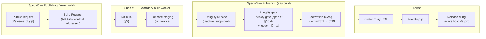
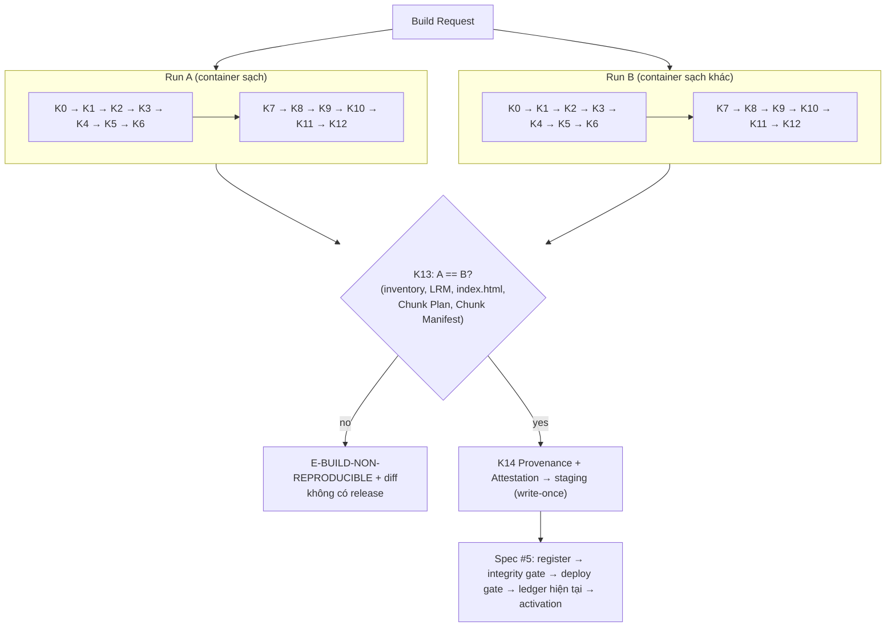
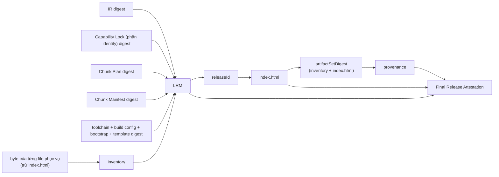
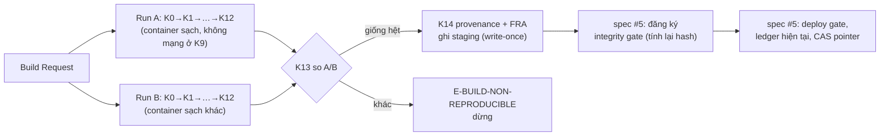
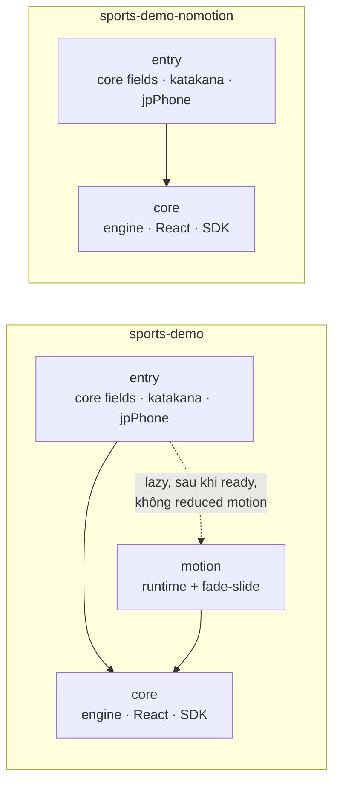
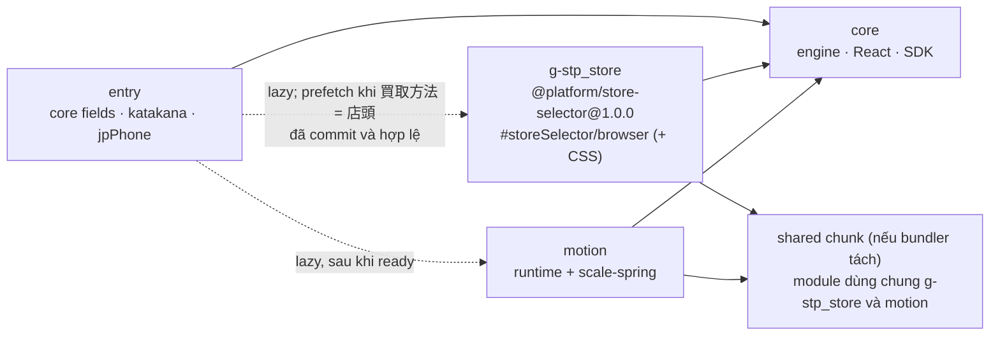

# Spec #3: Compiler, Bundle & Release Architecture (Design Proposal)

> **Trạng thái: PROPOSAL, revision 2.3** (2026-10-24).
> - Rev 2.3: đồng bộ catalog diagnostic với spec #4 rev 2.1 (§18.1a); IR preview chỉ được thực thi trong runtime preview cô lập trên origin riêng (ADR-053, §5.1).
> - Rev 2.1: thêm mode `preview` (§5.1) theo spec #4.
> - Rev 2.2: theo spec #4 review #1: `preview` là **tập con phân tích an toàn cho browser**, không có node hoàn tất tổng hợp (dùng `PREVIEW_ONLY_UNCONFIGURED_PATH`); thêm mode **`preflight`** phía server, authoritative (§5.1).
> - Review #1 (rev 1): **CONDITIONALLY ACCEPTED FOR TECHNICAL VERIFICATION**; OD3-01 → ADR-041, OD3-02 → ADR-042 (SPIKE-GATE-01).
> - Rev 2 cập nhật theo **evidence của SPIKE-GATE-01** ([báo cáo](../../discovery/P01_SPIKE_GATE_01_REPORT.md), `docs/evidence/P01/spike-gate-01/`) và thêm pipeline consistency review (§5.4, §5.5). Thay đổi so với rev 1: §27.
> - Hướng đi đã duyệt: ADR-036..040 (spec #3 Answer #1..#5). Cơ chế trong tài liệu này **PROPOSED**.
> - **G1 NOT APPROVED.** G9 và G10 BLOCKED. Không có code; không có AWS.
> - Nguồn:
>   - [P01_BRAINSTORM_NOTES.md](../../discovery/P01_BRAINSTORM_NOTES.md), Session 3: Spec #3 Answer #1..#5 (đề xuất S3-P01..P21 được chuyển vào đây và thay thế bản trong notes)
>   - [DECISIONS.md](../../DECISIONS.md): ADR-002, 004, 005, 012, 017, 018, 030, 031, 036..040
>   - [Spec #1 rev 3.3](2026-10-23-form-schema-workflow-design.md) §8, §9, §13, §14
>   - [Spec #2 rev 2.4](2026-10-24-plugin-contracts-capability-registry-design.md) §9, §10, §11, §17
>   - Master BUILD-01..10, PERF-01..07, SEC-04/05
>
> Phạm vi: subsystem spec số 3 trên 6. Spec này là **nguồn sự thật** cho: compiler pipeline, định dạng Normalized IR và các manifest của release, chunk planning, release identity, reproducible build, artifact verification, cách runtime nạp release (bootstrap, lazy loading, prefetch) và measurement contract. **Không** gồm: lưu trữ release, activation, CDN, API (spec #5); Admin UI (spec #4); Motion preset contract (spec #6).
>
> Ví dụ JSON đã được kiểm cú pháp (§25). Mọi hash trong ví dụ là giá trị giả.

## 0. Cách đọc trạng thái

| Nhãn | Ý nghĩa |
|---|---|
| **APPROVED AS DESIGN DIRECTION** | User duyệt hướng đi. Cơ chế vẫn cần review. |
| **PROPOSED** | Claude đề xuất, chờ user review. |
| **OPEN** | Còn chờ user (§22). |
| *[Claude]* | Lựa chọn nhỏ để tài liệu đủ cụ thể; user có thể bác bỏ. |

### 0.1. Bảng tổng hợp quyết định

| ADR | Nội dung | Trạng thái |
|---|---|---|
| ADR-002 | Hybrid Form Compiler | ACCEPTED (G0) |
| ADR-005 | Kết luận performance chỉ từ artifact đã đo | ACCEPTED (G0) |
| ADR-018 | Spike cần gate riêng | APPROVED AS DESIGN DIRECTION |
| ADR-030, ADR-031 | Release store bất biến; một version mỗi plugin trong một form release | APPROVED (spec #2) |
| ADR-036 | Self-contained Form Release, không mutable shared runtime | APPROVED AS DESIGN DIRECTION |
| ADR-037 | Session pin; Stable Entry URL + Immutable Release URL; active ≠ supported | APPROVED AS DESIGN DIRECTION |
| ADR-038 | CSR + Loading Shell trung tính; measurement contract; prerender là tương lai | APPROVED AS DESIGN DIRECTION |
| ADR-039 | Byte-for-byte reproducible build; LRM; attestation; provenance | APPROVED AS DESIGN DIRECTION |
| ADR-040 | Hybrid code splitting + prefetch có điều kiện; chunk failure an toàn | APPROVED AS DESIGN DIRECTION |
| ADR-041 | Vite + Rolldown là ứng viên bundler đánh giá | APPROVED AS EVALUATION DIRECTION; spike: đáp ứng §9 (OD3-01 chờ user chọn chính thức) |
| ADR-042 | SPIKE-GATE-01 | APPROVED WITH LIMITED SCOPE; đã chạy (§25.2) |
| §5–§21 | Cơ chế | **PROPOSED** |
| ADR-041 (OD3-01) | Vite 8.3.5 + Rolldown 1.2.15 là baseline đã kiểm chứng; chốt implementation sau VG-01..03 | **CONDITIONALLY APPROVED** |
| ADR-043 (OD3-03) | WebKit có thể tải lại chunk đã prefetch; evaluation failure không tự reload | **ACCEPTED FOR P0** |
| ADR-044 (OD3-04) | pnpm là ứng viên ưu tiên ở P02 | **APPROVED AS EVALUATION DIRECTION** |
| ADR-045 | Node 20 EOL; P02 đánh giá Node 24 LTS | **ACCEPTED** |

---

## 1. Mục đích

Spec #1 định nghĩa form là dữ liệu; spec #2 định nghĩa capability là code đã phát hành. Spec #3 biến hai thứ đó thành **một release tĩnh, bất biến, tự chứa** cho từng form, và định nghĩa cách browser nạp đúng release đó. Ba thuộc tính phải chứng minh được:

1. **Isolation:** artifact chỉ chứa những gì form dùng (BUILD-02, BUILD-06), và browser chỉ tải những gì khách thật sự cần (ADR-040).
2. **Identity và integrity:** cùng input cho ra cùng byte và cùng `releaseId`; mọi byte được phục vụ đều có hash được kiểm trước activation (ADR-039).
3. **Revision safety:** khách đang điền form không bao giờ bị chuyển sang release khác, và runtime không bao giờ hydrate draft của release khác (ADR-037).

## 2. Goals, non-goals, anti-goals

**Goals**
- G3-1: Pipeline có stage rõ ràng, input/output xác định, stage thuần tách khỏi stage có side effect.
- G3-2: Chunk plan tất định từ IR + Capability Lock; không lấy path từ Admin JSON.
- G3-3: Release identity tất định, không vòng lặp hash; publish idempotent.
- G3-4: Build tái lập từng byte trong môi trường chuẩn, có bằng chứng.
- G3-5: Runtime nạp đúng release (active hoặc đã pin), lazy-load đúng nhánh, lỗi tải không làm mất dữ liệu.
- G3-6: Measurement contract tách shell, form visible, form ready.

**Non-goals (P0)**
- Không SSR/SSG/prerender (ADR-038). Không service worker.
- Không shared runtime giữa form (ADR-036).
- Không build farm, nhiều cloud builder, tất định giữa OS, build-cache orchestration (ADR-039).
- Không ký artifact (ADR-030). Không deploy AWS (G10).
- Không size-based chunk tuning trước khi có số đo.

**Anti-goals**
- Coi FCP của shell là performance của form.
- Coi "network không request" là bằng chứng "code không có trong artifact".
- Tạo `releaseId` mới bằng timestamp/random để che non-determinism.
- Phục vụ public một file không nằm trong integrity contract (ví dụ sourcemap).
- Âm thầm tải active release khi release đã pin gặp lỗi.

## 3. Ràng buộc

- Máy local: Node 20.20.2, Docker 29.1.3 (CURRENT_STATUS). Builder image và version chính xác chốt ở P02 sau G1.
- Compiler, analyzer, engine: TypeScript. Backend Python chỉ **đọc** IR và Capability Lock, không tham gia build *[Claude, theo spec #1 §14: analyzer chạy trong publish pipeline]*.
- Bundler chưa chọn (OD3-01). Mọi yêu cầu dưới đây viết độc lập với bundler.

---

## 4. Ranh giới và luồng tổng thể



| Loại dữ liệu | Ví dụ | Bất biến? | Thuộc identity? | Ai sở hữu |
|---|---|---|---|---|
| Build artifact phục vụ | `assets/*.js`, `*.css`, `form-ir.*.json` | ✔ | ✔ (LRM inventory) | spec #3 |
| Immutable release HTML | `/r/{releaseId}/index.html` | ✔ | ✘ (hash trong attestation) | spec #3 |
| Private build artifact | chunk manifest, bundle stats, Capability Lock, sourcemap debug | ✔ | chunk manifest + lock: ✔ qua digest; sourcemap: ✘ | spec #3 |
| Build provenance, attestation | `provenance.json`, `attestation.json` | ✔ (write-once) | ✘ | spec #3 |
| Mutable Stable Entry HTML | `/f/{site}/{form}/` | ✘ | ✘ | spec #5 (sinh từ attestation) |
| Operational status | activation, support, security, retention | ✘ | ✘ | spec #5 |

---

## 5. Compiler pipeline

### 5.1. Build Request (input duy nhất của compiler)

Spec #5 tạo Build Request khi một revision được duyệt publish. Mọi tham chiếu là digest; compiler không đọc gì "mới nhất".

```json
{
  "buildRequestFormat": 1,
  "mode": "release",
  "form": { "formId": "frm_pc_demo", "siteId": "site_pc_demo", "revision": "rev7" },
  "definitionSnapshot": "sha256:6f1c0e9a2b7d4c18e5f3a9b0d2c4e6f8a1b3c5d7e9f0a2b4c6d8e0f1a3b5c7d9",
  "blockRevisions": [
    { "blockId": "blk_customer_info", "revision": "r2", "digest": "sha256:0a1b2c3d4e5f60718293a4b5c6d7e8f9012345678901234567890abcdef01234" }
  ],
  "previousDataContract": "sha256:1b2c3d4e5f60718293a4b5c6d7e8f9012345678901234567890abcdef0123456",
  "registryCatalog": "sha256:2c3d4e5f60718293a4b5c6d7e8f9012345678901234567890abcdef012345678",
  "ledgerSnapshotId": "ledger-0042",
  "runtimeOverrideSnapshotId": "override-0007",
  "buildConfig": "sha256:3d4e5f60718293a4b5c6d7e8f9012345678901234567890abcdef0123456789a",
  "bootstrap": "sha256:da73c9ebdf5b7d9abcde5f7b9dbacd4f6b8dacbdef5b7d9abcdf4b6e8acdef5f",
  "releaseHtmlTemplate": "sha256:4b6a1f0e3d2c5b8a7f6e9d0c1b4a3f2e5d8c7b6a9f0e1d2c3b4a5f6e7d8c9b0a",
  "platformSource": { "commit": "4e5f60718293a4b5c6d7e8f90123456789012345" },
  "builderImage": "sha256:a24a135cdcf5d0925e02f2b582c1746aa9d0502b5ffc656db04afd623c698c36"
}
```

- `mode`: `release` (trusted) · `rebuild-verify` · `dev` (không trusted, cho phát triển) · *(rev 2.1)* `preview`.
- **`preview`** (spec #4 §14.1; rev 2.2): **không** phải cả pipeline. Admin chỉ chạy **tập con thuần, tất định, an toàn cho browser**: kiểm cấu trúc (K1), version gate (K2), kiểm tra resolve **chỉ đọc** trên catalog snapshot (K3, không đọc store), expand/lower (K4), phân tích ngữ nghĩa (K5), sinh IR (K6) — bằng **cùng package TS và cùng version** với server. Package này không phụ thuộc code server-only, không I/O, không nạp plugin source. Input do Admin tải qua API (draft, block revision đã pin, catalog/ledger snapshot). Khác `release`: chỉ dừng ở diagnostic `gate: preview`; đích transition còn trống được lower thành node **`PREVIEW_ONLY_UNCONFIGURED_PATH`** (spec #1 §8.1: điểm dừng bị chặn, **không** phải hoàn tất). Không K7–K14, không artifact, **không authoritative**. *(rev 2.3, ADR-053)* Phân tích chạy trong Admin; IR preview chỉ được **thực thi** trong runtime preview cô lập (iframe trên origin preview riêng, spec #4 §14.7), không bao giờ trong document của Admin.
- **`preflight`** (rev 2.2): K0–K6 chạy **phía server** (build worker), cùng package, input theo digest; là kết quả **authoritative** cho mức Review-ready, cho Submission Simulation (IR do server sinh, không tin IR của Admin) và trước publish. IR preflight không bao giờ chứa `PREVIEW_ONLY_UNCONFIGURED_PATH` (`E-IR-PREVIEW-NODE`). Kết quả gồm version analyzer, `inputIds` (`draftVersion`, `catalogSnapshotId`, `ledgerSnapshotId`, `runtimeOverrideSnapshotId`) và digest **chỉ** của diagnostic K1–K6 để Admin phát hiện lệch (spec #4 §14.3); kết quả kiểm của spec #5 (ledger hiện tại, support matrix) trả riêng, ngoài digest.
- `previousDataContract` vắng khi là revision đầu.
- `bootstrap` và `releaseHtmlTemplate` (template `index.html` + CSS shell) là **platform asset** do trusted pipeline phát hành vào release store, được pin bằng digest như plugin (§14.1).
- `ledgerSnapshotId` và `runtimeOverrideSnapshotId` cho K3 một snapshot cố định của trạng thái plugin, nên K3 là hàm thuần. Spec #5 kiểm lại trạng thái **hiện tại** trước activation.
- **`buildOptions`** (private, không phải Build Request): ví dụ `sourcemap: private`, mức chi tiết báo cáo. Không được làm đổi byte phục vụ (TM-B15) nên không thuộc identity.
- **Lưu trữ:** Build Request được lưu trong provenance và release record (spec #5). Snapshot definition/block mà nó trỏ tới được giữ ít nhất bằng thời gian giữ release.
- **`rebuild-verify`:** đọc **Build Request đã lưu** của release, chạy lại K0..K12 với **lock đã lưu** thay cho K3, rồi so với release gốc (LRM digest, `index.html`, inventory). Đây là kiểm chứng; không tạo release.

### 5.2. Các stage

| # | Stage | Input → Output | Thuần? | Side effect | Cache an toàn? | Fail closed | Mode `rebuild-verify` |
|---|---|---|---|---|---|---|---|
| K0 | Intake & freeze | Build Request → các input đã tải và kiểm digest | ✘ | **đọc** store theo digest | — | ✔ (`E-BUILD-INPUT-DIGEST`, `E-BUILD-UNTRUSTED-SOURCE`) | đọc Build Request đã lưu + LRM + lock của release |
| K1 | Structural validation | definition, block → hợp lệ theo JSON Schema của `schemaVersion` (spec #1 §7.7) | ✔ | — | ✔ (dev) | ✔ | chạy |
| K2 | Version gate | `schemaVersion` được engine hỗ trợ | ✔ | — | ✔ | ✔ | chạy |
| K3 | Capability resolution | definition + block + catalog + ledger snapshot + override snapshot → **Capability Lock** (identity + resolution context, spec #2 §9.2) | ✔ | — | ✔ | ✔ với `E-CAP-*`; `W-CAP-DEPRECATED` ghi lại | **bỏ qua**, dùng lock đã lưu |
| K4 | Expand & lower | inline block, qualified identity, `skipWhen` → edge (spec #1 §14) | ✔ | — | ✔ | ✔ | chạy |
| K5 | Semantic & workflow analysis | identity, reference, type, permission/classification (spec #2 §13), graph, data contract diff | ✔ | — | ✔ | ✔ với `E-*`; `W-*` ghi lại | chạy |
| K6 | Emit IR | → **Normalized IR**, **Data Contract** (canonical JSON, §6) | ✔ | — | ✔ | ✔ | so với digest trong LRM |
| K7 | Chunk planning | IR + lock + build config → **Chunk Plan** (§7) | ✔ | — | ✔ | ✔ (`E-CHUNK-PLAN-*`) | chạy |
| K8 | Code generation | Chunk Plan → entry module, group module, capability map (§8) | ✔ | — | ✔ | ✔ | chạy |
| K9 | Bundle | module sinh ra + facet từ release store → `dist/` + module graph của bundler | ✘ (process, file tạm) | ghi thư mục tạm, **không mạng** | ✘ ở `release` | ✔ | chạy |
| K10 | Artifact verification | `dist/` + module graph + Chunk Plan → **Chunk Manifest** + kết quả kiểm (§10) | ✔ | — | ✘ | ✔ | chạy |
| K11 | LRM & `releaseId` | IR, Data Contract, lock, plan, Chunk Manifest, toolchain, inventory → **LRM** → `releaseId` (§11) | ✔ | — | — | ✔ | so `releaseId` |
| K12 | Release HTML | LRM + `releaseId` + template → `index.html` (§11.4) | ✔ | — | — | ✔ | so hash |
| K13 | Reproducibility verification | **điều phối** hai lần chạy K0..K12 độc lập rồi so sánh (§12). K13 không đứng sau K12 trong một lần chạy; nó bao hai lần chạy. | ✘ (điều phối) | chạy hai builder | ✘ | ✔ (`E-BUILD-NON-REPRODUCIBLE`) | so lần chạy lại với release gốc |
| K14 | Attestation & handoff | → **provenance**, **Final Release Attestation**; ghi release bundle vào staging (write-once) | ✘ | **ghi** staging | ✘ | ✔ | không ghi; chỉ báo cáo |

**Ngoài compiler (spec #5):** tạo Build Request; đăng ký release; integrity gate đọc lại từ storage; deploy gate (spec #2 §10.4); kiểm ledger **hiện tại** (trạng thái có thể đã đổi kể từ snapshot ở K3); activation; sinh `entry.html`; CDN. **Không có stage nào của compiler gọi AWS.**

- Chỉ K0 (đọc), K9 (process + file tạm), K13 (điều phối) và K14 (ghi staging) có side effect. K1–K8, K10–K12 là hàm thuần của input đã freeze.
- **Cache:** K1–K8 có thể cache theo digest input ở mode `dev`. Ở mode `release`, cả hai lần chạy của K13 đều sạch, không cache (ADR-039).
- Mọi stage fail closed; chỉ K3 và K5 có cảnh báo không chặn (`W-*`).
- **Thứ tự tất định cho mọi mảng** (áp cho Chunk Plan, Chunk Manifest, lock, inventory, provenance): mảng mang ngữ nghĩa thứ tự (step, field, transition) giữ đúng thứ tự trong IR; mọi mảng khác sắp theo khóa định nghĩa sẵn (bảng ở §11.1). JCS không sắp xếp mảng, nên quy tắc này là bắt buộc.



### 5.3. Thứ tự hash (không vòng lặp)



Không nút nào phụ thuộc vào nút đứng sau nó. Không file trong inventory chứa `releaseId`; `index.html` là file duy nhất chứa `releaseId` và nằm ngoài LRM. *(Spike EXP-02: thứ tự này cho `releaseId` giống hệt giữa hai build sạch, khi đổi thư mục làm việc trong container và giữa macOS/Linux arm64.)*

### 5.4. Thứ tự thực thi và ma trận phụ thuộc stage (rev 2, pipeline consistency review)



| Stage | Phụ thuộc (output của) | Sinh ra | Ghi vào | Hash nào bao phủ | Đóng băng sau | Chạy lại ở mỗi lần build của K13 |
|---|---|---|---|---|---|---|
| K0 | Build Request | input đã freeze theo digest | thư mục làm việc tạm (input chỉ đọc) | digest trong Build Request; một phần vào `LRM.inputs` | K0 | ✔ |
| K1, K2 | K0 | kết quả kiểm | — | — | — | ✔ |
| K3 | K0, K2 | Capability Lock (identity + context) | private tạm | phần identity → `LRM.inputs.capabilityLock` | K3 | ✔ (`release`); thay bằng lock đã lưu (`rebuild-verify`) |
| K4, K5 | K3, K1 | definition đã expand; diagnostic; diff Data Contract | báo cáo | — | — | ✔ |
| K6 | K5 | IR, Data Contract | IR → thư mục phục vụ; Data Contract → private | `LRM.inputs.ir` (= sha256 file IR), `LRM.inputs.dataContract` | K6 | ✔ |
| K7 | K6, K3, build config | Chunk Plan | private | `LRM.inputs.chunkPlan` | K7 | ✔ |
| K8 | K7 | module sinh ra | thư mục `gen` tạm (không phục vụ) | gián tiếp qua byte phục vụ | K8 | ✔ |
| K9 | K8, facet từ release store, lockfile | file phục vụ (trừ IR, `index.html`), module graph | thư mục output tạm | inventory (K11) | — | ✔ |
| K10 | K9, K7, K3 (lock cho INV-F1 và L1b) | Chunk Manifest, kết quả kiểm | private | `LRM.inputs.chunkManifest` | **tập file phục vụ đóng băng** | ✔ |
| K11 | K0 (digest build config, bootstrap, template), K3, K6, K7, K10, toolchain, inventory | LRM, `releaseId` (ứng viên) | private | chính LRM | K11 | ✔ |
| K12 | K11, template | `index.html` | thư mục phục vụ (ngoài inventory) | `FRA.indexHtmlSha256`, `artifactSetDigest` | K12 | ✔ |
| K13 | output A và B | kết luận + diff | báo cáo | — | — | (điều phối) |
| K14 | K13 pass | provenance, FRA, release bundle | **staging** (write-once) | FRA: `lrmDigest`, `indexHtmlSha256`, `artifactSetDigest`, `provenanceDigest` | K14 | không (một lần) |
| spec #5 đăng ký | staging | release record | release store | integrity gate tính lại toàn bộ | — | — |
| spec #5 activation | release record | active pointer | pointer store | — | — | — |

### 5.5. Trả lời pipeline consistency review (spec #3 review #1 §4)

| Câu hỏi | Trả lời |
|---|---|
| Orchestrator chạy lại stage nào cho hai build độc lập? | **Toàn bộ K0–K12** ở mỗi lần, trong container sạch riêng, không cache chung. K3 chạy ở cả hai lần (hàm thuần của snapshot); ở `rebuild-verify` K3 được thay bằng lock đã lưu. |
| LRM tính trước hay sau reproducibility verification? | **Trước**: mỗi lần chạy tự tính LRM và `releaseId` ở K11. K13 so hai LRM (và mọi file). `releaseId` chỉ là **ứng viên** cho tới khi K13 pass; không có gì được ghi ra ngoài thư mục tạm trước K14. |
| Có artifact nào bị đổi sau khi hash không? | Không. Sau K10, tập file phục vụ bị đóng băng; K11 hash nó. K12 chỉ **thêm** `index.html` (nằm ngoài inventory, được hash trong FRA). K14 chỉ ghi metadata private và copy nguyên vẹn sang staging. Minify và mọi hậu xử lý của bundler đều nằm trong K9, trước K10. |
| Attestation cover những gì? | `lrmDigest` (bao gồm inventory của mọi file phục vụ trừ `index.html`, cộng digest của IR, Data Contract, phần identity của lock, Chunk Plan, Chunk Manifest, build config, bootstrap, template), `indexHtmlSha256`, `artifactSetDigest` (mọi file phục vụ kể cả `index.html`), `provenanceDigest`. |
| File nằm ngoài inventory xử lý thế nào? | Trong thư mục phục vụ: ngoài inventory + `index.html` → `E-ARTIFACT-UNEXPECTED-FILE` (K10 và integrity gate của spec #5). Private, danh sách đóng: `lrm.json` (digest = `lrmDigest` trong FRA), `data-contract.json`, `capability-lock.json`, `chunk-plan.json`, `chunk-manifest.json` (bao qua digest trong LRM), `attestation.json`, `provenance.json`; sourcemap debug và bundle stats được liệt kê kèm hash trong `provenance.privateArtifacts`; file private khác → staging từ chối. |
| Stage sau có thể đổi output stage trước mà không làm mất hiệu lực hash không? | Không có đường nào: (1) mỗi stage chỉ ghi vào vùng của nó (bảng §5.4); (2) K11 hash sau khi tập file phục vụ đóng băng; (3) integrity gate của spec #5 **tính lại** mọi hash từ storage trước đăng ký và trước activation, nên bất kỳ thay đổi nào sau K14 đều bị phát hiện. |
| Side effect staging của compiler và side effect publishing của spec #5 tách thế nào? | Compiler chỉ **đọc** input theo digest (snapshot definition, **plugin** release store của spec #2, platform asset) và chỉ **ghi staging** (write-once theo `releaseId`). Nó không có quyền vào **form release store** (nơi phục vụ) hay active pointer. Spec #5 đọc staging, tự kiểm lại, kiểm trùng `releaseId` với form release store (nơi duy nhất quyết định collision), chép sang release store, rồi activation. Không bước nào của compiler gọi AWS hay đổi pointer. |

---

## 6. Normalized IR và Data Contract (spec #1 §12 giao cho spec #3)

- **IR envelope:** `{ "irFormat": 1, "engineIrRange": ">=1.0.0 <2.0.0", "form": {...}, "steps": [...], "nodes": [...], "conditions": {...}, "capabilities": { alias: CK }, "effects": [...] }`. Nội dung là kết quả K4–K5 của spec #1 (phẳng, đã resolve, không dạng viết tắt). Có JSON Schema 2020-12 riêng; TS engine và Python evaluator cùng đọc (ADR-017).
- **Canonical:** RFC 8785, UTF-8; key sắp xếp; mảng giữ thứ tự ngữ nghĩa (thứ tự step, thứ tự field), không sắp xếp lại.
- **Phân phối:** IR là **file asset** `assets/form-ir.<hash>.json` trong inventory, được `index.html` preload. Byte của file **chính là** JCS(IR), nên `sha256(file)` = `inputs.ir` trong LRM (K11 kiểm). Backend dùng **đúng byte đó** (lưu kèm release record, spec #5). *[Claude: tách file thay vì inline vào HTML để HTML nhỏ, IR cache được, và backend/browser dùng cùng byte.]*
- **Data Contract:** `{ dataContractFormat: 1, keys: [{ key, type, classification, include }] }`, dùng cho diff ở K5 và cho backend projection (spec #1 §7.6.7).
- IR **không** chứa giá trị khách (spec #1 §16).

---

## 7. Chunk planning (K7, ADR-040)

### 7.1. Đơn vị tải

| Đơn vị | Ví dụ | Vị trí |
|---|---|---|
| Engine + React DOM adapter | state machine, rule evaluator, renderer | **core** |
| Shared externals | React, React DOM, platform SDK (một bản, spec #2 §11.4) | **core** |
| Core field component được form dùng | `text`, `choice.radio`, `tel` | entry *[Claude]* |
| Validator (`cross-runtime-pure`, bản TS) | `jpPhone`, `katakana` | entry *[Claude]* |
| `fieldType` plugin (browser facet) | `storeSelector` | entry nếu dùng ở step đầu; ngược lại **lazy** |
| Motion runtime + preset của form (core, spec #6) | `fade-slide`, `scale-spring` | **lazy** group `motion`; không có nếu form không dùng Motion |

*[Claude]* Core field và validator luôn ở entry vì nhỏ và cần cho validation; tách chúng tạo nhiều chunk rất nhỏ (over-splitting). Điều chỉnh theo kích thước chỉ sau khi có số đo (P1).

**Chunk `core`** *(sửa sau consistency review)*: plugin khai React và SDK là peer (spec #2 §6.5), nên chunk của group phải import tĩnh React/SDK từ đâu đó. Nếu chúng nằm trong entry, group sẽ import tĩnh entry trong khi entry `import()` group → **vòng** entry↔group, và tên file theo hash nội dung cũng thành vòng. Vì vậy engine, adapter và shared externals nằm trong chunk riêng `core`:
- `entry` → `core` (tĩnh); `entry` → group (`import()`); group → `core` (tĩnh); `motion` → `core` (tĩnh).
- `core` không import gì của entry hay group. Đồ thị import **tĩnh** giữa các chunk là DAG; cạnh động chỉ đi từ entry (hoặc từ group tới group con, nếu có) xuống.
- `core` tải cùng entry (song song) nên không làm chậm T2; nó chỉ là ranh giới để tránh vòng.

### 7.2. Thuật toán (tất định)

1. Với mỗi `fieldType` plugin `u` trong Capability Lock, tính `U(u)` = tập step **đặt** field dùng nó (sau K4, block đã inline). Step `review` không tính vào `U(u)`: nhu cầu hiển thị tóm tắt ở 確認 được xử lý lúc runtime (§15.1).
2. `u` thuộc **entry** nếu step bắt đầu ∈ `U(u)`.
3. Các `u` còn lại nhóm theo `U(u)`: cùng tập step → cùng **group**. `label` = id của step xuất hiện **sớm nhất trong mảng `steps` của IR** (thứ tự khai báo, duy nhất) thuộc `U`; `groupId = "g-" + label`. Hai group trùng label → sắp các group đó theo danh sách chỉ số step (trong mảng `steps`) tăng dần, group đầu giữ label, các group sau thêm `-2`, `-3`.
4. Form có Motion → group `motion` (lazy). Không có Motion → **không có** group này, và codegen không sinh bất kỳ tham chiếu nào tới Motion.
5. Mỗi group có `triggerSteps = U(group)` (cho prefetch, §15.2).
6. Module dùng chung giữa các group được bundler tách thành **shared chunk trong release** khi có lợi; điều này được ghi vào Chunk Manifest, không thay đổi Chunk Plan.
7. Không bao giờ: một chunk chung cho nhiều release; import toàn registry; group cho design facet hay server facet.

**Chunk Plan** (private, digest trong LRM): `{ chunkPlanFormat: 1, core: { units }, entry: { units }, groups: [{ groupId, units: [FBK...], triggerSteps: [...] }] }`. `groups` sắp theo chỉ số step nhỏ nhất rồi `groupId`; `units` sắp theo chuỗi FBK/id module; `triggerSteps` theo thứ tự trong IR.

### 7.3. Chunk graph: Sports

`sports-demo` (Motion `fade-slide`) và `sports-demo-nomotion`. Không có plugin `fieldType`; validator `katakana`, `jpPhone` từ block `customer-info`.



- `sports-demo-nomotion`: chỉ có entry và core. Không group `motion`, không `import()` tới Motion, không module Motion trong module graph (TM-C02).
- Cả hai: không module nào của `@platform/store-selector` (TM-C01).

### 7.4. Chunk graph: PC

`pc-demo` (Motion `scale-spring`). `storeSelector` chỉ dùng ở `stp_store` (nhánh 店頭).



- Nhánh 宅配 (`stp_takuhai`) không dùng plugin nào → không có group; khách đi 宅配 không bao giờ tải `g-stp_store` (TM-C04). Ở 確認 của nhánh 宅配, field `store` inactive nên cũng không cần `g-stp_store` (§15.1).
- Cạnh liền là import tĩnh, cạnh đứt là `import()`.
- `storeList` và `storeIdValid` là server facet → không có trong bất kỳ chunk nào (TM-C07).

---

## 8. Code generation (K8)

- **Entry module** (sinh ra, chỉ có import + bootstrap của runtime): import tĩnh literal tới `core`, core field dùng trong form, validator TS và `fieldType` của entry; tạo **scoped capability map** (key CK, spec #2 §5.3) và truyền vào engine bằng DI.
- **Group loader:** với mỗi group, một hàm `() => import("./g-stp_store.js")` với **specifier literal** (INV-F3); bundler đổi thành tên có hash. Không có specifier ghép chuỗi hay biến. Group loader chịu trách nhiệm nạp CSS của group bằng `<link rel="stylesheet">` same-origin (không style inline) ở mọi đường tải (bậc 0 có thể ủy cho helper preload của bundler, xem §9), và group chỉ "sẵn sàng" khi cả JS và CSS đã tải (tránh nháy giao diện).
- **Không có registry toàn bộ.** Code sinh ra không import catalog, không import package `@platform/*` nào ngoài những gì có trong Chunk Plan.
- **Engine không tham chiếu Motion.** Motion chỉ được import từ module group `motion` do codegen sinh; luật L3 cấm package engine import Motion (bổ sung spec #2 §11.2).
- Nguồn của mọi specifier: Chunk Plan ← Capability Lock ← catalog (spec #2). Definition chỉ đóng góp alias đã được kiểm ngữ pháp; không chuỗi nào từ definition trở thành specifier.

---

## 9. Bundle (K9)

**Yêu cầu với bundler (độc lập với lựa chọn ở OD3-01):**

| Yêu cầu | Lý do |
|---|---|
| Output tất định (thứ tự module, tên chunk, hash) | ADR-039 |
| Hỗ trợ export condition tùy chỉnh (`design` không bật ở build khách) | spec #2 L1; kiểm ở spike |
| Xuất module graph đầy đủ (module → chunk, import tĩnh/động) | K10, Chunk Manifest |
| Code splitting theo `import()` literal; kiểm soát được shared chunk | §7 |
| ESM output; chunk naming theo content hash | cache bất biến |
| Resolve plugin từ release store (alias tới thư mục release, spec #2 §9.4); shared externals về đúng một bản | spec #2 §11.4 |
| Không sinh sourcemap vào thư mục phục vụ; không chèn `sourceMappingURL` | §11.5 |
| Chạy được không mạng | ADR-039 |
| Tên file chỉ gồm `[a-z0-9._-]` | §11.1. *(Spike: Rolldown mặc định sinh hash có chữ hoa và `_`; phải đặt `output.hashCharacters: 'hex'` và `[hash:12]`.)* |
| **L1b — resolve allowlist** *(rev 2, từ EXP-03)*: plugin của compiler trong bundler từ chối mọi module resolve ra ngoài tập cho phép: facet được phép của FBK trong lock (browser + `contract`), engine/core, Motion runtime và preset của core (chỉ trong group `motion`), shared externals, module sinh ra ở K8, và **danh sách đóng các module ảo của bundler** (ví dụ `virtual:vite/preload-helper`, `virtual:rolldown/runtime`); module có file thật phải có đuôi JS/CSS/JSON | Spike: `exports` không áp cho import tương đối trong package; design (n2) và cả file `.py` (n4) lọt vào build khách |

- Builder: canonical image (§12.1), thư mục làm việc cố định trong container, không mạng.
- **Cấu hình đã kiểm ở spike (Vite 8.3.5 + Rolldown 1.2.15):** `build.rolldownOptions.input`; `build.rolldownOptions.output.codeSplitting.groups` (nhóm `core`); `entryFileNames`/`chunkFileNames`/`assetFileNames` với `[hash:12]`; `hashCharacters: 'hex'`; `base: './'` (đường dẫn tương đối, không có `releaseId` trong asset); `build.modulePreload.polyfill: false`; `resolve.conditions` không có `design` ở build khách. Không dùng `rollupOptions`, `advancedChunks`, `manualChunks` (deprecated).
- **Nạp CSS của group** thuộc trách nhiệm của **group loader** (§8) ở mọi đường. Với Vite, ở lần tải thường (bậc 0) helper preload (`virtual:vite/preload-helper`) làm việc này; ở retry bậc 1 không đi qua helper nên group loader tự chèn `<link>` (§15.3).
- Tên file: `assets/<label>.<hash>.<ext>`, `hash` do bundler sinh **tất định**; chỉ ký tự `[a-z0-9._-]`. Vì đồ thị import tĩnh là DAG (§7.1), tên có hash tính được theo thứ tự phụ thuộc, không vòng. Hash trong tên file **không** phải bằng chứng integrity; `sha256` trong inventory mới là bằng chứng. *(Ví dụ trong tài liệu dùng 12 hex đầu của sha256 cho dễ đọc.)*

---

## 10. Artifact verification (K10)

Chạy trên output thật của K9, không tin lớp nào trước đó (spec #2 L5).

| Kiểm tra | Nguồn | Mã lỗi |
|---|---|---|
| Mọi module trong module graph thuộc tập cho phép: engine, shared externals (một bản), `contract`, browser facet của FBK trong lock, thư viện đã gói trong facet đó, và Motion runtime + preset của core **chỉ trong group `motion`** khi form dùng Motion (INV-F1, spec #2 rev 2.3) | module graph | `E-ARTIFACT-ILLEGAL-MODULE` |
| Không module/marker của design facet, `fixtures/`, test, mock (INV-F2); không file `.py` hay mã Python (INV-F4 phía artifact) | module graph + quét nội dung | `E-ARTIFACT-FORBIDDEN-FACET` |
| Đúng một React, một React DOM (INV-F7) | module graph | `E-ARTIFACT-DUPLICATE-SINGLETON` |
| Chunk thực tế khớp Chunk Plan: mỗi group có chunk; không chunk ngoài plan trừ shared chunk được ghi nhận; không module của group A xuất hiện ở entry | module graph + plan | `E-ARTIFACT-UNEXPECTED-CHUNK`, `E-CHUNK-PLAN-MISMATCH` |
| Form không Motion: không module Motion, không `import()` tới Motion | module graph + quét specifier | `E-ARTIFACT-MOTION-PRESENT` |
| Đồ thị import **tĩnh** giữa chunk là DAG; entry → group chỉ qua `import()`; `core` không import entry/group | module graph | `E-ARTIFACT-CHUNK-CYCLE` |
| Không `.map` trong thư mục phục vụ; không comment `sourceMappingURL` | inventory + quét | `E-ARTIFACT-PUBLIC-SOURCEMAP` |
| Không đường dẫn tuyệt đối của máy build (ví dụ thư mục làm việc trong container, `/home/`, `/Users/`, `C:\`) trong file phục vụ **và** trong artifact private thuộc identity (Chunk Plan, Chunk Manifest, lock) | quét nội dung | `E-ARTIFACT-ABSOLUTE-PATH` |
| Không secret (scanner, spec #2 L4) | quét nội dung | `E-ARTIFACT-SECRET` |
| Path hợp lệ, không trùng khi bỏ qua hoa/thường | inventory | `E-ARTIFACT-PATH-COLLISION` |
| *(rev 2)* Không module nào nằm ngoài resolve allowlist (L1b); không module có đuôi khác JS/CSS/JSON (ví dụ `.py`) | module graph | `E-ARTIFACT-ILLEGAL-MODULE` |

Output: **Chunk Manifest** (private, digest trong LRM): `{ chunkManifestFormat: 1, chunks: [{ file, sha256, kind: core|entry|group|shared, groupId?, modules: [...], staticImports: [...], dynamicImports: [...] }] }`. Đây là build graph evidence cho TM-C.
- **Module id được chuẩn hóa**, không bao giờ là đường dẫn tuyệt đối: `pkg:<name>@<version>/<path trong package>` (thư viện), `rel:<PRK>/<facet>/<path>` (facet plugin từ release store), `gen:<path tương đối>` (module do compiler sinh), `platform:<package>@<version>/<path>` (engine, core), `virtual:<tên>` (module ảo của bundler, bỏ ký tự điều khiển như `\0`). Id không chuẩn hóa được → `E-CHUNK-MANIFEST-MODULE-ID`.
- Sắp xếp: `chunks` theo `file`; `modules`, `staticImports`, `dynamicImports` theo chuỗi.

---

## 11. Release identity, HTML, attestation, provenance (ADR-039)

### 11.1. Logical Release Manifest (LRM)

| Trường | Nội dung |
|---|---|
| `lrmFormat` | `1`; có JSON Schema riêng; đổi cấu trúc = tăng số |
| `form` | `formId`, `siteId`, `revision`, `schemaVersion` |
| `inputs` | digest của IR (= sha256 của file IR), Data Contract, **phần identity** của Capability Lock, Chunk Plan, Chunk Manifest, build config, bootstrap, release HTML template (gồm CSS shell) |
| `toolchain` | version chính xác: engine, `browserHostApi`, compiler, bundler, minifier, Node, package manager, shared externals; digest builder image; digest lockfile |
| `inventory` | mọi file phục vụ dưới `/r/{releaseId}/` **trừ** `index.html`: `{ path, size, sha256, contentType }` |

- **Serialization:** RFC 8785 (JCS), UTF-8; số nguyên; không trường `null` (bỏ hẳn).
- **Hash:** SHA-256. Digest viết `sha256:<64 hex>`.
- **Path:** tương đối với gốc release; `/`; `[a-z0-9._/-]`; cấm `..`, `./`, `/` đầu, `//`, rỗng; trùng khi bỏ hoa/thường → lỗi; sắp xếp theo byte UTF-8.
- **`contentType`:** từ bảng cố định theo đuôi file.
- **Không thuộc LRM** (để `releaseId` không đổi khi chúng đổi): resolution context của lock (hash catalog, ledger/override snapshot), `buildOptions` (ví dụ `sourcemap: private`), platform commit, thời điểm, pipeline, operator. Chúng nằm trong provenance.
- **Khóa sắp xếp:** `inventory` theo `path` (byte UTF-8); `sharedExternals` theo tên; các mảng của Chunk Plan, Chunk Manifest như §7.2, §10; lock theo chuỗi CK rồi FBK; `resolvedDependencies` của provenance theo `name` rồi `version`.

### 11.2. `releaseId`

- `releaseId = "rel_" + base32-thường-không-padding(sha256(JCS(LRM)))[:26]` (130 bit). Digest đầy đủ ở attestation.
- Cùng LRM → cùng `releaseId`; đăng ký lại → no-op. Trùng `releaseId` mà digest/LRM khác → `E-RELEASE-ID-COLLISION`.
- Input có ý nghĩa khác (IR, lock, toolchain, config…) → LRM khác → `releaseId` khác.
- **Cùng input khai báo mà byte khác** → K13 fail `E-BUILD-NON-REPRODUCIBLE`; không có release nào được tạo. Đây không bao giờ là cách tạo release mới.
- Không timestamp, random, hostname, thời gian build trong LRM.

### 11.3. Ví dụ LRM: `pc-demo` rev7

```json
{
  "lrmFormat": 1,
  "form": { "formId": "frm_pc_demo", "siteId": "site_pc_demo", "revision": "rev7", "schemaVersion": "1.0.0" },
  "inputs": {
    "ir": "sha256:9e8d7c6b5a40f1e2d3c4b5a6978877665544332211009988776655443322110f",
    "dataContract": "sha256:8b2e4d6f8a0c2e4b6d8f0a2c4e6b8d0f2a4c6e8b0d2f4a6c8e0b2d4f6a8c0e2a",
    "capabilityLock": "sha256:9c3f5e7a9b1d3f5c7e9a1b3d5f7c9e1a3b5d7f9c1e3a5b7d9f1c3e5a7b9d1f3b",
    "chunkPlan": "sha256:ad40f6b8ac2e4a6d8fab2c4e6a8dfb1c3e5a7d9fbc2e4a6d8fac1e3b5d7f9a2c",
    "chunkManifest": "sha256:be51a7c9bd3f5b7e9abc3d5f7b9eab2d4f6b8eabcd3f5b7e9abd2f4c6e8abc3d",
    "buildConfig": "sha256:cf62b8dace4a6c8fabcd4e6a8cafbc3e5a7c9fbcde4a6c8fabce3a5d7f9bcd4e",
    "bootstrap": "sha256:da73c9ebdf5b7d9abcde5f7b9dbacd4f6b8dacbdef5b7d9abcdf4b6e8acdef5f",
    "releaseHtmlTemplate": "sha256:4b6a1f0e3d2c5b8a7f6e9d0c1b4a3f2e5d8c7b6a9f0e1d2c3b4a5f6e7d8c9b0a"
  },
  "toolchain": {
    "engine": "1.0.0",
    "browserHostApi": "1.0.0",
    "compiler": "1.0.0",
    "bundler": { "name": "bundler-tbd-od3-01", "version": "0.0.0" },
    "minifier": { "name": "minifier-tbd-od3-01", "version": "0.0.0" },
    "node": "20.20.2",
    "packageManager": { "name": "pm-tbd-p02", "version": "0.0.0" },
    "sharedExternals": { "react": "0.0.0-tbd", "react-dom": "0.0.0-tbd", "@platform/sdk-browser": "1.0.0" },
    "builderImage": "sha256:a24a135cdcf5d0925e02f2b582c1746aa9d0502b5ffc656db04afd623c698c36",
    "lockfile": "sha256:eb84dafce06c8eabcdef6a8cafebcde5a7c9ebdcefa6c8eabcde5c7f9bdef6a0"
  },
  "inventory": [
    { "path": "assets/core.6d5e4f3a2b10.js", "size": 52418, "sha256": "6d5e4f3a2b1009f8e7d6c5b4a39281706f5e4d3c2b1a09f8e7d6c5b4a3928170", "contentType": "text/javascript" },
    { "path": "assets/entry.3f9a1c2b7d10.js", "size": 8816, "sha256": "3f9a1c2b7d10e4f5a6b7c8d9e0f1a2b3c4d5e6f7a8b9c0d1e2f3a4b5c6d7e8f9", "contentType": "text/javascript" },
    { "path": "assets/form-ir.9e8d7c6b5a40.json", "size": 18320, "sha256": "9e8d7c6b5a40f1e2d3c4b5a6978877665544332211009988776655443322110f", "contentType": "application/json" },
    { "path": "assets/form.a1b2c3d4e5f6.css", "size": 7310, "sha256": "a1b2c3d4e5f6a7b8c9d0e1f2a3b4c5d6e7f8a9b0c1d2e3f4a5b6c7d8e9f0a1b2", "contentType": "text/css" },
    { "path": "assets/g-stp_store.2a3b4c5d6e7f.css", "size": 1204, "sha256": "2a3b4c5d6e7f8091a2b3c4d5e6f708192a3b4c5d6e7f8091a2b3c4d5e6f70819", "contentType": "text/css" },
    { "path": "assets/g-stp_store.5c4b3a291807.js", "size": 9120, "sha256": "5c4b3a291807f6e5d4c3b2a1908f7e6d5c4b3a291807f6e5d4c3b2a1908f7e6d", "contentType": "text/javascript" },
    { "path": "assets/motion.c0ffee123456.js", "size": 28750, "sha256": "c0ffee123456789abcdef0123456789abcdef0123456789abcdef0123456789a", "contentType": "text/javascript" }
  ]
}
```

*(Kích thước là số giả để minh họa cấu trúc, không phải số đo. Tên bundler/minifier/package manager là placeholder vì OD3-01/P02 chưa chốt.)*

### 11.4. `index.html` của release

Sinh sau `releaseId` bằng template tất định (K12). Chỉ chứa:
- `<script type="application/json" id="release">{ releaseId, formId, revision, load: { entry, entryIntegrity, core, coreIntegrity, css, cssIntegrity, ir, irIntegrity, bootstrap, bootstrapIntegrity, shellCssSha256 }, groups: { groupId: { js: [paths], css: [paths] } } }</script>` — dữ liệu, không thực thi. `groups` dùng cho cả tải và prefetch (§15).
- CSS shell inline tối thiểu lấy từ template, `<noscript>`.
- **CSP theo từng document** *(spec #5 phục vụ)*: `script-src 'self'`; `style-src 'self' 'sha256-<shellCssSha256>'`; `connect-src` chỉ origin API của platform. Vì mỗi HTML (release `index.html`, `entry.html`) mang hash CSS shell của chính nó, release cũ dùng template cũ vẫn hợp lệ.
- `<script src="/_platform/bootstrap.<hash>.js" defer integrity="…">` — bootstrap ở **release mode** (§14.3).
- Không script inline thực thi, không `unsafe-inline`.

`load` và `prefetch` dùng path tương đối với gốc release; spec #5 chép khối `load` sang `entry.html` khi activation (thêm tiền tố `/r/{releaseId}/`).

### 11.5. Sourcemap

- P0 **không deploy public sourcemap**. Thư mục phục vụ không có `.map`, JS/CSS không có `sourceMappingURL` (K10).
- `buildOptions.sourcemap: private` (không phải build config, không thuộc LRM): sourcemap được ghi vào **private build artifact** (ngoài thư mục phục vụ), có hash trong provenance, truy cập có kiểm soát (P0 local: không chép vào release store phục vụ). Bật hay tắt tùy chọn này **không được** làm đổi byte phục vụ; TM-B15 kiểm.
- Nếu tương lai muốn phục vụ sourcemap công khai, nó phải vào inventory/integrity như mọi file phục vụ khác, và cần review rò rỉ source (ADR mới).

### 11.6. Final Release Attestation và provenance

```json
{
  "attestationFormat": 1,
  "releaseId": "rel_k7q2m4x9t1c8v5b3n6p0r2s4wa",
  "lrmDigest": "sha256:46642d218253099e4b76d5bfbc1ba7f5bd03c05a396177cab6ded8009fe9dd0c",
  "indexHtmlSha256": "0d1c2b3a49586776859a4b3c2d1e0f9a8b7c6d5e4f3a2b1c0d9e8f7a6b5c4d3e",
  "artifactSetDigest": "sha256:1e2d3c4b5a6978877869a5b4c3d2e1f0a9b8c7d6e5f4a3b2c1d0e9f8a7b6c5d4",
  "provenanceDigest": "sha256:2f3e4d5c6b7a8998897a6b5c4d3e2f1a0b9c8d7e6f5a4b3c2d1e0f9a8b7c6d5e",
  "createdAt": "2026-10-24T00:00:00Z"
}
```

- `artifactSetDigest` = sha256 của JCS danh sách `{path, sha256}` của inventory cộng `index.html`.
- **Attestation thuộc release, provenance thuộc từng lần build.**
  - Lần đăng ký đầu tiên của một `releaseId` ghi attestation (write-once).
  - Build sau đó có cùng `releaseId` (rebuild-verify, hoặc publish lại cùng input) chỉ được coi là trùng khi **bộ identity** khớp: `lrmDigest`, `indexHtmlSha256`, `artifactSetDigest`. Khớp → no-op với release, và ghi thêm một **verification record** (provenance của lần build đó, liên kết `releaseId`). Không khớp → `E-RELEASE-ID-COLLISION`.
  - `createdAt`, `pipelineId`, `operator`, `runA/runB` khác nhau giữa các lần build là bình thường và không bao giờ được dùng để so trùng.
- **Provenance** (tinh thần SLSA Build Provenance, mức PoC): `subject [{ releaseId, artifactSetDigest }]`, `source { commit, treeClean }`, `builder { imageDigest, pipelineId, operator }`, `buildInstructions { command, buildConfigDigest }`, `resolvedDependencies [{ name, version, integrity }]`, `pluginReleases [{ PRK, facetHashes }]`, `toolchain`, `reproducibility { runA, runB, identical }`, `privateArtifacts [{ path, sha256 }]` (sourcemap debug, bundle stats). Chưa ký ở P0.
- Reproducibility nói build có tất định không; provenance nói build từ đâu, bằng gì. Không cái nào tự chứng minh pipeline đáng tin.

---

## 12. Reproducible build (ADR-039)

### 12.1. Môi trường chuẩn

- Một Docker image pin theo **digest**: Node và package manager version chính xác; không công cụ thừa.
- *(ADR-045)* Spike dùng Node 20.20.2, nay đã EOL; image đó chỉ để tái hiện spike. Canonical build cho production: đánh giá Node.js 24 LTS ở P02, pin digest, chạy lại verification tái lập và isolation (VG-05).
- `TZ=UTC`, `LANG=C.UTF-8`, `LC_ALL=C.UTF-8`, umask cố định, `NODE_ENV=production`, `SOURCE_DATE_EPOCH` = thời điểm commit (chỉ để công cụ cần timestamp có giá trị cố định; artifact không được chứa timestamp).
- Thư mục làm việc **cố định trong container** (ví dụ `/build`).
- Cài dependency từ lockfile ở chế độ frozen; plugin từ release store theo hash; sau bước cài, build chạy **không mạng**.
- Local build (ngoài image) chỉ cho phát triển/Dev Preview; không là bằng chứng trusted release.

### 12.2. Phạm vi của tuyên bố "reproducible"

- **Được chứng minh ở P0:** trong canonical environment (cùng image digest, cùng đường dẫn làm việc **trong container**, cùng input), hai lần build sạch cho byte giống hệt.
- **Không được chứng minh bởi P0:** độc lập với đường dẫn build. Đổi thư mục mount trên host **không** chứng minh điều này, vì toolchain trong container luôn thấy cùng một path (sửa đề xuất S3-P18 cũ).
- **Thay vào đó, P0 kiểm:** artifact không chứa đường dẫn tuyệt đối nào (K10 `E-ARTIFACT-ABSOLUTE-PATH`). Đây là kiểm tra trên output, không phải tuyên bố path independence.
- **Nếu muốn chứng minh path independence** (P1, tùy chọn): test có kiểm soát chạy build B với thư mục làm việc **trong container** khác (ví dụ `/build-alt`), so byte với A. Chỉ tuyên bố thuộc tính này khi test đó đã chạy và pass.

### 12.3. Verification (K13)

| Bước | Việc | Thất bại |
|---|---|---|
| 1 | Resolve input bất biến (K0 của cả hai lần): commit sạch, lockfile, hash plugin release, digest image, build config | `E-BUILD-UNPINNED-DEP`, `E-BUILD-DEP-MISSING`, `E-BUILD-UNTRUSTED-DEP` |
| 2 | Run A: container mới, không cache, K0..K12 | lỗi stage |
| 3 | Run B: container mới khác, không cache, K0..K12 | lỗi stage |
| 4 | So inventory (tập path, size), Chunk Plan, Chunk Manifest | `E-BUILD-NON-REPRODUCIBLE` + diff |
| 5 | So SHA-256 từng file, digest LRM, hash `index.html` | `E-BUILD-NON-REPRODUCIBLE` + diff |
| 6 | Toolchain thực tế khớp LRM | `E-TOOLCHAIN-MISMATCH` |
| 7 | Kiểm trùng `releaseId` **trong staging** theo bộ identity (§11.6): khớp → no-op + verification record. Kiểm trùng có thẩm quyền với form release store do spec #5 làm khi đăng ký. | `E-RELEASE-ID-COLLISION` |
| 8 | K14: provenance + attestation (lần đầu), ghi staging | `E-STAGING-WRITE` |

Báo cáo diff gồm path khác nhau, hash A/B, diff text với file text.

---

## 13. Ví dụ hai build artifact

### 13.1. `sports-demo-nomotion` rev3

```
/r/rel_a3k9…/                          (Immutable Release URL)
  index.html                           ngoài LRM; hash trong attestation
  assets/core.<h12>.js                 engine · React · SDK
  assets/entry.<h12>.js                core fields · katakana · jpPhone
  assets/form.<h12>.css
  assets/form-ir.<h12>.json
private (không phục vụ):
  lrm.json  data-contract.json  capability-lock.json  chunk-plan.json  chunk-manifest.json
  attestation.json  provenance.json  bundle-stats.json
```

- Không file `motion.*`, không `g-*`. Chunk Plan: `groups: []`. Hai chunk JS (`core`, `entry`) tải song song.
- Chunk Manifest: không module nào từ package Motion hay `@platform/store-selector`.

### 13.2. `pc-demo` rev7

```
/r/rel_k7q2…/
  index.html
  assets/core.<h12>.js                 engine · React · SDK
  assets/entry.<h12>.js                core fields · katakana · jpPhone
  assets/g-stp_store.<h12>.js          @platform/store-selector@1.0.0#storeSelector/browser
  assets/g-stp_store.<h12>.css         (nếu plugin có CSS)
  assets/motion.<h12>.js               Motion runtime + scale-spring
  assets/shared.<h12>.js               (chỉ khi bundler tách module dùng chung; ghi trong Chunk Manifest)
  assets/form.<h12>.css
  assets/form-ir.<h12>.json
private:
  lrm.json  data-contract.json  capability-lock.json  chunk-plan.json  chunk-manifest.json
  attestation.json  provenance.json  bundle-stats.json  [sourcemaps/ nếu sourcemap: private]
```

- Chunk Plan: `groups: [{ groupId: "g-stp_store", units: [FBK storeSelector/browser], triggerSteps: ["stp_store"] }, { groupId: "motion", … }]`.
- Không file nào chứa `storeList`/`storeIdValid` (server facet) hay design binding `StoreSelectorInspector`.

---

## 14. Nạp release ở runtime (ADR-037, ADR-038)

### 14.1. URL

| URL | Nội dung | Cache |
|---|---|---|
| Stable Entry `/f/{site}/{form}/` | `entry.html` (spec #5 sinh): shell, khối dữ liệu `active` = `{ formId, activeReleaseId, pointerVersion, load }`, `bootstrap.js` | browser `no-cache` + ETag; CDN TTL ngắn/invalidation khi activation |
| Immutable Release `/r/{releaseId}/` | `index.html` của release (§11.4) | bất biến |
| `/r/{releaseId}/assets/*` | asset của release | bất biến (`immutable`, max-age dài) |
| `/_platform/bootstrap.<hash>.js` | bootstrap, version của platform | bất biến |
| Status API (spec #5) | `GET …/releases/{releaseId}/status` | không cache |

- Khối `active` trong `entry.html` chỉ dùng để **chọn release cho khách mới**; không phải bằng chứng authoritative. Backend vẫn kiểm support/security ở mọi query/submit.
- **Vòng đời bootstrap** *(sửa sau consistency review)*:
  - Là platform asset, do trusted pipeline build bằng canonical builder, phát hành vào release store, pin bằng digest trong Build Request (§5.1) và trong LRM.
  - Release `index.html` tham chiếu bootstrap **của chính nó** (`load.bootstrap`). `entry.html` (spec #5) dùng bootstrap mà **active release** tham chiếu, nên entry và release active luôn cùng bootstrap.
  - Được giữ ít nhất bằng release nào còn tham chiếu nó.
  - **Metadata draft có version (`draftFormat`)**: bootstrap mới phải đọc được mọi `draftFormat` mà một release còn supported có thể đã ghi. Thay đổi format chỉ được **thêm** trường. `draftFormat` lạ → coi là `incompatible` (thông báo + Start Over), không xóa draft.

### 14.2. Luồng (CSR, ADR-038)

```mermaid
sequenceDiagram
  participant U as Browser
  participant E as entry.html (stable)
  participant B as bootstrap.js
  participant S as Status API
  participant R as Release assets
  U->>E: GET /f/site/form/
  E-->>U: shell (HTML+CSS) + active {releaseId: R8, load}
  U->>B: tải bootstrap (defer, SRI)
  B->>B: đọc metadata draft/session của form
  alt không draft, hoặc draft của R8
    B->>R: tải load của R8 (core, entry, css, ir; song song)
    R-->>U: React runtime R8 khởi tạo, render form
  else draft của R7
    B->>S: status(R7)
    alt supported
      B-->>U: 「前回の入力を再開する」/「最初からやり直す」
      U->>U: Resume → điều hướng /r/R7/ (runtime R8 không khởi tạo)
    else retired / suspended / incompatible
      B-->>U: thông báo + Start Over trên R8 (draft R7 giữ tới TTL)
    else lỗi mạng / timeout
      B-->>U: 「確認できませんでした」 + 再試行 + Start Over
    end
  end
```

- Không tải engine, plugin hay Motion **trước** khi bootstrap quyết định release (ADR-038). Không preload asset của active release trong `entry.html`.
- Fast path (không draft): `entry.html` → `bootstrap.js` → asset của active release, tải song song.

### 14.3. Release mode của bootstrap

Mở `/r/{R}/` trực tiếp: bootstrap đọc khối `release` của `index.html`.
- Có draft/session của `R` → kiểm status → supported thì tải runtime `R`; còn lại như §14.2.
- Không có draft/session của `R` → chuyển về Stable Entry (INV-R2: immutable URL không mở session mới cho release không active).

### 14.4. Invariant và session

| ID | Invariant |
|---|---|
| INV-R1 | Runtime chỉ hydrate draft có `releaseId` **bằng** `releaseId` của chính nó. Lệch → không hydrate, chuyển về Stable Entry. |
| INV-R2 | Immutable Release URL không khởi tạo session mới cho release không có draft/session tương ứng. |
| INV-R3 | Một document chỉ khởi tạo **một** runtime của **một** release; chunk lazy chỉ tải từ thư mục của release đó. |
| INV-R4 | Không lỗi nào (tải chunk, status, mạng) dẫn tới việc tải active release thay cho release đã pin. |

- Session: `sessionStorage` `{ releaseId, sessionId }`; reload trong cùng tab đi qua bootstrap và resume đúng release nếu còn supported.
- Draft: metadata `{ releaseId, revision, sessionId, savedAt, draftFormat }`, không PII (ADR-012). Khôi phục theo spec #1 NR-08/NR-09.
- **Hai tab:** draft theo `formId + sessionId`; `BroadcastChannel` báo tab khác đang mở và báo submit thành công. Giới hạn: best-effort; hai `idempotencyKey` khác nhau vẫn có thể tạo hai submission nếu khách cố ý gửi ở cả hai tab.

### 14.5. Loading Shell

- HTML/CSS tối giản, responsive, `role="status"` `aria-live="polite"` 「読み込み中…」; skeleton trung tính, không field giả, không nội dung đặc thù revision, không thông tin nhạy cảm.
- Reduced motion: không chuyển động.
- Chừa không gian để tránh layout shift lớn khi form thay shell (CLS đo ở §17).
- *(Rev 2, EXP-05)* **Gỡ shell trong cùng commit với lần render form đầu tiên** (trước khi trình duyệt vẽ, ví dụ layout effect), không gỡ sau khi form đã hiện. Spike: gỡ sau khi vẽ cho CLS 0.28; gỡ trong cùng commit cho CLS 0, T2/T3 không đổi.
- Chuyển sang form: thông báo 「フォームを読み込みました」; đưa focus tới tiêu đề step (tabindex=-1) chỉ khi người dùng chưa tự di chuyển focus.
- **Generic fallback notice** thuần CSS, hiện sau N giây nếu shell chưa được thay: 「読み込みに時間がかかっています。通信環境をご確認のうえ、ページを再読み込みしてください。」. Không đoán nguyên nhân (không phải CSP detector).
- `<noscript>`: 「このフォームをご利用いただくには、JavaScriptを有効にしてください。」
- Lỗi mà bootstrap phát hiện được (status, tải entry) → UI lỗi + 再試行; không loading vô hạn.

---

## 15. Lazy loading, prefetch, chunk failure (ADR-040)

### 15.1. Tải group khi chuyển step

- **Group cần cho step `s`** (tính lúc runtime từ IR và state hiện tại): group của mọi field plugin **active** được đặt trong `s`; với `review`: group của mọi field plugin **active** trên đường đi (để hiện `Summary`, spec #2 rev 2.3 §7.4). Field inactive không kéo group nào (nhánh 宅配 không cần `g-stp_store` ở 確認).
- Áp dụng cho **mọi cách vào step** (spec #1 INV-N9, rev 3.3): 次へ, 戻る, `jumpTo`, popstate/deep link, `restoreDraft`/reload.
- Vào step `s` mà group cần chưa sẵn sàng → engine vào **`awaitingCapability { groups, fromStep, stateVersion }`** (tương tự `awaitingValidation`, spec #1 C11). Khi khôi phục draft, `fromStep` là step đầu tiên trên đường đi hiển thị được bằng chunk đã có (thường là step đầu).
- `g` tải xong → transition **được tính lại** từ state hiện tại (INV-N2) rồi mới commit.
- Khách sửa input, bấm 戻る hoặc popstate trong lúc chờ → hủy ý định chuyển step (như INV-N8).
- `g` lỗi → **giữ step hiện tại**, không commit transition, không đổi giá trị; hiện lỗi (§15.3).
- Vì quy tắc trên áp cho cả `review` và cho khôi phục draft, không có đường nào hiển thị 確認 hay submit khi group cần chưa tải được.

### 15.2. Prefetch có điều kiện (luật tất định)

Prefetch group `g` khi **tất cả** điều kiện sau đúng:
1. Form đã ready (T3, §17).
2. Step kế tiếp trên `derivedPath(values)` tính từ step hiện tại thuộc `triggerSteps(g)` (nhìn trước **một** step *[Claude]*).
3. Mọi field quyết định transition dẫn tới step đó đã **commit và hợp lệ** (ví dụ 買取方法 = 店頭 đã chọn).
4. Không có tín hiệu tiết kiệm dữ liệu/mạng chậm: `navigator.connection.saveData === true` hoặc `effectiveType` ∈ {`slow-2g`, `2g`} → không prefetch. API không tồn tại (ví dụ Safari) → coi như không có tín hiệu.
5. `g` chưa tải và chưa từng prefetch trong session này.

- **Cơ chế:** `fetch()` độ ưu tiên thấp tới URL của JS và CSS của group (và shared chunk phụ thuộc, lấy từ khối `groups` trong `index.html`) để đưa vào HTTP cache. **Không** dùng `modulepreload` cho prefetch: nếu prefetch thất bại, nó không được làm hỏng module map dùng cho lần tải thật *[Claude]*.
- *(Rev 2, EXP-01)* Chromium 156 và Firefox 157 dùng lại response của prefetch cho lần tải module (2 request tổng); **WebKit 27.2 thì không** (4 request: JS và CSS bị tải hai lần). Cách xử lý trên WebKit: **OD3-03**.
- Prefetch **không** khởi tạo module, không đổi state, không phải validation hay transition. Branch đổi sau khi đã prefetch → byte nằm trong cache, không có gì được khởi tạo.
- Group `motion`: tải (không phải prefetch) sau T3 nếu form có Motion và `prefers-reduced-motion` không bật. Chưa tải xong thì step transition không có animation; không bao giờ chờ Motion.

### 15.3. Chunk failure: phân loại và recovery

**Phân loại** (theo thứ tự, mỗi bước có timeout):
1. `navigator.onLine === false` → `network`.
2. Status API của release đang chạy: `suspended` → `security-suspended`; `retired` → `retired`; release không khớp record → `incompatible`.
3. Probe `fetch(chunkUrl, { cache: "no-store" })`: 404/410 → `missing-asset`; 503 → `network` (tạm thời); lỗi mạng → `network`; **200** → `evaluation` (chunk tải được nhưng module ném lỗi khi evaluate; rev 2, EXP-04).

| Loại | Thông báo (ví dụ) | Recovery |
|---|---|---|
| `network` | 「通信エラーが発生しました。接続を確認して再試行してください。」 | 再試行 (bậc 1 → bậc 2) |
| `missing-asset` | 「現在この手続きを続行できません。時間をおいて再度お試しください。」 | không retry tự động; báo vận hành; không tải active release |
| `retired` | 「このフォームは更新されました。」 | Start Over trên active release (giữ draft tới TTL) |
| `security-suspended` | 「現在この機能はご利用いただけません。」 | không retry; không Start Over nếu active cũng bị suspend |
| `incompatible` | 「このフォームの読み込みに問題が発生しました。」 | Start Over trên active release |
| `evaluation` | 「このフォームの読み込みに問題が発生しました。再試行してください。」 | 再試行 (bậc 1 với token duy nhất → bậc 2); nếu lặp lại ở mọi lần thử thì đó là lỗi của release: báo vận hành, không tải active release |

**Hành vi đã đo** (SPIKE-GATE-01 EXP-04; Chromium 156, Firefox 157, WebKit 27.2 — giống nhau trên cả ba trừ chỗ ghi rõ):

| Lỗi lần đầu | `import()` lại **cùng URL** sau khi server phục hồi | `import()` với **query duy nhất** |
|---|---|---|
| HTTP 404 / 503, lỗi mạng | **có** request mới, thành công | thành công |
| Module throw khi evaluate | **không** request; ném lại lỗi cũ | thành công **nếu lỗi là tạm thời** (server đã trả nội dung đúng); lỗi lặp lại thì không token nào cứu được |
| Request còn đang chờ | dùng chung request đang bay | — |

- Khi kết nối bị reset, trình duyệt **tự gửi lại** trước khi báo lỗi (Chromium 1 lần, WebKit khoảng 3, Firefox khoảng 9 trong spike). Timeout tải group phải tính cả khoảng này.
- **WebKit (27.2 của Playwright; chưa kiểm Safari):** sau một lỗi evaluate, kể cả khi đã reload sang document mới và trình duyệt đã gửi request mới nhận 200 với nội dung đúng, `import()` cùng URL vẫn ném lỗi cũ. Nguyên nhân chưa rõ. `import()` với query mới thì phục hồi được.

**Retry (rev 2):**
- **Bậc 1** (nút 再試行): `import(url + "?retry=" + <token duy nhất mỗi lần thử>)`. Dùng token duy nhất thay cho bộ đếm là **biện pháp phòng ngừa** (bộ đếm có thể lặp lại URL đã thử trước reload); spike không đo trường hợp bộ đếm. Runtime tự chèn CSS của group vì đường này không đi qua helper preload của bundler. Import tương đối bên trong chunk vẫn resolve về URL gốc (không query), nên không nhân đôi module đã tải (spike: một React).
- **Bậc 2** (bậc 1 thất bại): đề xuất **tải lại trang**.
  - Cảnh báo trước: 「再読み込みすると、お名前・電話番号などの個人情報は再入力が必要です。」
  - Không bao giờ tự reload.
  - Trước khi reload: lưu draft (không PII) theo ADR-012.
  - Reload tới `/r/{pinnedReleaseId}/` → bootstrap release mode → resume đúng release; retired/suspended → hướng dẫn theo §14.2.
  - **Sau reload, nếu group lỗi lại thì vẫn đề xuất bậc 1** (token mới). Reload **không** được coi là chắc chắn phục hồi (WebKit).
- Lỗi của chunk entry (trước khi runtime khởi tạo) do bootstrap xử lý (TM-L06), cùng nguyên tắc.

---

## 16. Trạng thái release, retention, consistency, activation (handoff spec #5)

### 16.1. Bốn chiều trạng thái

| Chiều | Giá trị | Ai quyết |
|---|---|---|
| Activation | `active` / `inactive` | publish/rollback (một active mỗi form) |
| Support | `supported` / `retired` | support policy (OD-09, OD2-09) |
| Security | `normal` / `suspended` | Platform Security (ADR-032, ADR-035) |
| Asset retention | `served` / `withdrawn` / `archived` / `quarantined` | retention policy, security |

Ràng buộc (chưa có con số; chờ OD-08, OD2-09):
- `supportEndsAt ≥ deactivatedAt + max(G, T_edge_max)`.
- `assetsWithdrawnAt ≥ supportEndsAt` (còn nhận submit thì asset, kể cả lazy chunk, còn phục vụ).
- Rollback tới `R`: `R` không `suspended`/`quarantined`; asset `served` hoặc khôi phục được từ `archived` **và qua lại integrity gate**; precheck adapter (spec #2 §10.4); nếu `R` đã `retired` thì đặt lại `supported` bằng thao tác tường minh có audit. Không rebuild.
- `quarantined`: asset có thể gỡ ngay; backend chặn ngay mọi query/submit của release.

### 16.2. Consistency model

- Nguồn sự thật: **active pointer record** ở backend (`formId → { releaseId, pointerVersion }`, CAS). `entry.html` là bản chiếu.
- Asset và release HTML: nhất quán mạnh theo URL (bất biến).
- Stable entry: nhất quán **cuối cùng**; sau activation có thể còn phục vụ release trước trong tối đa `T_edge_max`; hai edge có thể khác nhau; không monotonic. An toàn vì mỗi session pin release của nó và release vừa rời active vẫn supported.
- Security suspend không dựa vào CDN: backend chặn ngay.

### 16.3. Activation (khung; chi tiết spec #5)

1. Đăng ký release từ staging (inactive, supported); integrity gate đọc lại từ storage (mọi file trong inventory, `index.html` theo attestation, không file thừa, `releaseId` tính lại).
2. Deploy gate / adapter precheck (spec #2 §10.4); ledger hiện tại.
3. **CAS active pointer** — bước duy nhất làm release thành active.
4. Sinh `entry.html` từ pointer + khối `load` của release; ghi ra.
5. Invalidate CDN (sau G10).
6. Xác minh stable URL trả `releaseId` mới.
- Lỗi ở 1–2 → active không đổi (TM-B11). Lỗi sau 3 → reconciler đưa `entry.html` khớp pointer. Rollback = cùng protocol, không có build.

### 16.4. Error contract (mã HTTP chốt ở spec #5)

| Loại | Mã | HTTP | `retryable` |
|---|---|---|---|
| Incompatible | `E-RELEASE-INCOMPATIBLE` | 409 | không |
| Tạm thời không khả dụng | `E-CAPABILITY-UNAVAILABLE` | 503 + `Retry-After` | có |
| Retired | `E-RELEASE-RETIRED` | 410 | không |
| Security suspended | `E-RELEASE-SUSPENDED`, `E-CAPABILITY-BLOCKED` | 423 | không |
| Validation | (spec #1 V-08) | 422 | không |
| Idempotency key dùng lại với payload khác | `E-IDEMPOTENCY-KEY-REUSED` | 409 | không |

---

## 17. Performance measurement contract (ADR-005, ADR-038)

### 17.1. Mốc thời gian

| Mốc | Định nghĩa | Cách đo |
|---|---|---|
| T1 Shell visible | FCP của `entry.html` | Performance API / Lighthouse lab |
| T2 Form visible | step đầu có nội dung thật | `performance.mark("form:visible")` + element timing |
| T3 Form ready | handler đã gắn, field đầu focus/nhập được, không chunk bắt buộc nào đang chờ | `performance.mark("form:ready")` |

### 17.2. Chỉ số

| Nhóm | Chỉ số |
|---|---|
| Thời gian | TTFB, FCP (= T1), LCP, CLS, INP, T2, T3 |
| Byte (raw / gzip / Brotli) | bootstrap JS, CSS ban đầu, runtime JS ban đầu (`core` + `entry`), từng group (JS + CSS), IR |
| Request | số request tới T2, tới T3; request phát sinh theo nhánh |
| Điều kiện | cold vs warm cache; profile mạng (ví dụ "Slow 4G" của công cụ lab); thiết bị/CPU throttle; Motion bật/tắt |

- Mỗi số liệu ghi: công cụ + version, profile, số lần chạy và trung vị, artifact (`releaseId`), ngày giờ. Ghi rõ **lab-only** cho tới khi có dữ liệu thật (PERF-03).
- Báo cáo luôn tách T1, T2, T3. Không dùng T1 để kết luận về form; không tuyên bố LCP/INP đạt mục tiêu khi chưa đo.
- **Budget:** chưa có con số; đặt sau baseline của chính PoC, duyệt ở G1 (ADR-005, PERF-05).
- Evidence (sau G1): `docs/evidence/<phase>/perf/<releaseId>/`.
- *(Rev 2, EXP-05)* **Phương pháp:**
  - Throttling bằng CDP của Chromium cộng độ trễ **sau** `responseStart`, nên TTFB đo theo cách này không có ý nghĩa. Muốn đo TTFB thì throttling ở tầng mạng (proxy).
  - INP chỉ đo được bằng tương tác thật hoặc kịch bản tương tác có định nghĩa; một cú click chỉ là proxy.
  - Throttling CDP chỉ có trên Chromium; Firefox/WebKit đo không throttle hoặc dùng proxy mạng.
- *(Rev 2)* **Số đo lab của spike** (fixture nhỏ, localhost, không CDN; **không** phải baseline hay budget): xem báo cáo spike §3.5. Bootstrap external tạo thêm một bước tuần tự khoảng một RTT trước khi tải `core`/`entry`/IR.

---

## 18. Failure matrix

### 18.1. Build-time (mọi dòng: fail closed, không release, active không đổi)

| Stage | Điều kiện | Mã |
|---|---|---|
| K0 | digest input không khớp; source không sạch | `E-BUILD-INPUT-DIGEST`, `E-BUILD-UNTRUSTED-SOURCE` |
| K0/K13 | dependency không pin, thiếu, không tin cậy | `E-BUILD-UNPINNED-DEP`, `E-BUILD-DEP-MISSING`, `E-BUILD-UNTRUSTED-DEP` |
| K1–K2 | schema sai; `schemaVersion` không hỗ trợ | (spec #1 §14) |
| K3 | capability thiếu/xung đột/không tương thích/bị chặn | `E-CAP-*` (spec #2 §9.2) |
| K5 | lỗi phân tích | `E-REF-*`, `E-TYPE-*`, `E-GRAPH-*`, `E-TRANSITION-*`, `E-PERM-*`, `E-CLASS-*`, `E-LABEL-MISSING`, `E-READONLY-FEATURE-BROKEN` (spec #1/#2; bổ sung §18.1a) |
| K7 | plan không lập được (ví dụ unit không thuộc step nào) | `E-CHUNK-PLAN-INVALID` |
| K9 | bundler lỗi; facet trong store sai hash | `E-BUNDLE-FAILED`, `E-LOCK-UNRESOLVABLE` |
| K10 | module trái phép, facet cấm, React trùng, chunk ngoài plan, Motion có mặt, cycle, sourcemap công khai, path tuyệt đối, secret, trùng path | §10 |
| K11 | LRM không nhất quán (tính lại không khớp) | `E-LRM-INCONSISTENT` |
| K13 | hai lần build khác byte; toolchain lệch | `E-BUILD-NON-REPRODUCIBLE`, `E-TOOLCHAIN-MISMATCH` |
| K14 | không ghi được staging; staging đã có `releaseId` với bộ identity khác | `E-STAGING-WRITE`, `E-RELEASE-ID-COLLISION` |
| spec #5 đăng ký | form release store đã có `releaseId` với bộ identity khác | `E-RELEASE-ID-COLLISION` |
| spec #5 | integrity gate lỗi; deploy gate lỗi; ledger chặn | `E-ARTIFACT-HASH-MISMATCH`, `E-ARTIFACT-UNEXPECTED-FILE`, spec #2 §10.4, `E-CAP-VULNERABLE`/`E-CAP-REVOKED` |

### 18.1a. Mã diagnostic bổ sung từ spec #4 rev 2.1 (K5 trừ khi ghi khác)

| Mã | Severity | Chặn publish | Kiểm tra | Nguồn quy tắc |
|---|---|---|---|---|
| `E-GRAPH-UNREACHABLE` | error | ✔ | step không có đường từ start (chứng minh được) | spec #1 §8.5 (1) |
| `E-GRAPH-NO-TERMINAL` | error | ✔ | có đường không tới `complete` | spec #1 §8.5 |
| `E-GRAPH-REVIEW-ORDER` | error | ✔ | `review` không đứng trước mọi `complete` | spec #1 §8.5 |
| `E-TRANSITION-TARGET-UNSET` | error | ✔ | dòng transition có điều kiện mà thiếu `to` (mode `preview`: lower thành `PREVIEW_ONLY_UNCONFIGURED_PATH`) | spec #4 §11.2 |
| `E-TRANSITION-SHADOWED` | error | ✔ | điều kiện hằng `false`/mâu thuẫn, hoặc bị che bởi điều kiện vô điều kiện/giống hệt đứng trước | spec #1 §8.5 (2), (3) |
| `W-RULE-SHADOWED` | warning | ✘ | tập giá trị là tập con của nhánh trước (chứng minh được, ngoài danh sách §8.5) | spec #4 §11.3 |
| `W-CONTRACT-CHANGE` | warning | ✘ (spec #5 đòi xác nhận khi gửi review) | data contract diff có contract-change (spec #1 R-02) | spec #4 §13.2 |
| `E-LABEL-MISSING` | error | ✔ | field/step thiếu nhãn `ja` | spec #4 §13.2 |
| `E-READONLY-FEATURE-BROKEN` | error | ✔ | prefill/lookup/`skipWhen`/nhóm lặp tham chiếu thứ không còn hợp lệ | spec #4 §8.1 |
| `E-ADMIN-CAP-NOT-BUNDLED` | error (chỉ Admin) | — (compiler **không** phát) | version đã pin không có trong Admin/Preview build | spec #4 §14.4 |

Phân biệt: `E-GRAPH-NO-DEFAULT` (spec #1) là thiếu `default`; `E-TRANSITION-TARGET-UNSET` là thiếu đích của dòng có điều kiện.

### 18.2. Runtime

| Tình huống | Hành vi | Mất dữ liệu? |
|---|---|---|
| Bootstrap không tải được | generic fallback notice (CSS) | không có dữ liệu để mất |
| Status API lỗi/timeout | 「確認できませんでした」 + 再試行 + Start Over; không tải runtime kèm draft | không |
| Entry chunk lỗi | lỗi + 再試行 (bootstrap) | không |
| Group chunk lỗi | §15.3, giữ step | không (bậc 2 cần nhập lại PII, có cảnh báo) |
| Release retired/suspended khi đang điền | lỗi ở query/submit theo §16.4; hướng dẫn | không mất giá trị trong memory |
| Submit trúng lúc trạng thái đổi | backend quyết theo trạng thái trong transaction | không ghi nửa chừng |

---

## 19. Test matrix

### 19.1. TM-C: bundle verification (ADR-040)

Bốn loại evidence: **G** = build graph (Chunk Plan, Chunk Manifest, module graph) · **I** = artifact inventory (tập file phục vụ + quét nội dung) · **N** = network request (log request của Playwright theo kịch bản) · **R** = runtime behavior (state/UI). Network PASS **không** thay cho G/I.

| # | Test | G | I | N | R | Pass |
|---|---|---|---|---|---|---|
| C01 | Sports không chứa Store Selector trong mọi file đã emit | ✔ | ✔ | | | không module/chuỗi đặc trưng của `@platform/store-selector` trong graph và trong mọi file |
| C02 | Sports Motion-none không chứa Motion runtime | ✔ | ✔ | | ✔ | không module Motion, không `import()` tới Motion, không file `motion.*`; workflow chạy đủ đường |
| C03 | PC 店頭 tải Store Selector khi cần | ✔ | | ✔ | ✔ | request tới `g-stp_store.*` xảy ra trước khi `stp_store` hiển thị; field hoạt động |
| C04 | PC 宅配 không request Store Selector | | | ✔ | ✔ | không request `g-stp_store.*` trong toàn bộ luồng 宅配 (prefetch theo luật §15.2 không kích hoạt) |
| C05 | Plugin dùng ở nhiều step không gây React/runtime trùng | ✔ | ✔ | | ✔ | một React, một engine trong graph; không lỗi hook |
| C06 | Design facet không có trong bundle khách | ✔ | ✔ | | | không module design; không canary design |
| C07 | Python server facet không có | ✔ | ✔ | | | không `.py`, không tên handler server (`query_store_list`, `validate_store_id`) |
| C08 | Mạng chậm làm chunk tải trễ, không mất dữ liệu | | | ✔ | ✔ | `awaitingCapability` hiển thị; giá trị giữ nguyên; transition commit sau khi tải |
| C09 | Chunk thiếu → lỗi và recovery | | | ✔ | ✔ | phân loại `missing-asset`; giữ step; không tải active release |
| C10 | Reload sau import lỗi giữ pinned release | | | ✔ | ✔ | sau bậc 2, runtime là release cũ (đúng `releaseId`), không phải active |
| C11 | Prefetch bị bỏ khi tiết kiệm dữ liệu | | | ✔ | ✔ | `saveData` giả lập → không request prefetch; vẫn lazy-load được khi tới step |
| C12 | Không có chunk ngoài dự kiến | ✔ | ✔ | | | mọi chunk khớp Chunk Plan + shared chunk được ghi nhận |
| C13 | Khôi phục draft ở 確認 của nhánh 店頭 | | | ✔ | ✔ | `g-stp_store` được tải trước khi 確認 hiển thị (`Summary`); nhánh 宅配 thì không |
| C14 | Đồ thị import tĩnh giữa chunk là DAG | ✔ | | | | không vòng entry↔group; group chỉ import tĩnh `core`/shared |
| C15 | *(rev 2)* Browser facet import design hoặc file server bằng đường dẫn tương đối | ✔ | ✔ | | | L1b từ chối ở K9; L3 báo `browser->design`/`browser->server`; nếu lọt thì L5 thấy canary |
| C16 | *(rev 2)* Prefetch được dùng lại cho lần tải module | | | ✔ | | Chromium/Firefox: không request lần hai; WebKit: theo OD3-03 |
| C17 | *(rev 2)* Lỗi evaluate → bậc 1 với token duy nhất phục hồi; sau reload vẫn có bậc 1 | | | ✔ | ✔ | phục hồi trên cả ba engine |

Evidence đầu tiên cho C01–C14 và C15–C17 (mức spike): `docs/evidence/P01/spike-gate-01/` (EXP-01, EXP-03, EXP-04).

### 19.2. TM-B: reproducible build (ADR-039; sửa từ S3-P21)

Evidence: `docs/evidence/<phase>/release-verification/<case>/` (command, output, danh sách hash, diff).

| # | Case | Pass | Fail |
|---|---|---|---|
| B01 | Hai build sạch cùng input | mọi SHA-256 và `releaseId` trùng | có file khác |
| B02 | Đảo thứ tự liệt kê file, thứ tự khai báo plugin/dependency trong input không mang ngữ nghĩa | hash như B01; Chunk Plan, Chunk Manifest, lock, inventory giống hệt | khác |
| B03 | Đổi source/plugin có ý nghĩa | `releaseId` khác, inventory phản ánh | trùng |
| B04 | Đổi timestamp/log/metadata vận hành | `releaseId` không đổi | đổi |
| B05 | Dependency không pin | `E-BUILD-UNPINNED-DEP` trước khi build | build chạy |
| B06 | Artifact dependency/plugin bị thay | `E-LOCK-UNRESOLVABLE` / `E-ARTIFACT-HASH-MISMATCH` | dùng artifact lạ |
| B07 | Sửa `index.html` sau khi sinh | integrity gate fail | qua gate |
| B08 | Sửa LRM | `E-LRM-INCONSISTENT` | qua gate |
| B09 | Cùng input, output khác (chèn non-determinism cố ý) | `E-BUILD-NON-REPRODUCIBLE`, không release | release được tạo |
| B10 | Build revision khác của cùng form | `releaseId` khác; tra đúng record | resolve nhầm |
| B11 | Publish fail ở integrity gate | pointer giữ nguyên | pointer đổi |
| B12 | Artifact chứa đường dẫn tuyệt đối (fixture cố ý) | `E-ARTIFACT-ABSOLUTE-PATH` | qua K10 |
| B13 | Sourcemap trong thư mục phục vụ hoặc có `sourceMappingURL` | `E-ARTIFACT-PUBLIC-SOURCEMAP` | qua K10 |
| B14 | *(P1, tùy chọn)* Build B với thư mục làm việc **trong container** khác | byte giống A (cả file phục vụ lẫn Chunk Manifest) → mới được tuyên bố path independence | khác → ghi defect, không tuyên bố |
| B15 | Bật/tắt `buildOptions.sourcemap: private` | byte phục vụ và `releaseId` không đổi; sourcemap chỉ ở private artifact | byte phục vụ đổi |
| B16 | Phát hành một plugin không liên quan (catalog đổi) hoặc đổi ledger của plugin khác, rồi build lại cùng form | `releaseId` không đổi (resolution context ngoài identity) | `releaseId` đổi |
| B17 | Build lại cùng input sau khi release đã đăng ký | no-op với release; thêm verification record; không `E-RELEASE-ID-COLLISION` | collision hoặc ghi đè attestation |

### 19.3. TM-L: loading/bootstrap (ADR-038)

Loại: **A** automated · **M** manual · **F** future (sau G10/hạ tầng thật).

| # | Tình huống | Kết quả mong đợi | Loại |
|---|---|---|---|
| L01 | Cold mobile, mạng chậm | shell từ HTML+CSS inline; T1/T2/T3 báo cáo riêng | A (lab) + M |
| L02 | Warm cache | bootstrap và asset từ cache; `entry.html` revalidate | A |
| L03 | Resume rev7 khi active rev8 | đề xuất Resume; runtime rev8 không khởi tạo | A |
| L04 | Rollback trong lúc bootstrap resolve | dùng `activeReleaseId` đã đọc; release đó vẫn supported | A |
| L05 | Status API chậm/không khả dụng | sau timeout: 確認できませんでした + 再試行 + Start Over | A |
| L06 | Bootstrap OK, entry chunk lỗi | lỗi + 再試行; không loading vô hạn | A |
| L07 | Offline | trước khi tải: trang lỗi của trình duyệt (không service worker); giữa chừng: engine xử lý lỗi mạng | A + M |
| L08 | CSP chặn script | generic fallback notice sau N giây; CSP report (nếu cấu hình) | A |
| L09 | JavaScript tắt | `<noscript>` | A |
| L10 | Back/Forward | bootstrap resolve lại ở stable entry; bfcache không khởi tạo runtime lần hai | A |
| L11 | Bàn phím/screen reader | `aria-live` loading; thông báo khi sẵn sàng; focus đúng luật | A (axe, focus) + M |
| L12 | Reduced motion | shell không chuyển động; không tải `motion` | A |
| L13 | `entry.html` cũ bị cache | release trước, vẫn supported, chạy bình thường; nếu retired → Start Over tải `entry.html` mới | A + F |
| L14 | Reload khi runtime chưa khởi tạo xong | cùng release; không draft trùng | A |

### 19.4. TM-R: revision pinning (ADR-037)

| # | Tình huống | Kết quả mong đợi | Nguồn sự thật |
|---|---|---|---|
| R01 | Publish rev8 khi tab đang mở rev7 | tab tiếp tục rev7, submit được nếu supported | session pin + release record rev7 |
| R02 | Rollback rev6 khi tab đang mở rev7 | như R01; rev7 không bị revoke | session pin + release record |
| R03 | Reload với draft rev7 (rev7 vẫn active) | tải rev7, khôi phục theo NR-08/NR-09 | draft metadata + `activeReleaseId` |
| R04 | Reload không draft | active release | `entry.html` |
| R05 | Resume rev7 khi rev8 active | Resume → `/r/rev7…/`; rev8 không khởi tạo | status API + INV-R1 |
| R06 | Resume khi rev7 retired | thông báo, Start Over trên active, draft giữ | status API |
| R07 | Resume khi rev7 suspended | thông báo; Start Over chỉ khi active không bị suspend | status API |
| R08 | Tab rev7 lazy-load chunk sau khi rev8 active | chunk tải từ thư mục rev7 | retention `served` |
| R09 | `entry.html` cũ còn cache | release trước, supported, submit được | ràng buộc §16.1 |
| R10 | Submit đúng lúc trạng thái rev7 đổi | quyết theo trạng thái trong transaction | release record |
| R11 | Hai tab cùng form | draft riêng; báo tab khác; best-effort | browser storage + `BroadcastChannel` |
| R12 | Reload ở step không còn hợp lệ, mất PII | về `firstIncomplete` kèm giải thích | engine |
| R13 | Mở trực tiếp immutable URL cũ | có draft/session → resume nếu supported; không → về stable entry | INV-R2 + status |
| R14 | Publish/rollback gián đoạn | trước CAS: không đổi gì; sau CAS: reconciler sửa `entry.html` | active pointer record |

---

## 20. Cross-spec mapping

### 20.1. Spec #1 ↔ Spec #3

| # | Interface | Spec #1 | Spec #3 | Trạng thái |
|---|---|---|---|---|
| X1-01 | Các stage compiler front-end | §14 (stage 0–7, khái niệm) | §5 (K0–K14) | spec #3 là nguồn sự thật; spec #1 §14 tham chiếu |
| X1-02 | Định dạng Normalized IR, Data Contract | §12 (giao cho spec #3), §14 | §6 | Đồng bộ |
| X1-03 | Catalog diagnostic | §14 (ví dụ) | §18.1 (mã build) | spec #3 cho mã build; catalog đầy đủ trong plan |
| X1-04 | Session/draft pin `releaseId`, NR-08/NR-09; C7 không xóa draft ngầm | §8.7.6 C7, §9, §13 | §14 | Đồng bộ (C7 sửa ở rev 3.3) |
| X1-05 | `awaitingCapability`, C11, INV-N9 cho mọi cách vào step (kể cả `restoreDraft`, `review`) | §8.7.6 | §15.1 | Đồng bộ ở spec #1 rev 3.3 |
| X1-06 | Prefetch dùng `derivedPath(values)` | §8.2 | §15.2 | Đồng bộ (chỉ đọc, không đổi ngữ nghĩa) |
| X1-07 | Validation thời điểm submit, backend dùng IR của release | §8.6, §11 | §6 (backend dùng cùng byte IR) | Đồng bộ |
| X1-08 | IR không chứa PII | §16 | §6 | Đồng bộ |

### 20.2. Spec #2 ↔ Spec #3

| # | Interface | Spec #2 | Spec #3 | Trạng thái |
|---|---|---|---|---|
| X2-01 | Capability Lock (K3); chỉ phần identity vào LRM | §9.2 (rev 2.3) | §5.2, §11.1 | Đồng bộ |
| X2-02 | Tiêu thụ release store, alias tới thư mục release | §9.4 | §9 | Đồng bộ |
| X2-03 | Nội dung Release Manifest: LRM (gồm `browserHostApi`) / provenance / release record (`serverHostApi`, Python, backend deployment) | §10.2 (rev 2.3) | §11 | Đồng bộ |
| X2-04 | Trạng thái release, lỗi 409/503/410/423 | §10.3, §10.6 | §16 | Đồng bộ |
| X2-05 | INV-F1..F7 (INV-F1 gồm Motion của core), L5 | §11 (rev 2.3) | §10 (K10) | Đồng bộ; K10 là hiện thực L5 |
| X2-06 | React singleton, shared externals | §11.4 | §7.1, §10 | Đồng bộ |
| X2-07 | Luật L3 "engine không import Motion" | §11.2 (rev 2.3) | §8 | Đồng bộ |
| X2-08 | C5 Isolation | §17.1 | §19.1 (TM-C) | Đồng bộ |
| X2-09 | Rebuild dùng lock đã lưu (AC2-06) | §9.3 | §5.2 (`rebuild-verify`), §12 | Đồng bộ |
| X2-10 | Dev Preview không là release | §9.5 | §12.1 (`mode: dev`) | Đồng bộ |
| X2-11 | `Summary` tùy chọn của `fieldType` cho 確認 | §7.4 (rev 2.3) | §15.1 | Đồng bộ |
| X2-12 | Rebuild dùng Build Request đã lưu | §9.3 (rev 2.3) | §5.1 | Đồng bộ |
| X2-13 | L1b resolve allowlist (gồm `contract`, Motion của core, module ảo); giới hạn của conditional exports đã đo; L5 kiểm cả server/`.py` | §11.2, §11.3, §11.5, §17.3 (rev 2.4) | §9, §10 | Đồng bộ |

### 20.3. Pending cho spec #5 và spec #6

- **Spec #5:** tạo Build Request; release staging/store; release record; status API; integrity gate đọc từ storage; activation (CAS) + reconciler; sinh `entry.html`; cache header thật và CDN invalidation (sau G10); retention job; HTTP status cuối cùng; TTL draft (OD-08); grace window (OD2-09); `T_edge_max`; lưu và phục vụ `bootstrap.js` của platform.
- **Spec #6:** contract preset Motion; nội dung group `motion`; hành vi reduced motion chi tiết; Motion Animation Editor (P0).

## 21. Phạm vi P0 / P1 / P2

| Hạng mục | P0 | P1 | P2 |
|---|---|---|---|
| Pipeline K0–K14, mode `release`/`rebuild-verify`/`dev` | ✔ | | |
| IR/Data Contract format | ✔ | | |
| Chunk plan theo step-set, entry/lazy/motion | ✔ | điều chỉnh theo kích thước sau khi đo | |
| Prefetch luật tất định, một step lookahead | ✔ | | heuristic nâng cao nếu có số liệu |
| Chunk failure: phân loại + retry hai bậc (token duy nhất) | ✔ (spike đã xác nhận bậc 1 trên ba engine) | | |
| L1b resolve allowlist trong bundler | ✔ | | |
| LRM, `releaseId`, attestation, provenance (không ký) | ✔ | | ký artifact |
| Reproducible build: canonical image, K13 | ✔ | path independence test (B14; spike đã pass cho fixture) | tất định giữa kiến trúc CPU/OS: không cam kết (spike: macOS/Linux arm64 giống nhau; x86_64 chưa kiểm) |
| Bootstrap B, shell, `<noscript>`, generic fallback | ✔ | | |
| Measurement contract, báo cáo lab-only | ✔ | dữ liệu thật (RUM) | |
| Prerender | ✘ | đánh giá nếu benchmark chứng minh cần | |
| Service worker/offline | ✘ | | xem xét |
| Sourcemap công khai | ✘ | cần ADR | |

## 22. Open decisions

| ID | Vấn đề | Phương án | Khuyến nghị | Ảnh hưởng | Hạn |
|---|---|---|---|---|---|
| OD3-01 ✅ *(ADR-041, CONDITIONALLY APPROVED)* | Chọn bundler chính thức | (a) Vite 8.3.5 + Rolldown 1.2.15. (b) bundler khác. | **(a), có điều kiện**: spike cho thấy đáp ứng các yêu cầu §9 **đã kiểm** (chunk group `core`, export condition, module graph, tái lập byte-for-byte, không mạng, tên file hex khi cấu hình). **Chưa kiểm:** resolve plugin từ release store (spike dùng `node_modules` workspace) và plugin L1b; hai mục này phải pass ở verification đầu của implementation | K9, K10 | Trước G1 |
| OD3-02 | Gate cho spike | — | **Đã quyết** (ADR-042) và đã chạy (§25.2) | — | — |
| OD3-03 ✅ *(ADR-043, ACCEPTED FOR P0)* | Prefetch trên WebKit (response prefetch không được dùng lại) | (a) P0 chấp nhận tải hai lần (group nhỏ; spike `g-stp_store` ~0.4 KB Brotli), đo lại với plugin thật. (b) Dùng `<link rel="modulepreload">` sau khi kiểm hành vi khi lỗi (rủi ro làm hỏng module map). (c) Tắt prefetch trên WebKit (cần nhận diện engine). | **(a)** cho P0; kiểm (b) trong verification của implementation | Băng thông trên Safari; độ phức tạp | Trước plan |
| OD3-04 ✅ *(ADR-044, đánh giá)* | Package manager | (a) npm với `legacy-peer-deps` (spike chạy được). (b) pnpm. (c) npm phiên bản khác. | **(b)** là ứng viên ưu tiên, chưa khóa version; kiểm theo VG-04 ở P02 | Lockfile, tái lập | P02 |

Còn OPEN từ spec trước và liên quan: OD2-08, OD2-09 (trước spec #5); OD-08, OD-09 (spec #1).

## 23. Rủi ro

| Rủi ro | Mức | Giảm thiểu |
|---|---|---|
| Bundler không tất định hoặc không hỗ trợ export condition | Trung bình (spike: tất định, condition hoạt động) | K13 bắt; L1b/L3/L5 độc lập với L1; chưa kiểm x86_64 |
| Bundler đưa file không phải JS (ví dụ `.py`) vào bundle khi bị import tương đối | Cao (spike n4) | L1b, L3, L5 |
| `import()` retry khác nhau giữa trình duyệt | Trung bình | retry hai bậc; spike đã đo ba engine; bậc 2 (reload) **không** chắc phục hồi trên WebKit nên luôn đề xuất lại bậc 1 sau reload |
| Thêm một request (bootstrap external) làm chậm cold load | Trung bình | đo T1/T2; tối ưu sau khi có số |
| Group nhỏ gây nhiều request (over-splitting) | Thấp | chỉ tách `fieldType` plugin và Motion; điều chỉnh sau đo |
| Prefetch lãng phí khi khách đổi nhánh | Thấp | một step lookahead, chỉ sau khi field quyết định đã commit và hợp lệ |
| Bộ quét K10 (chuỗi đặc trưng, path tuyệt đối) có false negative | Trung bình | dựa chủ yếu vào module graph; quét chuỗi là lớp phụ; negative fixture (spec #2 §17.3) |
| Hai tab gửi hai lần | Thấp | best-effort client; ghi rõ giới hạn |

## 24. Để builder tự quyết

- Cấu trúc nội bộ của compiler, thư mục và tên package
- Công cụ diff cho báo cáo K13
- Định dạng file bundle stats của bundler (miễn chuyển được thành Chunk Manifest)
- Giá trị N (giây) của generic fallback notice và timeout của status API/probe (chọn sau khi đo)
- Cách đóng gói builder image (miễn pin digest)

## 25. Kiểm chứng và consistency review

- Ví dụ JSON (§5.1, §11.3, §11.6) đã được parse. Evidence: `docs/evidence/P01/spec3-json-example-check.txt`.
- Consistency review độc lập: §25.1.

### 25.1. Kết quả consistency review (reviewer độc lập, 2026-10-24)

Một subagent mới đọc spec #3 đối chiếu ADR-029..040, spec #1, spec #2, đóng vai builder. Mọi phát hiện đã được sửa trước khi trình; không có câu hỏi nào cần user quyết ngoài OD3-01/02.

| Phát hiện | Loại | Xử lý |
|---|---|---|
| Allowlist K10/INV-F1 không có Motion của core → form có Motion bị chặn | Mâu thuẫn | §10; spec #2 rev 2.3 INV-F1 |
| Plugin import React (peer) → vòng entry↔group, tên file hash thành vòng | Mâu thuẫn + vòng hash | chunk `core` (§7.1); đồ thị tĩnh là DAG (§10, TM-C14); hash tên file không là integrity (§9) |
| Lock chứa hash catalog + ledger snapshot nhưng vào LRM → `releaseId` đổi khi plugin khác phát hành | Mâu thuẫn | lock tách identity / resolution context (spec #2 rev 2.3 §9.2; §11.1; TM-B16) |
| `sourcemap: private` nằm trong build config → đổi `releaseId` | Mâu thuẫn | chuyển sang `buildOptions` ngoài LRM (§5.1, §11.5, TM-B15) |
| Khôi phục draft vào step sau / 確認 không qua `awaitingCapability` | Mâu thuẫn | INV-N9 áp cho mọi cách vào step; 確認 cần group của field active (spec #1 rev 3.3; §15.1; TM-C13); `Summary` (spec #2 rev 2.3) |
| Spec #1 C7 còn "draft cũ bị xóa" | Mâu thuẫn | spec #1 rev 3.3 C7 |
| Bootstrap digest không có trong Build Request | Thiếu | `bootstrap`, `releaseHtmlTemplate` trong Build Request (§5.1); vòng đời bootstrap, `draftFormat` (§14.1) |
| `rebuild-verify` không có input của K1/K4/K5 | Thiếu | Build Request được lưu và dùng lại (§5.1; spec #2 rev 2.3 §9.3) |
| `W-*` ở K3; K3 đọc override hiện tại | Nhỏ | §5.2; `runtimeOverrideSnapshotId` |
| LRM thiếu `browserHostApi`; `serverHostApi`/Python chưa có chỗ | Nhỏ | §11.1 toolchain; release record (spec #2 rev 2.3 §10.2) |
| CSP cho CSS shell inline; CSS của group lazy | Câu hỏi | CSP theo từng document (§11.4); CSS group nạp bằng `<link>` (§8, §15.2) |
| File IR có phải đúng JCS(IR) | Câu hỏi | có; `sha256(file) = inputs.ir`; ví dụ sửa (§6, §11.3) |
| Template `index.html` ngoài identity | Lỗ hổng tất định | `releaseHtmlTemplate` trong LRM (§11.1) |
| Rebuild cùng input va chạm vì attestation/provenance khác | Lỗ hổng tất định | attestation theo release, provenance theo build; so trùng bằng bộ identity (§11.6; TM-B17) |
| Module id tuyệt đối/ảo lọt vào Chunk Manifest | Lỗ hổng tất định | chuẩn hóa module id; quét path tuyệt đối cả artifact private thuộc identity (§10) |
| Thứ tự mảng chưa định nghĩa; "thứ tự topo" không duy nhất | Lỗ hổng tất định | quy tắc sắp xếp (§5.2, §7.2, §10, §11.1); label theo thứ tự `steps` trong IR; TM-B02 mở rộng |
| Sơ đồ gợi ý K13 đứng sau K12 | Nhỏ | sơ đồ §5.2 vẽ hai lần chạy |

### 25.2. SPIKE-GATE-01 (rev 2)

| EXP | Kết quả | Ảnh hưởng đã áp |
|---|---|---|
| EXP-01 Build isolation | PASS | §9 (`hashCharacters`), §15.2 (WebKit, OD3-03) |
| EXP-02 Reproducible build | PASS (thêm: đổi thư mục trong container và macOS/Linux arm64 cũng giống hệt) | §12, §21 |
| EXP-03 Conditional exports | **FAIL** (hai điều kiện đã chốt): import tương đối vượt qua `exports` (design và `.py`); L3 và quét canary bắt đúng | §9, §10 (L1b), C15; spec #2 rev 2.4 |
| EXP-04 Dynamic import failure | PASS; giả định "reload luôn phục hồi" FAIL trên WebKit (Playwright) | §15.3 (thêm `evaluation`), C17 |
| EXP-05 Performance (lab) | PASS (đã đo); CLS 0.28 khi gỡ shell muộn → 0 sau khi sửa; preset Motion theo form chưa kiểm | §14.5, §17 |

Chi tiết, lệnh tái hiện, giới hạn: [P01_SPIKE_GATE_01_REPORT.md](../../discovery/P01_SPIKE_GATE_01_REPORT.md).

### 25.3. Consistency review sau spike (reviewer độc lập, 2026-10-24)

Một subagent mới đối chiếu spec #3 rev 2, báo cáo spike, spec #1 rev 3.3, spec #2 rev 2.4, ADR-036..042 và evidence JSON. Mọi phát hiện đã được xử lý:

| Phát hiện | Loại | Xử lý |
|---|---|---|
| Spec #2 §11.2 L1, §11.3 điểm 1 vẫn nói server code không thể bị bundle; thiếu dòng import tương đối server/`.py`; F9 vẫn tick L1; §17.3 thiếu L1b; L5 không kiểm server/`.py` | Không đồng bộ | spec #2 rev 2.4: sửa L1, điểm 1, F9, thêm F11, L1b trong §17.3, L5 kiểm server/`.py` |
| L1b allowlist thiếu `contract`, Motion của core, module ảo của bundler; báo cáo ghi "JS/CSS" | Mâu thuẫn (sẽ chặn build hợp lệ) | §9 và spec #2 L1b bổ sung; báo cáo D3 |
| `awaitingCapability { group }` (spec #1) vs `{ groups }` (spec #3) | Không đồng bộ | spec #1 C11 → `groups` |
| Spec #1 EC-36 (vào step có plugin lỗi tải) mâu thuẫn INV-N9 | Mâu thuẫn cũ | spec #1 EC-36 tách lỗi tải chunk / lỗi render; `manualEntry` chỉ cho `dataSource` |
| §23 "bậc 2 luôn đúng" vs §15.3 | Mâu thuẫn | §23 sửa |
| Lỗi evaluate không có loại trong phân loại §15.3 | Thiếu | thêm `evaluation` (probe 200) |
| Kiểm trùng `releaseId` ở ba nơi | Mâu thuẫn | staging ở K13/K14; có thẩm quyền ở spec #5 đăng ký (§5.5, §12.3, §18.1) |
| Danh sách file private thiếu LRM, Data Contract | Thiếu | §5.5, §13 |
| Hai chủ sở hữu việc nạp CSS group | Mâu thuẫn | group loader chịu trách nhiệm; bậc 0 có thể ủy cho helper (§8, §9) |
| Ma trận §5.4: K10 thiếu K3, K11 thiếu digest từ K0 | Thiếu | §5.4 |
| OD3-01 "đáp ứng mọi yêu cầu" — chưa kiểm release store và L1b | Tuyên bố quá mức | OD3-01 "có điều kiện"; báo cáo §0 |
| WebKit "dùng lại response lỗi trong bộ nhớ" — evidence cho thấy có request mới trả 200 | Tuyên bố quá mức | chỉ ghi điều quan sát được; nguyên nhân chưa rõ; Playwright WebKit ≠ Safari |
| "Bộ đếm retry không đủ" chưa đo | Tuyên bố quá mức | ghi là biện pháp phòng ngừa |
| Phục hồi lỗi evaluate bằng query chỉ đúng khi lỗi tạm thời | Tuyên bố quá mức | §15.3 bảng và loại `evaluation` |
| "Lần chạy đầu EXP-02 cũng giống hệt" không có evidence; spike ghi attestation mỗi lần build | Tuyên bố quá mức / khác biệt | báo cáo §3.2 |
| Preset Motion theo form chưa thật sự được kiểm | Thiếu bằng chứng | báo cáo §3.5, §25.2 |
| EXP-03 "FAIL một điều kiện" — thực tế hai điều kiện | Ghi sai kết quả | "FAIL (hai điều kiện)" ở báo cáo, §25.2, notes, CURRENT_STATUS |
| "L5" trong EXP-03 chỉ là quét canary của harness | Tuyên bố quá mức | báo cáo §3.3 |

## 26. Mức độ sẵn sàng (revision 2)

| Phần | Trạng thái | Còn mở |
|---|---|---|
| Pipeline (§5) | Chờ user review | — |
| IR/Data Contract (§6) | Chờ user review | — |
| Chunk planning, codegen (§7, §8) | Chờ user review | — |
| Bundle (§9) | Yêu cầu đã rõ; Vite + Rolldown đáp ứng ở spike | OD3-01 (chọn chính thức), OD3-04 |
| Verification K10 (§10) | Chờ user review | — |
| Identity, attestation, provenance (§11) | Theo ADR-039; chờ review | — |
| Reproducible build (§12) | Theo ADR-039; spike PASS | x86_64 chưa kiểm |
| Runtime loading (§14) | Theo ADR-037/038; chờ review | — |
| Lazy/prefetch/failure (§15) | Theo ADR-040; retry đã kiểm ở spike | OD3-03 |
| Trạng thái release, activation (§16) | Khung; chi tiết spec #5 | OD2-08, OD2-09, OD-08, OD-09 |
| Measurement (§17) | Chờ review | budget: sau baseline |
| Test matrix (§19) | Chờ review | — |

**Trạng thái tổng thể:** rev 2 **cần final review và Cross-Spec Review**; chưa duyệt hoàn toàn.

**Blocker:** không có blocker kiến trúc cho spec #4. Risk còn mở được chuyển thành verification gate VG-01..VG-10 (`docs/REQUIREMENTS_TRACEABILITY.md`): L1b, resolve từ release store, isolation với import tương đối, pnpm, Node 24, tái lập khác kiến trúc CPU, Safari thật, phục hồi lỗi evaluate trên WebKit, isolation của preset Motion, cache CDN/browser thật. Các mục này giữ OPEN cho tới khi có bằng chứng.

## 27. Thay đổi so với revision 1

- Áp ADR-041, ADR-042; kết quả SPIKE-GATE-01 (§25.2).
- §5.4, §5.5: thứ tự thực thi, ma trận phụ thuộc stage, trả lời pipeline consistency review.
- §9: `hashCharacters: 'hex'`; L1b resolve allowlist; cấu hình Vite/Rolldown đã kiểm; CSS của group ở đường retry.
- §10: kiểm L1b và đuôi file lạ.
- §14.5: gỡ shell trong cùng commit với lần render đầu.
- §15.2, §15.3: WebKit không dùng lại prefetch; bảng hành vi `import()` đã đo; retry token duy nhất; bậc 1 sau reload.
- §17: giới hạn phương pháp đo (TTFB với CDP, INP proxy).
- §19: C15–C17. §21, §22 (OD3-01 khuyến nghị, OD3-03, OD3-04), §23.
