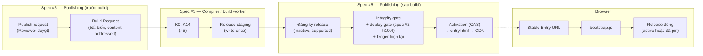
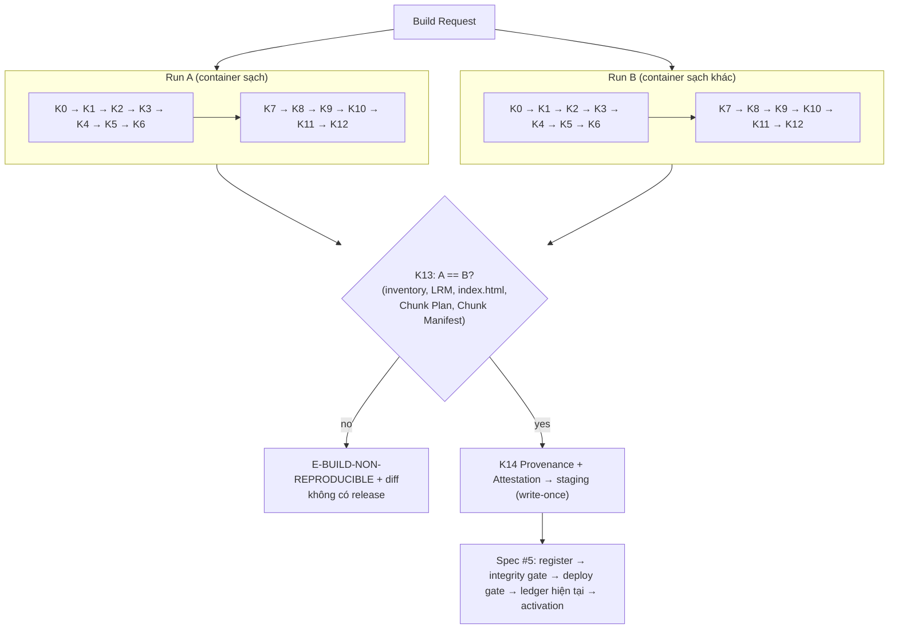
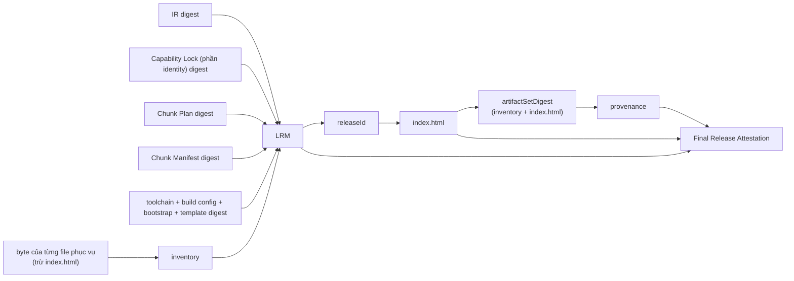
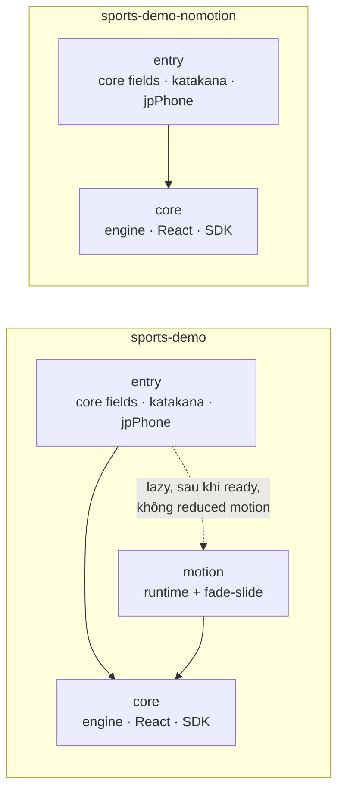
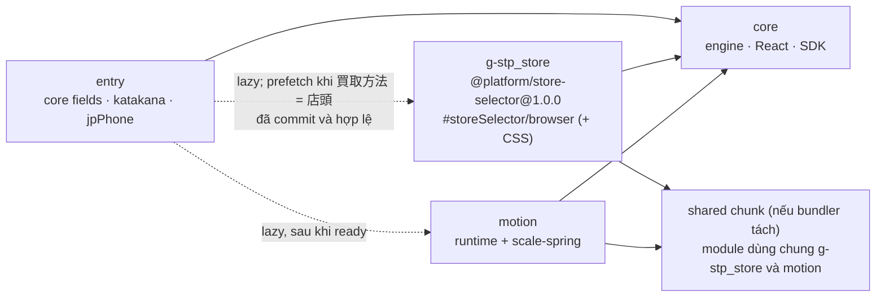

# Spec #3: Compiler, Bundle & Release Architecture (Design Proposal)

> **Trạng thái: PROPOSAL, revision 1** (2026-10-24). Chưa được user review. Đã qua consistency review độc lập và sửa (§25.1).
> - Hướng đi đã duyệt: ADR-036..040 (spec #3 Answer #1..#5). Cơ chế trong tài liệu này **PROPOSED**.
> - **G1 NOT APPROVED.** G9 và G10 BLOCKED. Không có code; không có AWS.
> - Nguồn:
>   - [P01_BRAINSTORM_NOTES.md](../../discovery/P01_BRAINSTORM_NOTES.md), Session 3: Spec #3 Answer #1..#5 (đề xuất S3-P01..P21 được chuyển vào đây và thay thế bản trong notes)
>   - [DECISIONS.md](../../DECISIONS.md): ADR-002, 004, 005, 012, 017, 018, 030, 031, 036..040
>   - [Spec #1 rev 3.3](2026-10-23-form-schema-workflow-design.md) §8, §9, §13, §14
>   - [Spec #2 rev 2.3](2026-10-24-plugin-contracts-capability-registry-design.md) §9, §10, §11, §17
>   - Master BUILD-01..10, PERF-01..07, SEC-04/05
>
> Phạm vi: subsystem spec số 3 trên 6. Spec này là **nguồn sự thật** cho: compiler pipeline, định dạng Normalized IR và các manifest của release, chunk planning, release identity, reproducible build, artifact verification, cách runtime nạp release (bootstrap, lazy loading, prefetch) và measurement contract. **Không** gồm: lưu trữ release, activation, CDN, API (spec #5); Admin UI (spec #4); Motion preset contract (spec #6).
>
> Ví dụ JSON đã được kiểm cú pháp (§25). Mọi hash trong ví dụ là giá trị giả.

## 0. Cách đọc trạng thái

| Nhãn | Ý nghĩa |
|---|---|
| **APPROVED AS DESIGN DIRECTION** | User duyệt hướng đi. Cơ chế vẫn cần review. |
| **PROPOSED** | Claude đề xuất, chờ user review. |
| **OPEN** | Còn chờ user (§22). |
| *[Claude]* | Lựa chọn nhỏ để tài liệu đủ cụ thể; user có thể bác bỏ. |

### 0.1. Bảng tổng hợp quyết định

| ADR | Nội dung | Trạng thái |
|---|---|---|
| ADR-002 | Hybrid Form Compiler | ACCEPTED (G0) |
| ADR-005 | Kết luận performance chỉ từ artifact đã đo | ACCEPTED (G0) |
| ADR-018 | Spike cần gate riêng | APPROVED AS DESIGN DIRECTION |
| ADR-030, ADR-031 | Release store bất biến; một version mỗi plugin trong một form release | APPROVED (spec #2) |
| ADR-036 | Self-contained Form Release, không mutable shared runtime | APPROVED AS DESIGN DIRECTION |
| ADR-037 | Session pin; Stable Entry URL + Immutable Release URL; active ≠ supported | APPROVED AS DESIGN DIRECTION |
| ADR-038 | CSR + Loading Shell trung tính; measurement contract; prerender là tương lai | APPROVED AS DESIGN DIRECTION |
| ADR-039 | Byte-for-byte reproducible build; LRM; attestation; provenance | APPROVED AS DESIGN DIRECTION |
| ADR-040 | Hybrid code splitting + prefetch có điều kiện; chunk failure an toàn | APPROVED AS DESIGN DIRECTION |
| §5–§21 | Cơ chế | **PROPOSED** |
| OD3-01, OD3-02 | Bundler; gate cho spike | **OPEN** (§22) |

---

## 1. Mục đích

Spec #1 định nghĩa form là dữ liệu; spec #2 định nghĩa capability là code đã phát hành. Spec #3 biến hai thứ đó thành **một release tĩnh, bất biến, tự chứa** cho từng form, và định nghĩa cách browser nạp đúng release đó. Ba thuộc tính phải chứng minh được:

1. **Isolation:** artifact chỉ chứa những gì form dùng (BUILD-02, BUILD-06), và browser chỉ tải những gì khách thật sự cần (ADR-040).
2. **Identity và integrity:** cùng input cho ra cùng byte và cùng `releaseId`; mọi byte được phục vụ đều có hash được kiểm trước activation (ADR-039).
3. **Revision safety:** khách đang điền form không bao giờ bị chuyển sang release khác, và runtime không bao giờ hydrate draft của release khác (ADR-037).

## 2. Goals, non-goals, anti-goals

**Goals**
- G3-1: Pipeline có stage rõ ràng, input/output xác định, stage thuần tách khỏi stage có side effect.
- G3-2: Chunk plan tất định từ IR + Capability Lock; không lấy path từ Admin JSON.
- G3-3: Release identity tất định, không vòng lặp hash; publish idempotent.
- G3-4: Build tái lập từng byte trong môi trường chuẩn, có bằng chứng.
- G3-5: Runtime nạp đúng release (active hoặc đã pin), lazy-load đúng nhánh, lỗi tải không làm mất dữ liệu.
- G3-6: Measurement contract tách shell, form visible, form ready.

**Non-goals (P0)**
- Không SSR/SSG/prerender (ADR-038). Không service worker.
- Không shared runtime giữa form (ADR-036).
- Không build farm, nhiều cloud builder, tất định giữa OS, build-cache orchestration (ADR-039).
- Không ký artifact (ADR-030). Không deploy AWS (G10).
- Không size-based chunk tuning trước khi có số đo.

**Anti-goals**
- Coi FCP của shell là performance của form.
- Coi "network không request" là bằng chứng "code không có trong artifact".
- Tạo `releaseId` mới bằng timestamp/random để che non-determinism.
- Phục vụ public một file không nằm trong integrity contract (ví dụ sourcemap).
- Âm thầm tải active release khi release đã pin gặp lỗi.

## 3. Ràng buộc

- Máy local: Node 20.20.2, Docker 29.1.3 (CURRENT_STATUS). Builder image và version chính xác chốt ở P02 sau G1.
- Compiler, analyzer, engine: TypeScript. Backend Python chỉ **đọc** IR và Capability Lock, không tham gia build *[Claude, theo spec #1 §14: analyzer chạy trong publish pipeline]*.
- Bundler chưa chọn (OD3-01). Mọi yêu cầu dưới đây viết độc lập với bundler.

---

## 4. Ranh giới và luồng tổng thể



| Loại dữ liệu | Ví dụ | Bất biến? | Thuộc identity? | Ai sở hữu |
|---|---|---|---|---|
| Build artifact phục vụ | `assets/*.js`, `*.css`, `form-ir.*.json` | ✔ | ✔ (LRM inventory) | spec #3 |
| Immutable release HTML | `/r/{releaseId}/index.html` | ✔ | ✘ (hash trong attestation) | spec #3 |
| Private build artifact | chunk manifest, bundle stats, Capability Lock, sourcemap debug | ✔ | chunk manifest + lock: ✔ qua digest; sourcemap: ✘ | spec #3 |
| Build provenance, attestation | `provenance.json`, `attestation.json` | ✔ (write-once) | ✘ | spec #3 |
| Mutable Stable Entry HTML | `/f/{site}/{form}/` | ✘ | ✘ | spec #5 (sinh từ attestation) |
| Operational status | activation, support, security, retention | ✘ | ✘ | spec #5 |

---

## 5. Compiler pipeline

### 5.1. Build Request (input duy nhất của compiler)

Spec #5 tạo Build Request khi một revision được duyệt publish. Mọi tham chiếu là digest; compiler không đọc gì "mới nhất".

```json
{
  "buildRequestFormat": 1,
  "mode": "release",
  "form": { "formId": "frm_pc_demo", "siteId": "site_pc_demo", "revision": "rev7" },
  "definitionSnapshot": "sha256:6f1c0e9a2b7d4c18e5f3a9b0d2c4e6f8a1b3c5d7e9f0a2b4c6d8e0f1a3b5c7d9",
  "blockRevisions": [
    { "blockId": "blk_customer_info", "revision": "r2", "digest": "sha256:0a1b2c3d4e5f60718293a4b5c6d7e8f9012345678901234567890abcdef01234" }
  ],
  "previousDataContract": "sha256:1b2c3d4e5f60718293a4b5c6d7e8f9012345678901234567890abcdef0123456",
  "registryCatalog": "sha256:2c3d4e5f60718293a4b5c6d7e8f9012345678901234567890abcdef012345678",
  "ledgerSnapshotId": "ledger-0042",
  "runtimeOverrideSnapshotId": "override-0007",
  "buildConfig": "sha256:3d4e5f60718293a4b5c6d7e8f9012345678901234567890abcdef0123456789a",
  "bootstrap": "sha256:da73c9ebdf5b7d9abcde5f7b9dbacd4f6b8dacbdef5b7d9abcdf4b6e8acdef5f",
  "releaseHtmlTemplate": "sha256:4b6a1f0e3d2c5b8a7f6e9d0c1b4a3f2e5d8c7b6a9f0e1d2c3b4a5f6e7d8c9b0a",
  "platformSource": { "commit": "4e5f60718293a4b5c6d7e8f90123456789012345" },
  "builderImage": "sha256:a24a135cdcf5d0925e02f2b582c1746aa9d0502b5ffc656db04afd623c698c36"
}
```

- `mode`: `release` (trusted) · `rebuild-verify` · `dev` (không trusted, cho phát triển).
- `previousDataContract` vắng khi là revision đầu.
- `bootstrap` và `releaseHtmlTemplate` (template `index.html` + CSS shell) là **platform asset** do trusted pipeline phát hành vào release store, được pin bằng digest như plugin (§14.1).
- `ledgerSnapshotId` và `runtimeOverrideSnapshotId` cho K3 một snapshot cố định của trạng thái plugin, nên K3 là hàm thuần. Spec #5 kiểm lại trạng thái **hiện tại** trước activation.
- **`buildOptions`** (private, không phải Build Request): ví dụ `sourcemap: private`, mức chi tiết báo cáo. Không được làm đổi byte phục vụ (TM-B15) nên không thuộc identity.
- **Lưu trữ:** Build Request được lưu trong provenance và release record (spec #5). Snapshot definition/block mà nó trỏ tới được giữ ít nhất bằng thời gian giữ release.
- **`rebuild-verify`:** đọc **Build Request đã lưu** của release, chạy lại K0..K12 với **lock đã lưu** thay cho K3, rồi so với release gốc (LRM digest, `index.html`, inventory). Đây là kiểm chứng; không tạo release.

### 5.2. Các stage

| # | Stage | Input → Output | Thuần? | Side effect | Cache an toàn? | Fail closed | Mode `rebuild-verify` |
|---|---|---|---|---|---|---|---|
| K0 | Intake & freeze | Build Request → các input đã tải và kiểm digest | ✘ | **đọc** store theo digest | — | ✔ (`E-BUILD-INPUT-DIGEST`, `E-BUILD-UNTRUSTED-SOURCE`) | đọc Build Request đã lưu + LRM + lock của release |
| K1 | Structural validation | definition, block → hợp lệ theo JSON Schema của `schemaVersion` (spec #1 §7.7) | ✔ | — | ✔ (dev) | ✔ | chạy |
| K2 | Version gate | `schemaVersion` được engine hỗ trợ | ✔ | — | ✔ | ✔ | chạy |
| K3 | Capability resolution | definition + block + catalog + ledger snapshot + override snapshot → **Capability Lock** (identity + resolution context, spec #2 §9.2) | ✔ | — | ✔ | ✔ với `E-CAP-*`; `W-CAP-DEPRECATED` ghi lại | **bỏ qua**, dùng lock đã lưu |
| K4 | Expand & lower | inline block, qualified identity, `skipWhen` → edge (spec #1 §14) | ✔ | — | ✔ | ✔ | chạy |
| K5 | Semantic & workflow analysis | identity, reference, type, permission/classification (spec #2 §13), graph, data contract diff | ✔ | — | ✔ | ✔ với `E-*`; `W-*` ghi lại | chạy |
| K6 | Emit IR | → **Normalized IR**, **Data Contract** (canonical JSON, §6) | ✔ | — | ✔ | ✔ | so với digest trong LRM |
| K7 | Chunk planning | IR + lock + build config → **Chunk Plan** (§7) | ✔ | — | ✔ | ✔ (`E-CHUNK-PLAN-*`) | chạy |
| K8 | Code generation | Chunk Plan → entry module, group module, capability map (§8) | ✔ | — | ✔ | ✔ | chạy |
| K9 | Bundle | module sinh ra + facet từ release store → `dist/` + module graph của bundler | ✘ (process, file tạm) | ghi thư mục tạm, **không mạng** | ✘ ở `release` | ✔ | chạy |
| K10 | Artifact verification | `dist/` + module graph + Chunk Plan → **Chunk Manifest** + kết quả kiểm (§10) | ✔ | — | ✘ | ✔ | chạy |
| K11 | LRM & `releaseId` | IR, Data Contract, lock, plan, Chunk Manifest, toolchain, inventory → **LRM** → `releaseId` (§11) | ✔ | — | — | ✔ | so `releaseId` |
| K12 | Release HTML | LRM + `releaseId` + template → `index.html` (§11.4) | ✔ | — | — | ✔ | so hash |
| K13 | Reproducibility verification | **điều phối** hai lần chạy K0..K12 độc lập rồi so sánh (§12). K13 không đứng sau K12 trong một lần chạy; nó bao hai lần chạy. | ✘ (điều phối) | chạy hai builder | ✘ | ✔ (`E-BUILD-NON-REPRODUCIBLE`) | so lần chạy lại với release gốc |
| K14 | Attestation & handoff | → **provenance**, **Final Release Attestation**; ghi release bundle vào staging (write-once) | ✘ | **ghi** staging | ✘ | ✔ | không ghi; chỉ báo cáo |

**Ngoài compiler (spec #5):** tạo Build Request; đăng ký release; integrity gate đọc lại từ storage; deploy gate (spec #2 §10.4); kiểm ledger **hiện tại** (trạng thái có thể đã đổi kể từ snapshot ở K3); activation; sinh `entry.html`; CDN. **Không có stage nào của compiler gọi AWS.**

- Chỉ K0 (đọc), K9 (process + file tạm), K13 (điều phối) và K14 (ghi staging) có side effect. K1–K8, K10–K12 là hàm thuần của input đã freeze.
- **Cache:** K1–K8 có thể cache theo digest input ở mode `dev`. Ở mode `release`, cả hai lần chạy của K13 đều sạch, không cache (ADR-039).
- Mọi stage fail closed; chỉ K3 và K5 có cảnh báo không chặn (`W-*`).
- **Thứ tự tất định cho mọi mảng** (áp cho Chunk Plan, Chunk Manifest, lock, inventory, provenance): mảng mang ngữ nghĩa thứ tự (step, field, transition) giữ đúng thứ tự trong IR; mọi mảng khác sắp theo khóa định nghĩa sẵn (bảng ở §11.1). JCS không sắp xếp mảng, nên quy tắc này là bắt buộc.



### 5.3. Thứ tự hash (không vòng lặp)



Không nút nào phụ thuộc vào nút đứng sau nó. Không file trong inventory chứa `releaseId`; `index.html` là file duy nhất chứa `releaseId` và nằm ngoài LRM.

---

## 6. Normalized IR và Data Contract (spec #1 §12 giao cho spec #3)

- **IR envelope:** `{ "irFormat": 1, "engineIrRange": ">=1.0.0 <2.0.0", "form": {...}, "steps": [...], "nodes": [...], "conditions": {...}, "capabilities": { alias: CK }, "effects": [...] }`. Nội dung là kết quả K4–K5 của spec #1 (phẳng, đã resolve, không dạng viết tắt). Có JSON Schema 2020-12 riêng; TS engine và Python evaluator cùng đọc (ADR-017).
- **Canonical:** RFC 8785, UTF-8; key sắp xếp; mảng giữ thứ tự ngữ nghĩa (thứ tự step, thứ tự field), không sắp xếp lại.
- **Phân phối:** IR là **file asset** `assets/form-ir.<hash>.json` trong inventory, được `index.html` preload. Byte của file **chính là** JCS(IR), nên `sha256(file)` = `inputs.ir` trong LRM (K11 kiểm). Backend dùng **đúng byte đó** (lưu kèm release record, spec #5). *[Claude: tách file thay vì inline vào HTML để HTML nhỏ, IR cache được, và backend/browser dùng cùng byte.]*
- **Data Contract:** `{ dataContractFormat: 1, keys: [{ key, type, classification, include }] }`, dùng cho diff ở K5 và cho backend projection (spec #1 §7.6.7).
- IR **không** chứa giá trị khách (spec #1 §16).

---

## 7. Chunk planning (K7, ADR-040)

### 7.1. Đơn vị tải

| Đơn vị | Ví dụ | Vị trí |
|---|---|---|
| Engine + React DOM adapter | state machine, rule evaluator, renderer | **core** |
| Shared externals | React, React DOM, platform SDK (một bản, spec #2 §11.4) | **core** |
| Core field component được form dùng | `text`, `choice.radio`, `tel` | entry *[Claude]* |
| Validator (`cross-runtime-pure`, bản TS) | `jpPhone`, `katakana` | entry *[Claude]* |
| `fieldType` plugin (browser facet) | `storeSelector` | entry nếu dùng ở step đầu; ngược lại **lazy** |
| Motion runtime + preset của form (core, spec #6) | `fade-slide`, `scale-spring` | **lazy** group `motion`; không có nếu form không dùng Motion |

*[Claude]* Core field và validator luôn ở entry vì nhỏ và cần cho validation; tách chúng tạo nhiều chunk rất nhỏ (over-splitting). Điều chỉnh theo kích thước chỉ sau khi có số đo (P1).

**Chunk `core`** *(sửa sau consistency review)*: plugin khai React và SDK là peer (spec #2 §6.5), nên chunk của group phải import tĩnh React/SDK từ đâu đó. Nếu chúng nằm trong entry, group sẽ import tĩnh entry trong khi entry `import()` group → **vòng** entry↔group, và tên file theo hash nội dung cũng thành vòng. Vì vậy engine, adapter và shared externals nằm trong chunk riêng `core`:
- `entry` → `core` (tĩnh); `entry` → group (`import()`); group → `core` (tĩnh); `motion` → `core` (tĩnh).
- `core` không import gì của entry hay group. Đồ thị import **tĩnh** giữa các chunk là DAG; cạnh động chỉ đi từ entry (hoặc từ group tới group con, nếu có) xuống.
- `core` tải cùng entry (song song) nên không làm chậm T2; nó chỉ là ranh giới để tránh vòng.

### 7.2. Thuật toán (tất định)

1. Với mỗi `fieldType` plugin `u` trong Capability Lock, tính `U(u)` = tập step **đặt** field dùng nó (sau K4, block đã inline). Step `review` không tính vào `U(u)`: nhu cầu hiển thị tóm tắt ở 確認 được xử lý lúc runtime (§15.1).
2. `u` thuộc **entry** nếu step bắt đầu ∈ `U(u)`.
3. Các `u` còn lại nhóm theo `U(u)`: cùng tập step → cùng **group**. `label` = id của step xuất hiện **sớm nhất trong mảng `steps` của IR** (thứ tự khai báo, duy nhất) thuộc `U`; `groupId = "g-" + label`. Hai group trùng label → sắp các group đó theo danh sách chỉ số step (trong mảng `steps`) tăng dần, group đầu giữ label, các group sau thêm `-2`, `-3`.
4. Form có Motion → group `motion` (lazy). Không có Motion → **không có** group này, và codegen không sinh bất kỳ tham chiếu nào tới Motion.
5. Mỗi group có `triggerSteps = U(group)` (cho prefetch, §15.2).
6. Module dùng chung giữa các group được bundler tách thành **shared chunk trong release** khi có lợi; điều này được ghi vào Chunk Manifest, không thay đổi Chunk Plan.
7. Không bao giờ: một chunk chung cho nhiều release; import toàn registry; group cho design facet hay server facet.

**Chunk Plan** (private, digest trong LRM): `{ chunkPlanFormat: 1, core: { units }, entry: { units }, groups: [{ groupId, units: [FBK...], triggerSteps: [...] }] }`. `groups` sắp theo chỉ số step nhỏ nhất rồi `groupId`; `units` sắp theo chuỗi FBK/id module; `triggerSteps` theo thứ tự trong IR.

### 7.3. Chunk graph: Sports

`sports-demo` (Motion `fade-slide`) và `sports-demo-nomotion`. Không có plugin `fieldType`; validator `katakana`, `jpPhone` từ block `customer-info`.



- `sports-demo-nomotion`: chỉ có entry và core. Không group `motion`, không `import()` tới Motion, không module Motion trong module graph (TM-C02).
- Cả hai: không module nào của `@platform/store-selector` (TM-C01).

### 7.4. Chunk graph: PC

`pc-demo` (Motion `scale-spring`). `storeSelector` chỉ dùng ở `stp_store` (nhánh 店頭).



- Nhánh 宅配 (`stp_takuhai`) không dùng plugin nào → không có group; khách đi 宅配 không bao giờ tải `g-stp_store` (TM-C04). Ở 確認 của nhánh 宅配, field `store` inactive nên cũng không cần `g-stp_store` (§15.1).
- Cạnh liền là import tĩnh, cạnh đứt là `import()`.
- `storeList` và `storeIdValid` là server facet → không có trong bất kỳ chunk nào (TM-C07).

---

## 8. Code generation (K8)

- **Entry module** (sinh ra, chỉ có import + bootstrap của runtime): import tĩnh literal tới `core`, core field dùng trong form, validator TS và `fieldType` của entry; tạo **scoped capability map** (key CK, spec #2 §5.3) và truyền vào engine bằng DI.
- **Group loader:** với mỗi group, một hàm `() => import("./g-stp_store.js")` với **specifier literal** (INV-F3); bundler đổi thành tên có hash. Không có specifier ghép chuỗi hay biến. CSS của group (nếu có) được loader chèn bằng `<link rel="stylesheet">` same-origin (không style inline), và group chỉ "sẵn sàng" khi cả JS và CSS đã tải (tránh nháy giao diện).
- **Không có registry toàn bộ.** Code sinh ra không import catalog, không import package `@platform/*` nào ngoài những gì có trong Chunk Plan.
- **Engine không tham chiếu Motion.** Motion chỉ được import từ module group `motion` do codegen sinh; luật L3 cấm package engine import Motion (bổ sung spec #2 §11.2).
- Nguồn của mọi specifier: Chunk Plan ← Capability Lock ← catalog (spec #2). Definition chỉ đóng góp alias đã được kiểm ngữ pháp; không chuỗi nào từ definition trở thành specifier.

---

## 9. Bundle (K9)

**Yêu cầu với bundler (độc lập với lựa chọn ở OD3-01):**

| Yêu cầu | Lý do |
|---|---|
| Output tất định (thứ tự module, tên chunk, hash) | ADR-039 |
| Hỗ trợ export condition tùy chỉnh (`design` không bật ở build khách) | spec #2 L1; kiểm ở spike |
| Xuất module graph đầy đủ (module → chunk, import tĩnh/động) | K10, Chunk Manifest |
| Code splitting theo `import()` literal; kiểm soát được shared chunk | §7 |
| ESM output; chunk naming theo content hash | cache bất biến |
| Resolve plugin từ release store (alias tới thư mục release, spec #2 §9.4); shared externals về đúng một bản | spec #2 §11.4 |
| Không sinh sourcemap vào thư mục phục vụ; không chèn `sourceMappingURL` | §11.5 |
| Chạy được không mạng | ADR-039 |

- Builder: canonical image (§12.1), thư mục làm việc cố định trong container, không mạng.
- Tên file: `assets/<label>.<hash>.<ext>`, `hash` do bundler sinh **tất định**; chỉ ký tự `[a-z0-9._-]`. Vì đồ thị import tĩnh là DAG (§7.1), tên có hash tính được theo thứ tự phụ thuộc, không vòng. Hash trong tên file **không** phải bằng chứng integrity; `sha256` trong inventory mới là bằng chứng. *(Ví dụ trong tài liệu dùng 12 hex đầu của sha256 cho dễ đọc.)*

---

## 10. Artifact verification (K10)

Chạy trên output thật của K9, không tin lớp nào trước đó (spec #2 L5).

| Kiểm tra | Nguồn | Mã lỗi |
|---|---|---|
| Mọi module trong module graph thuộc tập cho phép: engine, shared externals (một bản), `contract`, browser facet của FBK trong lock, thư viện đã gói trong facet đó, và Motion runtime + preset của core **chỉ trong group `motion`** khi form dùng Motion (INV-F1, spec #2 rev 2.3) | module graph | `E-ARTIFACT-ILLEGAL-MODULE` |
| Không module/marker của design facet, `fixtures/`, test, mock (INV-F2); không file `.py` hay mã Python (INV-F4 phía artifact) | module graph + quét nội dung | `E-ARTIFACT-FORBIDDEN-FACET` |
| Đúng một React, một React DOM (INV-F7) | module graph | `E-ARTIFACT-DUPLICATE-SINGLETON` |
| Chunk thực tế khớp Chunk Plan: mỗi group có chunk; không chunk ngoài plan trừ shared chunk được ghi nhận; không module của group A xuất hiện ở entry | module graph + plan | `E-ARTIFACT-UNEXPECTED-CHUNK`, `E-CHUNK-PLAN-MISMATCH` |
| Form không Motion: không module Motion, không `import()` tới Motion | module graph + quét specifier | `E-ARTIFACT-MOTION-PRESENT` |
| Đồ thị import **tĩnh** giữa chunk là DAG; entry → group chỉ qua `import()`; `core` không import entry/group | module graph | `E-ARTIFACT-CHUNK-CYCLE` |
| Không `.map` trong thư mục phục vụ; không comment `sourceMappingURL` | inventory + quét | `E-ARTIFACT-PUBLIC-SOURCEMAP` |
| Không đường dẫn tuyệt đối của máy build (ví dụ thư mục làm việc trong container, `/home/`, `/Users/`, `C:\`) trong file phục vụ **và** trong artifact private thuộc identity (Chunk Plan, Chunk Manifest, lock) | quét nội dung | `E-ARTIFACT-ABSOLUTE-PATH` |
| Không secret (scanner, spec #2 L4) | quét nội dung | `E-ARTIFACT-SECRET` |
| Path hợp lệ, không trùng khi bỏ qua hoa/thường | inventory | `E-ARTIFACT-PATH-COLLISION` |

Output: **Chunk Manifest** (private, digest trong LRM): `{ chunkManifestFormat: 1, chunks: [{ file, sha256, kind: core|entry|group|shared, groupId?, modules: [...], staticImports: [...], dynamicImports: [...] }] }`. Đây là build graph evidence cho TM-C.
- **Module id được chuẩn hóa**, không bao giờ là đường dẫn tuyệt đối: `pkg:<name>@<version>/<path trong package>` (thư viện), `rel:<PRK>/<facet>/<path>` (facet plugin từ release store), `gen:<path tương đối>` (module do compiler sinh), `platform:<package>@<version>/<path>` (engine, core), `virtual:<tên>` (module ảo của bundler, bỏ ký tự điều khiển như `\0`). Id không chuẩn hóa được → `E-CHUNK-MANIFEST-MODULE-ID`.
- Sắp xếp: `chunks` theo `file`; `modules`, `staticImports`, `dynamicImports` theo chuỗi.

---

## 11. Release identity, HTML, attestation, provenance (ADR-039)

### 11.1. Logical Release Manifest (LRM)

| Trường | Nội dung |
|---|---|
| `lrmFormat` | `1`; có JSON Schema riêng; đổi cấu trúc = tăng số |
| `form` | `formId`, `siteId`, `revision`, `schemaVersion` |
| `inputs` | digest của IR (= sha256 của file IR), Data Contract, **phần identity** của Capability Lock, Chunk Plan, Chunk Manifest, build config, bootstrap, release HTML template (gồm CSS shell) |
| `toolchain` | version chính xác: engine, `browserHostApi`, compiler, bundler, minifier, Node, package manager, shared externals; digest builder image; digest lockfile |
| `inventory` | mọi file phục vụ dưới `/r/{releaseId}/` **trừ** `index.html`: `{ path, size, sha256, contentType }` |

- **Serialization:** RFC 8785 (JCS), UTF-8; số nguyên; không trường `null` (bỏ hẳn).
- **Hash:** SHA-256. Digest viết `sha256:<64 hex>`.
- **Path:** tương đối với gốc release; `/`; `[a-z0-9._/-]`; cấm `..`, `./`, `/` đầu, `//`, rỗng; trùng khi bỏ hoa/thường → lỗi; sắp xếp theo byte UTF-8.
- **`contentType`:** từ bảng cố định theo đuôi file.
- **Không thuộc LRM** (để `releaseId` không đổi khi chúng đổi): resolution context của lock (hash catalog, ledger/override snapshot), `buildOptions` (ví dụ `sourcemap: private`), platform commit, thời điểm, pipeline, operator. Chúng nằm trong provenance.
- **Khóa sắp xếp:** `inventory` theo `path` (byte UTF-8); `sharedExternals` theo tên; các mảng của Chunk Plan, Chunk Manifest như §7.2, §10; lock theo chuỗi CK rồi FBK; `resolvedDependencies` của provenance theo `name` rồi `version`.

### 11.2. `releaseId`

- `releaseId = "rel_" + base32-thường-không-padding(sha256(JCS(LRM)))[:26]` (130 bit). Digest đầy đủ ở attestation.
- Cùng LRM → cùng `releaseId`; đăng ký lại → no-op. Trùng `releaseId` mà digest/LRM khác → `E-RELEASE-ID-COLLISION`.
- Input có ý nghĩa khác (IR, lock, toolchain, config…) → LRM khác → `releaseId` khác.
- **Cùng input khai báo mà byte khác** → K13 fail `E-BUILD-NON-REPRODUCIBLE`; không có release nào được tạo. Đây không bao giờ là cách tạo release mới.
- Không timestamp, random, hostname, thời gian build trong LRM.

### 11.3. Ví dụ LRM: `pc-demo` rev7

```json
{
  "lrmFormat": 1,
  "form": { "formId": "frm_pc_demo", "siteId": "site_pc_demo", "revision": "rev7", "schemaVersion": "1.0.0" },
  "inputs": {
    "ir": "sha256:9e8d7c6b5a40f1e2d3c4b5a6978877665544332211009988776655443322110f",
    "dataContract": "sha256:8b2e4d6f8a0c2e4b6d8f0a2c4e6b8d0f2a4c6e8b0d2f4a6c8e0b2d4f6a8c0e2a",
    "capabilityLock": "sha256:9c3f5e7a9b1d3f5c7e9a1b3d5f7c9e1a3b5d7f9c1e3a5b7d9f1c3e5a7b9d1f3b",
    "chunkPlan": "sha256:ad40f6b8ac2e4a6d8fab2c4e6a8dfb1c3e5a7d9fbc2e4a6d8fac1e3b5d7f9a2c",
    "chunkManifest": "sha256:be51a7c9bd3f5b7e9abc3d5f7b9eab2d4f6b8eabcd3f5b7e9abd2f4c6e8abc3d",
    "buildConfig": "sha256:cf62b8dace4a6c8fabcd4e6a8cafbc3e5a7c9fbcde4a6c8fabce3a5d7f9bcd4e",
    "bootstrap": "sha256:da73c9ebdf5b7d9abcde5f7b9dbacd4f6b8dacbdef5b7d9abcdf4b6e8acdef5f",
    "releaseHtmlTemplate": "sha256:4b6a1f0e3d2c5b8a7f6e9d0c1b4a3f2e5d8c7b6a9f0e1d2c3b4a5f6e7d8c9b0a"
  },
  "toolchain": {
    "engine": "1.0.0",
    "browserHostApi": "1.0.0",
    "compiler": "1.0.0",
    "bundler": { "name": "bundler-tbd-od3-01", "version": "0.0.0" },
    "minifier": { "name": "minifier-tbd-od3-01", "version": "0.0.0" },
    "node": "20.20.2",
    "packageManager": { "name": "pm-tbd-p02", "version": "0.0.0" },
    "sharedExternals": { "react": "0.0.0-tbd", "react-dom": "0.0.0-tbd", "@platform/sdk-browser": "1.0.0" },
    "builderImage": "sha256:a24a135cdcf5d0925e02f2b582c1746aa9d0502b5ffc656db04afd623c698c36",
    "lockfile": "sha256:eb84dafce06c8eabcdef6a8cafebcde5a7c9ebdcefa6c8eabcde5c7f9bdef6a0"
  },
  "inventory": [
    { "path": "assets/core.6d5e4f3a2b10.js", "size": 52418, "sha256": "6d5e4f3a2b1009f8e7d6c5b4a39281706f5e4d3c2b1a09f8e7d6c5b4a3928170", "contentType": "text/javascript" },
    { "path": "assets/entry.3f9a1c2b7d10.js", "size": 8816, "sha256": "3f9a1c2b7d10e4f5a6b7c8d9e0f1a2b3c4d5e6f7a8b9c0d1e2f3a4b5c6d7e8f9", "contentType": "text/javascript" },
    { "path": "assets/form-ir.9e8d7c6b5a40.json", "size": 18320, "sha256": "9e8d7c6b5a40f1e2d3c4b5a6978877665544332211009988776655443322110f", "contentType": "application/json" },
    { "path": "assets/form.a1b2c3d4e5f6.css", "size": 7310, "sha256": "a1b2c3d4e5f6a7b8c9d0e1f2a3b4c5d6e7f8a9b0c1d2e3f4a5b6c7d8e9f0a1b2", "contentType": "text/css" },
    { "path": "assets/g-stp_store.2a3b4c5d6e7f.css", "size": 1204, "sha256": "2a3b4c5d6e7f8091a2b3c4d5e6f708192a3b4c5d6e7f8091a2b3c4d5e6f70819", "contentType": "text/css" },
    { "path": "assets/g-stp_store.5c4b3a291807.js", "size": 9120, "sha256": "5c4b3a291807f6e5d4c3b2a1908f7e6d5c4b3a291807f6e5d4c3b2a1908f7e6d", "contentType": "text/javascript" },
    { "path": "assets/motion.c0ffee123456.js", "size": 28750, "sha256": "c0ffee123456789abcdef0123456789abcdef0123456789abcdef0123456789a", "contentType": "text/javascript" }
  ]
}
```

*(Kích thước là số giả để minh họa cấu trúc, không phải số đo. Tên bundler/minifier/package manager là placeholder vì OD3-01/P02 chưa chốt.)*

### 11.4. `index.html` của release

Sinh sau `releaseId` bằng template tất định (K12). Chỉ chứa:
- `<script type="application/json" id="release">{ releaseId, formId, revision, load: { entry, entryIntegrity, core, coreIntegrity, css, cssIntegrity, ir, irIntegrity, bootstrap, bootstrapIntegrity, shellCssSha256 }, groups: { groupId: { js: [paths], css: [paths] } } }</script>` — dữ liệu, không thực thi. `groups` dùng cho cả tải và prefetch (§15).
- CSS shell inline tối thiểu lấy từ template, `<noscript>`.
- **CSP theo từng document** *(spec #5 phục vụ)*: `script-src 'self'`; `style-src 'self' 'sha256-<shellCssSha256>'`; `connect-src` chỉ origin API của platform. Vì mỗi HTML (release `index.html`, `entry.html`) mang hash CSS shell của chính nó, release cũ dùng template cũ vẫn hợp lệ.
- `<script src="/_platform/bootstrap.<hash>.js" defer integrity="…">` — bootstrap ở **release mode** (§14.3).
- Không script inline thực thi, không `unsafe-inline`.

`load` và `prefetch` dùng path tương đối với gốc release; spec #5 chép khối `load` sang `entry.html` khi activation (thêm tiền tố `/r/{releaseId}/`).

### 11.5. Sourcemap

- P0 **không deploy public sourcemap**. Thư mục phục vụ không có `.map`, JS/CSS không có `sourceMappingURL` (K10).
- `buildOptions.sourcemap: private` (không phải build config, không thuộc LRM): sourcemap được ghi vào **private build artifact** (ngoài thư mục phục vụ), có hash trong provenance, truy cập có kiểm soát (P0 local: không chép vào release store phục vụ). Bật hay tắt tùy chọn này **không được** làm đổi byte phục vụ; TM-B15 kiểm.
- Nếu tương lai muốn phục vụ sourcemap công khai, nó phải vào inventory/integrity như mọi file phục vụ khác, và cần review rò rỉ source (ADR mới).

### 11.6. Final Release Attestation và provenance

```json
{
  "attestationFormat": 1,
  "releaseId": "rel_k7q2m4x9t1c8v5b3n6p0r2s4wa",
  "lrmDigest": "sha256:46642d218253099e4b76d5bfbc1ba7f5bd03c05a396177cab6ded8009fe9dd0c",
  "indexHtmlSha256": "0d1c2b3a49586776859a4b3c2d1e0f9a8b7c6d5e4f3a2b1c0d9e8f7a6b5c4d3e",
  "artifactSetDigest": "sha256:1e2d3c4b5a6978877869a5b4c3d2e1f0a9b8c7d6e5f4a3b2c1d0e9f8a7b6c5d4",
  "provenanceDigest": "sha256:2f3e4d5c6b7a8998897a6b5c4d3e2f1a0b9c8d7e6f5a4b3c2d1e0f9a8b7c6d5e",
  "createdAt": "2026-10-24T00:00:00Z"
}
```

- `artifactSetDigest` = sha256 của JCS danh sách `{path, sha256}` của inventory cộng `index.html`.
- **Attestation thuộc release, provenance thuộc từng lần build.**
  - Lần đăng ký đầu tiên của một `releaseId` ghi attestation (write-once).
  - Build sau đó có cùng `releaseId` (rebuild-verify, hoặc publish lại cùng input) chỉ được coi là trùng khi **bộ identity** khớp: `lrmDigest`, `indexHtmlSha256`, `artifactSetDigest`. Khớp → no-op với release, và ghi thêm một **verification record** (provenance của lần build đó, liên kết `releaseId`). Không khớp → `E-RELEASE-ID-COLLISION`.
  - `createdAt`, `pipelineId`, `operator`, `runA/runB` khác nhau giữa các lần build là bình thường và không bao giờ được dùng để so trùng.
- **Provenance** (tinh thần SLSA Build Provenance, mức PoC): `subject [{ releaseId, artifactSetDigest }]`, `source { commit, treeClean }`, `builder { imageDigest, pipelineId, operator }`, `buildInstructions { command, buildConfigDigest }`, `resolvedDependencies [{ name, version, integrity }]`, `pluginReleases [{ PRK, facetHashes }]`, `toolchain`, `reproducibility { runA, runB, identical }`, `privateArtifacts [{ path, sha256 }]` (sourcemap debug, bundle stats). Chưa ký ở P0.
- Reproducibility nói build có tất định không; provenance nói build từ đâu, bằng gì. Không cái nào tự chứng minh pipeline đáng tin.

---

## 12. Reproducible build (ADR-039)

### 12.1. Môi trường chuẩn

- Một Docker image pin theo **digest**: Node và package manager version chính xác; không công cụ thừa.
- `TZ=UTC`, `LANG=C.UTF-8`, `LC_ALL=C.UTF-8`, umask cố định, `NODE_ENV=production`, `SOURCE_DATE_EPOCH` = thời điểm commit (chỉ để công cụ cần timestamp có giá trị cố định; artifact không được chứa timestamp).
- Thư mục làm việc **cố định trong container** (ví dụ `/build`).
- Cài dependency từ lockfile ở chế độ frozen; plugin từ release store theo hash; sau bước cài, build chạy **không mạng**.
- Local build (ngoài image) chỉ cho phát triển/Dev Preview; không là bằng chứng trusted release.

### 12.2. Phạm vi của tuyên bố "reproducible"

- **Được chứng minh ở P0:** trong canonical environment (cùng image digest, cùng đường dẫn làm việc **trong container**, cùng input), hai lần build sạch cho byte giống hệt.
- **Không được chứng minh bởi P0:** độc lập với đường dẫn build. Đổi thư mục mount trên host **không** chứng minh điều này, vì toolchain trong container luôn thấy cùng một path (sửa đề xuất S3-P18 cũ).
- **Thay vào đó, P0 kiểm:** artifact không chứa đường dẫn tuyệt đối nào (K10 `E-ARTIFACT-ABSOLUTE-PATH`). Đây là kiểm tra trên output, không phải tuyên bố path independence.
- **Nếu muốn chứng minh path independence** (P1, tùy chọn): test có kiểm soát chạy build B với thư mục làm việc **trong container** khác (ví dụ `/build-alt`), so byte với A. Chỉ tuyên bố thuộc tính này khi test đó đã chạy và pass.

### 12.3. Verification (K13)

| Bước | Việc | Thất bại |
|---|---|---|
| 1 | Resolve input bất biến (K0 của cả hai lần): commit sạch, lockfile, hash plugin release, digest image, build config | `E-BUILD-UNPINNED-DEP`, `E-BUILD-DEP-MISSING`, `E-BUILD-UNTRUSTED-DEP` |
| 2 | Run A: container mới, không cache, K0..K12 | lỗi stage |
| 3 | Run B: container mới khác, không cache, K0..K12 | lỗi stage |
| 4 | So inventory (tập path, size), Chunk Plan, Chunk Manifest | `E-BUILD-NON-REPRODUCIBLE` + diff |
| 5 | So SHA-256 từng file, digest LRM, hash `index.html` | `E-BUILD-NON-REPRODUCIBLE` + diff |
| 6 | Toolchain thực tế khớp LRM | `E-TOOLCHAIN-MISMATCH` |
| 7 | Kiểm trùng `releaseId` trong store theo bộ identity (§11.6): khớp → no-op + verification record | `E-RELEASE-ID-COLLISION` |
| 8 | K14: provenance + attestation (lần đầu), ghi staging | `E-STAGING-WRITE` |

Báo cáo diff gồm path khác nhau, hash A/B, diff text với file text.

---

## 13. Ví dụ hai build artifact

### 13.1. `sports-demo-nomotion` rev3

```
/r/rel_a3k9…/                          (Immutable Release URL)
  index.html                           ngoài LRM; hash trong attestation
  assets/core.<h12>.js                 engine · React · SDK
  assets/entry.<h12>.js                core fields · katakana · jpPhone
  assets/form.<h12>.css
  assets/form-ir.<h12>.json
private (không phục vụ):
  chunk-plan.json  chunk-manifest.json  capability-lock.json  bundle-stats.json
  provenance.json  attestation.json
```

- Không file `motion.*`, không `g-*`. Chunk Plan: `groups: []`. Hai chunk JS (`core`, `entry`) tải song song.
- Chunk Manifest: không module nào từ package Motion hay `@platform/store-selector`.

### 13.2. `pc-demo` rev7

```
/r/rel_k7q2…/
  index.html
  assets/core.<h12>.js                 engine · React · SDK
  assets/entry.<h12>.js                core fields · katakana · jpPhone
  assets/g-stp_store.<h12>.js          @platform/store-selector@1.0.0#storeSelector/browser
  assets/g-stp_store.<h12>.css         (nếu plugin có CSS)
  assets/motion.<h12>.js               Motion runtime + scale-spring
  assets/shared.<h12>.js               (chỉ khi bundler tách module dùng chung; ghi trong Chunk Manifest)
  assets/form.<h12>.css
  assets/form-ir.<h12>.json
private:
  chunk-plan.json  chunk-manifest.json  capability-lock.json  bundle-stats.json
  provenance.json  attestation.json  [sourcemaps/ nếu sourcemap: private]
```

- Chunk Plan: `groups: [{ groupId: "g-stp_store", units: [FBK storeSelector/browser], triggerSteps: ["stp_store"] }, { groupId: "motion", … }]`.
- Không file nào chứa `storeList`/`storeIdValid` (server facet) hay design binding `StoreSelectorInspector`.

---

## 14. Nạp release ở runtime (ADR-037, ADR-038)

### 14.1. URL

| URL | Nội dung | Cache |
|---|---|---|
| Stable Entry `/f/{site}/{form}/` | `entry.html` (spec #5 sinh): shell, khối dữ liệu `active` = `{ formId, activeReleaseId, pointerVersion, load }`, `bootstrap.js` | browser `no-cache` + ETag; CDN TTL ngắn/invalidation khi activation |
| Immutable Release `/r/{releaseId}/` | `index.html` của release (§11.4) | bất biến |
| `/r/{releaseId}/assets/*` | asset của release | bất biến (`immutable`, max-age dài) |
| `/_platform/bootstrap.<hash>.js` | bootstrap, version của platform | bất biến |
| Status API (spec #5) | `GET …/releases/{releaseId}/status` | không cache |

- Khối `active` trong `entry.html` chỉ dùng để **chọn release cho khách mới**; không phải bằng chứng authoritative. Backend vẫn kiểm support/security ở mọi query/submit.
- **Vòng đời bootstrap** *(sửa sau consistency review)*:
  - Là platform asset, do trusted pipeline build bằng canonical builder, phát hành vào release store, pin bằng digest trong Build Request (§5.1) và trong LRM.
  - Release `index.html` tham chiếu bootstrap **của chính nó** (`load.bootstrap`). `entry.html` (spec #5) dùng bootstrap mà **active release** tham chiếu, nên entry và release active luôn cùng bootstrap.
  - Được giữ ít nhất bằng release nào còn tham chiếu nó.
  - **Metadata draft có version (`draftFormat`)**: bootstrap mới phải đọc được mọi `draftFormat` mà một release còn supported có thể đã ghi. Thay đổi format chỉ được **thêm** trường. `draftFormat` lạ → coi là `incompatible` (thông báo + Start Over), không xóa draft.

### 14.2. Luồng (CSR, ADR-038)

```mermaid
sequenceDiagram
  participant U as Browser
  participant E as entry.html (stable)
  participant B as bootstrap.js
  participant S as Status API
  participant R as Release assets
  U->>E: GET /f/site/form/
  E-->>U: shell (HTML+CSS) + active {releaseId: R8, load}
  U->>B: tải bootstrap (defer, SRI)
  B->>B: đọc metadata draft/session của form
  alt không draft, hoặc draft của R8
    B->>R: tải load của R8 (core, entry, css, ir; song song)
    R-->>U: React runtime R8 khởi tạo, render form
  else draft của R7
    B->>S: status(R7)
    alt supported
      B-->>U: 「前回の入力を再開する」/「最初からやり直す」
      U->>U: Resume → điều hướng /r/R7/ (runtime R8 không khởi tạo)
    else retired / suspended / incompatible
      B-->>U: thông báo + Start Over trên R8 (draft R7 giữ tới TTL)
    else lỗi mạng / timeout
      B-->>U: 「確認できませんでした」 + 再試行 + Start Over
    end
  end
```

- Không tải engine, plugin hay Motion **trước** khi bootstrap quyết định release (ADR-038). Không preload asset của active release trong `entry.html`.
- Fast path (không draft): `entry.html` → `bootstrap.js` → asset của active release, tải song song.

### 14.3. Release mode của bootstrap

Mở `/r/{R}/` trực tiếp: bootstrap đọc khối `release` của `index.html`.
- Có draft/session của `R` → kiểm status → supported thì tải runtime `R`; còn lại như §14.2.
- Không có draft/session của `R` → chuyển về Stable Entry (INV-R2: immutable URL không mở session mới cho release không active).

### 14.4. Invariant và session

| ID | Invariant |
|---|---|
| INV-R1 | Runtime chỉ hydrate draft có `releaseId` **bằng** `releaseId` của chính nó. Lệch → không hydrate, chuyển về Stable Entry. |
| INV-R2 | Immutable Release URL không khởi tạo session mới cho release không có draft/session tương ứng. |
| INV-R3 | Một document chỉ khởi tạo **một** runtime của **một** release; chunk lazy chỉ tải từ thư mục của release đó. |
| INV-R4 | Không lỗi nào (tải chunk, status, mạng) dẫn tới việc tải active release thay cho release đã pin. |

- Session: `sessionStorage` `{ releaseId, sessionId }`; reload trong cùng tab đi qua bootstrap và resume đúng release nếu còn supported.
- Draft: metadata `{ releaseId, revision, sessionId, savedAt, draftFormat }`, không PII (ADR-012). Khôi phục theo spec #1 NR-08/NR-09.
- **Hai tab:** draft theo `formId + sessionId`; `BroadcastChannel` báo tab khác đang mở và báo submit thành công. Giới hạn: best-effort; hai `idempotencyKey` khác nhau vẫn có thể tạo hai submission nếu khách cố ý gửi ở cả hai tab.

### 14.5. Loading Shell

- HTML/CSS tối giản, responsive, `role="status"` `aria-live="polite"` 「読み込み中…」; skeleton trung tính, không field giả, không nội dung đặc thù revision, không thông tin nhạy cảm.
- Reduced motion: không chuyển động.
- Chừa không gian để tránh layout shift lớn khi form thay shell (CLS đo ở §17).
- Chuyển sang form: thông báo 「フォームを読み込みました」; đưa focus tới tiêu đề step (tabindex=-1) chỉ khi người dùng chưa tự di chuyển focus.
- **Generic fallback notice** thuần CSS, hiện sau N giây nếu shell chưa được thay: 「読み込みに時間がかかっています。通信環境をご確認のうえ、ページを再読み込みしてください。」. Không đoán nguyên nhân (không phải CSP detector).
- `<noscript>`: 「このフォームをご利用いただくには、JavaScriptを有効にしてください。」
- Lỗi mà bootstrap phát hiện được (status, tải entry) → UI lỗi + 再試行; không loading vô hạn.

---

## 15. Lazy loading, prefetch, chunk failure (ADR-040)

### 15.1. Tải group khi chuyển step

- **Group cần cho step `s`** (tính lúc runtime từ IR và state hiện tại): group của mọi field plugin **active** được đặt trong `s`; với `review`: group của mọi field plugin **active** trên đường đi (để hiện `Summary`, spec #2 rev 2.3 §7.4). Field inactive không kéo group nào (nhánh 宅配 không cần `g-stp_store` ở 確認).
- Áp dụng cho **mọi cách vào step** (spec #1 INV-N9, rev 3.3): 次へ, 戻る, `jumpTo`, popstate/deep link, `restoreDraft`/reload.
- Vào step `s` mà group cần chưa sẵn sàng → engine vào **`awaitingCapability { groups, fromStep, stateVersion }`** (tương tự `awaitingValidation`, spec #1 C11). Khi khôi phục draft, `fromStep` là step đầu tiên trên đường đi hiển thị được bằng chunk đã có (thường là step đầu).
- `g` tải xong → transition **được tính lại** từ state hiện tại (INV-N2) rồi mới commit.
- Khách sửa input, bấm 戻る hoặc popstate trong lúc chờ → hủy ý định chuyển step (như INV-N8).
- `g` lỗi → **giữ step hiện tại**, không commit transition, không đổi giá trị; hiện lỗi (§15.3).
- Vì quy tắc trên áp cho cả `review` và cho khôi phục draft, không có đường nào hiển thị 確認 hay submit khi group cần chưa tải được.

### 15.2. Prefetch có điều kiện (luật tất định)

Prefetch group `g` khi **tất cả** điều kiện sau đúng:
1. Form đã ready (T3, §17).
2. Step kế tiếp trên `derivedPath(values)` tính từ step hiện tại thuộc `triggerSteps(g)` (nhìn trước **một** step *[Claude]*).
3. Mọi field quyết định transition dẫn tới step đó đã **commit và hợp lệ** (ví dụ 買取方法 = 店頭 đã chọn).
4. Không có tín hiệu tiết kiệm dữ liệu/mạng chậm: `navigator.connection.saveData === true` hoặc `effectiveType` ∈ {`slow-2g`, `2g`} → không prefetch. API không tồn tại (ví dụ Safari) → coi như không có tín hiệu.
5. `g` chưa tải và chưa từng prefetch trong session này.

- **Cơ chế:** `fetch()` độ ưu tiên thấp tới URL của JS và CSS của group (và shared chunk phụ thuộc, lấy từ khối `groups` trong `index.html`) để đưa vào HTTP cache. **Không** dùng `modulepreload` cho prefetch: nếu prefetch thất bại, nó không được làm hỏng module map dùng cho lần tải thật *[Claude]*.
- Prefetch **không** khởi tạo module, không đổi state, không phải validation hay transition. Branch đổi sau khi đã prefetch → byte nằm trong cache, không có gì được khởi tạo.
- Group `motion`: tải (không phải prefetch) sau T3 nếu form có Motion và `prefers-reduced-motion` không bật. Chưa tải xong thì step transition không có animation; không bao giờ chờ Motion.

### 15.3. Chunk failure: phân loại và recovery

**Phân loại** (theo thứ tự, mỗi bước có timeout):
1. `navigator.onLine === false` → `network`.
2. Status API của release đang chạy: `suspended` → `security-suspended`; `retired` → `retired`; release không khớp record → `incompatible`.
3. Probe `fetch(chunkUrl, { cache: "no-store" })`: 404/410 → `missing-asset`; lỗi mạng → `network`.

| Loại | Thông báo (ví dụ) | Recovery |
|---|---|---|
| `network` | 「通信エラーが発生しました。接続を確認して再試行してください。」 | 再試行 (bậc 1 → bậc 2) |
| `missing-asset` | 「現在この手続きを続行できません。時間をおいて再度お試しください。」 | không retry tự động; báo vận hành; không tải active release |
| `retired` | 「このフォームは更新されました。」 | Start Over trên active release (giữ draft tới TTL) |
| `security-suspended` | 「現在この機能はご利用いただけません。」 | không retry; không Start Over nếu active cũng bị suspend |
| `incompatible` | 「このフォームの読み込みに問題が発生しました。」 | Start Over trên active release |

**Retry hai bậc** (vì `import()` lần hai với cùng URL không chắc tạo request mới):
- **Bậc 1:** `import(url + "?retry=" + n)`. URL mới → module record mới → request mới. Chỉ hiệu quả khi chính chunk gốc lỗi; import tương đối bên trong vẫn resolve về URL gốc (không query) nên không nhân đôi module đã tải.
- **Bậc 2** (bậc 1 thất bại hoặc lỗi nằm ở chunk phụ thuộc): đề xuất **tải lại trang**.
  - Cảnh báo trước: 「再読み込みすると、お名前・電話番号などの個人情報は再入力が必要です。」
  - Không bao giờ tự reload.
  - Trước khi reload: lưu draft (không PII) theo ADR-012.
  - Reload tới `/r/{pinnedReleaseId}/` → bootstrap release mode → resume đúng release; retired/suspended → hướng dẫn theo §14.2.
- Hành vi bậc 1 trên Chromium, WebKit, Gecko **phải được kiểm ở spike** (OD3-02) trước khi coi là thiết kế cuối. Nếu không đáng tin trên một engine, engine đó chỉ dùng bậc 2.
- Lỗi của chunk entry (trước khi runtime khởi tạo) do bootstrap xử lý (TM-L06), cùng nguyên tắc.

---

## 16. Trạng thái release, retention, consistency, activation (handoff spec #5)

### 16.1. Bốn chiều trạng thái

| Chiều | Giá trị | Ai quyết |
|---|---|---|
| Activation | `active` / `inactive` | publish/rollback (một active mỗi form) |
| Support | `supported` / `retired` | support policy (OD-09, OD2-09) |
| Security | `normal` / `suspended` | Platform Security (ADR-032, ADR-035) |
| Asset retention | `served` / `withdrawn` / `archived` / `quarantined` | retention policy, security |

Ràng buộc (chưa có con số; chờ OD-08, OD2-09):
- `supportEndsAt ≥ deactivatedAt + max(G, T_edge_max)`.
- `assetsWithdrawnAt ≥ supportEndsAt` (còn nhận submit thì asset, kể cả lazy chunk, còn phục vụ).
- Rollback tới `R`: `R` không `suspended`/`quarantined`; asset `served` hoặc khôi phục được từ `archived` **và qua lại integrity gate**; precheck adapter (spec #2 §10.4); nếu `R` đã `retired` thì đặt lại `supported` bằng thao tác tường minh có audit. Không rebuild.
- `quarantined`: asset có thể gỡ ngay; backend chặn ngay mọi query/submit của release.

### 16.2. Consistency model

- Nguồn sự thật: **active pointer record** ở backend (`formId → { releaseId, pointerVersion }`, CAS). `entry.html` là bản chiếu.
- Asset và release HTML: nhất quán mạnh theo URL (bất biến).
- Stable entry: nhất quán **cuối cùng**; sau activation có thể còn phục vụ release trước trong tối đa `T_edge_max`; hai edge có thể khác nhau; không monotonic. An toàn vì mỗi session pin release của nó và release vừa rời active vẫn supported.
- Security suspend không dựa vào CDN: backend chặn ngay.

### 16.3. Activation (khung; chi tiết spec #5)

1. Đăng ký release từ staging (inactive, supported); integrity gate đọc lại từ storage (mọi file trong inventory, `index.html` theo attestation, không file thừa, `releaseId` tính lại).
2. Deploy gate / adapter precheck (spec #2 §10.4); ledger hiện tại.
3. **CAS active pointer** — bước duy nhất làm release thành active.
4. Sinh `entry.html` từ pointer + khối `load` của release; ghi ra.
5. Invalidate CDN (sau G10).
6. Xác minh stable URL trả `releaseId` mới.
- Lỗi ở 1–2 → active không đổi (TM-B11). Lỗi sau 3 → reconciler đưa `entry.html` khớp pointer. Rollback = cùng protocol, không có build.

### 16.4. Error contract (mã HTTP chốt ở spec #5)

| Loại | Mã | HTTP | `retryable` |
|---|---|---|---|
| Incompatible | `E-RELEASE-INCOMPATIBLE` | 409 | không |
| Tạm thời không khả dụng | `E-CAPABILITY-UNAVAILABLE` | 503 + `Retry-After` | có |
| Retired | `E-RELEASE-RETIRED` | 410 | không |
| Security suspended | `E-RELEASE-SUSPENDED`, `E-CAPABILITY-BLOCKED` | 423 | không |
| Validation | (spec #1 V-08) | 422 | không |
| Idempotency key dùng lại với payload khác | `E-IDEMPOTENCY-KEY-REUSED` | 409 | không |

---

## 17. Performance measurement contract (ADR-005, ADR-038)

### 17.1. Mốc thời gian

| Mốc | Định nghĩa | Cách đo |
|---|---|---|
| T1 Shell visible | FCP của `entry.html` | Performance API / Lighthouse lab |
| T2 Form visible | step đầu có nội dung thật | `performance.mark("form:visible")` + element timing |
| T3 Form ready | handler đã gắn, field đầu focus/nhập được, không chunk bắt buộc nào đang chờ | `performance.mark("form:ready")` |

### 17.2. Chỉ số

| Nhóm | Chỉ số |
|---|---|
| Thời gian | TTFB, FCP (= T1), LCP, CLS, INP, T2, T3 |
| Byte (raw / gzip / Brotli) | bootstrap JS, CSS ban đầu, runtime JS ban đầu (`core` + `entry`), từng group (JS + CSS), IR |
| Request | số request tới T2, tới T3; request phát sinh theo nhánh |
| Điều kiện | cold vs warm cache; profile mạng (ví dụ "Slow 4G" của công cụ lab); thiết bị/CPU throttle; Motion bật/tắt |

- Mỗi số liệu ghi: công cụ + version, profile, số lần chạy và trung vị, artifact (`releaseId`), ngày giờ. Ghi rõ **lab-only** cho tới khi có dữ liệu thật (PERF-03).
- Báo cáo luôn tách T1, T2, T3. Không dùng T1 để kết luận về form; không tuyên bố LCP/INP đạt mục tiêu khi chưa đo.
- **Budget:** chưa có con số; đặt sau baseline của chính PoC, duyệt ở G1 (ADR-005, PERF-05).
- Evidence (sau G1): `docs/evidence/<phase>/perf/<releaseId>/`.

---

## 18. Failure matrix

### 18.1. Build-time (mọi dòng: fail closed, không release, active không đổi)

| Stage | Điều kiện | Mã |
|---|---|---|
| K0 | digest input không khớp; source không sạch | `E-BUILD-INPUT-DIGEST`, `E-BUILD-UNTRUSTED-SOURCE` |
| K0/K13 | dependency không pin, thiếu, không tin cậy | `E-BUILD-UNPINNED-DEP`, `E-BUILD-DEP-MISSING`, `E-BUILD-UNTRUSTED-DEP` |
| K1–K2 | schema sai; `schemaVersion` không hỗ trợ | (spec #1 §14) |
| K3 | capability thiếu/xung đột/không tương thích/bị chặn | `E-CAP-*` (spec #2 §9.2) |
| K5 | lỗi phân tích | `E-REF-*`, `E-TYPE-*`, `E-GRAPH-*`, `E-PERM-*`, `E-CLASS-*` (spec #1/#2) |
| K7 | plan không lập được (ví dụ unit không thuộc step nào) | `E-CHUNK-PLAN-INVALID` |
| K9 | bundler lỗi; facet trong store sai hash | `E-BUNDLE-FAILED`, `E-LOCK-UNRESOLVABLE` |
| K10 | module trái phép, facet cấm, React trùng, chunk ngoài plan, Motion có mặt, cycle, sourcemap công khai, path tuyệt đối, secret, trùng path | §10 |
| K11 | LRM không nhất quán; trùng `releaseId` | `E-LRM-INCONSISTENT`, `E-RELEASE-ID-COLLISION` |
| K13 | hai lần build khác byte; toolchain lệch | `E-BUILD-NON-REPRODUCIBLE`, `E-TOOLCHAIN-MISMATCH` |
| K14 | không ghi được staging; staging đã có `releaseId` với nội dung khác | `E-STAGING-WRITE`, `E-RELEASE-ID-COLLISION` |
| spec #5 | integrity gate lỗi; deploy gate lỗi; ledger chặn | `E-ARTIFACT-HASH-MISMATCH`, `E-ARTIFACT-UNEXPECTED-FILE`, spec #2 §10.4, `E-CAP-VULNERABLE`/`E-CAP-REVOKED` |

### 18.2. Runtime

| Tình huống | Hành vi | Mất dữ liệu? |
|---|---|---|
| Bootstrap không tải được | generic fallback notice (CSS) | không có dữ liệu để mất |
| Status API lỗi/timeout | 「確認できませんでした」 + 再試行 + Start Over; không tải runtime kèm draft | không |
| Entry chunk lỗi | lỗi + 再試行 (bootstrap) | không |
| Group chunk lỗi | §15.3, giữ step | không (bậc 2 cần nhập lại PII, có cảnh báo) |
| Release retired/suspended khi đang điền | lỗi ở query/submit theo §16.4; hướng dẫn | không mất giá trị trong memory |
| Submit trúng lúc trạng thái đổi | backend quyết theo trạng thái trong transaction | không ghi nửa chừng |

---

## 19. Test matrix

### 19.1. TM-C: bundle verification (ADR-040)

Bốn loại evidence: **G** = build graph (Chunk Plan, Chunk Manifest, module graph) · **I** = artifact inventory (tập file phục vụ + quét nội dung) · **N** = network request (log request của Playwright theo kịch bản) · **R** = runtime behavior (state/UI). Network PASS **không** thay cho G/I.

| # | Test | G | I | N | R | Pass |
|---|---|---|---|---|---|---|
| C01 | Sports không chứa Store Selector trong mọi file đã emit | ✔ | ✔ | | | không module/chuỗi đặc trưng của `@platform/store-selector` trong graph và trong mọi file |
| C02 | Sports Motion-none không chứa Motion runtime | ✔ | ✔ | | ✔ | không module Motion, không `import()` tới Motion, không file `motion.*`; workflow chạy đủ đường |
| C03 | PC 店頭 tải Store Selector khi cần | ✔ | | ✔ | ✔ | request tới `g-stp_store.*` xảy ra trước khi `stp_store` hiển thị; field hoạt động |
| C04 | PC 宅配 không request Store Selector | | | ✔ | ✔ | không request `g-stp_store.*` trong toàn bộ luồng 宅配 (prefetch theo luật §15.2 không kích hoạt) |
| C05 | Plugin dùng ở nhiều step không gây React/runtime trùng | ✔ | ✔ | | ✔ | một React, một engine trong graph; không lỗi hook |
| C06 | Design facet không có trong bundle khách | ✔ | ✔ | | | không module design; không canary design |
| C07 | Python server facet không có | ✔ | ✔ | | | không `.py`, không tên handler server (`query_store_list`, `validate_store_id`) |
| C08 | Mạng chậm làm chunk tải trễ, không mất dữ liệu | | | ✔ | ✔ | `awaitingCapability` hiển thị; giá trị giữ nguyên; transition commit sau khi tải |
| C09 | Chunk thiếu → lỗi và recovery | | | ✔ | ✔ | phân loại `missing-asset`; giữ step; không tải active release |
| C10 | Reload sau import lỗi giữ pinned release | | | ✔ | ✔ | sau bậc 2, runtime là release cũ (đúng `releaseId`), không phải active |
| C11 | Prefetch bị bỏ khi tiết kiệm dữ liệu | | | ✔ | ✔ | `saveData` giả lập → không request prefetch; vẫn lazy-load được khi tới step |
| C12 | Không có chunk ngoài dự kiến | ✔ | ✔ | | | mọi chunk khớp Chunk Plan + shared chunk được ghi nhận |
| C13 | Khôi phục draft ở 確認 của nhánh 店頭 | | | ✔ | ✔ | `g-stp_store` được tải trước khi 確認 hiển thị (`Summary`); nhánh 宅配 thì không |
| C14 | Đồ thị import tĩnh giữa chunk là DAG | ✔ | | | | không vòng entry↔group; group chỉ import tĩnh `core`/shared |

### 19.2. TM-B: reproducible build (ADR-039; sửa từ S3-P21)

Evidence: `docs/evidence/<phase>/release-verification/<case>/` (command, output, danh sách hash, diff).

| # | Case | Pass | Fail |
|---|---|---|---|
| B01 | Hai build sạch cùng input | mọi SHA-256 và `releaseId` trùng | có file khác |
| B02 | Đảo thứ tự liệt kê file, thứ tự khai báo plugin/dependency trong input không mang ngữ nghĩa | hash như B01; Chunk Plan, Chunk Manifest, lock, inventory giống hệt | khác |
| B03 | Đổi source/plugin có ý nghĩa | `releaseId` khác, inventory phản ánh | trùng |
| B04 | Đổi timestamp/log/metadata vận hành | `releaseId` không đổi | đổi |
| B05 | Dependency không pin | `E-BUILD-UNPINNED-DEP` trước khi build | build chạy |
| B06 | Artifact dependency/plugin bị thay | `E-LOCK-UNRESOLVABLE` / `E-ARTIFACT-HASH-MISMATCH` | dùng artifact lạ |
| B07 | Sửa `index.html` sau khi sinh | integrity gate fail | qua gate |
| B08 | Sửa LRM | `E-LRM-INCONSISTENT` | qua gate |
| B09 | Cùng input, output khác (chèn non-determinism cố ý) | `E-BUILD-NON-REPRODUCIBLE`, không release | release được tạo |
| B10 | Build revision khác của cùng form | `releaseId` khác; tra đúng record | resolve nhầm |
| B11 | Publish fail ở integrity gate | pointer giữ nguyên | pointer đổi |
| B12 | Artifact chứa đường dẫn tuyệt đối (fixture cố ý) | `E-ARTIFACT-ABSOLUTE-PATH` | qua K10 |
| B13 | Sourcemap trong thư mục phục vụ hoặc có `sourceMappingURL` | `E-ARTIFACT-PUBLIC-SOURCEMAP` | qua K10 |
| B14 | *(P1, tùy chọn)* Build B với thư mục làm việc **trong container** khác | byte giống A (cả file phục vụ lẫn Chunk Manifest) → mới được tuyên bố path independence | khác → ghi defect, không tuyên bố |
| B15 | Bật/tắt `buildOptions.sourcemap: private` | byte phục vụ và `releaseId` không đổi; sourcemap chỉ ở private artifact | byte phục vụ đổi |
| B16 | Phát hành một plugin không liên quan (catalog đổi) hoặc đổi ledger của plugin khác, rồi build lại cùng form | `releaseId` không đổi (resolution context ngoài identity) | `releaseId` đổi |
| B17 | Build lại cùng input sau khi release đã đăng ký | no-op với release; thêm verification record; không `E-RELEASE-ID-COLLISION` | collision hoặc ghi đè attestation |

### 19.3. TM-L: loading/bootstrap (ADR-038)

Loại: **A** automated · **M** manual · **F** future (sau G10/hạ tầng thật).

| # | Tình huống | Kết quả mong đợi | Loại |
|---|---|---|---|
| L01 | Cold mobile, mạng chậm | shell từ HTML+CSS inline; T1/T2/T3 báo cáo riêng | A (lab) + M |
| L02 | Warm cache | bootstrap và asset từ cache; `entry.html` revalidate | A |
| L03 | Resume rev7 khi active rev8 | đề xuất Resume; runtime rev8 không khởi tạo | A |
| L04 | Rollback trong lúc bootstrap resolve | dùng `activeReleaseId` đã đọc; release đó vẫn supported | A |
| L05 | Status API chậm/không khả dụng | sau timeout: 確認できませんでした + 再試行 + Start Over | A |
| L06 | Bootstrap OK, entry chunk lỗi | lỗi + 再試行; không loading vô hạn | A |
| L07 | Offline | trước khi tải: trang lỗi của trình duyệt (không service worker); giữa chừng: engine xử lý lỗi mạng | A + M |
| L08 | CSP chặn script | generic fallback notice sau N giây; CSP report (nếu cấu hình) | A |
| L09 | JavaScript tắt | `<noscript>` | A |
| L10 | Back/Forward | bootstrap resolve lại ở stable entry; bfcache không khởi tạo runtime lần hai | A |
| L11 | Bàn phím/screen reader | `aria-live` loading; thông báo khi sẵn sàng; focus đúng luật | A (axe, focus) + M |
| L12 | Reduced motion | shell không chuyển động; không tải `motion` | A |
| L13 | `entry.html` cũ bị cache | release trước, vẫn supported, chạy bình thường; nếu retired → Start Over tải `entry.html` mới | A + F |
| L14 | Reload khi runtime chưa khởi tạo xong | cùng release; không draft trùng | A |

### 19.4. TM-R: revision pinning (ADR-037)

| # | Tình huống | Kết quả mong đợi | Nguồn sự thật |
|---|---|---|---|
| R01 | Publish rev8 khi tab đang mở rev7 | tab tiếp tục rev7, submit được nếu supported | session pin + release record rev7 |
| R02 | Rollback rev6 khi tab đang mở rev7 | như R01; rev7 không bị revoke | session pin + release record |
| R03 | Reload với draft rev7 (rev7 vẫn active) | tải rev7, khôi phục theo NR-08/NR-09 | draft metadata + `activeReleaseId` |
| R04 | Reload không draft | active release | `entry.html` |
| R05 | Resume rev7 khi rev8 active | Resume → `/r/rev7…/`; rev8 không khởi tạo | status API + INV-R1 |
| R06 | Resume khi rev7 retired | thông báo, Start Over trên active, draft giữ | status API |
| R07 | Resume khi rev7 suspended | thông báo; Start Over chỉ khi active không bị suspend | status API |
| R08 | Tab rev7 lazy-load chunk sau khi rev8 active | chunk tải từ thư mục rev7 | retention `served` |
| R09 | `entry.html` cũ còn cache | release trước, supported, submit được | ràng buộc §16.1 |
| R10 | Submit đúng lúc trạng thái rev7 đổi | quyết theo trạng thái trong transaction | release record |
| R11 | Hai tab cùng form | draft riêng; báo tab khác; best-effort | browser storage + `BroadcastChannel` |
| R12 | Reload ở step không còn hợp lệ, mất PII | về `firstIncomplete` kèm giải thích | engine |
| R13 | Mở trực tiếp immutable URL cũ | có draft/session → resume nếu supported; không → về stable entry | INV-R2 + status |
| R14 | Publish/rollback gián đoạn | trước CAS: không đổi gì; sau CAS: reconciler sửa `entry.html` | active pointer record |

---

## 20. Cross-spec mapping

### 20.1. Spec #1 ↔ Spec #3

| # | Interface | Spec #1 | Spec #3 | Trạng thái |
|---|---|---|---|---|
| X1-01 | Các stage compiler front-end | §14 (stage 0–7, khái niệm) | §5 (K0–K14) | spec #3 là nguồn sự thật; spec #1 §14 tham chiếu |
| X1-02 | Định dạng Normalized IR, Data Contract | §12 (giao cho spec #3), §14 | §6 | Đồng bộ |
| X1-03 | Catalog diagnostic | §14 (ví dụ) | §18.1 (mã build) | spec #3 cho mã build; catalog đầy đủ trong plan |
| X1-04 | Session/draft pin `releaseId`, NR-08/NR-09; C7 không xóa draft ngầm | §8.7.6 C7, §9, §13 | §14 | Đồng bộ (C7 sửa ở rev 3.3) |
| X1-05 | `awaitingCapability`, C11, INV-N9 cho mọi cách vào step (kể cả `restoreDraft`, `review`) | §8.7.6 | §15.1 | Đồng bộ ở spec #1 rev 3.3 |
| X1-06 | Prefetch dùng `derivedPath(values)` | §8.2 | §15.2 | Đồng bộ (chỉ đọc, không đổi ngữ nghĩa) |
| X1-07 | Validation thời điểm submit, backend dùng IR của release | §8.6, §11 | §6 (backend dùng cùng byte IR) | Đồng bộ |
| X1-08 | IR không chứa PII | §16 | §6 | Đồng bộ |

### 20.2. Spec #2 ↔ Spec #3

| # | Interface | Spec #2 | Spec #3 | Trạng thái |
|---|---|---|---|---|
| X2-01 | Capability Lock (K3); chỉ phần identity vào LRM | §9.2 (rev 2.3) | §5.2, §11.1 | Đồng bộ |
| X2-02 | Tiêu thụ release store, alias tới thư mục release | §9.4 | §9 | Đồng bộ |
| X2-03 | Nội dung Release Manifest: LRM (gồm `browserHostApi`) / provenance / release record (`serverHostApi`, Python, backend deployment) | §10.2 (rev 2.3) | §11 | Đồng bộ |
| X2-04 | Trạng thái release, lỗi 409/503/410/423 | §10.3, §10.6 | §16 | Đồng bộ |
| X2-05 | INV-F1..F7 (INV-F1 gồm Motion của core), L5 | §11 (rev 2.3) | §10 (K10) | Đồng bộ; K10 là hiện thực L5 |
| X2-06 | React singleton, shared externals | §11.4 | §7.1, §10 | Đồng bộ |
| X2-07 | Luật L3 "engine không import Motion" | §11.2 (rev 2.3) | §8 | Đồng bộ |
| X2-08 | C5 Isolation | §17.1 | §19.1 (TM-C) | Đồng bộ |
| X2-09 | Rebuild dùng lock đã lưu (AC2-06) | §9.3 | §5.2 (`rebuild-verify`), §12 | Đồng bộ |
| X2-10 | Dev Preview không là release | §9.5 | §12.1 (`mode: dev`) | Đồng bộ |
| X2-11 | `Summary` tùy chọn của `fieldType` cho 確認 | §7.4 (rev 2.3) | §15.1 | Đồng bộ |
| X2-12 | Rebuild dùng Build Request đã lưu | §9.3 (rev 2.3) | §5.1 | Đồng bộ |

### 20.3. Pending cho spec #5 và spec #6

- **Spec #5:** tạo Build Request; release staging/store; release record; status API; integrity gate đọc từ storage; activation (CAS) + reconciler; sinh `entry.html`; cache header thật và CDN invalidation (sau G10); retention job; HTTP status cuối cùng; TTL draft (OD-08); grace window (OD2-09); `T_edge_max`; lưu và phục vụ `bootstrap.js` của platform.
- **Spec #6:** contract preset Motion; nội dung group `motion`; hành vi reduced motion chi tiết; Motion Animation Editor (P0).

## 21. Phạm vi P0 / P1 / P2

| Hạng mục | P0 | P1 | P2 |
|---|---|---|---|
| Pipeline K0–K14, mode `release`/`rebuild-verify`/`dev` | ✔ | | |
| IR/Data Contract format | ✔ | | |
| Chunk plan theo step-set, entry/lazy/motion | ✔ | điều chỉnh theo kích thước sau khi đo | |
| Prefetch luật tất định, một step lookahead | ✔ | | heuristic nâng cao nếu có số liệu |
| Chunk failure: phân loại + retry hai bậc | ✔ (sau khi spike xác nhận bậc 1) | | |
| LRM, `releaseId`, attestation, provenance (không ký) | ✔ | | ký artifact |
| Reproducible build: canonical image, K13 | ✔ | path independence test (B14) | tất định giữa OS: không làm |
| Bootstrap B, shell, `<noscript>`, generic fallback | ✔ | | |
| Measurement contract, báo cáo lab-only | ✔ | dữ liệu thật (RUM) | |
| Prerender | ✘ | đánh giá nếu benchmark chứng minh cần | |
| Service worker/offline | ✘ | | xem xét |
| Sourcemap công khai | ✘ | cần ADR | |

## 22. Open decisions

| ID | Vấn đề | Phương án | Khuyến nghị | Ảnh hưởng | Hạn |
|---|---|---|---|---|---|
| **OD3-01** | Chọn bundler | (a) Vite/Rollup (stack sơ bộ ở P00). (b) bundler khác đáp ứng §9. | Quyết **sau spike** theo bảng yêu cầu §9; (a) là ứng viên đầu tiên | K9, K10, tính tái lập | Trước G1 |
| **OD3-02** | Gate cho spike kỹ thuật (ADR-018) | Phạm vi đề xuất: code dùng xong bỏ, ngoài nhánh chính, build hai form tối giản (Sports-nomotion và PC có một plugin giả) để đo: (1) isolation L5/TM-C01/C02/C04; (2) hai build sạch byte-identical; (3) export condition `design`; (4) hành vi `import()` retry bậc 1 trên Chromium/WebKit/Gecko; (5) số byte và T1/T2/T3 lab. Evidence giữ lại, code xóa. | Duyệt spike trước khi chốt spec #3 | Xác nhận các giả định chưa kiểm chứng của §9, §12, §15.3 | Khi user sẵn sàng; trước G1 |

Còn OPEN từ spec trước và liên quan: OD2-08, OD2-09 (trước spec #5); OD-08, OD-09 (spec #1).

## 23. Rủi ro

| Rủi ro | Mức | Giảm thiểu |
|---|---|---|
| Bundler không tất định hoặc không hỗ trợ export condition | Cao | spike (OD3-02); K13 bắt; L3/L5 độc lập với L1 |
| `import()` retry khác nhau giữa trình duyệt | Trung bình | retry hai bậc; spike xác nhận; bậc 2 luôn đúng |
| Thêm một request (bootstrap external) làm chậm cold load | Trung bình | đo T1/T2; tối ưu sau khi có số |
| Group nhỏ gây nhiều request (over-splitting) | Thấp | chỉ tách `fieldType` plugin và Motion; điều chỉnh sau đo |
| Prefetch lãng phí khi khách đổi nhánh | Thấp | một step lookahead, chỉ sau khi field quyết định đã commit và hợp lệ |
| Bộ quét K10 (chuỗi đặc trưng, path tuyệt đối) có false negative | Trung bình | dựa chủ yếu vào module graph; quét chuỗi là lớp phụ; negative fixture (spec #2 §17.3) |
| Hai tab gửi hai lần | Thấp | best-effort client; ghi rõ giới hạn |

## 24. Để builder tự quyết

- Cấu trúc nội bộ của compiler, thư mục và tên package
- Công cụ diff cho báo cáo K13
- Định dạng file bundle stats của bundler (miễn chuyển được thành Chunk Manifest)
- Giá trị N (giây) của generic fallback notice và timeout của status API/probe (chọn sau khi đo)
- Cách đóng gói builder image (miễn pin digest)

## 25. Kiểm chứng và consistency review

- Ví dụ JSON (§5.1, §11.3, §11.6) đã được parse. Evidence: `docs/evidence/P01/spec3-json-example-check.txt`.
- Consistency review độc lập: §25.1.

### 25.1. Kết quả consistency review (reviewer độc lập, 2026-10-24)

Một subagent mới đọc spec #3 đối chiếu ADR-029..040, spec #1, spec #2, đóng vai builder. Mọi phát hiện đã được sửa trước khi trình; không có câu hỏi nào cần user quyết ngoài OD3-01/02.

| Phát hiện | Loại | Xử lý |
|---|---|---|
| Allowlist K10/INV-F1 không có Motion của core → form có Motion bị chặn | Mâu thuẫn | §10; spec #2 rev 2.3 INV-F1 |
| Plugin import React (peer) → vòng entry↔group, tên file hash thành vòng | Mâu thuẫn + vòng hash | chunk `core` (§7.1); đồ thị tĩnh là DAG (§10, TM-C14); hash tên file không là integrity (§9) |
| Lock chứa hash catalog + ledger snapshot nhưng vào LRM → `releaseId` đổi khi plugin khác phát hành | Mâu thuẫn | lock tách identity / resolution context (spec #2 rev 2.3 §9.2; §11.1; TM-B16) |
| `sourcemap: private` nằm trong build config → đổi `releaseId` | Mâu thuẫn | chuyển sang `buildOptions` ngoài LRM (§5.1, §11.5, TM-B15) |
| Khôi phục draft vào step sau / 確認 không qua `awaitingCapability` | Mâu thuẫn | INV-N9 áp cho mọi cách vào step; 確認 cần group của field active (spec #1 rev 3.3; §15.1; TM-C13); `Summary` (spec #2 rev 2.3) |
| Spec #1 C7 còn "draft cũ bị xóa" | Mâu thuẫn | spec #1 rev 3.3 C7 |
| Bootstrap digest không có trong Build Request | Thiếu | `bootstrap`, `releaseHtmlTemplate` trong Build Request (§5.1); vòng đời bootstrap, `draftFormat` (§14.1) |
| `rebuild-verify` không có input của K1/K4/K5 | Thiếu | Build Request được lưu và dùng lại (§5.1; spec #2 rev 2.3 §9.3) |
| `W-*` ở K3; K3 đọc override hiện tại | Nhỏ | §5.2; `runtimeOverrideSnapshotId` |
| LRM thiếu `browserHostApi`; `serverHostApi`/Python chưa có chỗ | Nhỏ | §11.1 toolchain; release record (spec #2 rev 2.3 §10.2) |
| CSP cho CSS shell inline; CSS của group lazy | Câu hỏi | CSP theo từng document (§11.4); CSS group nạp bằng `<link>` (§8, §15.2) |
| File IR có phải đúng JCS(IR) | Câu hỏi | có; `sha256(file) = inputs.ir`; ví dụ sửa (§6, §11.3) |
| Template `index.html` ngoài identity | Lỗ hổng tất định | `releaseHtmlTemplate` trong LRM (§11.1) |
| Rebuild cùng input va chạm vì attestation/provenance khác | Lỗ hổng tất định | attestation theo release, provenance theo build; so trùng bằng bộ identity (§11.6; TM-B17) |
| Module id tuyệt đối/ảo lọt vào Chunk Manifest | Lỗ hổng tất định | chuẩn hóa module id; quét path tuyệt đối cả artifact private thuộc identity (§10) |
| Thứ tự mảng chưa định nghĩa; "thứ tự topo" không duy nhất | Lỗ hổng tất định | quy tắc sắp xếp (§5.2, §7.2, §10, §11.1); label theo thứ tự `steps` trong IR; TM-B02 mở rộng |
| Sơ đồ gợi ý K13 đứng sau K12 | Nhỏ | sơ đồ §5.2 vẽ hai lần chạy |

## 26. Mức độ sẵn sàng (revision 1)

| Phần | Trạng thái | Còn mở |
|---|---|---|
| Pipeline (§5) | Chờ user review | — |
| IR/Data Contract (§6) | Chờ user review | — |
| Chunk planning, codegen (§7, §8) | Chờ user review | — |
| Bundle (§9) | Yêu cầu đã rõ; công cụ chưa chọn | OD3-01, OD3-02 |
| Verification K10 (§10) | Chờ user review | — |
| Identity, attestation, provenance (§11) | Theo ADR-039; chờ review | — |
| Reproducible build (§12) | Theo ADR-039; chờ review | OD3-02 (bằng chứng) |
| Runtime loading (§14) | Theo ADR-037/038; chờ review | — |
| Lazy/prefetch/failure (§15) | Theo ADR-040; chờ review | OD3-02 (retry bậc 1) |
| Trạng thái release, activation (§16) | Khung; chi tiết spec #5 | OD2-08, OD2-09, OD-08, OD-09 |
| Measurement (§17) | Chờ review | budget: sau baseline |
| Test matrix (§19) | Chờ review | — |

**Blocker:** không có blocker kiến trúc cho spec #4. Bằng chứng thực nghiệm (isolation, tái lập, retry) cần spike (OD3-02) trước G1.
