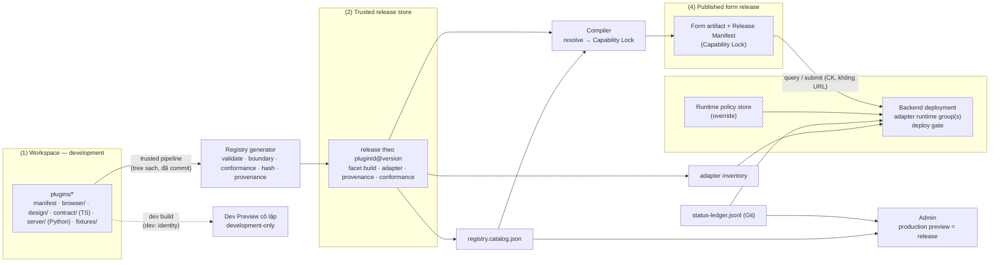

# Spec #2: Plugin Contracts & Capability Registry (Design Proposal)

> **Trạng thái: PROPOSAL, revision 2.12** (2026-10-25).
> - Rev 2.12 (ADR-074, user duyệt SR-04): **Host-owned Declarative Presentation là hướng thiết kế P0 đã duyệt**. §6.2.2 mới: contract metadata (schema đóng, không có chuỗi tự do, primitive trong allowlist của Platform, không cấp quyền API), ba tầng Edit Canvas / Interactive Preview / Published Form và parity của từng tầng, negative fixture N-PRES-01..08; registry P0 từ chối `bindings.presentation`, `bindings.design`, export `./presentation`/`./design` (`E-PRESENTATION-EXECUTABLE-REF`); sửa chỗ còn ghi Admin build chứa `presentation`/`design` (§4, §6.5, INV-A2, L3, §17.2, §18.1, §21).
> - Rev 2.11 (vòng sửa C1, Cross-Subsystem Review): **presentation khai báo do host sở hữu** thay cho export JS `Presentation` ở P0 (SR-04/ADR-070, đề xuất chờ user xác nhận; §6.2.1, §7.4); INV-A1: Admin build **không** chứa module nào của plugin; INV-A2: loại version `revoked`, cho phép adapter submit mock của preview (MINOR-14); §8.1 bước 11 ingestion runtime (CSR-01); §10.3/§10.4 theo `S` = release và miễn trừ (MINOR-18); §15 body có `schemaVersion` (MINOR-06); §16.3 `deprecated` chỉ thông tin (CSR-17); §16.5 G-ADM/G-EXEC (CSR-04); §21 phạm vi theo ADR-072; `motionPreset` không còn "Motion Animation Editor".
> - Rev 2.10: đồng bộ spec #6 (I6-03, I6-06): INV-A2 có Motion runtime + mọi version `@platform/motion-presets` được hỗ trợ; luật L3 cho package Motion (không import dispatcher/store/selector của engine, không API mạng/storage).
> - Rev 2.9: ADR-061 — **P0 không nạp design binding**: chỉ inspector tự sinh + control typed của Admin; design binding là P1 (sandbox) (§6.3, §6.4, §7.2, §11.1 INV-A1, §18.1). ADR-057/058 — đóng OD2-08 (`T_stale` 60 s chỉ cho query thông tin) và OD2-09 (`G` = 7 ngày); enforce runtime qua admission gate của spec #5 §9.3 (§15.3, §16.5).
> - Rev 2.8: theo targeted review của Preview isolation: binding `presentation` + export `./presentation` + entry SDK `@platform/sdk-browser/presentation` (§6.2.1, §6.4, §6.5); L3 viết lại (bỏ `design` → browser); invariant INV-A1/INV-A2 và L1b/L5 cho Admin build và Preview build (§11.1, §11.2); conformance với spy mở rộng cho `presentation` **và design facet** (§17.2); ghi trung thực rằng design facet và `presentation` vẫn là code plugin chạy trong origin Admin (§7.2, §10.1; spec #4 OD4-07).
> - Rev 2.7: theo ADR-053 (Preview cô lập): `Presentation` nằm ở **sub-entry `presentation`** riêng của browser facet, có đồ thị import thuần (§7.4, L3 §11.2); Admin build chỉ chứa design facet + entry `presentation`; browser facet hành vi chỉ vào **Preview build** trên origin preview riêng (§10.1); conformance kiểm cả lúc import module (§17.2).
> - Rev 2.6: theo spec #4 review #1 BLOCKER A — `fieldType` có export **`Presentation`** thuần hiển thị, không side effect (§7.4) + conformance (§17.2); Admin chỉ dùng `Presentation` trên Design Canvas. Registry kiểm `designHostApi` của Admin build (§10.1).
> - Rev 2.5: §6.3 bắt buộc `title` tiếng Nhật cho mọi thuộc tính của `configSchema`/`paramsSchema` và quy định tập con mà inspector tự sinh vẽ được (theo builder check của spec #4); cập nhật ví dụ §6.4.
> - Rev 2.4: thêm lớp **L1b (resolve allowlist trong bundler)** và cập nhật §11.5 theo evidence SPIKE-GATE-01 EXP-03 (spec #3 rev 2 §25.2).
> - Rev 2.2: §10.2 tách Logical Release Manifest (input của `releaseId`) và Final Release Metadata theo ADR-038 / spec #3 notes S3-P12.
> - Rev 2.3: đồng bộ với spec #3 rev 1 sau consistency review: Capability Lock tách identity / resolution context (§9.2); rebuild dùng Build Request đã lưu (§9.3); §10.2 (vị trí `browserHostApi`, `serverHostApi`); INV-F1 có Motion của core (§11.1); L3 cấm engine import Motion; `fieldType` có `Summary` tùy chọn cho 確認 (§7.4).
> - Rev 2.1: chỉ **đồng bộ với ADR-037** (spec #3 Answer #2): §10.3 (active ≠ supported, theo release), §10.6 (phân loại lỗi, không gom thành 503), §19 (I-19, I-22). Chưa có review mới của user cho rev 2.
> - Review #1 (rev 1): **CHANGES REQUIRED — DESIGN DIRECTION ACCEPTED.** OD2-01..07 đã được user quyết (ADR-029..035). Rev 2 áp các quyết định đó và sửa các mâu thuẫn được nêu. Thay đổi so với rev 1: §27.
> - Spec #2 **chưa được duyệt hoàn toàn**. **G1 NOT APPROVED.** G9 và G10 BLOCKED.
> - Nguồn:
>   - [P01_BRAINSTORM_NOTES.md](../../discovery/P01_BRAINSTORM_NOTES.md), Session 3: Spec #2 Answer #1..#3, Review #1
>   - [DECISIONS.md](../../DECISIONS.md): ADR-016, ADR-017, ADR-019..035
>   - [Spec #1 rev 3.1](2026-10-23-form-schema-workflow-design.md) §7, §10..§16
>   - Master ARCH-09, ARCH-10, BUILD-01..08, SEC-02..04
>
> Phạm vi: subsystem spec số 2 trên 6. Theo spec #1 §12, khi được duyệt, spec này là **nguồn sự thật** cho: danh sách capability kind, manifest, registry, permission/side effect, async lifecycle ở cấp capability, compatibility, governance theo version và conformance. Bundling, định dạng Release Manifest/Dependency Lock thuộc spec #3; API, persistence, outbox, auth và deploy thuộc spec #5; Motion thuộc spec #6.
>
> Không có code triển khai. Chữ ký TypeScript/Python chỉ minh họa contract. Ví dụ JSON đã được kiểm (evidence ở §25).

## 0. Cách đọc trạng thái

| Nhãn | Ý nghĩa |
|---|---|
| **ACCEPTED** | User xác nhận ở mức nguyên tắc. Không có nghĩa kiến trúc hay implementation đã được duyệt. |
| **APPROVED …** | User duyệt quyết định/hướng đi, có thể kèm điều chỉnh. Cơ chế chi tiết vẫn cần review. |
| **PROPOSED** | Claude đề xuất, chờ user review. |
| **OPEN** | Còn chờ user (§22). |
| *[Claude]* | Lựa chọn nhỏ Claude tự quyết để tài liệu đủ cụ thể. User có thể bác bỏ. |

### 0.1. Bảng tổng hợp quyết định

| ADR | Nội dung | Trạng thái |
|---|---|---|
| ADR-016 | Plugin mở rộng capability; engine sở hữu lifecycle, navigation, điều phối validation, submit | ACCEPTED (spec #1) |
| ADR-017 | Hai evaluator TS/Python, một semantic contract, conformance fixtures | APPROVED AS DESIGN DIRECTION |
| ADR-019 | JSON Schema 2020-12 canonical | APPROVED AS DESIGN DIRECTION |
| ADR-021 | Platform đặt classification tối thiểu, Editor chỉ được tăng | APPROVED AS DESIGN DIRECTION |
| ADR-022 | `deferToSubmit` có giới hạn, không fail-open | APPROVED AS DESIGN DIRECTION |
| ADR-023 | Centralized Governance + Distributed Contribution, trust model, pin chính xác | ACCEPTED |
| ADR-024 | 4 family, package nhiều facet, registry tĩnh + import sinh tường minh | ACCEPTED |
| ADR-025 / ADR-027 | Phân loại thao tác; P0 không có business write trước submit; final submission 8 bước | ACCEPTED |
| ADR-026 | Manifest, identity, resolution, compatibility, data flow security, facet boundary | APPROVED AS DESIGN DIRECTION WITH ADJUSTMENTS |
| ADR-028 | Manifest bất biến + status ledger | ACCEPTED (policy chi tiết ở ADR-032, ADR-035) |
| ADR-029 | OD2-01: server capability adapter theo version, deploy gate, fail closed | **APPROVED WITH ADJUSTMENTS** |
| ADR-030 | OD2-02: Immutable Plugin Release Store, 4 lớp | **APPROVED** |
| ADR-031 | OD2-03: một version mỗi plugin trong một Form Release | **APPROVED FOR P0** |
| ADR-032 | OD2-04: `deprecated`/`vulnerable`/`revoked` có security governance | **APPROVED (MODIFIED by user)** |
| ADR-033 | OD2-05: 5 kind P0 + design binding; còn lại do core hoặc chỉ contract; Motion vẫn P0 | **APPROVED WITH P0 SCOPE** |
| ADR-034 | OD2-06: bind effect đã approve; P0 chỉ mock; site policy | **APPROVED WITH RESTRICTIONS** |
| ADR-035 | OD2-07: Git ledger + emergency runtime override | **APPROVED WITH ADJUSTMENTS** |
| §5–§21 | Cơ chế chi tiết | **PROPOSED** |
| OD2-08, OD2-09 | Quyết định mới phát sinh | **OPEN** (§22) |

---

## 1. Mục đích và lý do

Spec #1 giữ DSL nhỏ: mọi thứ ngoài catalog built-in đi qua plugin. Vì vậy plugin là nơi dễ phá vỡ những gì spec #1 bảo vệ:
- code server hoặc secret lọt vào bundle của khách;
- form A kéo theo code của form B;
- compiler và backend hiểu một capability theo hai cách khác nhau;
- form đang chạy tự đổi hành vi vì có plugin version mới hoặc backend mới;
- dữ liệu do browser gửi lên được backend tin như dữ liệu đã xác minh.

Spec #2 định nghĩa hợp đồng giữa developer viết plugin, platform (registry, compiler, engine, Python host) và Business Editor (chỉ cấu hình), để các lỗi trên bị chặn **bằng cấu trúc**, không phụ thuộc vào sự cẩn thận của từng người.

**Thước đo thành công:**
- Sports artifact không chứa module nào của `store-selector`; PC artifact chứa đúng browser facet của nó, không có design facet hay dấu vết server (BUILD-06, đo ở spec #3/P07).
- Cùng một capability key được compiler và backend resolve ra cùng một implementation (hash khớp).
- Không có đường nào để published revision dùng plugin version khác version đã pin, kể cả sau rebuild hay deploy backend mới.
- Thêm plugin mới không cần sửa engine.

## 2. Goals, non-goals, anti-goals

**Goals**
- G2-1: Capability identity duy nhất, cùng dạng chuẩn ở TS và Python (ADR-026).
- G2-2: Manifest khai báo, validate được bằng JSON Schema 2020-12 (ADR-019).
- G2-3: Ranh giới facet được enforce nhiều lớp và kiểm chứng được (ADR-024, ADR-026).
- G2-4: Resolve tất định, pin chính xác, không fallback, không tự nâng (ADR-023, ADR-031).
- G2-5: Compatibility giữa plugin release, adapter, backend deployment và published revision được kiểm ở publish, deploy, rollback và runtime (ADR-029).
- G2-6: Data flow: classification vào/ra, propagation, trust, site scope (ADR-026).
- G2-7: Governance theo version với security governance và runtime override (ADR-032, ADR-035).
- G2-8: Contract cho Query / Provisional / Final / Post-commit; Provisional chỉ thiết kế (ADR-027).
- G2-9: Conformance suite là cổng vào release store.

**Non-goals (P0)**
- Không marketplace, không dynamic package registry, không remote JavaScript, không upload artifact từ Admin (ADR-023, ADR-030).
- Không Provisional Command Framework, không business write trước submit (ADR-027).
- Không implement kind ngoài phạm vi ADR-033.
- Không sandbox thực thi; không orchestration nhiều runtime; không incident-management service; chưa ký artifact (ADR-029, ADR-030, ADR-035).
- Không telemetry từ plugin.

**Anti-goals**
- Registry thành service locator toàn cục.
- Admin JSON chứa thứ gì có thể biến thành import path, URL hay tên module.
- Dùng semver thay cho bằng chứng tương thích.
- Plugin tự khai output của nó là trusted; dùng nguồn gốc giá trị (provenance) làm cơ sở tin cậy.
- Isolation dựa vào một cơ chế duy nhất (chỉ tree-shaking, hay chỉ conditional exports).
- Kết luận "isolation PASS" khi chưa có artifact build thật.

## 3. Ràng buộc

- Master và CLAUDE.md: không code trước G1; không push trước G9; AWS read-only trước G10; chỉ dữ liệu giả, cửa hàng và địa chỉ hư cấu; chi tiết nội bộ công ty chỉ ở `docs/internal/`.
- Backend Python (master API-01). Engine, compiler, Admin dùng TypeScript (ADR-002). Máy local: Node 20.20.2, Python 3.9.6. Version runtime cuối cùng chốt ở spec #3/#5.
- Spec #1 rev 3.1 là input (§19 liệt kê các interface).

---

## 4. Kiến trúc tổng thể



| Thành phần | Sở hữu | Không được |
|---|---|---|
| Plugin (developer) | manifest, implementation từng facet, fixtures, messages | điều khiển navigation/submit/activity; tự chọn endpoint; tự khai output trusted |
| Trusted pipeline + generator | kiểm tra, conformance, build, hash, provenance, ghi release store | nhận artifact từ nguồn khác |
| Status ledger (Git) + runtime override | trạng thái code của từng version | sửa release manifest |
| Compiler | resolve → Capability Lock, sinh import tường minh | lấy chuỗi từ definition làm import specifier; chọn version |
| Engine (browser) | gọi capability qua scoped capability map, async manager, typed command | `registry.get()` toàn cục |
| Backend deployment | chạy adapter theo Capability Lock, enforce permission và policy | nạp module theo chuỗi từ request; thay version |
| Admin | catalog cho Editor (dữ liệu); vẽ `presentation` khai báo bằng primitive của host (§6.2.2, ADR-074); mở Interactive Preview cô lập | nạp, import hay thực thi code plugin; cho nhập code, URL, import path; preview production bằng workspace build |

---

*(Rev 2.8; sửa ở rev 2.12 theo ADR-074.)* Ngoài artifact của khách, trusted pipeline còn build hai bundle cho Admin từ cùng release store: **Admin build** trên origin Admin — **không** module nào của plugin, chỉ đọc manifest/catalog dạng dữ liệu (INV-A1) — và **Preview build** trên origin preview riêng (engine + `contract` + `browser` facet + Motion, INV-A2) (spec #4 §14.4, §14.7; spec #3 §10.1; ADR-053, ADR-074). *(Lịch sử rev 2.7–2.10: Admin build từng chứa `contract` + `presentation` + `design`.)*

## 5. Capability identity và các khái niệm version (ADR-026, ADR-029)

### 5.1. Năm thành phần của identity

| Thành phần | Ví dụ | Vai trò | Có trong key? |
|---|---|---|---|
| `pluginId` | `@platform/store-selector` | đơn vị phát hành, review, ownership | ✔ |
| `pluginVersion` | `1.0.0` | release bất biến | ✔ |
| `capabilityId` | `storeSelector` | tên **duy nhất trong một release**, bất kể kind | ✔ |
| `capabilityKind` | `fieldType` | interface mà capability hiện thực | ✘ (thuộc tính, được kiểm khi resolve) |
| `executionFacet` | `browser` / `server` / `design` | môi trường chạy, **suy ra** từ kind (§7.1) | ✔ ở FBK |

Family không được khai trong manifest; nó suy ra từ kind theo bảng cố định của platform, nên không thể khai lệch.

### 5.2. Key chuẩn

| Key | Dạng chuỗi | Dùng ở |
|---|---|---|
| Plugin Release Key (PRK) | `@platform/store-selector@1.0.0` | release store, ledger, dependency |
| Capability Key (CK) | `@platform/store-selector@1.0.0#storeSelector` | Capability Lock, IR, request query/submit |
| Facet Binding Key (FBK) | `@platform/store-selector@1.0.0#storeSelector/browser` | import sinh ra, adapter, hash |

```
pluginId      = "@" scope "/" name          ; scope, name = [a-z0-9][a-z0-9-]{0,63}
version       = MAJOR "." MINOR "." PATCH    ; không số 0 đứng đầu; release không có prerelease/build
capabilityId  = [a-z][A-Za-z0-9]{0,63}
facet         = "browser" / "server" / "design"
PRK = pluginId "@" version ;  CK = PRK "#" capabilityId ;  FBK = CK "/" facet
```

- Trong artifact máy đọc, key được lưu **dạng object** `{ plugin, version, capability, facet? }`. Dạng chuỗi chỉ để hiển thị, làm map key và log. `formatKey`/`parseKey` có fixture chung TS/Python (C3).
- `pluginId` không được dùng lại sau khi `retired` (§16.4). Đổi tên capability = xóa + thêm = breaking. Version `0.x` không publish được *[Claude]*.
- Workspace build mang **dev identity** `dev:@platform/store-selector@1.1.0+ws.<treehash12>`. Ngữ pháp khác hẳn PRK nên không thể nhầm với release (§9.5).

### 5.3. Resolve cùng một identity ở compiler và backend

1. Definition tham chiếu capability qua alias trong `dependencies.capabilities`, giá trị là object `{ plugin, version, capability, kind }` (§6.6).
2. Compiler resolve thành **Capability Lock** (§9.2): CK đã sắp xếp; mỗi CK có kind, family, FBK cần dùng và hash từng facet build.
3. Lock nằm trong Release Manifest (định dạng: spec #3), lưu kèm published revision.
4. Backend **không resolve lại**. Với mỗi request, backend đọc lock của đúng revision, tìm adapter theo FBK + hash (§10). Không có → fail closed (§10.6).
5. Browser engine nhận scoped capability map do compiler sinh, key là CK. Request từ browser mang CK dạng object, không mang tên module hay URL.

### 5.4. Năm khái niệm version cần tách bạch (ADR-029)

| Khái niệm | Ví dụ | Bất biến? | Ai tạo | Ghi ở đâu |
|---|---|---|---|---|
| **Source package version** | workspace `plugins/store-selector`, manifest khai `1.1.0`, chưa phát hành → `dev:` identity | ✘ | developer | không ghi vào production |
| **Plugin release** (PRK) | `@platform/store-selector@1.0.0` | ✔ | trusted pipeline | release store |
| **Server adapter version** | `adp:@platform/store-selector@1.0.0#storeIdValid/server@<facetHash12>+host1` | ✔ | trusted pipeline | release store, deployment inventory |
| **Backend deployment version** | `backend 2026.10.24-1`: host version + `serverHostApi` + adapter inventory + Python lockfile hash | ✔ cho mỗi lần deploy | deploy | deployment manifest (spec #5) |
| **Published form revision** | `frm_pc_demo` rev 7 | ✔ | publish | form store + Release Manifest |
| **Capability Lock** | bên trong Release Manifest của rev 7 | ✔ | compiler | Release Manifest |

- **Server adapter** = server facet của một release + lớp bọc (shim) cho một `serverHostApi` major. Adapter là đơn vị mà backend nạp và route tới. Một release có thể có nhiều adapter nếu platform hỗ trợ nhiều host API major; P0 chỉ có một.
- Quan hệ: published revision → (Capability Lock) → FBK + hash → adapter có cùng FBK + hash → nằm trong inventory của backend deployment đang chạy.

---

## 6. Manifest (ADR-026, PROPOSED)

### 6.1. Nguyên tắc

- File `plugin.manifest.json` ở gốc thư mục plugin, validate theo meta-schema `urn:forms-poc:schema:plugin-manifest:1` (JSON Schema 2020-12).
- **Bất biến sau khi phát hành.** Không chứa trạng thái (ở ledger, §16).
- Mọi schema nhúng hợp lệ theo 2020-12 **và** platform profile (§6.3).
- Không chứa secret, URL, host, tên biến môi trường.
- Range chỉ được dùng ở `compat`. Phụ thuộc giữa plugin luôn là version chính xác.

### 6.2. Trường cấp plugin

| Trường | Bắt buộc | Ý nghĩa |
|---|---|---|
| `$schema` | ✔ | `urn:forms-poc:schema:plugin-manifest:1` |
| `plugin`, `version` | ✔ | PRK |
| `title` | ✔ | `{ "ja" }` |
| `owners` | ✔ | team id của code owner |
| `compat` | ✔ | range `browserHostApi`, `serverHostApi`, `designHostApi`, `formSchema`; chỉ những host mà plugin có facet |
| `pluginDependencies` | ✔ (có thể rỗng) | `{ plugin, version }` chính xác |
| `facets` | ✔ | `browser: { packageExport }`, `design: { packageExport }`, `server: { pythonPackage, pythonRequirements }` |
| `capabilities` | ✔ (≥ 1) | §6.2.1 |

#### 6.2.1. Trường cấp capability

| Trường | Áp dụng | Ý nghĩa |
|---|---|---|
| `id`, `kind` | mọi kind | `capabilityId`; kind theo §7.1 |
| `title` | mọi kind dùng được từ catalog của Editor | `{ "ja" }` |
| `bindings` | kind có code | tên export theo facet. Facet thực thi do family quyết (§7.1); `design` là **authoring binding** tùy chọn (§7.2); *(rev 2.8)* `presentation` (chỉ `fieldType`, tùy chọn): tên export trong entry `./presentation` của browser facet (§7.4). *(rev 2.12, ADR-074)* P0: registry **từ chối** `bindings.presentation` và `bindings.design` (`E-PRESENTATION-EXECUTABLE-REF`, §6.2.2); chỉ được mở lại ở P1 trong ranh giới cô lập thật, cần ADR mới |
| `presentation` *(rev 2.11)* | `fieldType` (P0) | **dữ liệu khai báo**, không phải code: `{ primitive: "text" \| "textarea" \| "select" \| "radio" \| "checkbox" \| "number" \| "card", placeholderFrom?: <JSON Pointer vào config>, sampleOptionsFrom?: { capability: <id `dataSource` cùng release có `previewFixtures`>, label: <JSON Pointer vào phần tử fixture> } }`. Host (Admin) vẽ bằng component lõi của chính nó. Không biểu thức, không URL, không chuỗi CSS/HTML. Thiếu → thẻ giữ chỗ trung tính. Contract đầy đủ: §6.2.2 (ADR-074) |
| `configSchema` | kind cấu hình được | những gì Editor cấu hình |
| `valueSchema` | `fieldType`, `validator`, `serverValidator` | kiểu giá trị |
| `paramsSchema` | `validator`, `serverValidator`, `derivedFn` | kiểu `params` do definition truyền (§6.6) |
| `inputs` | kind nhận input | port có tên `{ schema, accepts, required }` |
| `outputSchema` | `dataSource`, `derivedFn` | kiểu output |
| `dataPolicy` | kind có dữ liệu | `valueFloor` (fieldType), `outputFloor` (§13.1) |
| `verification` | `fieldType` (**bắt buộc**) | chính sách xác minh phía server khi submit (§13.2) |
| `requires` | tùy kind | liên kết trong **cùng release**, từ vựng đóng: `options` (fieldType → dataSource). Khóa khác → `E-REQUIRES-INVALID` |
| `permissions` | `server-io` | `{ connectors, sideEffects, storage }` (§13.4) |
| `authority` | `validator`, `serverValidator` | `advisory` / `authoritative` (spec #1 §11) |
| `allowsDeferToSubmit` | `serverValidator` | ADR-022 |
| `timeoutMs` | kind async | chặn trên bởi trần platform (§12) |
| `fallback` | `dataSource` | `manualEntry` / `unavailable` |
| `messages` | `validator`, `serverValidator` | `{ code: { "ja" } }` |
| `fixtures` | `cross-runtime-pure`, kind có server facet | thư mục fixture trong plugin (§17) |
| `previewFixtures` | `dataSource` | dữ liệu có version cho preview khi không gọi adapter (§9.5) |

#### 6.2.2. Host-owned Declarative Presentation (ADR-074, P0)

**Nguyên tắc.** Admin chỉ thực thi renderer và component do **Platform** sở hữu. Plugin chỉ cung cấp **dữ liệu** khai báo (manifest, schema, `previewFixtures`) đã được registry validate. Không JavaScript, JSX, HTML, CSS, URL module hay event handler nào của plugin được import hoặc thực thi trong origin Admin.

**Schema của `presentation`** (do Platform sở hữu; phiên bản từ vựng gắn với `designHostApi` của Admin, §10.1):

| Khóa | Kiểu | Ràng buộc |
|---|---|---|
| `primitive` | enum | thuộc **allowlist của Platform** cho `designHostApi` mà Admin build hỗ trợ. P0: `text`, `textarea`, `select`, `radio`, `checkbox`, `number`, `card` (thẻ trung tính: nhãn + loại). Mỗi primitive là một component lõi của Admin; thêm primitive = thay đổi platform có review, nâng `designHostApi` minor |
| `placeholderFrom` | JSON Pointer | ngữ pháp `^(/[A-Za-z0-9_]+)+$`; phải trỏ tới thuộc tính kiểu `string` có trong `configSchema` của chính capability |
| `sampleOptionsFrom.capability` | `capabilityId` | `dataSource` trong **cùng release**, có `previewFixtures` |
| `sampleOptionsFrom.label` | JSON Pointer | cùng ngữ pháp; trỏ tới thuộc tính `string` trong `outputSchema` của phần tử fixture |

- Schema **đóng** ở mọi cấp (`additionalProperties: false`). Không có **chuỗi tự do** nào trong `presentation`: mọi giá trị là enum, id đã khai, hoặc JSON Pointer đúng ngữ pháp và resolve được. Vì vậy không có chỗ cho URL, `javascript:`, markup, CSS, biểu thức hay tên handler.
- Nội dung hiển thị chỉ đến từ: `title`/`messages` (`ja`) trong manifest, giá trị config trong draft, và `previewFixtures`. Tất cả là **dữ liệu không tin cậy**, chỉ được render thành text node (không `dangerouslySetInnerHTML`, không thuộc tính `href`/`src`/`style` lấy từ dữ liệu).
- **Không cấp quyền.** `presentation` không đặt tên endpoint, không mang permission, không kích hoạt request. `sampleOptionsFrom.capability` chỉ chọn **bản fixture nào trong catalog** để đọc; Admin **không bao giờ** gọi adapter `dataSource` cho Canvas. Danh sách endpoint Admin API là hằng trong code của host; metadata không thêm, đổi hay mở rộng được (spec #5 §7.5 vẫn kiểm quyền ở server cho mọi request).
- **Không có tham chiếu thực thi ở P0.** Registry từ chối `bindings.presentation`, `bindings.design`, export `./presentation` / `./design`, và mọi khóa trong manifest/catalog mang module specifier hay URL (`E-PRESENTATION-EXECUTABLE-REF`). Export JS `Presentation` (§7.4) và design binding (§7.2) là **P1**, chỉ trong ranh giới cô lập thật, cần ADR mới. Inspector P0 vẫn là inspector tự sinh + control typed (ADR-061); không mở lại custom executable Inspector.

**Ba tầng, ba mức parity** (spec #4 §9, §14.1):

| Tầng | Chạy gì | Parity phải có | Không được tuyên bố |
|---|---|---|---|
| **Edit Canvas** | renderer khai báo của host (Admin build, không code plugin) | **semantic/configuration parity** với definition: accessible name (nhãn), helper, bắt buộc, placeholder đã khai, thứ tự field/section/step, độ rộng; option của field core; option mẫu (gắn nhãn 「サンプル」) từ `previewFixtures` | pixel-identical; giao diện đặc thù của plugin; hành vi, trạng thái async, validation, Motion |
| **Interactive Preview** | runtime khách trong iframe cô lập (Preview build, INV-A2): engine + browser `Component` của PRK đã approve | **presentation/behavior parity** theo contract có version: cùng `platformReleaseId` (engine, Motion, preset) và cùng PRK/hash facet như release sẽ build; chứng minh bằng conformance scenario (spec #4 4Z08) | parity cho release build bằng `platformReleaseId` hoặc lock khác |
| **Published Form** | runtime khách thật theo release bất biến (spec #3, #5) | — (đây là chuẩn) | — |

- Field plugin trên Canvas **luôn** mang nhãn 「編集用の簡易表示」 và nút 「プレビューで確認」 (mở Interactive Preview tại step chứa field, chọn sẵn field). Không có `presentation`, primitive là `card`, hoặc Admin không hỗ trợ phiên bản từ vựng → thẻ trung tính kèm 「この部品の実際の表示はプレビューで確認してください」. Builder **không** âm thầm vẽ một UI khác rồi coi là giống runtime.

**Negative fixture bắt buộc** (theo luật §17.3: fail đúng lý do + control pass):

| ID | Vi phạm (đúng một) | Lớp bắt | Kỳ vọng |
|---|---|---|---|
| N-PRES-01 | khóa lạ trong `presentation` (`onClick`, `html`, `style`, `className`, `component`) | C0 | `E-PRESENTATION-INVALID` |
| N-PRES-02 | `primitive` ngoài allowlist (`iframe`, `custom`, `html`) | C0 | `E-PRESENTATION-PRIMITIVE` |
| N-PRES-03 | JSON Pointer không resolve / trỏ thuộc tính không phải `string` / `sampleOptionsFrom.capability` không phải `dataSource` cùng release hoặc không có `previewFixtures` | C0 | `E-PRESENTATION-POINTER` |
| N-PRES-04 | chuỗi URL, `javascript:` hay markup đặt vào ô JSON Pointer | C0 (ngữ pháp) | `E-PRESENTATION-POINTER` |
| N-PRES-05 | tham chiếu thực thi: `bindings.presentation`, `bindings.design`, export `./presentation`/`./design`, khóa `moduleUrl`/`import` trong manifest | C0 | `E-PRESENTATION-EXECUTABLE-REF` |
| N-PRES-06 | import bắc cầu: một module của app Admin hoặc thư viện allowlist import (trực tiếp hay bắc cầu) package plugin (`contract`, `browser`, `presentation`, `design`, `server`, `fixtures`) | L1b (Admin build) + L5 canary | `E-ADMIN-BUILD-PLUGIN-MODULE` (spec #3 §10.1) |
| N-PRES-07 | `import()` không literal hoặc URL lấy từ catalog trong code Admin | lint tĩnh Admin + L5 | `E-ADMIN-BUILD-DYNAMIC-IMPORT` (spec #3 §10.1) |
| N-PRES-08 | giá trị config trong draft chứa `` / `<script>` | E2E Admin (spec #4 4C02) | hiện thành chữ; không phần tử DOM mới, không request, không vi phạm CSP |

### 6.3. Platform profile cho schema nhúng

| Cho phép | Cấm | Lý do |
|---|---|---|
| `type`, `enum`, `const`, `properties`, `required`, `additionalProperties`, `items`, `prefixItems`, `minItems`, `maxItems`, `minLength`, `maxLength`, `minimum`, `maximum`, `pattern`, `default`, `title`, `description`, `$defs`, `$ref` nội bộ (`#/$defs/...`), `oneOf`/`anyOf` có `const` phân biệt | `$ref` ra ngoài, `$dynamicRef`, `format` như assertion, `contentEncoding`/`contentMediaType`, `unevaluated*` *[Claude]*, `type: "number"` | không fetch ngoài; `format` khác nhau giữa thư viện; P0 chỉ số nguyên (spec #1 §7.6.2) |
| `pattern` theo tập con regex chung (lớp ký tự, lượng từ, neo `^$`) | lookbehind, backreference, Unicode property | regex ECMAScript và Python `re` phải cho cùng kết quả |
| | `type: "object"` không có `additionalProperties: false` | không có field lạ |

`minLength`/`maxLength` luôn đếm theo code point (luật cố định, spec #1 §7.6.4; cũng là ngữ nghĩa của JSON Schema). C3 có fixture surrogate pair.

*(Rev 2.5, spec #4 §10.2.)* **Schema mà Business Editor cấu hình** (`configSchema`, `paramsSchema`):
- Mọi thuộc tính phải có `title` là chuỗi tiếng Nhật (nhãn hiển thị); `description` tiếng Nhật nếu cần giải thích. Enum phải có nhãn hiển thị cho từng giá trị (ví dụ dùng `oneOf` gồm `{ const, title }`). Thiếu → `E-SCHEMA-PROFILE`.
- Inspector tự sinh chỉ vẽ được tập con: `boolean`, enum có nhãn, `string`, `integer`, mảng chuỗi ngắn. Schema ngoài tập này (object lồng, mảng object, `$defs`…) → `E-SCHEMA-PROFILE` ở P0 (ADR-061: P0 không có design binding). Cần khả năng thiết yếu ngoài tập con → đề xuất một **control typed built-in** của Admin qua review platform, không mở code tùy ý. Từ P1: cho phép khi có design binding chạy trong sandbox (§7.2).
- Tên thuộc tính (ví dụ `filterByPrefecture`) không bao giờ hiện cho Business Editor.

### 6.4. Ví dụ chuẩn: `@platform/store-selector@1.0.0`

Dữ liệu cửa hàng hư cấu. Mọi schema bên trong hợp lệ theo 2020-12 (§25).

```json
{
  "$schema": "urn:forms-poc:schema:plugin-manifest:1",
  "plugin": "@platform/store-selector",
  "version": "1.0.0",
  "title": { "ja": "店舗選択" },
  "owners": ["platform-maintainers"],
  "compat": {
    "browserHostApi": ">=1.0.0 <2.0.0",
    "serverHostApi": ">=1.0.0 <2.0.0",
    "designHostApi": ">=1.0.0 <2.0.0",
    "formSchema": ">=1.0.0 <2.0.0"
  },
  "pluginDependencies": [],
  "facets": {
    "browser": { "packageExport": "./browser" },
    "server": { "pythonPackage": "store_selector_server", "pythonRequirements": [] }
  },
  "capabilities": [
    {
      "id": "storeSelector",
      "kind": "fieldType",
      "title": { "ja": "店舗を選ぶ" },
      "bindings": { "browser": "StoreSelectorField" },
      "presentation": { "primitive": "select", "placeholderFrom": "/placeholder", "sampleOptionsFrom": { "capability": "storeList", "label": "/name" } },
      "configSchema": {
        "type": "object",
        "additionalProperties": false,
        "properties": {
          "filterByPrefecture": { "type": "boolean", "default": true, "title": "都道府県で絞り込む" },
          "placeholder": { "type": "string", "maxLength": 40, "title": "未選択時の表示", "description": "店舗が選ばれていないときに表示する文章です。" }
        }
      },
      "valueSchema": { "type": "string", "pattern": "^ST-[0-9]{4}$" },
      "inputs": {
        "prefecture": {
          "schema": { "type": "string", "minLength": 1, "maxLength": 8 },
          "accepts": "public",
          "required": false
        }
      },
      "dataPolicy": { "valueFloor": "public" },
      "verification": { "policy": "authoritativeCheck", "check": "storeIdValid" },
      "requires": { "options": "storeList" }
    },
    {
      "id": "storeList",
      "kind": "dataSource",
      "title": { "ja": "店舗一覧" },
      "bindings": { "server": "query_store_list" },
      "inputs": {
        "prefecture": {
          "schema": { "type": "string", "minLength": 1, "maxLength": 8 },
          "accepts": "public",
          "required": false
        }
      },
      "outputSchema": {
        "type": "array",
        "maxItems": 200,
        "items": {
          "type": "object",
          "additionalProperties": false,
          "required": ["id", "name"],
          "properties": {
            "id": { "type": "string", "pattern": "^ST-[0-9]{4}$" },
            "name": { "type": "string", "minLength": 1, "maxLength": 60 },
            "prefecture": { "type": "string", "maxLength": 8 }
          }
        }
      },
      "dataPolicy": { "outputFloor": "public" },
      "permissions": { "connectors": ["mock-store-directory"], "sideEffects": "none", "storage": "none" },
      "timeoutMs": 3000,
      "fallback": "unavailable",
      "fixtures": "fixtures/storeList",
      "previewFixtures": "fixtures/storeList/preview"
    },
    {
      "id": "storeIdValid",
      "kind": "serverValidator",
      "title": { "ja": "店舗の確認" },
      "bindings": { "server": "validate_store_id" },
      "valueSchema": { "type": "string", "pattern": "^ST-[0-9]{4}$" },
      "inputs": {
        "prefecture": {
          "schema": { "type": "string", "minLength": 1, "maxLength": 8 },
          "accepts": "public",
          "required": false
        }
      },
      "authority": "authoritative",
      "allowsDeferToSubmit": true,
      "permissions": { "connectors": ["mock-store-directory"], "sideEffects": "idempotentRead", "storage": "none" },
      "timeoutMs": 3000,
      "messages": {
        "storeNotAvailable": { "ja": "選択した店舗は現在ご利用いただけません。別の店舗をお選びください。" }
      },
      "fixtures": "fixtures/storeIdValid"
    }
  ]
}
```

- `fieldType` không có server binding. Xác minh server là capability riêng `storeIdValid`, liên kết qua `verification.check`. Mỗi capability có đúng một family nên facet không mơ hồ.
- *(rev 2.9, ADR-061)* P0: Inspector của `storeSelector` là **inspector tự sinh** từ `configSchema` (boolean + string, nằm trong tập con §6.3); input port `prefecture` nối bằng control typed của Admin (`SetCapabilityInputs`, spec #4 §8). Không có design binding ở P0.
- `mock-store-directory` là connector id do platform đăng ký phía server, trỏ tới dữ liệu hư cấu.

### 6.5. Đóng gói (minh họa; tên thư mục chốt ở spec #3/P02)

```
plugins/store-selector/
  plugin.manifest.json
  package.json        # P0 (rev 2.12, ADR-074): exports chỉ "./contract", "./browser"; "./presentation", "./design" là P1 (bị registry từ chối ở P0); không có "." gộp, không wildcard
  contract/           # type sinh từ schema + hằng thuần
  browser/            # TS/TSX
  # presentation/, design/: P1, chỉ trong ranh giới cô lập thật (§6.2.2)
  server/             # Python package, chỉ import tương đối
  fixtures/           # fixture có version theo release; không nằm trong exports
```

```json
{
  "exports": {
    "./contract": { "import": "./dist/contract/index.js", "types": "./dist/contract/index.d.ts" },
    "./browser": { "import": "./dist/browser/index.js", "types": "./dist/browser/index.d.ts" }
  },
  "peerDependencies": { "react": "<pin theo engine>", "@platform/sdk-browser": "<pin theo browserHostApi>" }
}
```

*(Rev 2.12: ví dụ đã bỏ `./presentation`, `./design` theo ADR-074; điều kiện export `design` ở L1 giữ cho P1.)* `package.json` được chép nguyên vào release, nên điều kiện export vẫn có hiệu lực khi compiler resolve từ store. **Conditional exports chỉ là một lớp (L1), không phải security boundary duy nhất**; hiệu lực của nó phải được kiểm trong bundler thật (§11.5).

### 6.6. Definition dùng capability thế nào (đồng bộ vào spec #1 rev 3.1)

```json
{
  "dependencies": {
    "capabilities": {
      "storeSel": { "plugin": "@platform/store-selector", "version": "1.0.0", "capability": "storeSelector", "kind": "fieldType" },
      "jpPhone": { "plugin": "@platform/validator-jp-phone", "version": "1.0.0", "capability": "jpPhone", "kind": "validator" },
      "logSubmission": { "plugin": "@platform/effect-mock-log", "version": "1.0.0", "capability": "recordSubmission", "kind": "postCommitEffect" }
    }
  },
  "fields": [
    { "id": "fld_store", "key": "store", "type": "plugin:storeSel",
      "config": { "filterByPrefecture": true },
      "inputs": { "prefecture": { "ref": "$local:fld_visit_pref" } } },
    { "id": "fld_phone", "key": "phone", "type": "tel",
      "validators": [{ "use": "jpPhone", "params": {} }] }
  ],
  "effects": [
    { "id": "eff_log", "use": "logSubmission", "on": "submission.committed",
      "inputs": { "formRef": { "system": "formRef" }, "purchaseMethod": { "ref": "$local:fld_method" } } }
  ]
}
```

- `type: "plugin:<alias>"`, alias trỏ tới `fieldType`. `config` validate theo `configSchema`.
- `inputs` map mỗi port sang `{ "ref": <path theo spec #1 §6.3> }`, `{ "const": <giá trị public> }` hoặc (chỉ cho effect) `{ "system": "formRef" | "submissionId" | "submittedAt" }`. Port `required` thiếu mapping → `E-CAP-INPUT-MISSING`.
- **Capability được liên kết** (`requires.options`, `verification.check`) nhận input theo **tên port**: registry bắt buộc mọi port của chúng có port cùng tên, cùng schema trên capability chủ (`E-REQUIRES-PORT-MISMATCH`). Không cần mapping thứ hai.
- Validator: `{ use, params? }`, `params` theo `paramsSchema`; bỏ qua thì là `{}` (không khai `paramsSchema` thì chỉ được là `{}`).
- `effects` theo §15.3.

---

## 7. Capability kinds và ma trận P0/P1/P2 (ADR-033)

### 7.1. Ma trận kind

| Kind | Family | Facet thực thi | P0 | P1 | P2 | Ở P0 nhu cầu được đáp ứng bởi |
|---|---|---|---|---|---|---|
| `fieldType` | `browser-ui` | browser | **implement** (`store-selector`) | | | |
| `validator` | `cross-runtime-pure` | browser (TS) + server (Python) | **implement** (`jpPhone`, `katakana`) | | | |
| `dataSource` | `server-io` | server | **implement** (`storeList`) | | | |
| `serverValidator` | `server-io` | server | **implement** (`storeIdValid`) | | | |
| `postCommitEffect` | `server-io` | server | **implement** (chỉ mock) | | | |
| `canonicalizer` | `cross-runtime-pure` | browser + server | contract | implement (`postal-code`) | | **core**: canonicalization built-in (spec #1 §7.6.5) |
| `derivedFn` | `cross-runtime-pure` | browser + server | contract | implement khi có nhu cầu | | **core**: `calculated` (spec #1 §10) |
| `template` | `design-time` | không có code | contract | implement | | **core**: clone từ revision (spec #1 §20) |
| `motionPreset` | `browser-ui` | browser | contract | implement | | **core**: Motion presets là **P0**; Editor chỉ chọn preset / nhóm / speed (spec #6, ADR-066/067) — không có animation editor ở P0 |
| `layout` | `browser-ui` | browser | contract | | implement | **core**: layout chuẩn |
| `provisionalCommand` | `server-io` | server | contract (§14.3) | | implement khi có nhu cầu | không có (P0 không có pre-submit write) |
| UI interaction, navigation | — | — | **core** | | | không phải kind (ADR-016) |
| Final submission command | — | — | **core** | | | không phải kind (ADR-027) |
| Option set tĩnh (ví dụ 都道府県) | — | — | **core** (`optionsFrom: "core:jpPrefectures"`) | xem xét kind riêng nếu cần | | không phải kind ở P0 |

- **Facet hợp lệ theo family** (normative): `browser-ui` → `browser`; `cross-runtime-pure` → đúng `browser` + `server`; `server-io` → `server`; `design-time` → không có code thực thi. Binding thực thi ở facet khác → `E-FACET-FORBIDDEN`.
- "contract" = interface và luật registry được định nghĩa trong spec này; registry P0 **từ chối** release dùng kind đó (`E-KIND-NOT-ENABLED`). Bật một kind là thay đổi cấu hình platform có review, không cần sửa engine nếu contract đã có.
- Kind bị bỏ so với rev 1: `inspector` (thành design binding, §7.2), `previewMock` (thành `previewFixtures`, §9.5).

### 7.2. Design binding (thay cho kind `inspector`)

*(Rev 2.9, ADR-061: toàn bộ mục này là **P1**. P0 không nạp design binding vào Admin; capability chỉ dùng inspector tự sinh và control typed. Khi bật ở P1, design binding chạy trong sandbox, không trong origin Admin.)*

Chỉ có **một** cơ chế đăng ký: `bindings.design` của chính capability.
- Áp dụng cho mọi capability có `configSchema` (P0: `fieldType`; tương lai: validator có params phức tạp, effect).
- Không có binding → Admin dùng inspector tự sinh từ `configSchema`.
- `design` là **authoring facet**: chỉ chạy trong Admin, không bao giờ vào artifact của khách (L1, L3, L5). Nó không phải execution facet nên không đổi family của capability.
- *(rev 2.8, trung thực; giữ làm lý do cho ADR-061/ADR-074 — rev 2.12: P0 registry từ chối `bindings.design`, §6.2.2)* Design binding là React có state và handler; nếu chạy **trong origin Admin đã xác thực**: L3 chỉ chặn được API mạng viết trực tiếp; code cố ý có thể lách (`globalThis[...]`, `new Image().src`, chèn `<script>`), và code cùng origin đọc được CSRF token của Admin. Bảo vệ hiện có chỉ phù hợp trust model ADR-023 (developer thiện chí, trusted pipeline, review, conformance §17.2, CSP của Admin), **không** chống mã độc cố ý. Có giữ design binding trong origin Admin ở P0 hay không: spec #4 OD4-07.
- Contract: React component nhận `{ config, onChange(config), schema, catalogContext }`. Admin validate output theo `configSchema` trước khi ghi draft bằng typed command của Admin (spec #4). Inspector không ghi ra ngoài config của node.
- Admin cũng là ứng dụng browser: design facet cũng **không** được chứa secret (L4).

### 7.3. Contract chung

- Capability chỉ nhận input đã map tĩnh. Không truy cập toàn bộ state, DOM ngoài vùng của nó, storage, `location`, cookie.
- **Không mutate form state.** Capability trả giá trị; engine áp dụng bằng typed command qua single writer (spec #1 INV-N1). Plugin không có tham chiếu tới command dispatcher.
- Lỗi có cấu trúc `{ code, params? }`. Exception không bắt được → `E-CAPABILITY-FAILED`, log không có giá trị.
- Không đọc đồng hồ, locale, timezone, số ngẫu nhiên trừ khi host cấp qua context.

### 7.4. Interface theo kind (minh họa)

**`fieldType` (browser):**
```ts
type FieldTypeBrowser<V, C, I> = {
  Component: (p: FieldProps<V, C, I>) => ReactNode;
  Summary?: (p: { value: V | undefined; config: Readonly<C>; options?: QueryState<unknown> }) => ReactNode;
  // rev 2.3: hiển thị giá trị ở step 確認; không có thì engine hiện giá trị thô. Cùng facet, cùng chunk.
  Presentation?: (p: { value?: V; config: Readonly<C>; sampleOptions?: unknown; ids: A11yIds }) => ReactNode;
  // rev 2.11 (C1, SR-04/ADR-070; rev 2.12: ADR-074 duyệt): export JS này là **P1** và chỉ được nạp trong một ranh giới cô lập thật
  // (iframe sandbox trên origin riêng). P0: Design Canvas dùng `presentation` khai báo trong manifest (§6.2.1),
  // do host vẽ — không có JavaScript nào của plugin chạy trong origin Admin.
  // rev 2.6: CHỈ hiển thị, dùng trên Design Canvas của Admin (spec #4 §9). Thuần: không hook có side effect
  // (useEffect/useLayoutEffect gây I/O), không timer, không storage, không mạng, không đọc engine/context.
  // Không có thì Canvas hiện thẻ giữ chỗ trung tính; Canvas không bao giờ mount `Component`.
  // rev 2.7/2.8: `Presentation` được export từ entry `./presentation` của browser facet (binding
  // `bindings.presentation`). Đồ thị import của entry này ⊆ thư mục `presentation/` ∪ `contract`
  // ∪ `@platform/sdk-browser/presentation` ∪ thư viện allowlist (L3). `Component` được phép import
  // `Presentation` để dùng chung markup; chiều ngược lại bị cấm.
};
type FieldProps<V, C, I> = {
  value: V | undefined;
  onChange(next: V | undefined): void;   // engine kiểm valueSchema rồi phát typed command
  onCommit(): void;                       // blur / compositionend
  status: FieldStatus; config: Readonly<C>; inputs: Readonly<Partial<I>>;
  options?: QueryState<unknown>;          // requires.options: engine gọi dataSource, plugin chỉ render
  ids: A11yIds;
};
type QueryState<O> = { state: "idle" } | { state: "pending" } | { state: "ready"; value: O }
  | { state: "error"; code: string; retry(): void } | { state: "timedOut"; retry(): void };
```

**`validator` (cross-runtime-pure):** `validate(value, params) → { ok: true } | { ok: false, code, params? }`, bản TS và Python cùng dạng JSON.

**`dataSource` / `serverValidator` (server, qua adapter):**
```python
async def query_store_list(inputs: dict, ctx: ServerContext) -> list: ...
async def validate_store_id(value: str, inputs: dict, ctx: ServerContext) -> dict: ...
class ServerContext:
    site: SiteRef          # suy ra từ published revision, không từ payload
    deadline: float; cancelled: CancelToken
    connectors: Mapping[str, Connector]   # chỉ connector đã khai
    log: RedactingLogger
```

**`postCommitEffect` (server):** `async def handle(event, ctx) -> Done | Retry(after) | Failed(code)`; `event = { eventId, submissionId, formRef, data }`, `data` chỉ gồm input đã map.

**Contract-only (không implement P0):** `canonicalize(raw) → str` (idempotent); `compute(inputs, params) → O | Missing`; `motionPreset`/`layout` theo spec #6/#4; `provisionalCommand` theo §14.3.

**Engine client connector** (không phải plugin): node dùng `dataSource` → engine gửi query `{ capability: CK, revisionRef, inputs }` tới backend. Transport ở spec #5.

---

## 8. Trusted release pipeline và registry generation (ADR-024, ADR-030, PROPOSED)

### 8.1. Pipeline

| # | Bước | Thất bại |
|---|---|---|
| 0 | **Trusted mode**: chạy trên tree đã commit, sạch (`git status` rỗng), ghi commit SHA. P0 = generator chạy ở local theo chế độ CI; sau G9 là CI thật. Không có đầu vào nào khác (không upload, không URL). | `E-UNTRUSTED-SOURCE` |
| 1 | Discover: glob cố định `plugins/*/plugin.manifest.json` | — |
| 2 | Validate manifest và schema nhúng (2020-12 + profile) | `E-MANIFEST-INVALID`, `E-SCHEMA-INVALID`, `E-SCHEMA-PROFILE` |
| 3 | Luật kind: facet theo family; kind chưa bật; `requires`/`verification.check` đúng kind trong cùng release; port khớp; `verification` bắt buộc cho `fieldType`; `capabilityId` duy nhất; *(rev 2.5)* `title` tiếng Nhật và tập con inspector cho `configSchema`/`paramsSchema` (§6.3) | `E-FACET-MISSING`, `E-FACET-FORBIDDEN`, `E-KIND-NOT-ENABLED`, `E-REQUIRES-INVALID`, `E-REQUIRES-PORT-MISMATCH`, `E-VERIFICATION-MISSING`, `E-VERIFICATION-INVALID`; *(rev 2.12)* `presentation` theo §6.2.2: `E-PRESENTATION-INVALID`, `E-PRESENTATION-PRIMITIVE`, `E-PRESENTATION-POINTER`, `E-PRESENTATION-EXECUTABLE-REF` |
| 4 | Exports khớp `packageExport`, điều kiện đúng; không `.` gộp; không wildcard; shared externals là `peerDependencies` | `E-EXPORT-MISMATCH`, `E-SHARED-EXTERNAL` |
| 5 | Binding: TS stub `satisfies` interface rồi typecheck; Python kiểm AST tên và async/sync | `E-BINDING-MISSING`, `E-BINDING-SIGNATURE` |
| 6 | Boundary graph (L3, §11.2) | `E-BOUNDARY-VIOLATION` |
| 7 | Resolve `pluginDependencies`; thiếu; cycle | `E-PLUGIN-DEP-MISSING`, `E-PLUGIN-DEP-CYCLE` |
| 8 | Build facet **của version trong workspace** và adapter; tính hash. PRK đã có trong store: cùng tree hash → bỏ qua (không build lại); khác → `E-RELEASE-IMMUTABLE`. Release cũ không bao giờ build lại. | build error, `E-RELEASE-IMMUTABLE` |
| 9 | Conformance (§17) | `E-CONFORMANCE-FAILED` |
| 10 | Ghi release + **provenance record**; emit `registry.catalog.json` và `adapter-inventory.json` từ **toàn bộ** release store | — |
| 11 *(rev 2.11, CSR-01)* | **Ingestion runtime**: với mỗi release mới có server facet, gọi ingestion của spec #5 §9.3.3 (tạo `CAPSTATUS#{PRK}` + mọi gate FBK trong một transaction); release chỉ vào Admin capability set / Preview build sau khi ingestion thành công | `CAPABILITY_INGEST_CONFLICT` |

**Provenance record** của mỗi release (ADR-030): PRK; source commit; tree hash thư mục plugin; version toolchain (Node, bundler, TypeScript, Python); hash npm lockfile và `pythonRequirements` đã resolve; facet inventory (FBK → hash từng file); adapter inventory; `compat`; hash báo cáo conformance; pipeline id; thời điểm. Ký artifact: phase sau (ADR-030).

### 8.2. Đầu ra

| File | Người đọc | Chứa | Không chứa |
|---|---|---|---|
| `registry.catalog.json` | Admin, compiler | metadata, schema, FBK + hash, provenance tóm tắt | code, đường dẫn tuyệt đối, secret |
| `adapter-inventory.json` | deploy, backend | adapter id → FBK, hash file, `serverHostApi`, `pythonRequirements` | browser/design facet |
| Release store entry | compiler, deploy | facet build, adapter, `package.json`, provenance, fixtures | — |

Pipeline tất định; catalog có hash riêng, ghi vào Release Manifest khi compile.

---

## 9. Version và dependency resolution (ADR-023, ADR-031, PROPOSED)

### 9.1. Hai đồ thị

1. **Plugin → plugin** (`pluginDependencies`, pin chính xác), kiểm ở registry. P0 *[Claude]*: demo không dùng.
2. **Form → capability**: alias của form và của mọi block revision đã pin.

Thư viện bên thứ ba: browser/design gói sẵn trong facet build (§9.4); server theo `pythonRequirements` kiểm với lockfile của deployment (§10.5).

### 9.2. Thuật toán resolve (một version mỗi plugin, ADR-031)

Input: snapshot draft, block revision đã pin, catalog (hash), ledger + runtime override hiện tại, version host.

1. Gom tham chiếu `R`; mỗi tham chiếu nhớ **chuỗi nguồn** (form → block alias → …).
2. Nhóm theo `pluginId`. Hơn một version → `E-CAP-VERSION-CONFLICT` kèm **dependency chain** của từng version, ví dụ: `@platform/store-selector: 1.0.0 (form frm_pc_demo › storeSel) ≠ 1.1.0 (form › block customerInfo@r3 › storeSel)`. Không tự nâng/hạ, không bỏ qua, không chọn theo thứ tự.
3. Tra PRK trong catalog → `E-CAP-MISSING`. Không fallback.
4. Capability có trong release, kind khớp → `E-CAP-NOT-IN-RELEASE`, `E-CAP-KIND-MISMATCH`.
5. Thêm capability liên kết (`requires.options`, `verification.check`) — cùng release nên cùng version.
6. Mở rộng `pluginDependencies` bắc cầu; trùng `pluginId` khác version → như bước 2; cycle → `E-PLUGIN-DEP-CYCLE`.
7. Compatibility với host hiện tại → `E-CAP-ENGINE-INCOMPAT`.
8. Trạng thái hiệu lực (§16.5) → `E-CAP-VULNERABLE`, `E-CAP-REVOKED`, `W-CAP-DEPRECATED` (hoặc `E-CAP-DEPRECATED-NEW-USE` nếu policy chặn dùng mới).
9. Config/mapping/classification/effect policy → `E-CAP-CONFIG-INVALID`, `E-TYPE-MAPPING`, `E-PERM-CLASSIFICATION`, `E-EFFECT-NOT-ALLOWED`.
10. Emit **Capability Lock** gồm hai phần *(rev 2.3)*:
    - **identity:** CK sắp xếp; mỗi CK: kind, family, FBK cần dùng, hash từng facet. Chỉ phần này vào LRM (spec #3 §11.1), nên một plugin không liên quan được phát hành (catalog đổi) hay ledger đổi trạng thái không làm đổi `releaseId`.
    - **resolution context:** hash catalog, id ledger snapshot, id runtime override snapshot. Lưu kèm lock và trong provenance, ngoài identity.

Giới hạn một version chỉ trong **một Form Release**. Form khác nhau dùng version khác nhau bình thường.

### 9.3. Rebuild và không tự nâng

- Rebuild revision cũ là **kiểm chứng tái lập**, không phải publish: dùng **Build Request**, Release Manifest và lock đã lưu (spec #3 §5.1, rev 2.3), không chạy lại bước 1–9, không đọc catalog hiện tại. Facet theo hash không còn → `E-LOCK-UNRESOLVABLE`; bản published không bị ảnh hưởng (BUILD-10).
- Rebuild không bị ledger chặn (để audit được cả revision `revoked`), nhưng **đưa artifact vào phục vụ** là publish/rollback và chịu §16.
- Chỉ Admin đề xuất version mới: lúc chèn (version `active` tương thích mới nhất) hoặc thao tác nâng có chủ đích, tạo draft mới, kèm impact analysis (form/block bị ảnh hưởng, diff `valueSchema` theo spec #1 R-02, regression test).

### 9.4. Phía TS tiêu thụ release (ADR-030)

- Compiler và Admin production preview chỉ resolve plugin từ release store theo FBK trong lock, không từ workspace. Hash file được kiểm trước khi đưa vào bundler; lệch → `E-LOCK-UNRESOLVABLE`.
- Facet build **gói sẵn thư viện bên thứ ba**, trừ **shared externals** (React, React DOM, platform SDK) khai là `peerDependencies`. Nâng lockfile monorepo không đổi hành vi release cũ.
- Shared externals được compiler resolve về **đúng một bản**: bản đi kèm engine version của lần compile (§11.4).
- Hệ quả đã biết: thư viện có thể trùng giữa hai plugin trong một artifact. Chấp nhận ở P0 nếu đo được và không gây xung đột; budget và tối ưu ở spec #3.

### 9.5. Bốn lớp và dev preview (ADR-030)

| Lớp | Nội dung | Ai dùng | Identity |
|---|---|---|---|
| (1) Workspace | source đang phát triển | developer, Dev Preview | `dev:…+ws.<treehash>` |
| (2) Trusted release store | release do pipeline tạo | compiler, Admin production preview, deploy | PRK |
| (3) Runtime deployment | adapter đã deploy và xác minh trong backend; facet browser nằm trong artifact | backend | adapter id + deployment version |
| (4) Published form release | artifact + Release Manifest + lock | khách, backend | form revision |

**Dev Preview** (development-only):
- Chạy trong môi trường dev cô lập: Admin ở chế độ `development` + backend local có cờ `allowDevCapabilities`, dữ liệu riêng.
- UI luôn có banner 「開発用プレビュー（未リリース）」.
- Không bao giờ giả làm release: dev identity có ngữ pháp riêng; publish pipeline từ chối mọi `dev:` (`E-DEV-CAPABILITY`); backend không có cờ dev từ chối request mang `dev:`.
- Draft tạo trong Dev Preview mà tham chiếu `dev:` không publish được cho tới khi plugin được phát hành và alias được trỏ sang PRK.

**Preview fixtures:** `previewFixtures` của `dataSource` là dữ liệu có version theo release. Admin dùng khi preview không gọi adapter (ví dụ test tự động của Admin); kết quả mang nhãn 「プレビュー用データ」 (BUILD-08). Mặc định production preview gọi adapter thật của release (ở PoC adapter đọc dữ liệu hư cấu).

---

## 10. Server compatibility và adapter theo version (ADR-029, PROPOSED)

### 10.1. Bề mặt có version

| Bề mặt | Ai khai | Plugin khai trong `compat` |
|---|---|---|
| `browserHostApi` | engine TS | range |
| `serverHostApi` | Python host | range |
| `designHostApi` | Admin | range |
| `formSchema` | `schemaVersion` của DSL | range |
| Runtime (Node, bundler, Python, lockfile) | — | không khai; ghi vào Release Manifest/deployment manifest |

ADR-026 nói một `engineApi` range; spec tách theo host vì các host có version độc lập. Đây là làm rõ, không đổi nguyên tắc.

*(Rev 2.11, C1; rev 2.12 ADR-074.)* **Admin build** (origin Admin) không chứa code plugin nào (INV-A1); Canvas vẽ `presentation` khai báo (§6.2.2). `designHostApi` từ rev 2.12 là **phiên bản từ vựng presentation khai báo** (allowlist primitive) mà Admin build hỗ trợ, không còn là API cho code design. **Preview build** (origin preview riêng) chứa engine + browser facet + Motion (INV-A2), không chứa version `revoked`; version bị revoke sau khi build vẫn còn trong bundle tới lần build sau, nhưng không được dùng: preview session mang `blockedPrks` (spec #5 §7.3) và iframe không mount `Component` của chúng; lời gọi server qua gate (spec #5 §9.3). *(Lịch sử rev 2.6–2.10: Admin build từng chứa entry `presentation` JS.)* *(Rev 2.6, spec #4 §8.3, §14.4.)* Hai build chỉ đưa vào những release có facet design hoặc browser mà, với **từng facet có mặt**, `compat.designHostApi` / `compat.browserHostApi` chứa version của Admin/engine trong bản build đó (không kiểm host mà release không có facet, §6.2; release chỉ có facet server chỉ cần metadata trong catalog snapshot); release không đạt thì không có trong **Admin capability set** và Admin hiện nó là 「この管理画面では編集できない版」, không bao giờ đổi version thay người dùng.

### 10.2. Release Manifest ghi gì (nội dung spec #2 yêu cầu, định dạng spec #3)

Version chính xác của engine, `browserHostApi`, compiler, bundler, Node, shared externals; `serverHostApi` và backend deployment version lúc publish; Python; hash lockfile; hash catalog; id ledger snapshot; Capability Lock đầy đủ.

*(Rev 2.2, 2.3.)* Các mục trên chia ba nơi (spec #3 §11): **Logical Release Manifest** chứa những gì quyết định identity và hành vi của artifact (IR, phần identity của Capability Lock, version engine/`browserHostApi`/compiler/bundler/shared externals, build config, file inventory) và là input của `releaseId`; **provenance/attestation** của build chứa thời điểm, pipeline, resolution context của lock (catalog, ledger, override snapshot), signature; **release record** (spec #5, lúc đăng ký) chứa `serverHostApi`, backend deployment version và Python của lúc publish.

### 10.3. Tập release được hỗ trợ (supported set)

*(Rev 2.1, ADR-037.)* Đơn vị hỗ trợ là **release** (`releaseId`, một artifact cụ thể của một revision), không chỉ revision. Active ≠ supported: release `inactive` vẫn có thể `supported`. Rollback chỉ đổi active, không làm release publish sau đó thành `retired`. Bốn chiều trạng thái (activation, support, security, asset retention) và các mốc thời gian: spec #3 (notes S3-P06).

*(Rev 2.9, thay định nghĩa cũ theo spec #5 §9.2 và ADR-058.)* Backend phải hỗ trợ mọi release trong tập `S` = mọi release **đã từng active** mà chưa bị retire (gate release không có `rel#retired`). Tập này gồm release đang active, release trong grace window `G` (7 ngày từ lúc rời active, để khách đang mở form cũ gửi được), và release đã quá `supportEndsAt` nhưng chưa retire. Submission được nhận tới `retiredAt`. Miễn trừ của deploy gate cho server FBK đã bị revoke: spec #5 §9.2.

Revision chỉ rời `S` bằng **retire tường minh** sau `G`. Khách gửi tới release đã retire nhận `410 E-RELEASE-RETIRED`, UI hướng dẫn bắt đầu lại trên active release (spec #1 §13, ADR-037).

### 10.4. Deploy gate

Chạy trước khi một backend deployment nhận traffic (P0: lúc khởi động backend local), kể cả khi **rollback backend**:

```
for mỗi release R ∈ S:   # rev 2.11: S = release đã từng active chưa retire (spec #5 §9.2)
  for mỗi server FBK trong R.capabilityLock:
    nếu gate của FBK đang có blocker loại revoked/override/M3: bỏ qua (miễn trừ, spec #5 §9.2); mở lại gate đòi adapter có mặt
    deployment inventory có adapter cùng FBK + hash?          → không: FAIL
    serverHostApi của deployment ∈ compat.serverHostApi?      → không: FAIL
    môi trường Python của adapter group thỏa pythonRequirements? → không: FAIL
    fixture conformance của adapter chạy pass trên deployment?  → không: FAIL
FAIL → không nhận traffic. Báo cáo (revision, FBK, lý do).
```

**Frontend rollback ≠ backend rollback:**
- Rollback form (con trỏ về revision cũ `R_old`): precheck adapter của `R_old` có trong deployment đang chạy và trạng thái hiệu lực cho phép. Không thỏa → chặn rollback, chỉ rõ adapter thiếu.
- Rollback backend (deploy bản cũ): chạy cùng deploy gate với `S` hiện tại. Bản cũ có thể thiếu adapter cho revision mới → bị chặn.
- Hai thao tác độc lập; không thao tác nào ngầm kéo theo thao tác kia.

### 10.5. Adapter runtime group và Python packaging

- **Adapter runtime group** = một môi trường Python (một process/venv) nạp một tập adapter. Router của backend tra FBK + hash → group → adapter.
- **P0:** một backend deployment, một group, nhiều adapter, **khi không xung đột dependency** (ADR-029). Adapter được nạp dưới module alias duy nhất suy ra từ adapter id; server facet chỉ dùng import tương đối; danh sách nạp chỉ đến từ `adapter-inventory.json` đã kiểm hash, không bao giờ từ request.
- Xung đột dependency (hai adapter cần hai version thư viện không tương thích) → deploy gate FAIL ở P0. Hướng xử lý cho production (**chỉ đề xuất**, không implement): nhiều group, mỗi group một môi trường, router chọn group theo FBK; chi tiết thuộc kiến trúc production sau G10.
- Server facet không phụ thuộc browser runtime: chỉ Python stdlib trong allowlist, thư viện đã duyệt và SDK host; I/O là JSON theo schema; conformance chạy trong môi trường không có Node.

### 10.6. Fail closed lúc runtime

Trước khi xử lý query hoặc submission (final submission bước 2), backend kiểm: revision ∈ `S`; mọi adapter cần dùng có trong deployment với đúng hash; host API trong range; trạng thái hiệu lực cho phép.

*(Rev 2.1, ADR-037: phân biệt bốn loại, không gom thành 503. HTTP status chốt ở spec #5.)*

| Loại | Tình huống | Phản hồi | Ghi submission? | Khách thấy |
|---|---|---|---|---|
| Incompatible | `releaseId` không thuộc `formId` + `revision` trong record tin cậy; lock lệch; `draftFormat` lạ | `409 E-RELEASE-INCOMPATIBLE`, `retryable: false` | không | giải thích, Start Over trên active, draft giữ |
| Temporarily unavailable | adapter thiếu/sai hash/host không tương thích (lỗi vận hành) | `503 E-CAPABILITY-UNAVAILABLE` + `Retry-After`, `retryable: true`, cảnh báo vận hành | không | lỗi tạm thời, 再試行, draft giữ nguyên |
| Permanently retired | release đã `retired` | `410 E-RELEASE-RETIRED`, `retryable: false` | không | form đã được cập nhật, Start Over trên active, draft giữ |
| Security suspended | release `suspended`, hoặc capability bị chặn bởi policy (`revoked`, override) | `423 E-RELEASE-SUSPENDED` / `423 E-CAPABILITY-BLOCKED`, `retryable: false`, kèm incident id | không | thông báo tạm ngừng (§16.3), giữ state |

Không có nhánh nào thay bằng version khác.

---

## 11. Facet boundary: chứng minh bằng thiết kế (ADR-024, ADR-026)

### 11.1. Invariant

| ID | Invariant |
|---|---|
| INV-F1 | Module trong artifact của khách ⊆ engine ∪ shared externals (một bản) ∪ `contract` ∪ browser facet của FBK trong lock ∪ thư viện đã gói trong các facet đó ∪ *(rev 2.3)* Motion runtime và preset của core (chỉ trong group `motion`, chỉ khi form dùng Motion; spec #3 §7). |
| INV-F2 | Không có module của design facet, server facet, `fixtures/`, test hay mock trong artifact của khách. |
| INV-F3 | Mọi import specifier (tĩnh hoặc `import()`) trong code compiler sinh là literal lấy từ catalog, không từ chuỗi trong definition. |
| INV-F4 | Server facet chạy được khi không có Node/JS runtime. |
| INV-F5 | Không có secret trong browser/design facet, manifest, catalog, artifact, sourcemap hay metadata build. |
| INV-F6 | Hai form chỉ khác nhau về module plugin đúng bằng hiệu của hai lock (BUILD-06). |
| INV-F7 | Artifact chứa đúng **một** bản React và React DOM. |
| INV-A1 *(rev 2.11)* | **Admin build** (origin Admin): module ⊆ app Admin ∪ shared externals ∪ thư viện allowlist. **Không** module nào từ package plugin (kể cả `contract`, `presentation`, `design`, `browser`); Admin chỉ đọc manifest/catalog dạng **dữ liệu** (JSON). Kiểm bằng L1b + L5 với canary trong mọi entry của plugin fixture; *(rev 2.12)* kiểm cả phụ thuộc bắc cầu và `import()` không literal (spec #3 §10.1, N-PRES-06/07) |
| INV-A2 *(rev 2.8)* | **Preview build** (origin preview; *rev 2.11*: không chứa version có ledger `revoked` — CSR-07; cho phép adapter submit mock **của platform** chỉ dùng trong preview cho `simulatePending`, spec #6 §10 — MINOR-14): module ⊆ engine ∪ shared externals ∪ `contract` ∪ `browser` facet (của Admin capability set; *rev 2.12*: không có entry `presentation` ở P0) ∪ *(rev 2.10)* Motion runtime (thư viện đã pin) + Motion Adapter + mọi version `@platform/motion-presets` được hỗ trợ (spec #6 §7.2) ∪ thư viện allowlist. Không có `design`, server facet, `fixtures/`, test, mock ngoài `previewFixtures` dạng dữ liệu. |

### 11.2. Sáu lớp

| Lớp | Cơ chế | Lúc chạy | Bắt được |
|---|---|---|---|
| **L1 Resolution** | `./design` chỉ có điều kiện `design`; build của khách không bật `design`. Server facet (Python) không có trong `exports`. | build | import design hoặc server **qua `exports`**. *(Rev 2.4: không chặn import tương đối bên trong package — xem L1b.)* |
| **L1b Resolve allowlist** *(rev 2.4; rev 2.8: áp thêm cho Admin build theo INV-A1 và Preview build theo INV-A2, do trusted pipeline build bằng cùng toolchain spec #3, deploy theo spec #5)* | Plugin của compiler trong bundler (K9, spec #3 §9) từ chối mọi module resolve ra ngoài tập cho phép: facet được phép của FBK trong lock (browser + `contract`), engine/core, Motion của core (chỉ group `motion`), shared externals, module sinh ra, danh sách đóng các module ảo của bundler; module có file thật phải có đuôi JS/CSS/JSON. | build | import **tương đối** sang `design/`, `server/`, `fixtures/` hay file `.py` — những thứ `exports` không chặn được (spike EXP-03 n2, n4) |
| **L2 Generation** | Compiler sinh một entry/form, chỉ import literal tới `packageExport` browser của FBK trong lock. Code-split chỉ bằng `import()` literal do compiler sinh. Definition chỉ có key có cấu trúc, kiểm theo ngữ pháp §5.2. | compile | kéo plugin không dùng; Admin JSON điều khiển import |
| **L3 Static boundary** | Đồ thị phụ thuộc bắc cầu từ mỗi facet entry. `contract` → chỉ contract; `browser` → contract, SDK browser, thư viện allowlist; *(rev 2.8, thay luật cũ "`design` → browser"; rev 2.12: các luật `presentation`/`design` dưới đây chỉ áp ở **P1** — P0 registry từ chối hai entry này, §6.2.2)* `presentation` → chỉ file trong `presentation/`, `contract`, `@platform/sdk-browser/presentation` (entry SDK riêng, không API runtime), thư viện allowlist; `browser` → contract, SDK browser, `presentation`, thư viện allowlist; `design` → contract, SDK design, `presentation`, thư viện allowlist; cấm `presentation` → `browser`/`design`, cấm `design` → `browser`, cấm `browser` → `design`; module dùng chung giữa `presentation` và `browser` phải nằm trong `presentation/` (khi đó nó thuộc đồ thị `presentation` và chịu luật của nó); cấm `node:*`, `fs`, `child_process`, `server/`, `fixtures/`, `test/`; cấm trong browser/design: `fetch`, `XMLHttpRequest`, `WebSocket`, `sendBeacon`, `import()` không literal; shared externals không được gói vào facet; *(rev 2.10)* package `@platform/motion-presets` và Motion Adapter không được import dispatcher, store hay selector của engine, không dùng API mạng/storage; *(rev 2.3)* package engine không được import Motion (Motion chỉ vào qua group `motion` do compiler sinh). Python: cấm `requests`, `urllib`, `http.client`, `socket`, `subprocess`, `os.environ`, import tuyệt đối sang plugin khác. | registry | import sai hướng trực tiếp/bắc cầu; mạng trực tiếp; gói React riêng |
| **L4 Secret hygiene** | Không có trường secret trong manifest; secret ở cấu hình connector của host. Secret scanner trên source plugin, artifact, sourcemap, metadata. Sourcemap không phục vụ công khai (SEC-04; chi tiết spec #3). | registry + build | hardcode token |
| **L5 Artifact verification** | Module stats của bundler phải thuộc tập INV-F1; canary marker của design facet, server facet và fixtures không xuất hiện; không module có đuôi `.py` hay mã của server facet; INV-F6 giữa Sports và PC; INV-F7. | sau build (spec #3) | lỗi của L1–L3, cấu hình bundler sai, thư viện kéo code lạ |
| **L6 Negative fixtures** | Mỗi guard có fixture vi phạm cố ý (§17.3). | CI | guard bị vô hiệu hoặc hỏng mà không ai biết |

### 11.3. Lập luận

| Kịch bản lỗi | L1 | L2 | L3 | L4 | L5 |
|---|---|---|---|---|---|
| F1 browser facet import design | ✔ (qua `exports`); ✘ nếu import tương đối — L1b bắt | | ✔ | | ✔ |
| F2 browser facet kéo bắc cầu thư viện chỉ dành cho Admin | | | ✔ | | ✔ |
| F3 compiler sinh import facet sai | ✔ | | | | ✔ |
| F4 Admin JSON chứa path/URL | | ✔ | | | ✔ |
| F5 secret trong browser facet | | | | ✔ | ✔ |
| F6 Sports kéo `store-selector` | | ✔ | | | ✔ |
| F7 server facet phụ thuộc Node | | | ✔ | | (L6: chạy không có Node) |
| F8 Python facet nạp version plugin khác | | | ✔ | | (router theo hash) |
| F9 fixture/mock lọt vào artifact | ✔ (qua `exports`); ✘ nếu import tương đối — L1b bắt | | ✔ | | ✔ |
| F11 *(rev 2.4)* browser facet import file server/`.py` bằng đường dẫn tương đối | ✘ (spike n4) — L1b bắt | | ✔ | | ✔ |
| F10 hai bản React | | | ✔ | | ✔ |

Mỗi kịch bản phải qua ít nhất hai lớp độc lập (F7, F8 được bổ sung bởi L6 và router). Điểm mấu chốt:
1. Server code ở ngôn ngữ khác và không nằm trong `exports`. *(Rev 2.4: điều này **không** đủ — bundler vẫn đưa được file `.py` vào bundle nếu bị import tương đối (spike n4); L1b, L3 và L5 mới là lớp chặn.)*
2. Design facet không resolve được trong build của khách, không chỉ "không được import" theo quy ước. Nhưng L1 **không** được coi là boundary duy nhất: L3 và L5 kiểm độc lập.
3. Đầu vào của generator là catalog, không phải definition.
4. L5 kiểm trên output, không tin lớp nào trước đó.
5. L6 chứng minh từng guard bắt đúng lỗi của nó.

### 11.4. Shared runtime dependencies

- **React singleton:** facet khai React/React DOM là `peerDependencies` và không gói chúng (L3, bước 4 của §8.1). Compiler resolve mọi import `react` về bản của engine. L5 kiểm INV-F7. Duplicate React gây lỗi hook lúc runtime nên phải bị chặn ở build, không phát hiện ở runtime.
- **Platform SDK:** facet build dựa trên SDK của `browserHostApi` mà nó khai; compiler kiểm range (§9.2 bước 7). SDK là shared external, chỉ một bản.
- **Thư viện khác:** được phép trùng ở P0 nếu đo được và không xung đột (thư viện có state toàn cục bị loại khỏi allowlist). Budget và chiến lược dedupe: spec #3.

### 11.5. Giới hạn của chứng minh

- Đây là chứng minh ở mức thiết kế. **Không kết luận isolation PASS** trước khi có artifact build thật và L5 chạy trên nó (spec #3/P07). Spike đo isolation cần gate riêng (ADR-018).
- Hành vi của custom export condition (`design`) phụ thuộc bundler; phải được kiểm trong bundler thật ở spike spec #3. Nếu bundler không hỗ trợ đúng, L1 được thay bằng alias chặn tường minh, còn L3/L5 giữ nguyên.
- *(Rev 2.4, SPIKE-GATE-01 EXP-03, Vite 8.3.5 + Rolldown 1.2.15)* Export condition hoạt động đúng: build khách từ chối `./design` với lý do `is not exported under the conditions [...]`, build design resolve được. Nhưng `exports` **không** áp cho import tương đối bên trong package: browser facet import `../design/index.js` đưa được code design vào build khách, và import `../server/handler.py` đưa được nội dung file Python vào bundle (Rolldown coi đuôi lạ là JS). L3 bắt cả hai trước khi build và L5 thấy canary sau khi build. Vì vậy thêm L1b.

---

## 12. Async lifecycle và cancellation (PROPOSED)

| Việc | Engine (browser) | Plugin | Backend |
|---|---|---|---|
| Khi nào gọi | ✔ (input đổi → fingerprint mới) | ✘ | — |
| Timeout | `min(timeoutMs, trần)` | khai `timeoutMs` | deadline phía server |
| Cancel | `AbortSignal` khi fingerprint đổi, node inactive, unmount, 戻る/popstate (INV-N8) | tôn trọng signal/token | token + bỏ kết quả quá deadline |
| Bỏ kết quả cũ | INV-N4 (`fingerprint`, `seq`, node active, field đích chưa bị khách sửa) | ✘ | — |
| Retry | chỉ khi khách bấm 再試行 (P0) *[Claude]* | ✘ | connector đọc idempotent: tối đa 1 lần trong deadline *[Claude]* |

- Trạng thái một lần gọi: `idle → pending → ready | error | timedOut`, cộng `cancelled` và `discarded` (không hiển thị). `dataSource` lỗi theo `fallback`.
- Python cancel là hợp tác; code đồng bộ trong thread không bị dừng cưỡng bức, host chỉ bỏ kết quả. An toàn vì `dataSource`/`serverValidator` chỉ có `sideEffects: none | idempotentRead`.
- Trần timeout: chốt sau khi đo (ADR-005).
- `postCommitEffect`: xử lý theo lease trên outbox; at-least-once nên handler idempotent theo `eventId`; retry có backoff và giới hạn, sau đó `failed` (spec #5).

---

## 13. Security policy và data flow (ADR-021, ADR-026, PROPOSED)

### 13.1. Classification theo port

| Khai báo | Ý nghĩa | Kiểm |
|---|---|---|
| `dataPolicy.valueFloor` | mức tối thiểu của giá trị field | `E-CLASS-BELOW-MIN` |
| `inputs.<port>.accepts` | mức cao nhất port được nhận | taint của nguồn ≤ `accepts`, nếu không `E-PERM-CLASSIFICATION` |
| `dataPolicy.outputFloor` | mức tối thiểu của output | output = max(taint input, `outputFloor`) |

- Không declassification ở P0. Taint đi qua `requires.options`. Input của effect cũng theo `accepts`; mock effect P0 chỉ nhận `public` và ID hệ thống *[Claude]*.

### 13.2. Provenance, authority và verification là ba khái niệm riêng

*(Review #1 §8.3: không dùng `valueOrigin` để quyết định trust.)*

**Luật gốc:** mọi giá trị backend nhận từ client đều **untrusted**, bất kể nó đến từ đâu. Chỉ giá trị backend tự tính hoặc tự xác minh trong chính request đó mới được dùng cho quyết định nghiệp vụ.

| Khái niệm | Câu hỏi | Ai khai/ghi | Ảnh hưởng tới trust? |
|---|---|---|---|
| **Provenance** | giá trị đến từ đâu? `userInput`, `optionSelection`, `lookupAutofill`, `clientDerived`, `prefillConst` | engine ghi lại lúc runtime | **Không.** Chỉ dùng cho UX (ví dụ quy tắc ghi đè autofill, §18.3), debug và audit. Backend không đọc nó để quyết định tin hay không. |
| **Authority policy** | nguồn nào có thẩm quyền quyết định giá trị hợp lệ? `customerClaim` (khách tự khai, đúng sai do rule kiểm) hoặc `authoritativeSource` (một hệ thống, ví dụ danh mục cửa hàng của site) | manifest của `fieldType` (qua `verification.policy`) và rule của definition | quyết định cách xác minh |
| **Verification policy** | backend làm gì khi submit? | manifest `verification`, analyzer suy ra cho built-in | thực thi lúc submit |

**Verification policy (enum đóng):**

| Policy | Nghĩa | Dùng cho |
|---|---|---|
| `validateAsInput` | chạy validator của IR như input của khách | text, số, địa chỉ do khách nhập hoặc autofill |
| `recompute` | backend tự tính lại, bỏ giá trị client | derived `submit: include` (spec #1 D-06) |
| `authoritativeCheck` | chạy `check` (một `serverValidator` authoritative) với nguồn có thẩm quyền, ngoài `validateAsInput` | giá trị phải thuộc tập do hệ thống quyết, ví dụ `storeId` |

- `fieldType` **bắt buộc** khai `verification` (không có mặc định) → `E-VERIFICATION-MISSING`.
- `authoritativeCheck` → `check` phải trỏ tới `serverValidator` cùng release, `authority: authoritative`, `allowsDeferToSubmit: true` → nếu không `E-VERIFICATION-INVALID`.
- `verification` không nằm trong `configSchema`, nên Editor không đổi được.
- Output phía client (renderer, `derivedFn` bản TS, lookup autofill) không bao giờ tự thành server-trusted; nó chỉ là input cho một trong ba policy trên.

### 13.3. Tenant / site authorization

- `ServerContext.site` do backend suy ra từ `formId + revision`, không từ payload/header client.
- Connector có phạm vi site: `mock-store-directory` chỉ trả cửa hàng hư cấu của site đó; `storeIdValid` từ chối `storeId` của site khác.
- **Site policy** (P0, ADR-034): danh sách effect được phép theo site (`allowedEffects: [{ plugin, capability }]`), do Platform Admin quản lý, không phải Business Editor. Giới hạn plugin theo site cho các kind khác: P1 qua ADR *[Claude]*.

### 13.4. Permission vocabulary

| Permission | Giá trị | Enforce |
|---|---|---|
| `connectors` | connector id trong allowlist server | adapter chỉ nhận connector đã khai |
| `sideEffects` | `none` / `idempotentRead` / `effect` (chỉ `postCommitEffect`) / `provisional` (contract, chưa bật) | registry kiểm theo kind; host chỉ cấp connector ghi cho kind được phép |
| `storage` | `none` (P0) | không cấp API storage |
| secret | không có trường | secret ở cấu hình connector của host |

Browser và design facet không có permission mạng. Mọi gọi mạng từ browser đi qua engine client connector. CSP `connect-src` của artifact chỉ cho origin API của platform (spec #3/#5).

### 13.5. Admin config là untrusted

Validate theo `configSchema` ở Admin, ở publish pipeline phía server và ở backend. Profile cấm `format: uri`; nếu cần chọn connector thì dùng `enum` id đã duyệt. Text thuần, escape mặc định.

### 13.6. Giới hạn trung thực

Không có sandbox. Enforcement gồm static check, context có phạm vi, review, conformance. Bảo vệ trước lỗi của developer có thiện chí, không trước mã độc cố ý (trust model ADR-023).

---

## 14. Phân loại thao tác và Provisional Command (ADR-025, ADR-027)

### 14.1. Bốn loại thao tác phía server

| Loại | Đổi business state? | P0 | Ai sở hữu | Kind |
|---|---|---|---|---|
| Query | không | ✔ | plugin qua adapter | `dataSource`, `serverValidator` |
| Provisional Command | trạng thái tạm | ✘ (contract) | plugin qua adapter (tương lai) | `provisionalCommand` |
| Final Command | ✔ | ✔ | **core** (ADR-016) | không có |
| Post-commit Effect | sau commit | ✔ (mock) | plugin qua adapter, từ outbox | `postCommitEffect` |

Contract không giả định mọi server write chỉ xảy ra sau final submit: `sideEffects: provisional`, kind `provisionalCommand` và lifecycle point `beforeFinalSubmit` đã có trong từ vựng nhưng chưa bật.

### 14.2. P0: không có business write trước submit

Trước submit chỉ có UI interaction, cập nhật field có điều kiện, query chỉ đọc, validation, preview, khôi phục draft phía client (ADR-012). `storeSelector` chỉ ghi `storeId` vào field. Đây là giới hạn PoC; flow cũ có pre-submit write cần audit trước migration (chi tiết nếu có chỉ ở `docs/internal/`).

### 14.3. Contract Provisional Command (thiết kế cho P1/P2)

| Khía cạnh | Yêu cầu |
|---|---|
| Ownership | resource gắn form session (id do server cấp) và site |
| Idempotency | `commandKey`; cùng key cùng payload → cùng kết quả; khác payload → 409 |
| TTL | `expiresAt` do nguồn authoritative quyết; TTL cleanup chỉ là dọn dẹp, không đảm bảo invariant |
| Authorization | như §13.3, thêm rate limit theo session/IP |
| Cancellation | `release(resourceId)` tường minh; không đảm bảo luôn được gọi |
| Retry | chỉ cho command idempotent |
| Reconciliation | final command xác minh lại resource tại nguồn authoritative |
| Compensation | manifest khai `compensation: reversible / expiring / irreversible`; `irreversible` (OTP, email) không được giả vờ hoàn tác |
| Orphan | resource không được dùng hết hạn hoặc bị release; báo cáo cho vận hành |
| Race | nguồn authoritative quyết (ví dụ ràng buộc unique) |
| Abuse | quota theo session/site; challenge nếu cần (P2) |

Không xây generic saga engine.

---

## 15. Final submission P0: điểm chạm của plugin (ADR-027, ADR-034)

Transport, lưu trữ và outbox thuộc spec #5. Spec #2 quy định plugin tham gia ở đâu.

```mermaid
sequenceDiagram
  participant B as Browser (engine)
  participant API as Backend submit
  participant A as Adapters
  participant DB as Local DB
  participant W as Outbox worker
  B->>API: submit {formId, releaseId, revision, schemaVersion, values, idempotencyKey}
  API->>DB: tra idempotencyKey
  alt key đã commit, cùng payload hash
    API-->>B: 200 receipt cũ
  else key đã dùng, khác payload hash
    API-->>B: 409 E-IDEMPOTENCY-KEY-REUSED (không ghi)
  else key mới
    API->>API: (2) revision ∈ S, adapter + hash; đọc nhất quán mạnh gate trước khi gọi adapter (spec #5 §9.3)
    API->>A: (3) validateAsInput · recompute · authoritativeCheck (storeIdValid) · deferToSubmit
    A-->>API: pass / reject / timeout
    alt reject
      API-->>B: 422 lỗi theo external path (không ghi)
    else timeout / không khả dụng
      API-->>B: 503 retryable (không ghi)
    else pass
      API->>DB: (5)(6) một transaction: ConditionCheck gate form/release/FBK + submission + idempotency + outbox event mỗi effect (spec #5 §10.3)
      API-->>B: (7) 200 receipt {submissionId, status: received}
      W->>A: (8) postCommitEffect.handle(event) theo lease
      W->>DB: trạng thái xử lý
    end
  end
```

### 15.1. Bước 4 và idempotency

- Key lạ → từ chối; field inactive → `422 E-INACTIVE-DATA-PRESENT` (ADR-060); giá trị `displayOnly` không được gửi.
- Payload hash = SHA-256 của JCS `{formId, releaseId, values}` *(rev 2.8, đồng bộ spec #5 §10.2)*.
- Engine dùng **cùng** `idempotencyKey` khi retry sau 503/lỗi mạng (payload không đổi). Sau phản hồi **dứt khoát** (422) và khách sửa dữ liệu, engine tạo **key mới** cho lần submit tiếp theo, vì payload đã khác *[Claude]*. Lưu và xử lý key của lần thử bị từ chối: spec #5.

### 15.2. Khi `storeIdValid` từ chối lúc submit (Review #1 §8.1)

- **Không tạo submission**, không tạo outbox event.
- `422`, lỗi `{ path: "store", code: "storeNotAvailable" }` theo external path (spec #1 V-08).
- Engine đưa khách về step chứa field đó (`stp_store`), focus field, hiện message 「選択した店舗は現在ご利用いただけません。別の店舗をお選びください。」.
- `storeList` được gọi lại (fingerprint của field bị đánh dấu cũ) để khách thấy danh sách hiện tại và chọn lại.
- **Mọi giá trị hợp lệ khác giữ nguyên**; draft giữ nguyên; field `store` giữ giá trị cũ kèm lỗi cho tới khi khách chọn lại (không tự xóa, để khách thấy mình đã chọn gì).

### 15.3. Effect binding (ADR-034)

- Definition khai `effects: [{ id, use, on: "submission.committed", inputs }]` (§6.6). Không có trigger nào khác ở P0.
- Analyzer và publish pipeline kiểm: alias trỏ tới `postCommitEffect` trong registry, trạng thái cho phép, `inputs` hợp lệ theo `accepts`, effect có trong **site policy** (`E-EFFECT-NOT-ALLOWED`).
- Backend kiểm lại khi tạo outbox event (ConditionCheck gate FBK trong transaction submit, spec #5 §9.3, §10.3) và khi worker xử lý (đọc nhất quán mạnh gate). Nếu lúc xử lý effect đã bị chặn bởi policy, event chuyển `blocked` (không retry ngầm), ghi audit; recovery path quyết replay hay hủy.
- Business Editor chỉ chọn trong danh sách effect được phép của site; không tạo command mới.
- Retry không nhân đôi: handler idempotent theo `eventId`; mock ghi một dòng log với ràng buộc unique trên `eventId`.
- **P0:** chỉ `@platform/effect-mock-log#recordSubmission`, ghi `submissionId`, `formRef`, thời điểm và field `public` đã map vào bảng log local. Không mạng, không email, không API công ty.

---

## 16. Governance theo version (ADR-028, ADR-032, ADR-035, PROPOSED)

### 16.1. Hai trạng thái độc lập

| Trạng thái | Thuộc về | Giá trị | Ai đổi |
|---|---|---|---|
| **Code status** | plugin version (PRK) | `active` / `deprecated` / `vulnerable` / `revoked` | Platform Maintainer qua ledger; Platform Security qua runtime override |
| **Form availability** | form (spec #5) | `live` / `degraded` (một số thao tác bị chặn) / `suspended` | hệ quả của mitigation, hoặc thao tác vận hành có chủ đích |

Đổi code status **không** tự động đổi form availability thành `suspended`. Ảnh hưởng tới form được quyết qua mitigation (§16.2) sau impact analysis.

### 16.2. Mitigation

| ID | Mitigation | Phạm vi |
|---|---|---|
| M1 | chặn chèn mới trong Admin | catalog |
| M2 | chặn publish/rollback tới revision chứa version đó | compiler, publish |
| M3 | chặn **thao tác runtime cụ thể** (query, serverValidator, effect) của các FBK bị ảnh hưởng, fail closed | backend |
| M4 | tạm ngừng nhận submit của form (form vẫn xem được, draft giữ) | form |
| M5 | suspend form (trang bảo trì tĩnh) | form |
| M6 | roll forward: publish revision mới dùng version đã sửa (impact analysis + regression) | form |
| M7 | rollback tới revision không chứa version đó (precheck §10.4) | form |

### 16.3. Ma trận trạng thái

| Trạng thái | Bắt buộc | Do Platform Security/Maintainer quyết | Form đã publish |
|---|---|---|---|
| `deprecated` | cảnh báo `W-CAP-DEPRECATED`; M1 nếu ledger entry có `blockNewUse: true` | ngày hết hỗ trợ (`supportEndsAt`) | *(rev 2.11, CSR-17)* tiếp tục hoạt động; `supportEndsAt` **chỉ là thông tin** (cảnh báo, báo cáo) — không có chặn tự động; muốn ngừng phải áp M2–M5 tường minh |
| `vulnerable` | M1 + M2 theo security policy; **impact analysis** | severity, exploitability, exposure (form nào, site nào, facet nào lộ ra: browser facet trên form public hay chỉ server); **remediation deadline** hoặc emergency mitigation (M3–M7) | chủ form tham gia thực hiện (thường M6) nhưng **không tự miễn trừ**; miễn trừ chỉ do Platform Security, có ghi lý do và hạn |
| `revoked` | M1 + M2 + **M3 cho mọi server FBK của version** (backend enforce tại authoritative boundary, không fallback) + incident record | M4/M5/M6/M7 theo impact analysis, đặc biệt khi rủi ro nằm ở browser facet (backend không chặn được code đã nằm trong artifact) | thấy lỗi có thông báo (`E-CAPABILITY-BLOCKED`), có recovery path |

- **User-facing failure** khi bị M3: field/chức năng hiện 「現在この機能はご利用いただけません。しばらくしてから再度お試しください。」; submit bị chặn với cùng thông điệp; draft giữ nguyên.
- **Incident record** (bắt buộc cho `revoked` và cho mọi override): `{ incidentId, PRK/FBK, severity, exposure, mitigations, decidedBy, decidedAt, recoveryPath, deadline? }`, append-only.
- Recovery path điển hình: M6 → kiểm regression → bỏ M4/M5 → giữ ledger `revoked` cho version cũ.

### 16.4. Status ledger (Git)

- `registry/status-ledger.jsonl` append-only, đổi qua PR do Platform Maintainer duyệt; git history là audit baseline (ADR-035).
- Entry theo version: `{ plugin, version, status, reason, blockNewUse?, supportEndsAt?, advisoryRef?, incidentId?, decidedBy, decidedAt }`.
- Entry theo plugin: `{ plugin, status: "retired", reason, decidedBy, decidedAt }` (không có `version`): không nhận release mới, id không dùng lại.

### 16.5. Emergency runtime override (ADR-035)

- **Runtime policy store** (P0: bảng trong DB local của backend; mô phỏng ở local): entry `{ target: PRK | FBK, effect: "vulnerable" | "revoked" | "block-operation", incidentId, reason, actor, createdAt, expiresAt? }`.
- **Thay đổi**: chỉ qua API admin đã xác thực, role `platform-security` (RBAC ở spec #5, F-P0-13). Business Editor, Reviewer và người dùng form không có quyền. P0 có thể có một tài khoản local giữ role này.
- **Audit**: mọi thay đổi ghi audit log append-only (F-P0-16).
- **Enforce**: *(rev 2.11, CSR-04)* override có hiệu lực cho **admission** tại commit (G-ADM, spec #5 §9.3.7: transaction submit kiểm gate). Thực thi adapter **không** được bảo đảm dừng ngay (G-EXEC, TOCTOU — ADR-063): chỉ lời gọi có lần đọc gate sau commit mới không chạy. Trạng thái hiệu lực là `CAPSTATUS#{PRK}` (spec #5 §9.3.2).
- **Trạng thái hiệu lực** = mức **chặt nhất** của ledger và override (`active` < `deprecated` < `vulnerable` < `revoked`). Override không bao giờ nới lỏng ledger.
- **Release manifest không bị đụng tới.**
- **Reconciliation** (chạy ở generator và khi backend khởi động): báo cáo override chưa có entry ledger tương ứng sau hạn ghi trong incident; ledger đã chặt hơn override → override có thể đóng; override hết `expiresAt` → không tự gỡ nếu ledger chưa được cập nhật, mà báo cáo để người quyết.
- **Runtime status store không khả dụng:** ADR-057 — submit fail closed (503); chỉ query thông tin dùng cache ≤ 60 s (spec #5 §9.3). Override có hiệu lực tại commit nhờ admission gate (spec #5 §9.3).

---

## 17. Conformance suite (ADR-023, PROPOSED)

### 17.1. Các mức

| Mức | Nội dung | Áp dụng |
|---|---|---|
| C0 Manifest | meta-schema, profile, luật kind/facet, exports, binding | mọi plugin |
| C1 Boundary | L3, lint API cấm, import Python, canary có mặt | mọi plugin có code |
| C2 Contract theo kind | harness của platform (§17.2) | kind P0 |
| C3 Cross-runtime differential | cùng fixture chạy TS và Python, so canonical JSON byte-for-byte; input sinh ngẫu nhiên có seed; nhóm biên của spec #1 §7.6.10; `formatKey`/`parseKey` | `cross-runtime-pure`, key grammar |
| C4 Compatibility | mọi host API trong range được hỗ trợ (P0: bản hiện tại); regression form đang pin version trước | release mới |
| C5 Isolation | L5 trên artifact thật | spec #3/P07 |

### 17.2. C2 theo kind P0

| Kind | Kiểm |
|---|---|
| `fieldType` | controlled; `onChange` chỉ phát giá trị hợp lệ hoặc `undefined`; không throw với `undefined`; dùng `ids` a11y; không còn listener sau unmount; không `onCommit` trong IME composition (giới hạn harness ghi rõ, spec #1 AC-18); design binding chỉ phát config hợp lệ (P1); *(rev 2.6; rev 2.12: phần spy cho `Presentation` JS và design binding dưới đây chỉ áp ở **P1**)* `Presentation` mount trong harness có spy trên `fetch`/`XMLHttpRequest`/`WebSocket`/`sendBeacon`/`setTimeout`/`setInterval`/`localStorage`/`sessionStorage`/`indexedDB` → **không một lời gọi nào**, kể cả sau nhiều lần render; negative fixture có `useEffect` + fetch lúc mount phải làm test này fail đúng lý do; *(rev 2.7)* **import** entry `presentation` (module evaluation) dưới cùng spy → 0 lời gọi; negative fixture có side effect ở top-level module phải fail; *(rev 2.8)* danh sách spy mở rộng: thêm `document.cookie`, `Image`/thuộc tính `src`, `document.createElement('script'|'iframe'|'link')`, `EventSource`, `postMessage`, `window.open`, `location`, `BroadcastChannel`, `Worker`, `navigator.serviceWorker`, `requestAnimationFrame`; harness chạy dưới CSP của Admin; **design binding** (nếu có) chịu cùng spy lúc import và lúc mount, chỉ được gọi `onChange`. Giới hạn: spy chỉ phát hiện hành vi xảy ra trong harness, không chứng minh không có code chạy theo điều kiện. | *(rev 2.11; rev 2.12 P0)* `presentation` khai báo: validate theo schema đóng của §6.2.2; mọi JSON Pointer resolve tới thuộc tính `string` có trong `configSchema` / `outputSchema` của fixture; harness vẽ được bằng component lõi; N-PRES-01..05 fail đúng mã, control pass.
| `validator` | thuần (hai lần cùng kết quả; input deep-freeze); kết quả đúng dạng; mọi `code` có message `ja` |
| `dataSource` | output đúng `outputSchema`; tôn trọng cancel/deadline; chỉ connector đã khai; log không có giá trị (PII marker giả); `previewFixtures` hợp lệ theo `outputSchema` |
| `serverValidator` | không dùng connector ghi; lặp lại cùng kết quả; reject/timeout đúng spec #1 §11 |
| `postCommitEffect` | idempotent theo `eventId`; Done/Retry/Failed; không mạng thật |

### 17.3. Negative fixture cho từng guard (Review #1 §9)

Mỗi guard `G` (*rev 2.12:* gồm N-PRES-01..08 ở §6.2.2; L1, L1b — kể cả cho Admin build và Preview build, L2, từng luật L3, L4, từng kiểm tra L5 — kể cả INV-A1/INV-A2 với canary marker đặt trong module của `Component` và của `design`, từng luật C0) có fixture `N_G` vi phạm **đúng một** luật. Test của `G` phải chứng minh ba điều:
1. Chạy trên `N_G` → thất bại.
2. Thất bại **đúng lý do**: diagnostic có mã lỗi của `G` và trỏ tới module/vị trí vi phạm trong `N_G`; không được là lỗi phụ (cú pháp, thiếu file, timeout).
3. **Control**: `N_G` sau khi bỏ đúng vi phạm đó → pass. Nếu control fail, fixture hỏng chứ không phải guard tốt.

Kết quả lưu làm evidence. Fixture và kết quả conformance là một phần của release, bất biến cùng release.

---

## 18. Kiểm chứng trên giấy

### 18.1. `@platform/store-selector@1.0.0` (P0, chỉ PC)

**`storeExists` và `storeIdValid`** (Review #1 §8.1): `storeExists` chỉ xuất hiện trong đề xuất ở chat của phiên trước, không có trong file nào của repo. Đó là **cùng một capability** với `storeIdValid`. Tên `storeIdValid` thay thế, và contract thống nhất là: `serverValidator`, `authority: authoritative`, `allowsDeferToSubmit: true`, chỉ chạy lúc submit qua `verification.check` của `storeSelector`. Giá trị `allowsDeferToSubmit: false` trong đề xuất cũ bị bỏ vì nó buộc validate async ở step, trái với phạm vi P0 (spec #1 §20).

| Bước | Kết quả |
|---|---|
| Registry | 3 capability: `storeSelector` (browser-ui; P0 không design binding), `storeList` (server-io), `storeIdValid` (server-io). Facet: browser, server; *(rev 2.12)* `presentation` khai báo `select` + `sampleOptionsFrom: storeList` (dữ liệu, §6.2.2) — Canvas hiện 「編集用の簡易表示」, UI thật xem ở Interactive Preview. |
| Editor chèn field | Admin hiện 「店舗を選ぶ」; inspector tự sinh từ `configSchema` (ADR-061); alias `{ …, capability: "storeSelector", kind: "fieldType" }` |
| Compile PC | Lock: `storeSelector` (FBK browser), `storeList` (FBK server), `storeIdValid` (FBK server). Design binding không vào lock. Entry import đúng `browser` của release `1.0.0`. |
| Compile Sports | Lock không có `@platform/store-selector`; L5 kiểm INV-F6 |
| Runtime PC | engine gọi `storeList` qua client connector (CK); backend chạy adapter đúng hash; trả cửa hàng hư cấu |
| Submit | `storeId` untrusted; policy `authoritativeCheck` → `storeIdValid` (site lấy từ revision). Fail → §15.2. |
| Backend mới với `serverHostApi 2.0.0` | ngoài range `<2.0.0` → deploy gate FAIL cho mọi revision PC trong `S` |
| `1.0.0` bị `revoked` | M1 + M2 + M3: `storeList` và `storeIdValid` bị chặn, PC thành `degraded`; Platform Security quyết M6 (publish `1.0.1`) hoặc M5 |

### 18.2. `@platform/validator-jp-phone@1.0.0` (P0, Sports và PC)

`validator` (cross-runtime-pure): browser TS + server Python, cùng fixture (`０９０－１２３４－５６７８` hợp lệ sau canonicalization built-in của `tel`; số quá ngắn → `invalidPhone`). C3 so byte-for-byte. Không có design binding; Admin dùng inspector tự sinh.

### 18.3. `@platform/postal-code` (P1, chỉ contract; Review #1 §8.4)

Thành phần: `canonicalizer` `postalCanon` (cross-runtime-pure), `dataSource` `addressByPostal` (connector `mock-postal-directory`, địa chỉ hư cấu), `fieldType` `postalCode` (`verification: validateAsInput`). Plugin **không** ghi vào field địa chỉ.

**Map kết quả lookup vào field** (derived `external lookup`, spec #1 §10 D-03, đã đồng bộ ở rev 3.1):
```json
{ "id": "fld_pref", "key": "prefecture", "type": "text",
  "derived": { "kind": "lookup", "source": "addr",
               "inputs": { "postalCode": { "ref": "$local:fld_postal" } },
               "select": "/prefecture", "overwrite": "untilEdited" } }
```
- `source` là alias tới `dataSource`; `select` là JSON Pointer vào `outputSchema` (kiểm kiểu lúc compile). Nhiều field cùng `source` + cùng `inputs` dùng chung **một** request (cùng fingerprint).
- Engine áp kết quả bằng typed command `ApplyDerivedValue { target, value, fingerprint, seq }` qua single writer (INV-N1). Đây là đường ghi duy nhất; plugin không có quyền tới nó.

**Trạng thái mỗi field đích:** `empty` · `autofilled(fp)` · `userEdited`.

| Sự kiện | `empty` | `autofilled(fp_old)` | `userEdited` |
|---|---|---|---|
| Kết quả mới `fp` khớp INV-N4 | điền, → `autofilled(fp)` | thay, → `autofilled(fp)` | **không đổi** |
| Kết quả về muộn (`fp`/`seq` không khớp) | bỏ | bỏ | bỏ |
| Mã bưu điện đổi, request mới đang chờ | không đổi | giữ giá trị cũ, đánh dấu `stale` (hiển thị mờ, không chặn nhập) | không đổi |
| Không tìm thấy / lỗi / timeout | không đổi, cho nhập tay | **xóa** (địa chỉ của mã cũ không còn khớp), → `empty`, cho nhập tay | không đổi |
| Mã bưu điện bị xóa | không đổi | xóa, → `empty` | không đổi |
| Khách sửa field | → `userEdited` | → `userEdited` | — |

- Khách luôn được sửa giá trị autofill (`editable`); sau khi sửa, lookup không ghi đè nữa (`untilEdited`). `overwrite: always` không được dùng cho field `editable` *[Claude]*.
- Submit: giá trị địa chỉ untrusted, policy `validateAsInput`; backend không gọi lại lookup.
- Classification: `outputFloor: public`, field đích `personal`, nên field giữ `personal` (taint = max).

---

## 19. Cross-Spec Interface Matrix: Spec #1 ↔ Spec #2

Trạng thái: **Đồng bộ** = spec #1 rev 3.1 đã được sửa để khớp; **Tham chiếu** = spec #1 chỉ trỏ sang spec #2; **Chờ** = phụ thuộc quyết định còn mở.

| # | Interface | Spec #1 | Spec #2 | Nguồn sự thật | Trạng thái |
|---|---|---|---|---|---|
| I-01 | Tham chiếu capability (`dependencies.capabilities`, object + `kind`) | §7.1, §7.2, §7.3 | §5.2, §6.6 | spec #2 (dạng), spec #1 (vị trí trong DSL) | Đồng bộ |
| I-02 | Field plugin: `type: plugin:<alias>`, `config`, `inputs` | §7.1, §7.3 | §6.6 | spec #2 | Đồng bộ (sửa `config.dataset`) |
| I-03 | Validator: `validators[{ use, params }]`, `paramsSchema` | §7.1, §11 | §6.2.1, §6.6 | spec #2 | Đồng bộ |
| I-04 | Danh sách kind, ma trận P0/P1/P2 | §12 | §7.1 | spec #2 | Tham chiếu |
| I-05 | Hệ kiểu schema (2020-12 + profile, integer-only) | §7.7, §7.6.2 | §6.3 | spec #1 (ADR-019), spec #2 (profile cho plugin) | Đồng bộ |
| I-06 | Classification theo port, taint | §16, §10 D-07 | §13.1 | spec #2 cho plugin, spec #1 cho built-in | Đồng bộ |
| I-07 | Trust/verification (provenance ≠ trust) | §8.6, §10 D-06 | §13.2 | spec #2 | Đồng bộ |
| I-08 | `deferToSubmit` cho server verification | §11 | §13.2, §15.2 | spec #1 (ngữ nghĩa), spec #2 (điều kiện manifest) | Đồng bộ |
| I-09 | Async: fingerprint, cancel, stale | §8.7.6 INV-N4/N8 | §12 | spec #1 (invariant), spec #2 (contract capability) | Đồng bộ |
| I-10 | External lookup → field (`select`, `overwrite`, trạng thái field đích) | §10 D-03 | §18.3 | spec #1 (DSL), spec #2 (dataSource) | Đồng bộ |
| I-11 | Plugin output của `fieldType` (`inst:fld/outputId`) | §7.8 | — | spec #2 | Đồng bộ: hoãn **P1** (projection khai báo từ value); P0 không có |
| I-12 | `effects` cấp form | §7.1 | §15.3 | spec #2 (contract), spec #1 (vị trí) | Đồng bộ |
| I-13 | Pin, Capability Lock, một version mỗi plugin | §13, §14 bước 3 | §9 | spec #2; định dạng lock: spec #3 | Đồng bộ |
| I-14 | Diagnostic codes | §14 | §8.1, §9.2 | catalog: spec #3 | Tham chiếu |
| I-15 | Submit, lỗi theo path, idempotency key sau 422 | §8.6, V-08, INV-N5 | §15 | spec #1 (ngữ nghĩa), spec #5 (transport) | Đồng bộ |
| I-16 | Lỗi plugin, fallback, error boundary | §12 PL-05, EC-36 | §12 | spec #2 | Tham chiếu |
| I-17 | Canonicalization | §7.6.5 | §7.1 (core P0, kind P1) | spec #1 | Đồng bộ |
| I-18 | Admin preview: release vs dev | §15 (BUILD-08) | §9.5 | spec #2 | Đồng bộ |
| I-19 | Release được hỗ trợ, retire, grace window | §13, OD-09 | §10.3 | spec #5 | Đồng bộ theo ADR-037 (đơn vị là release; active ≠ supported); con số **chờ** OD-09, OD2-09 |
| I-22 | Session/draft pin `releaseId`; resolver trước runtime; phân loại lỗi 409/503/410/423 | §9 `session`, §13 | §10.3, §10.6 | spec #3 (resolver), spec #5 (transport, activation) | Đồng bộ (rev 3.2 / rev 2.1) |
| I-20 | Motion preset | §7.3 (ví dụ), spec #6 | §7.1 (core P0, kind P1) | spec #6 | Đồng bộ (bỏ `scaleSpring` khỏi `capabilities` ở ví dụ) |
| I-21 | Option set tĩnh (`optionsFrom`) | §7.2 (`jpPrefectures`) | §7.1 | spec #1 (core) | Đồng bộ: `core:jpPrefectures`, không còn là capability |

---

## 20. Edge cases và acceptance criteria

**Edge cases**

| ID | Tình huống | Hành vi |
|---|---|---|
| EC2-01 | Form và block pin hai version cùng plugin | `E-CAP-VERSION-CONFLICT` kèm dependency chain |
| EC2-02 | Alias khai sai kind | `E-CAP-KIND-MISMATCH` |
| EC2-03 | Release thiếu trong store khi rebuild | `E-LOCK-UNRESOLVABLE`; published không ảnh hưởng |
| EC2-04 | Plugin phụ thuộc vòng | `E-PLUGIN-DEP-CYCLE` |
| EC2-05 | Backend mới có `serverHostApi` ngoài range của revision ∈ `S` | deploy gate FAIL |
| EC2-06 | Adapter đã nạp khác hash | `503 E-CAPABILITY-UNAVAILABLE`, không ghi |
| EC2-07 | Capability ref dạng `../../x` hoặc URL | bị chặn bởi ngữ pháp (L2) |
| EC2-08 | Browser facet import `./design` | build fail (L1), registry fail (L3) |
| EC2-09 | Design code lọt vào artifact qua thư viện | L5 canary fail |
| EC2-10 | `storeId` của site khác | `storeIdValid` reject → §15.2 |
| EC2-11 | Field `personal` map vào port `accepts: public` | `E-PERM-CLASSIFICATION` |
| EC2-12 | Cùng key đã commit, payload khác | `409`, không ghi |
| EC2-13 | Effect handler lỗi sau commit | submission còn; retry; `failed` sau giới hạn |
| EC2-14 | Effect chạy hai lần do hết lease | một tác động |
| EC2-15 | Version thành `revoked` khi có form đang sống | M1+M2+M3; form `degraded`; Platform Security quyết thêm |
| EC2-16 | Rollback form tới revision có version `vulnerable` | bị chặn (M2) |
| EC2-17 | `storeList` về sau khi khách đổi tỉnh | bỏ (INV-N4) |
| EC2-18 | Release dùng kind chưa bật | `E-KIND-NOT-ENABLED` |
| EC2-19 | Phát hành lại cùng version khác nội dung | `E-RELEASE-IMMUTABLE` |
| EC2-20 | Config chứa URL | không thể (profile, `additionalProperties: false`) |
| EC2-21 | Draft tham chiếu `dev:` được đem đi publish | `E-DEV-CAPABILITY` |
| EC2-22 | Facet gói riêng một bản React | `E-SHARED-EXTERNAL` (registry), INV-F7 (L5) |
| EC2-23 | Rollback form tới revision mà deployment không có adapter | rollback bị chặn (§10.4) |
| EC2-24 | Rollback backend về bản thiếu adapter cho revision mới | deploy gate FAIL |
| EC2-25 | Khách đang mở revision vừa bị thay, rồi submit | chấp nhận nếu trong `G`; ngoài `G` và đã retire → `410` |
| EC2-26 | Effect bị chặn bởi policy khi worker xử lý | event `blocked`, audit, không retry ngầm |
| EC2-27 | Business Editor cố đổi trạng thái plugin | không có quyền (role `platform-security`) |
| EC2-28 | Mã bưu điện đổi khi địa chỉ đã autofill (P1) | theo bảng §18.3 |

**Acceptance criteria** (thành test sau G1)

| ID | Tiêu chí |
|---|---|
| AC2-01 | `formatKey`/`parseKey` TS và Python khớp trên toàn bộ fixture, kể cả `dev:` và chuỗi không hợp lệ. |
| AC2-02 | Mọi manifest pass C0; placeholder `{"type":"enum"}`, `$ref` ra ngoài, `format` assertion bị từ chối. |
| AC2-03 | Lock và import sinh ra của Sports/PC khớp §18.1 (bằng chứng artifact ở spec #3). |
| AC2-04 | Mỗi guard có negative fixture thỏa ba điều kiện §17.3. |
| AC2-05 | Server conformance pass trong môi trường không có Node. |
| AC2-06 | Rebuild sau khi catalog có version mới: lock không đổi, artifact hash không đổi (phụ thuộc tính tái lập của spec #3). |
| AC2-07 | Deploy gate: FAIL khi thiếu adapter/ngoài range/xung đột dependency; PASS khi đủ; chạy cả cho rollback backend. |
| AC2-08 | Submit trùng key cùng payload → cùng receipt; khác payload sau commit → 409; không có hai submission. |
| AC2-09 | Effect lỗi không mất submission; retry và `failed` quan sát được; effect ngoài site policy bị chặn ở publish. |
| AC2-10 | Mỗi ô của ma trận §16.3 có test (Admin, publish, rollback, backend). |
| AC2-11 | Taint và `E-PERM-CLASSIFICATION` đúng với các kịch bản §13.1. |
| AC2-12 | `storeIdValid` từ chối `storeId` site khác; luồng §15.2 giữ nguyên giá trị hợp lệ khác. |
| AC2-13 | Runtime override có hiệu lực ngay ở request kế tiếp, chỉ role `platform-security` đổi được, có audit; trạng thái hiệu lực = mức chặt nhất. |
| AC2-14 | Dev Preview không publish được và backend không có cờ dev từ chối `dev:`. |
| AC2-15 | Artifact có đúng một React (INV-F7). |

## 21. Phạm vi P0 và phần hoãn

| Hạng mục | Thiết kế ở spec #2 | Implement trong P0 slice | Hoãn |
|---|---|---|---|
| Key grammar, manifest meta-schema, profile | ✔ | ✔ | — |
| Trusted pipeline + generator + provenance | ✔ | ✔ (local, chế độ CI) | CI thật: sau G9; ký artifact: phase sau |
| Kind | ✔ | 5 kind P0 + `previewFixtures` (§7.1); design binding là P1 (ADR-061) | theo ma trận §7.1 |
| Resolve + Capability Lock | ✔ | ✔ | — |
| Adapter, deploy gate, supported set | ✔ | ✔ (một deployment, một group, kiểm lúc khởi động) | nhiều group/runtime: đề xuất production |
| L1–L6 | ✔ | ✔ (L5 cùng spec #3) | — |
| Ledger + ma trận §16.3 + mitigation | ✔ | ✔ (*rev 2.11, ADR-072*: M2, **M3 `block-operation` theo FBK**, **M4**, M5 qua API thật; spec #5 §9.3) | UI quản lý đầy đủ: P1 |
| Runtime override | ✔ | ✔ *(rev 2.11, ADR-072)* API chạy ở local PoC (authz, audit, CAS, idempotency, fail closed; spec #5 §7.2) | incident service đầy đủ: không làm |
| Effect binding + site policy | ✔ | ✔ (một mock effect) | effect thật: ngoài PoC |
| Dev Preview | ✔ | ✔ tối thiểu | — |
| *(rev 2.12, ADR-074)* Presentation khai báo do host sở hữu | ✔ (§6.2.2) | ✔ (allowlist primitive P0, N-PRES-01..08) | JS `Presentation`, design binding: P1 trong ranh giới cô lập thật (ADR mới) |
| Provisional Command | ✔ contract | ✘ | P2 |
| Postal-code | ✔ contract | ✘ | P1 |

**Phạm vi plan:** theo ADR-018, plan chỉ viết sau G1 (đủ 6 spec + Cross-Subsystem Review), gồm cả phần spec #2 sở hữu và các bề mặt spec #3/#5 mà spec #2 dựa vào (bundler cho L5/C5, supported set, submit pipeline, outbox, RBAC). Spec #2 không đặt thứ tự implement.

## 22. Quyết định

### 22.1. Đã quyết (Review #1)

OD2-01 → ADR-029 · OD2-02 → ADR-030 · OD2-03 → ADR-031 · OD2-04 → ADR-032 · OD2-05 → ADR-033 · OD2-06 → ADR-034 · OD2-07 → ADR-035. Cơ chế chi tiết trong tài liệu này vẫn PROPOSED.

### 22.2. OPEN (mới)

| ID | Vấn đề | Phương án | Khuyến nghị | Lý do | Trade-off | Hạn quyết |
|---|---|---|---|---|---|---|
| **OD2-08** ✅ *(ADR-057: (a), `T_stale` = 60 s chỉ cho query thông tin; submit/revocation/activation không dùng cache — spec #5 §9.3)* | Backend làm gì khi runtime policy store không khả dụng | (a) Dùng snapshot tốt gần nhất (lưu cục bộ, kèm thời điểm) trong thời hạn `T_stale`; quá hạn thì fail closed cho thao tác của plugin (query, serverValidator, effect) và cho submit cần chúng; không có snapshot lúc khởi động thì không nhận traffic. (b) Fail closed ngay. (c) Fail open theo ledger Git. | **(a)**, `T_stale` do user/Platform Security chốt | Override là kênh khẩn cấp: fail open (c) có thể bỏ qua một lệnh `revoked` vừa ban hành; (b) biến sự cố nhỏ của store thành sự cố toàn hệ thống | (a) có cửa sổ `T_stale` mà override mới chưa thấy được | Trước spec #5 |
| **OD2-09** ✅ *(ADR-058: `G` = 7 ngày, P0 default)* | Grace window `G` cho revision vừa bị thay | (a) `G` cố định do platform đặt, ≥ thời gian sống tối đa của phiên form trong browser và gắn với TTL draft (OD-08). (b) `G` theo từng site. | **(a)**; con số chốt cùng OD-08/OD-09 | Tránh backend update làm hỏng form đang mở (ADR-029) | Giữ adapter cũ lâu hơn | Trước spec #5 |

### 22.3. OPEN còn lại từ spec #1 (không đổi)

OD-03, OD-05, OD-06, OD-08, OD-09, OD-10, OD-11, OD-13 (spec #1 §21). Liên quan trực tiếp tới spec #2: OD-05 (field inactive → I-15), OD-08/OD-09 (→ OD2-09, I-19).

## 23. Rủi ro và trade-off

| Rủi ro | Mức | Giảm thiểu |
|---|---|---|
| Hai implementation TS/Python lệch nhau | Cao | C3, profile schema/regex, fixture bất biến |
| Xung đột thư viện Python giữa adapter cùng group | Trung bình | allowlist nhỏ ở P0; deploy gate phát hiện; production dùng nhiều group (đề xuất) |
| Guard sai mà không ai biết | Trung bình | negative fixture + control (§17.3) |
| Custom export condition không được bundler hỗ trợ đúng | Trung bình | kiểm ở spike spec #3; L3/L5 độc lập với L1 |
| Thư viện trùng làm phình bundle | Trung bình | đo ở spec #3, budget trước khi tối ưu |
| Ledger Git chậm khi khẩn cấp | Đã xử lý | runtime override (§16.5) |
| Override store không khả dụng | Trung bình | OD2-08 |
| Giữ nhiều adapter cũ quá lâu | Thấp | retire tường minh sau `G` (OD2-09) |
| Quá nhiều khái niệm cho site developer | Trung bình | SDK sinh phần lớn manifest; ví dụ đầy đủ; bảng §5.4 |
| Chứng minh thiết kế ≠ bằng chứng đo | Biết trước | §11.5; spec #3/P07 |
| Không có sandbox | Chấp nhận | ADR-023, §13.6 |

## 24. Để builder tự quyết

- Tên thư mục, package npm, module Python
- Thư viện JSON Schema (TS và Python) theo profile
- Công cụ dựng đồ thị phụ thuộc và lint cho L3
- Thuật toán sinh canary marker; định dạng file của release store (bất biến, có hash)
- Cấu trúc nội bộ của harness conformance và của adapter shim
- Danh sách đầy đủ mã diagnostic theo các nhóm đã nêu

## 25. Kiểm chứng và builder check

- Ví dụ JSON ở §6.4, §6.5, §6.6 và §18.3 được parse; mọi schema nhúng ở §6.4 được kiểm theo meta-schema 2020-12 và profile; negative control `{"type":"enum"}` bị từ chối. Evidence: `docs/evidence/P01/spec2-manifest-example-check.txt`.
- Builder check rev 1 (§25.1). Rev 2 chưa chạy builder check mới; các thay đổi rev 2 đến trực tiếp từ review của user.

### 25.1. Builder check rev 1 (reviewer độc lập, 2026-10-24)

| Phản hồi | Phân loại | Xử lý (rev 2) |
|---|---|---|
| Phía TS: import trỏ tới workspace, không tới version đã pin; hash chứng thực gì; generator có build lại release cũ | Lỗ hổng | §9.4, §8.1 bước 8, 10; ADR-030 |
| Thiếu cú pháp map port; implied capability; `params`; `config.dataset` lệch | Thiếu | §6.6; spec #1 rev 3.1 |
| `storeIdValid` lúc step hay lúc submit | Mâu thuẫn | §13.2, §15.2, §18.1 |
| §13.2 mâu thuẫn §18.3; prefill địa chỉ | Mâu thuẫn | §13.2 (verification policy), §18.3 (derived lookup) |
| `requires.inspects`, `title`, luật đếm độ dài | Lỗi | §6.2.1, §7.2 (bỏ kind `inspector`), §6.3 |
| Rebuild | Thiếu | §9.3 |
| Phạm vi plan | Đã trả lời | §21 |
| `engineApi`; `retired` | Nhỏ | §10.1, §16.4 |

## 26. Mức độ sẵn sàng của spec #2 (revision 2)

| Phần | Trạng thái | Còn mở |
|---|---|---|
| Identity, khái niệm version (§5) | Chờ user review | — |
| Manifest, profile, binding trong definition (§6) | Chờ user review | — |
| Kind + ma trận P0/P1/P2, design binding (§7) | Theo ADR-033; chờ review cơ chế | — |
| Pipeline, provenance (§8) | Theo ADR-030; chờ review | — |
| Resolution, 4 lớp, Dev Preview (§9) | Theo ADR-030/031; chờ review | — |
| Adapter, supported set, deploy gate (§10) | Theo ADR-029; chờ review | OD2-09 |
| Isolation (§11) | Chờ review; bằng chứng ở spec #3/P07 | — |
| Async (§12) | Chờ review | trần timeout: sau đo |
| Security, provenance/authority/verification (§13) | Chờ review | — |
| Thao tác, Provisional (§14) | Chờ review | — |
| Final submission, effect binding (§15) | Theo ADR-034; chờ review | OD-05 (spec #1) |
| Governance, override (§16) | Theo ADR-032/035; chờ review | OD2-08 |
| Conformance (§17) | Chờ review | — |
| Interface matrix #1 ↔ #2 (§19) | 20/21 đồng bộ hoặc tham chiếu | I-19 đồng bộ theo ADR-058 (spec #5 §9.2, §9.4) |

**Ảnh hưởng tới spec #3 (compiler & bundle):** các input mà spec #3 cần từ spec #2 đã có: Capability Lock (§9.2), release store và cách tiêu thụ (§9.4), shared externals và React singleton (§11.4), invariant INV-F1..F7 và L5 (§11), nội dung Release Manifest (§10.2). OD2-08/OD2-09 thuộc spec #5, **không chặn** spec #3.

## 27. Thay đổi so với revision 1

- Áp OD2-01..07 (ADR-029..035).
- §5.4 mới: năm khái niệm version; dev identity.
- §6: bỏ `valueOrigin`, `requiresServerVerification`, `requires.serverVerification`, `requires.inspects`; thêm `verification`, `previewFixtures`; inspector thành `bindings.design`.
- §7: ma trận P0/P1/P2; bỏ kind `inspector`, `previewMock`; `E-KIND-RESERVED` → `E-KIND-NOT-ENABLED`.
- §8: trusted mode, provenance record.
- §9: chuỗi phụ thuộc trong diagnostic; bốn lớp; Dev Preview.
- §10: adapter, supported set, grace window, rollback form ≠ rollback backend, mã lỗi fail closed.
- §11: INV-F7, §11.4 shared runtime, §11.5 giới hạn (conditional exports không là boundary duy nhất).
- §13.2: provenance / authority / verification.
- §15: luồng khi `storeIdValid` từ chối; key mới sau 422; effect binding + site policy.
- §16: tách code status và form availability; mitigation M1–M7; runtime override.
- §17.3: negative fixture + control.
- §18: `storeExists` = `storeIdValid`; postal-code lookup chi tiết.
- §19: Cross-Spec Interface Matrix (I-01..I-21). Phát hiện thêm khi đồng bộ: `jpPrefectures` ở spec #1 §7.2 là một loại capability không có trong ma trận kind → chuyển thành option set của core (I-21).
- §22: OD2-08, OD2-09.
